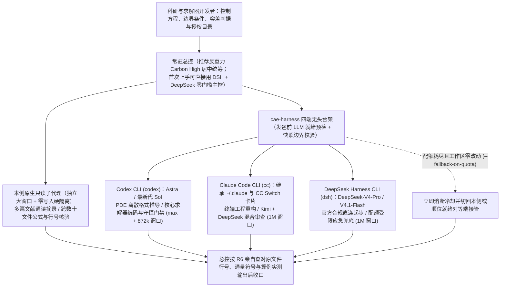

# Antigravity、Codex、Claude Code 与 DeepSeek Harness：面向 AI-CAE 研发的多代理工程约束与门禁验证台架

本仓库（`Antigravity_Codex_ClaudeCode_DeepSeekHarness`）面向计算流体力学（CFD）、有限元分析（FEA）、偏微分方程（PDE）数值求解器、网格生成与高性能科学计算研发，单点维护 Google Antigravity（反重力）、OpenAI Codex、Anthropic Claude Code（及 CC Switch）与 DeepSeek Harness（`DSH`）共用的全局工程规则（`R0–R11`）、确定性生命周期钩子、严格只读子代理、本地混合分流路由、跨端物理门禁台架（`cae-harness`）及全栈自举演进与整仓清淤协议（`fleet-evolve`）。

**上游真源与业务仓库解耦**：运行一次 `install.py` 后，四端配置各自独立落盘至宿主机全局根目录（`~/.gemini/config/plugins/user-guard`、`~/.codex`、`~/.claude`、`~/.dsh`）。日常 CFD/FEA/PDE 课题仓库在自身目录直接获得全局守卫与跨端门禁，无需拷入本仓文件；本仓专责同源模板演进、全栈升级体检、工具链耦合诊断与自动化回归验证。全仓仅依赖 Python 3.11+ 标准库，覆盖 Windows 与 WSL2／Linux 环境。

> **English Overview** — `Antigravity_Codex_ClaudeCode_DeepSeekHarness` is a zero-dependency (**Python 3.11+ standard library only**, Windows & WSL2/Linux, **Apache-2.0**) multi-agent engineering guardrail, deterministic verification harness (`cae-harness`), and self-hosting fleet evolution protocol (`fleet-evolve`) spanning **Google Antigravity (`agy`)**, **OpenAI Codex (`codex`)**, **Anthropic Claude Code (`claude` / `cc`, with CC Switch)**, and **DeepSeek Harness (`dsh`)** for **AI-assisted CAE / CFD / FEA / PDE solver development**:
> - **Explicit Prerequisite Boundary & Single-Source Adaptive Distribution**: Network/proxy setup, client binary installation, official OAuth sign-in, and provider API keys are **user-managed prerequisites** (surfaced transparently by read-only probes; never bypassed). All upper-layer governance assets—shared `R0–R11` rules, skills (`cae-harness`, `fleet-evolve`), deterministic lifecycle hooks, read-only subagents, and local HTTP split routing—are maintained in **this single upstream repository** and compiled into each agent's host-global root.
> - **Dual Visual Matrices & 3-Tier Toolchain Upgrade Safety**: Chapter 4 maintains (1) the orthogonal **Agent Shell × Foundation LLM** matrix locking maximum single-model pure reasoning tiers (`max` / `high`) and (2) the **Fuzzy-to-Exact Invocation Matrix** covering daily CAE tasks, read-only audits (`fleet-evolve audit`), whole-repo SSOT refactoring (`fleet-evolve hygiene`), and full-stack non-Master upgrades (`fleet-evolve`) with **ABI/dependency coupling warnings** for compiled scientific stacks (`jax`, `scipy`, `mpi4py`, WSL LTS).
> - **Compliant Zero-Barrier Onboarding & Numerical Redlines**: Teams can start immediately with official **`DSH + DeepSeek`** and scale smoothly to **Antigravity**, **Codex** (`Astra` / `Sol`), and **Claude Code**. Enforces compaction user-word recovery, `R4` workspace write boundaries, and `R3.6` numerical tolerance (`rtol`/`atol`) and empirical order of convergence (EOC) gates. Built-in prompt rules (`R0–R11`) are authored in **Simplified Chinese**.

---

## 一、AI-CAE 求解器研发痛点与工程防线

在推导高阶离散格式、编写和验证 C++/Fortran/Python 数值求解器时，本台架针对五类高频失控点建立确定性防线：

| AI-CAE 常见失控点 | 本台架的工程防线 | 真实作用边界（不夸大） |
| --- | --- | --- |
| **自动压缩丢掉前置物理与边界约定**<br>长会话中途压缩后漏掉首轮定下的无量纲基准、法向指向、Riemann 通量符号或守恒判据 | 压缩／恢复钩子自动从反重力、Codex 与 Claude Code 本地轨迹归档全部用户原话并注入 `R9` 回溯提醒 | 保证用户历轮指令可重读核对；底层宿主轨迹本身被截断时如实标明缺口 |
| **凑测试绿灯擅自放宽容差或虚报已验证**<br>守恒残差不降或网格经验收敛阶（EOC）不达标时，把 `rtol=1e-12` 改成 `1e-4` 或未跑算例报完工 | `R3.6` 验收红线 + 结构化 JSON 回执 + `cae-harness gate` 非空 `--verify-cmd` 多轮闭环 | 严禁弱化容差与断言；未执行验证命令的编码任务强制标记 `verification_executed: false` |
| **只读复核顺手改坏源码、命令越界污染相邻算例**<br>审查通量雅可比时误改被审文件，或在项目外建 `git worktree`、误删外部目录、空读未变化残差日志 | 原生只读子代理 + `cae-harness` 快照零写入校验 + `status_guard.py` Python AST／Shell 静态守卫与日志复合指纹 | 读写硬隔离；项目外写删须经用户明确批准，标准系统临时目录与运行缓存正常放行 |
| **单一引擎难兼顾“多文献统筹”“硬核数理门禁”与“合规直连兜底”**<br>单模型长窗口易失忆、偏科，或海外配额耗尽后整条科研流水线停摆 | 反重力居中总控 + 原生子代理独立窗口分流 + `cae-harness` 四端专长选模配窗与 `--fallback-on-quota` 顺位接管 | 预检拦截空凭据与离线路由；配额耗尽且工作区零改动时自动切回本侧或顺位就绪端 |
| **全栈升级破坏科学计算 ABI 或多文档叠补丁腐化**<br>盲目升级全局 Python／WSL 搞崩 `jax`/`mpi4py` 编译扩展，或每次打补丁导致规则矛盾膨胀 | `install.py --audit-upgrade` 三级工具链耦合预警 + `ccswitch_admin.py` 无损卡片投影 + `fleet-evolve` 单点真源整篇重构 | 非主控 CLI 安全升级，高耦合运行时强制预警拦截；每次演进强制减法清淤与全量单测回归 |

---

## 二、前置权责硬边界与六种部署模式

### 1. 用户自理底座 vs. 单仓唯一真源按需分发

| 层级 | 负责方 | 边界与硬性准则 |
| --- | --- | --- |
| **底层前置前提**<br>（网络／安装／登录／Key） | **用户本人自理**<br>（探针透明暴露缺口，绝不绕过） | 1. **网络连通与合规代理**：海外官方端所需的系统代理／TUN 由用户自理；国内直连或内网环境可直接使用官方 `DSH + DeepSeek` 或 `Claude Code` 挂载国内官方 API（脚本仅感知本机既有代理，**绝不内置灰产反代**）。<br>2. **客户端初装、官方 OAuth 登录与 API Key**：各客户端初始安装、官方账号登录及 `DEEPSEEK_API_KEY`／CC Switch 供应商密钥由用户本人填写（本仓**绝不代存、篡改或上传任何凭据**）。 |
| **上层治理资产与非主控演进**<br>（规则／技能／钩子／路由／体检） | **本仓库单点真源维护，自适应编译分发** | 全局规则 `R0–R11`、托管技能（`cae-harness`、`fleet-evolve`）、五类生命周期钩子、只读子代理、本地分流路由（`router.py`）及最高纯思考挡／最大窗口配置，**仅在本仓库维护一套源码**，按各端外壳与模型特性编译落盘至宿主机全局根目录；全栈升级时自动覆盖非活跃主控工具链并对 Python／WSL 重度 ABI 耦合发出预警。 |

### 2. 六种宿主机全局部署模式

| 部署模式 | 适用场景 | 安装参数 | 宿主机全局落盘范围 |
| --- | --- | --- | --- |
| **四端全量协同** | 已装多端，日常由反重力统管并跨端调度 | `--app all`（或默认 `auto`） | 按实测检出端同步反重力、Codex、Claude Code 与 DSH 全局资产，可选附 `--with-cc-router` 与 `--disable-ccswitch-prompts` |
| **反重力 + Codex 双主力** | 文献统筹写作 + PDE 推导与求解器门禁双核配合 | `--app both` | 配齐反重力与 Codex 独立守卫、只读子代理及双向 `cae-harness`／`fleet-evolve` |
| **单 DSH 零门槛合规模式** | **首次上手**、国内直连／内网环境或保底调试端 | `--app dsh` | 同步 `~/.dsh/AGENTS.md`（保留自定义尾段）与 `~/.dsh/skills/`，直接复用官方 `DEEPSEEK_API_KEY` 或官方账号 |
| **单反重力模式** | 单独使用 Google Antigravity | `--app antigravity` | 安装 `~/.gemini/config/plugins/user-guard` 原生插件与可选 `zotero-mcp` |
| **单 Codex 模式** | 单独使用 OpenAI Codex | `--app codex` | 同步 `~/.codex/AGENTS.md`、只读子代理、钩子、`workspace-write` 沙箱与 `skills/` |
| **单 Claude Code 模式** | 单独使用 Claude Code（及可选 CC Switch） | `--app claude` | 同步 `~/.claude/CLAUDE.md`、只读子代理、五类钩子（无损合并 `settings.json`）、`skills/` 及可选 `router/` |

---

## 三、四端对等架构与窗口隔离边界

反重力（`agy`）、Codex（`codex`）、Claude Code（`claude`／`cc`）与 DeepSeek Harness（`dsh`）处于同一对等逻辑层级——任一端均可独立担任主控，也可经 `cae-harness` 作为无头后端被调起：

| 执行层 | 运行位置 | 上下文窗口隔离形态 | 模型与思考挡位决策权 |
| --- | --- | --- | --- |
| **前端交互主会话** | 四端桌面或终端主窗口 | 当前主会话窗口 | 用户在前端界面、CC Switch 或 DSH 中自选，钩子与 `cae-harness` 绝不反向篡改 |
| **宿主内置复合模式** | 宿主内部（如反重力 `Orchestrator`） | 单会话内多模型共享同一窗口（容量不叠加） | 宿主固定编排，不支持外部下发纯思考挡位，默认排除 |
| **本侧原生只读子代理** | `invoke_subagent`／`run_workflow`、Codex 或 Claude 原生子代理 | 每个子代理独占独立子窗口，零写入隔离 | 默认 `inherit` 跟随主会话；Claude Code 接入 `router.py` 时子代理自动分流至 `deepseek-flash` |
| **`cae-harness` 无头 CLI** | 按需拉起的 `codex`、`agy`、`claude -p`、`dsh --profile headless` 独立子进程 | 全新无痕会话，预检就绪后下发声明最大窗口 | 由 `cae-harness` 按显式参数、自然语言点名或任务专长独立优选旗舰模型与最高纯思考挡 |



---

## 四、双核心可视化矩阵：Agent/LLM 正交适配矩阵 × 模糊与精确调起矩阵

本章由 [`fleet-evolve`](template/user-guard/skills/fleet-evolve/SKILL.md) 单点维护（严守 `R0` 不拆独立矩阵文件；严守 `R3.6` 区分**官方规格**、**本机目录声明**与**宿主受控实测**，运行态时效由 `fleet_state.py` 与 `--audit-upgrade` 实时校验）。

### 1. 矩阵一：模型／Agent 二维正交适配矩阵（`宿主外壳控制面 × 基座模型推理面`）

| 角色层级 | 宿主外壳 × 基座模型 | 锁定挡位与窗口配置 | 核心守护与隔离约束 | 正交选型准则（为何选此外壳 × 模型组合） | 宿主实测状态 |
| --- | --- | --- | --- | --- | --- |
| **常驻总控（Master）** | **Antigravity**（桌面／CLI）× **`Gemini 4 Carbon`** | 单模型最高可用挡 **`high`**（排除共享窗口的 `Orchestrator` 与第三方托管模型）；官方标称窗口 `1,048,576` token | `PreInvocation` 检查点原话回溯、`PreToolUse` AST／Shell 硬边界与防空转、`Stop` 防刷屏与四态收口（`normal->advisory->drain->freeze`） | 多文献综合、全局进度／配额／窗口规划与中文工程写作摩擦最低；CLI 在长输入下存在自动检查点压缩阈值，故超长单窗口硬算主动下放下游节点 | Windows + WSL 双侧对齐实测通过 |
| **同端只读并发层** | **Antigravity 原生子代理**（`readonly-reader`／`auditor`／`collaborator`）× **`inherit`（`Carbon High`）** | 继承主会话模型，每个子代理独占独立窗口（10+ 同构目录盘点方用 `run_workflow`） | 仅开放 `read_file`／`search_web`；零写入、零子进程冷启动开销，完成后响应式唤醒主会话 | 长篇论文摘录、跨多文件符号／行号静态核对与文档润色最快；因与主会话同属 `Carbon (High)`，**不可替代异构模型独立复核或带脚本验证的写盘门禁** | 多路并发实测零越界 |
| **数理与机理攻坚层** | **Codex CLI**（`codex:astra`）× **`GPT-6-Astra`**（`gpt-6-astra`） | 单模型纯思考最高挡 **`max`**（跳过套娃 `ultra`）+ 显式下发目录声明最大窗口 **`872,000` token**（有效比 95%） | `codex exec -s read-only --ephemeral --output-schema` + 任务前后全目录哈希快照校验 `changed_files == []` | PDE 弱形式、DGSEM 分裂导数算子、弯曲网格度量恒等式与 Riemann 雅可比推导首选，提供独立于 Gemini 的异构深度推理；派工须预切核心文件行号并设 `--timeout 900–1200` | Windows 目录就绪（开放式全仓探索 `600s` 超时边界已标定） |
| **核心编码与物理门禁层** | **Codex CLI**（`codex:sol`）× **`GPT-6.1-Sol`**（`gpt-6.1-sol`） | 单模型最高挡 **`max`** + **`872,000` token** 窗口（受控实测累积至 `808,892` token 同轮 6/6 全中未压缩） | `workspace-write` 沙箱 + `--write-scope` 白名单对比 + `gate` 强制非空 `--verify-cmd` 多轮排错（严禁放宽 `rtol`/`atol`） | 求解器核心算子实现、深层代码安全／逻辑审查、分片审计（`audit`）及守恒残差／EOC 门禁（`gate`）主力，多文件补丁收敛速度显著快于 `Astra` | Windows 无头往返 `rc=0` 与压力探针通过 |
| **终端长上下文与混合分流层** | **Claude Code CLI**（`cc:default`）× **`Kimi K3.1 Pro`（`k3.1-pro[1m]`）+ `DeepSeek-V4.1-Flash`（`deepseek-flash`）** | 交互默认 `effortLevel: "xhigh"`，无头下发 **`max`**；卡片声明窗口 `1,048,576`、压缩窗口 `1,000,000` token | `claude -p` 不加 `--bare` 完整继承 `~/.claude` 五类钩子、`--json-schema` 强约束与本地 `router.py`（子代理强制 `max`） | **为何交互与混合审查优先选 `CC + DeepSeek/Kimi` 而非裸 `DSH`**：`Claude Code` 具备完整五类确定性 Hooks、原生 JSON Schema 强校验、MCP 工具链及 Kimi 主 + DS 子代理分流，多步工具循环稳定性更高 | Windows 与 WSL 本地路由双侧实测 `rc=0` |
| **零门槛合规起步与应急兜底层** | **DeepSeek Harness CLI**（`dsh:default`／`dsh:flash`）× **`DeepSeek-V4-Pro`（`deepseek-v4-pro`）／`DeepSeek-V4.1-Flash`（`deepseek-flash`）** | 锁定 **`max`** 挡（省流微查用 `low`）；内置契约声明窗口 **`1,048,576` token** | `--profile headless --patch` 一次性临时 YAML 注入模型／挡位与官方凭据（`~/.dsh` 零改动），自动剥离尾随 `DSML` 标签 | **何时选 `DSH + DeepSeek`**：① 首次上手或纯内网零反代、零本地路由依赖的官方合规最短路径；② 直连原生 `DeepSeek-V4-Pro` 满血审查；③ 三端触发 `--fallback-on-quota` 时的保底接管端 | Windows 原生与 WSL 互操作实测 `rc=0` |

> **备选与默认排除模型**：Codex `GPT-6.1-Terra`（`872k`）与反重力 `Gemini 4 Argon` 按同族主力识别；Codex `GPT-6-Luna` 与反重力 `Gemini 4 Hydrogen`（支持至 `xhigh`）仅在按需省流微查或用户点名时启用；反重力托管第三方模型（如 `Claude Sonnet/Opus 5.5`；旧 `Claude 4.6` 与 `GPT-OSS-120b` 由体检标记退役）及各端二次派生 `ultra` 挡默认排除。参考规格：[OpenAI Codex 模型说明](https://learn.chatgpt.com/docs/models)、[Antigravity 模型说明](https://antigravity.google/docs/models)、[Google Gemini 窗口规格](https://docs.cloud.google.com/gemini-enterprise-agent-platform/models/migrate)。

### 2. 矩阵二：用户日常模糊指令、全栈升级／整仓重构与 100% 精确调起矩阵

日常科研直接用平实白话交办任务，总控按 `R3.1` 自动选路；若要 **100% 锁定调起特定技能、模式、子代理或无头引擎**，直接在指令中写出第 3 列的**精确锚点名**：

| 任务意图分类 | 日常模糊说法示例（自然对话自动路由） | 100% 锁定调起的精确锚点名 | 底层执行链路与硬门禁约束 |
| --- | --- | --- | --- |
| **全栈升级重算与非主控工具链更新** | “全面更新整套配置”“全升级所有用到的东西（除当前主控外，含 Python/WSL 等）” | **`fleet-evolve`**（默认 `full` 模式；支持 `/fleet-evolve`） | 读取 [`fleet-evolve/SKILL.md`](template/user-guard/skills/fleet-evolve/SKILL.md) $\rightarrow$ 检查 `fleet_state.py` 状态锁 $\rightarrow$ 并发调研 + **非活跃主控 CLI／工具三级耦合分级升级**（Tier 1 直接升；Tier 2 验进程锁再升；Tier 3 如全局 `Python 3.13->3.14`／`jax` `cp313` ABI 或 WSL 跨 LTS 强制输出**依赖耦合警告**拦截强升）$\rightarrow$ 重算双矩阵 $\rightarrow$ 双侧同步与真机探针（`rc == 0` 且 `all_aligned: true`）$\rightarrow$ Phase 4 七项门禁 $\rightarrow$ 待推送挂起 |
| **只读升级与工具链耦合体检** | “只检查下四端配置、模型和 Python/WSL 工具链有没有过期或冲突，别改文件” | **`fleet-evolve audit`** 或 **`install.py --audit-upgrade`** | 全程零写入：核查双侧四端规则／钩子／技能字节漂移、登录与 API Key 自理缺口、CC Switch 退役项状态及 `host.toolchain` 编译扩展耦合风险 |
| **整仓代码／结构／文档重构与回归门禁** | “全量分析优化整个仓库代码、文件结构和文档可读性、通用性、逻辑一致性、安全性，解决叠补丁问题并验收” | **`fleet-evolve hygiene`** | 并发派发原生只读子代理 + 异构无头引擎（`codex:sol`／`dsh:default`）全量审计代码安全边界、死代码与结构冗余 $\rightarrow$ **按单点真源（SSOT）面向 CAE 人员整篇重写文档（彻底消除补丁式堆叠）** $\rightarrow$ 主控 `R6` 逐行核对原文件行号 $\rightarrow$ 跑通六模式沙箱、严格插件校验、全量 `unittest` 与脱敏终审 |
| **本机初装或跨子系统增量部署** | “帮我配置这台机器”“把 WSL 那边也同步配好” | 按根 **`AGENTS.md` 运行 `install.py`**（`--probe-apps` / `--dry-run` / `--with-cc-router`） | 零写入探测双侧客户端与凭据缺口 $\rightarrow$ 空跑预演列出宿主机全局路径与自定义尾段保留计划 $\rightarrow$ 获 `R4` 批准后幂等落盘 |
| **长文献通读／多文件公式行号核验** | “把这几篇论文和几十个头文件通读一遍摘出通量公式”“逐行核对汇报里的公式和源码行号” | 原生只读子代理 **`readonly-reader`**、**`readonly-collaborator`**、**`readonly-auditor`**；10+ 同构目录盘点用 **`run_workflow`** | 在当前宿主内派生独立窗口只读子会话（硬禁写文件与执行命令），返回精确文件路径与行号交总控按 `R6` 复核 |
| **PDE 离散格式推导／守恒与稳定性证明** | “把这套可压缩 NS 分裂格式和弯曲网格度量恒等式从头严密推一遍” | **`cae-harness` 调 `codex:astra`**（`task --kind math \| direction --tier max`） | 预检就绪后无头启动 `gpt-6-astra`（`max` + `872k` 窗口 + `read-only` 沙箱 + 快照零写入校验；预切核心文件行号并设 `--timeout 900+`） |
| **求解器核心算子编码 + 物理门禁验收** | “实现这个 HLLC 通量与雅可比算子，跑通守恒残差和网格收敛阶测试再交付” | **`cae-harness gate` 调 `codex:sol`**（附 `--write-scope` 与 `--verify-cmd`） | 无头启动 `gpt-6.1-sol`（`max` + `872k` 窗口）在白名单内修改源码 $\rightarrow$ 运行非空 `--verify-cmd` $\rightarrow$ 不过则在 `--max-rounds` 内排错（严禁放宽 `rtol`/`atol`） |
| **大型求解器分片审计／异构交叉审查** | “把整个 `src/` 扫一遍查边界漏项”“让 CC 或 DSH 独立复核刚改完的模块” | **`cae-harness audit`** 或 **`cae-harness task --kind review --engine codex:sol \| cc:default \| dsh:default \| dsh:flash`** | 预检目标端就绪 $\rightarrow$ 安全预算内 `single-pass` 或超预算自动 `sharded` 只读审查 $\rightarrow$ 结构化 JSON 回传问题定位与行号 $\rightarrow$ 总控 `R6` 复核 |
| **Claude 供应商无损切卡** | “看看 CC 现在挂的哪张卡”“把 CC 切到 Kimi 主 + DS 子代理混合卡” | **`ccswitch_admin.py status`** 或 **`ccswitch_admin.py switch-card "K3.1主+DS子代理"`**（或 `"Kimi"` / `"DeepSeek"`；首次建卡先运行 `prepare-cards`） | 核验直连可写模式 $\rightarrow$ 在线原子备份 `cc-switch.db` 与 `settings.json` $\rightarrow$ 仅投影模型与鉴权键，100% 保留五类 Hooks 与 `effortLevel: "xhigh"` |
| **文字润色／按需省流／配额断流自动兜底** | “润色这段论文引言别放大结论”“这轮只查拼写省点额度”“没额度自动换别的端跑” | 润色用 **`--kind polish`**；省流说 **“省流／降挡”** 或 **`--tier high \| low`**；防断流加 **`--fallback-on-quota`** | `polish` 用短篇 `medium`／长篇 `high` 防 `R5` 无声放大；仅在用户要求省流时解除 `max` 锁挡；触发 `quota_exhausted` 且零改动时自动顺位接管 |

### 3. 五层上下文物理边界（严禁将“标称窗口”等同于“单条塞入上限”）

1. **目录／卡片声明最大窗口**：Codex `872,000`、Gemini 4 与 DeepSeek `1,048,576`、Claude 卡片 `1,000,000`／`1,048,576` token；`cae-harness` 对 Codex 自动下发 `-c model_context_window=<最大声明窗口>`。
2. **单条消息入口载荷上限**：Codex `turn/start` 单条上限 `1,048,576` 字符；反重力 CLI 单条达 44～66 万字节会出现入口截断，大体积源码须让子进程在目录内按文件读取。
3. **自动检查点（Compaction）触发点**：受控实测 Codex `GPT-6.1-Sol` 分轮累积至 `808,892` token（有效窗口 **97.65%**）未压缩且 6/6 口令全中；反重力 CLI `Hydrogen` 累积至 `241,625` token 时 6/6 全中，至 `290,028` token 触发自动检查点压缩后早期散落细节无法仅凭摘要还原（定量记录见[架构设计与生命周期钩子规范](docs/architecture-and-hooks.md)）。
4. **分片审计安全输入预算**：`cae-harness audit` 扣除系统提示词、文件清单与 JSON Schema 开销后的单批源码安全上限。
5. **实际阅读覆盖**：以回执文件清单与总控 `R6` 行号抽查为准；触发压缩后严格按 `R9` 重读磁盘原话归档，绝不盲目重跑已落盘写入。

---

## 五、快速安装、升级体检与常用命令速查

在仓库根目录执行（Windows 用 `python`，WSL2／Linux 用 `python3`；安装后在各端全局技能目录内同样可用）：

```sh
git clone https://github.com/Xinyu-Li-1997/Antigravity_Codex_ClaudeCode_DeepSeekHarness.git
cd Antigravity_Codex_ClaudeCode_DeepSeekHarness

# 1. 零写入探测双侧客户端、资产漂移、工具链耦合与四端就绪态
python -B install.py --probe-apps
python -B install.py --audit-upgrade
python -B template/user-guard/skills/cae-harness/scripts/cae_harness.py assess --caller antigravity

# 2. 空跑预演拟改写的宿主机全局路径（零写入），确认后正式安装
python -B install.py --dry-run --yes
powershell -NoProfile -ExecutionPolicy Bypass -File .\install.ps1   # Windows
# bash install.sh                                                     # WSL2 / Linux

# 3. 调 Codex Astra 推导 PDE 离散格式 / 调 Codex Sol 执行求解器守恒门禁验收
python -B template/user-guard/skills/cae-harness/scripts/cae_harness.py task --caller antigravity --engine codex:astra --kind math --tier max --timeout 900 --fallback-on-quota --target "<项目目录>" --task-file "<任务单.md>"
python -B template/user-guard/skills/cae-harness/scripts/cae_harness.py gate --caller antigravity --worker codex:sol --tier max --fallback-on-quota --target "<项目目录>" --task-file "<任务单.md>" --write-scope "src/*.py" --verify-cmd "python -B -m unittest discover -s tests"

# 4. 调 Claude Code / DSH 独立交叉审查，或无损切换 CC Switch 供应商卡片
python -B template/user-guard/skills/cae-harness/scripts/cae_harness.py task --caller antigravity --engine cc:default --kind review --target "<项目目录>" --task-file "<任务单.md>"
python -B template/user-guard/skills/cae-harness/scripts/cae_harness.py task --caller antigravity --engine dsh:default --kind review --target "<项目目录>" --task-file "<任务单.md>"
python -B template/claude/router/ccswitch_admin.py switch-card "K3.1主+DS子代理"
```

| `install.py` 常用参数 | 作用说明 |
| --- | --- |
| `--app auto/all/both/antigravity/codex/claude/dsh` | 指定部署范围（默认 `auto` 自动同步已检出端） |
| `--probe-apps` / `--audit-upgrade` | 只读输出双侧客户端探测 JSON／只读体检四端漂移、CC Switch、模型与 `host.toolchain` 耦合风险 |
| `--dry-run` / `--yes` | `--dry-run` 仅打印计划零写盘；`--yes` 跳过交互确认（用于对话内已获用户 `R4` 批准后） |
| `--sync-model-defaults` / `--no-model-config` | 前者显式覆盖默认模型推荐值（默认仅补缺项），后者跳过模型配置（二者互斥） |
| `--codex-handoff-mode` / `--claude-handoff-mode` | 设置 Codex／Claude 长会话交接策略（`advisory`/`enforce`/`off`，默认 `advisory`） |
| `--with-cc-router` | 将本地混合分流路由 `router.py` 与 `ccswitch_admin.py` 同步至 `<claude_home>/router/` |
| `--disable-ccswitch-prompts` / `--purge-ccswitch-legacy` | 在线备份 `cc-switch.db` 后禁用旧提示词与技能开关／归档清空退役表记录与目录 |
| `--target-dir` / `--codex-home` / `--claude-home` / `--dsh-home` | 指定自定义或临时沙箱安装根目录（用于隔离回归测试） |
| `--no-zotero` / `--skip-test` | 跳过可选 `zotero-mcp` 配置／跳过安装末尾的自检测试 |

进一步阅读：[CAE 工程与科研协作实践指南](docs/workflow-guide.md)、[底层架构与生命周期钩子规范](docs/architecture-and-hooks.md)、[`cae-harness` 技能手册](template/user-guard/skills/cae-harness/SKILL.md)、[`fleet-evolve` 全栈自举演进协议](template/user-guard/skills/fleet-evolve/SKILL.md)与[仓库维护指引](AGENTS.md)。

---

## 六、仓库目录结构与开源许可

```text
Antigravity_Codex_ClaudeCode_DeepSeekHarness/
├── README.md                                 # 仓库总入口：CAE 防线、前置边界、六模式部署与双核心可视化矩阵
├── CHANGELOG.md                              # 版本演进、工具链耦合守卫与安全加固记录
├── LICENSE / NOTICE                          # Apache License 2.0 许可证与第 4(d) 条原创架构署名声明
├── AGENTS.md                                 # 四端共读的本机初始化、三级耦合升级与门禁回归指引
├── install.py / install.ps1 / install.sh     # 跨平台安装与零写入全栈升级体检器（含工具链耦合诊断）
├── .github/workflows/ci.yml                  # Windows + Ubuntu 六模式沙箱、零漂移体检与全量单测 CI 门禁
├── docs/
│   ├── workflow-guide.md                     # CAE/CFD/FEA 求解器研发实战指南（任务单、收敛阶四级证据与容差红线）
│   └── architecture-and-hooks.md             # 底层架构真源：钩子事件协议、AST/Shell 守卫、路由限流与实测标定
├── template/
│   ├── user-guard/                           # 反重力原生插件及四端同源核心资产
│   │   ├── plugin.json / hooks.json / README.md / assets/logo.svg
│   │   ├── rules/AGENTS.md                   # 四端同源 R0–R11 全局工程与科学计算规则
│   │   ├── hooks/*.py                        # 原话回溯、R4 目录硬边界、防空转刷屏与长会话收口 5 个共用模块
│   │   ├── agents/readonly-*.md              # 反重力三个 inherit 只读子代理
│   │   └── skills/
│   │       ├── cae-harness/                  # 四端无头编排与物理门禁手册（SKILL.md）及脚本（cae_harness.py）
│   │       └── fleet-evolve/                 # 全栈自举演进与整仓清淤协议（SKILL.md）及状态锁（fleet_state.py）
│   ├── codex/                                # Codex 五类生命周期事件模板与 read-only 子代理定义
│   └── claude/                               # Claude Code 钩子模板、只读子代理及 router/ 本地分流与切卡工具
└── tests/                                    # 安装器、钩子守卫、本地路由、工具链体检与无头编排离线单测套件
```

本仓库仅调用用户通过官方合规渠道安装并配置好凭据的客户端 CLI 与本地工具，不内置任何第三方反代中转、私有凭据或绕过官方权限与计费的逻辑。本项目采用 [Apache License 2.0](LICENSE) 开源许可，衍生分发须按协议第 4(d) 条完整保留根目录下的 [NOTICE](NOTICE) 原创归属声明（`Copyright 2026 Xinyu Li (Xinyu-Li-1997)`）。
