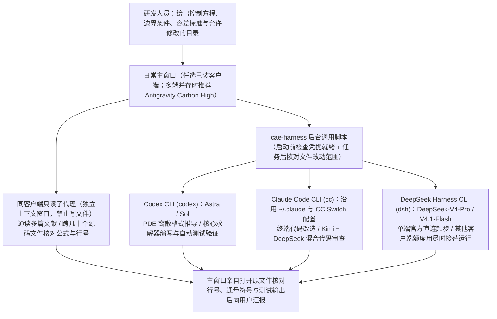

# 面向 CAE / CFD / FEA 求解器研发的多客户端工程规则与后台验证工具

本仓库（`Antigravity_Codex_ClaudeCode_DeepSeekHarness`）为已有的 AI 编程客户端安装一套共用的工程计算规范、安全检查钩子与后台协作脚本，面向计算流体力学（CFD）、有限元分析（FEA）、偏微分方程（PDE）数值求解器、网格生成与科学计算研发。支持的客户端包括 **Google Antigravity（反重力，`agy`）**、**OpenAI Codex（`codex`）**、**Anthropic Claude Code（`claude` / `cc`，可配合 CC Switch 管理供应商配置）** 以及 **DeepSeek Harness（`dsh`）**。

运行一次 `install.py` 后，规则与脚本会写入你电脑上已安装客户端的全局配置目录（`~/.gemini/config/plugins/user-guard`、`~/.codex`、`~/.claude`、`~/.dsh`）。平时打开自己的 C++、Fortran 或 Python 求解器项目即可直接使用，**不需要往课题代码仓库里复制任何本仓库文件**。全仓仅使用 Python 3.11+ 标准库，支持 Windows 与 WSL2 / Linux。

---

## 一、解决求解器研发中的哪五类常见问题

| 求解器研发中常遇到的情况 | 本仓库提供的做法 | 实际作用范围 |
| :--- | :--- | :--- |
| **长对话自动压缩后丢掉最初定下的物理约定**<br>聊久了触发上下文压缩，漏掉第一轮约定的无量纲参考量、界面外法向指向、通量正负号或边界条件 | 压缩与恢复钩子自动从客户端本地会话记录中提取历轮用户原话写入磁盘，并在恢复时提醒模型先重读核对（见 [AGENTS.md](template/user-guard/rules/AGENTS.md) `R9`） | 确保历轮原始指令可随时回看；若客户端底层日志本身已被截断，会如实标出缺失范围 |
| **测试不过时擅自放宽容差，或没跑算例就报完工**<br>守恒残差不降或网格经验收敛阶（EOC）不达标时，把 `rtol=1e-12` 改成 `1e-4` 凑绿灯 | 全局规则严禁弱化 `rtol` / `atol` 与测试断言（`R3.6`）；`cae-harness gate` 要求必须传入测试命令 `--verify-cmd`，未跑测试的编码回执明确标记 `verification_executed: false` | 防止虚假通过测试；具体物理判据与算例脚本仍需由研发人员在 `--verify-cmd` 中指定 |
| **只读审查顺手改坏源码，或命令误改项目外目录**<br>检查通量雅可比公式时误改原文件，或在项目外乱建 `git worktree`、反复空读未变化的残差日志 | 原生只读子代理禁止写文件与跑命令；`cae-harness` 对只读任务做前后文件哈希快照比对；`status_guard.py` 拦截项目外写文件与无变化日志重复读取 | 项目外写删操作必须先经用户同意；系统临时目录、会话记录目录与标准 `.cache` 缓存正常放行 |
| **单个模型难以兼顾多文献阅读、长篇公式推导与额度备用**<br>单一窗口容易被几十个头文件塞满，或者某个客户端配额用完后手头工作被迫中断 | 支持同客户端只读子代理分担文献阅读，也支持通过 `cae-harness` 后台调用其他已就绪客户端；附带 `--fallback-on-quota` 时可在零文件改动前提下自动换用可用客户端 | 启动前先检查登录态与密钥是否可用；若任务中途已修改过代码文件，绝不自动换客户端覆盖现场 |
| **升级工具搞坏科学计算环境，或规则文档越叠越乱**<br>直接跨版本升级全局 Python / WSL 导致 `jax`、`mpi4py` 二进制扩展失效，或长期打补丁导致文档前后矛盾 | `install.py --audit-upgrade` 只读检查全局 Python / WSL 的编译扩展依赖风险；`fleet-evolve` 升级非主控工具并按三步流程整篇重写文档 | 对存在严重二进制耦合的系统级升级只发警告不强升；仓库更新全部经过离线单元测试校验 |

---

## 二、安装前准备与五分钟上手

### 1. 哪些需要你自己准备，哪些由本仓库配置

- **你需要事先准备的前提**：
  1. **网络连接**：访问海外官方服务所需的系统代理或 TUN 由用户自行配置；国内直连或内网环境可直接使用官方 `DeepSeek Harness`（`DSH`）或将 `Claude Code` 连接到国内官方 API（本仓库脚本只读取本机已有代理设置，**不内置任何第三方中转反代**）。
  2. **客户端安装与账号凭据**：至少安装四个客户端中的一个，并完成官方账号登录或配置好 API Key（例如在环境变量或 `~/.dsh/.credentials.yaml` 中配好官方 `DEEPSEEK_API_KEY`，或在 CC Switch 中填好供应商密钥；本仓库**不代存、不修改也不上传任何账号凭据**）。
- **本仓库自动配置的内容**：共用工程规则 `R0–R11`、五个生命周期钩子脚本、三个只读子代理、跨客户端后台调用脚本 [`cae-harness`](template/user-guard/skills/cae-harness/SKILL.md)、工具升级与仓库整理脚本 [`fleet-evolve`](template/user-guard/skills/fleet-evolve/SKILL.md)，以及可选的 Claude Code 本地分流脚本 `router.py`。

### 2. 选择安装范围并写入配置

不必装齐四个客户端——你平时用哪个客户端，就只装哪个客户端的配置；装了多个客户端时，默认 `auto` 会自动识别并一并配好：

| 你的本机情况 | 推荐安装命令（Windows 用 `python`，WSL2 / Linux 用 `python3`） | 实际写入的全局目录 |
| :--- | :--- | :--- |
| **只有 DeepSeek Key，想最快开始用**（或国内直连环境） | `python -B install.py --app dsh` | 更新 `~/.dsh/AGENTS.md`（保留自定义尾段）与 `~/.dsh/skills/`，不动 `.credentials.yaml` |
| **只用单个 Codex / Claude Code / Antigravity** | `python -B install.py --app codex`（或 `claude` / `antigravity`） | 只写入对应客户端的全局配置目录（`~/.codex`、`~/.claude` 或 `~/.gemini/config/plugins/user-guard`） |
| **同时用 Antigravity + Codex** | `python -B install.py --app both` | 同步这两个客户端的规则、只读子代理、钩子与后台调用技能 |
| **装了多个客户端，希望一起配齐** | `python -B install.py`（默认 `--app auto`；若还用 CC Switch 混合分流，加 `--with-cc-router --disable-ccswitch-prompts`） | 自动为本机已检出的客户端写入对应全局配置，重复运行不会产生重复配置项 |

在终端按顺序执行以下命令即可完成检查与安装：

```sh
git clone https://github.com/Xinyu-Li-1997/Antigravity_Codex_ClaudeCode_DeepSeekHarness.git
cd Antigravity_Codex_ClaudeCode_DeepSeekHarness

# 1. 只读查看本机已安装哪些客户端（不修改任何文件）
python -B install.py --probe-apps

# 2. 空跑预览将写入哪些全局文件路径（不修改任何文件），确认无误后正式安装
python -B install.py --dry-run --yes
powershell -NoProfile -ExecutionPolicy Bypass -File .\install.ps1   # Windows 交互安装
# bash install.sh                                                     # WSL2 / Linux 交互安装

# 3. 安装后随时可做只读对齐体检（看到 summary.all_aligned 为 true 即表示完全同步）
python -B install.py --audit-upgrade
```

> **如何关闭提醒或卸载**：如果不需要 Codex 或 Claude Code 的长对话交接提醒，可运行 `python -B install.py --app codex --codex-handoff-mode off`（或 `--claude-handoff-mode off`）。如需彻底移除本仓库配置，删除对应客户端配置目录下的 `user-guard` 插件目录或 `hooks/`、`skills/cae-harness`、`skills/fleet-evolve` 目录即可（安装前有旧配置时，脚本对 `cc-switch.db` 等均留有备份，详见 [底层架构与钩子说明](docs/architecture-and-hooks.md)）。

### 3. 打开自己的求解器项目跑通第一次任务

安装完成后，平时在客户端聊天框里直接用中文交办任务即可自动生效。如果你想在命令行直接测试 `cae-harness` 后台调用（所有示例统一用 `--caller auto` 自动识别当前环境；`<任务单.md>` 的具体写法与完整模板见 [求解器研发实践指南](docs/workflow-guide.md)）：

```sh
# 查看当前机器上哪些客户端和模型已经就绪，以及推荐分工（只读）
python -B template/user-guard/skills/cae-harness/scripts/cae_harness.py assess --caller auto

# 让后台客户端只读审查指定项目代码（可换用 dsh:default、codex:sol 或 cc:default）
python -B template/user-guard/skills/cae-harness/scripts/cae_harness.py task --caller auto \
  --engine dsh:default --kind review --target "<你的求解器项目目录>" --task-file "<任务单.md>"

# 让后台客户端按白名单修改源码，并自动运行守恒性或收敛阶测试脚本验证
python -B template/user-guard/skills/cae-harness/scripts/cae_harness.py gate --caller auto \
  --worker codex:sol --tier max --fallback-on-quota --target "<你的求解器项目目录>" \
  --task-file "<任务单.md>" --write-scope "src/*.py" --verify-cmd "python -B -m unittest discover -s tests"
```

---

## 三、四个客户端怎么配合与常用概念说明

### 1. 对等关系与多客户端分工

`Antigravity`（`agy`）、`Codex`（`codex`）、`Claude Code`（`claude` / `cc`）与 `DeepSeek Harness`（`dsh`）处于**完全对等**的位置：任一客户端都可以单独作为你的日常主窗口，也可以通过 `cae-harness` 作为后台工具被调用。后文流程图与示例常以 **Antigravity 作为主窗口**，只是因为它的桌面界面便于同时对照多篇论文和统筹任务；如果你平时习惯只在终端里用 `Codex`、`Claude Code` 或 `DSH`，用法同样完整。



### 2. 四个常见概念速查

- **推理强度挡位（`--tier` / `effort`）**：模型单次回答投入的思考预算，从低到高依次为 `low`、`medium`、`high`、`xhigh`、`max`。公式推导、核心编码与代码审查默认使用该模型支持的最高单模型挡位（自动避开会二次拆分任务的 `ultra` 挡）；仅在纯文字润色（防过度发挥改变原意）或你明确提出节省额度时降挡。
- **CC Switch 卡片**：桌面配置工具 CC Switch 里保存的一套 Claude Code 连接参数与模型组合（后文简称“卡片”），比如单用 Kimi、单用 DeepSeek，或主对话用 Kimi、子代理转发给 DeepSeek 的混合卡片。可用 `ccswitch_admin.py switch-card "<卡片名>"` 在不破坏钩子设置的前提下切换。
- **后台无头调用的默认环境 vs. `--clean-room` 纯净盲读**：`cae-harness` 启动的后台进程默认拥有**全新的空对话历史**，但仍会读取对应客户端全局目录里的 `R0–R11` 规则、钩子、全局技能以及目标目录下的 `AGENTS.md`。当你需要模拟毫无背景的外部新手来挑文档毛病时，可在只读 `task` 命令后加 `--clean-room`（支持 `codex`、`claude`、`dsh`），临时剥离所有全局规则、钩子、技能与 `AGENTS.md`，只保留底层登录凭据。
- **上下文窗口的三层区别**：模型标称最大窗口（如 `872,000` 或 `1,048,576` token）不等于单条消息能一次塞入的字符数，也不等于客户端触发自动压缩（Compaction，反重力中记为 `CHECKPOINT`）的位置。审查大型求解器时应让后台进程在目录内按文件读取或使用 `cae-harness audit` 自动分批检查；具体窗口测试数据见 [底层架构与钩子说明](docs/architecture-and-hooks.md)。

---

## 四、两张核心参考表

以下两张表由 [`fleet-evolve`](template/user-guard/skills/fleet-evolve/SKILL.md) 在模型或工具大版本更新时原地维护，避免拆出多份重复表格。

### 1. 表一：客户端与模型搭配表

| 分工角色 | 客户端与推荐模型 | 推理强度与窗口设置 | 为什么选这套搭配 | 本机验证情况 |
| :--- | :--- | :--- | :--- | :--- |
| **日常主窗口统筹** | **Antigravity**（桌面或 CLI）+ **`Gemini 4 Carbon`** | 单模型最高可用挡 **`high`**（避开共享窗口的 `Orchestrator` 与第三方托管模型）；官方标称窗口 `1M` token | 多文献对比、任务规划与中文技术写作最顺手；CLI 在长对话下会较早触发自动检查点压缩，因此超长单窗口推导与批量查代码主动交给后台进程 | Windows 与 WSL 双侧配置同步实测通过 |
| **同客户端并行只读核查** | **Antigravity 原生子代理**（`readonly-reader` / `auditor` / `collaborator`）+ **`inherit`** | 跟随主窗口模型，每个子代理独占独立窗口（需同时盘点 10 个以上同构目录时用 `run_workflow`） | 只开放 `read_file` 与 `search_web`，启动最快且绝不改文件；适合论文摘录与行号核对，但与主窗口同属同一模型，不能替代跨模型独立复核 | 多路并发实测零越界 |
| **PDE 公式推导与路线论证** | **Codex CLI**（`codex:astra`）+ **`GPT-6-Astra`**（`gpt-6-astra`） | 最高挡 **`max`** + 模型最大声明窗口 **`872,000` token** | 弱形式推导、DGSEM 分裂算子、弯曲网格度量恒等式与通量雅可比求导准确度高，可与 Gemini 交叉印证；派任务时建议标明相关文件行号并设 `--timeout 900` 以上 | Windows 模型目录就绪，超时边界已实测确认 |
| **核心算子编码与自动测试** | **Codex CLI**（`codex:sol`）+ **`GPT-6.1-Sol`**（`gpt-6.1-sol`） | 最高挡 **`max`** + **`872,000` token** 窗口 | 求解器算子实现、深层代码逻辑审查、分批代码排查（`audit`）及带 `--verify-cmd` 的自动修改测试（`gate`）主力，多文件修改收敛明显快于 `Astra` | Windows 无头调用返回码 `0` 与长窗口测试通过 |
| **终端长对话与混合代码审查** | **Claude Code CLI**（`cc:default`）+ **`Kimi K3.1 Pro`（`k3.1-pro[1m]`）+ `DeepSeek-V4.1-Flash`** | 交互默认 `effortLevel: "xhigh"`，无头调用传 **`max`**；配置窗口 `1M` token | 相比直接裸调单模型 CLI，`Claude Code` 具备完整的五类生命周期钩子、原生 `--json-schema` 输出校验与本地 `router.py` 主从分流，多步工具调用更稳 | Windows 与 WSL 本地路由双侧无头调用返回码 `0` |
| **单端直连起步与额度备用** | **DeepSeek Harness CLI**（`dsh:default` / `dsh:flash`）+ **`DeepSeek-V4-Pro` / `DeepSeek-V4.1-Flash`** | 默认 **`max`**（快速小检查可用 `low`）；内置窗口 **`1,048,576` token** | ① 首次上手或纯内网无需配置本地路由即可官方直连；② 直接调用 `DeepSeek-V4-Pro` 做独立复核；③ 其他客户端配额用尽时通过 `--fallback-on-quota` 自动接替 | Windows 原生与 WSL 跨系统调用返回码 `0` |

> **其他可选与默认排除的模型**：Codex `GPT-6.1-Terra`（`872k`）与反重力 `Gemini 4 Argon` 按同代主力识别；Codex `GPT-6-Luna` 与反重力 `Gemini 4 Hydrogen`（支持至 `xhigh`）在需要节省额度或明确点名时使用；反重力内置的第三方托管模型（如 `Claude Sonnet/Opus 5.5`；旧 `Claude 4.6` 与 `GPT-OSS-120b` 会在体检中提示已退役）以及各客户端自动二次派生的 `ultra` 挡默认不选。官方参考文档：[OpenAI Codex 模型说明](https://learn.chatgpt.com/docs/models)、[Antigravity 模型说明](https://antigravity.google/docs/models)、[Google Gemini 窗口规格](https://docs.cloud.google.com/gemini-enterprise-agent-platform/models/migrate)。

### 2. 表二：日常模糊说法与精确调用对照表

平时直接用自然中文提要求即可自动选路；如果你想**明确指定某个功能、模式、子代理或后台引擎**，在对话里带上第 3 列的名称即可：

| 你想做的事 | 平时怎么说（自动选路） | 想明确指定时写哪个名字 | 实际完成的动作与限制 |
| :--- | :--- | :--- | :--- |
| **全套升级工具并更新配置** | “全面更新整套配置”“把除了当前主控之外的工具包括 Python、WSL 都检查升级一下” | **`fleet-evolve`**（默认 `full` 模式，或输入 `/fleet-evolve`） | 检查升级非当前主控的 CLI 与辅助工具；若全局 Python 装有 `jax`/`mpi4py` 等编译扩展或涉及 WSL 跨 LTS 升级，**先发出依赖冲突警告并停止强升**；随后同步双侧配置、跑真机无头检查与全套单元测试，暂停等待你确认后再推送 Git |
| **只做升级与环境依赖检查** | “只检查一下四端配置、模型和 Python/WSL 有没有过期或冲突，别改文件” | **`fleet-evolve audit`** 或 **`install.py --audit-upgrade`** | 全程不改任何文件：检查 Windows 与 WSL 双侧配置文件差异、登录与 Key 缺失项、CC Switch 旧配置状态以及全局 Python 编译扩展耦合风险 |
| **整理优化全仓代码与文档** | “全面检查优化仓库代码、目录结构和文档可读性，把生硬堆叠的文字重写顺并验收” | **`fleet-evolve hygiene`** | 并发检查代码逻辑与安全边界；用 `--clean-room` 启动无头代理从新手视角盲读挑刺，由主窗口从头写成自然通顺的工程中文，再独立核对技术准确度、跑完六种沙箱安装与全套脱敏单测 |
| **首次配置电脑或同步 WSL** | “帮我配置这台机器”“把 WSL 那边也同步配好” | 按根 **`AGENTS.md` 运行 `install.py`**（`--probe-apps` / `--dry-run` / `--with-cc-router`） | 先只读探测已安装客户端与凭据状态，再空跑列出拟写入路径与自定义尾段保留方式，经你同意后正式写入 |
| **读多篇文献或逐行核对公式** | “把这几篇论文和头文件读完摘出通量公式”“逐行核对报告里的行号和原文件是否一致” | 只读子代理 **`readonly-reader`**、**`readonly-collaborator`**、**`readonly-auditor`**；10+ 目录批量盘点用 **`run_workflow`** | 在当前客户端内开启独立窗口只读核查（禁止改文件与跑命令），返回文件路径与精确行号由主窗口复核 |
| **推导 PDE 离散格式与守恒性** | “把这套可压缩 NS 分裂格式和弯曲网格度量恒等式从头推一遍” | **`cae-harness` 调 `codex:astra`**（`task --kind math \| direction --tier max`） | 检查凭据就绪后启动 `gpt-6-astra`（`max` 挡 + `872k` 窗口 + 只读沙箱 + 前后文件快照对比） |
| **编写求解器算子并跑测试** | “实现这个 HLLC 通量与雅可比算子，跑通守恒残差和网格收敛阶测试再给我” | **`cae-harness gate` 调 `codex:sol`**（配 `--write-scope` 与 `--verify-cmd`） | 启动 `gpt-6.1-sol` 在允许改动的目录范围内写代码并运行 `--verify-cmd`，失败则在限定轮数内定位修复，严禁放宽 `rtol` / `atol` |
| **大目录代码排查或交叉复核** | “把整个 `src/` 扫一遍查边界漏项”“让 CC 或 DSH 独立复核刚改完的模块” | **`cae-harness audit`** 或 **`cae-harness task --kind review --engine codex:sol \| cc:default \| dsh:default \| dsh:flash`** | 小目录单次送审、大目录自动分批只读送审，返回结构化问题清单与行号；加 **`--clean-room`** 可做无预设盲读 |
| **查看或切换 Claude 供应商卡片** | “看看 CC 现在用的哪张卡”“把 CC 切到 Kimi 主 + DS 子代理混合卡” | **`ccswitch_admin.py status`** 或 **`ccswitch_admin.py switch-card "K3.1主+DS子代理"`**（首次建卡先跑 `prepare-cards`） | 自动在线备份 `cc-switch.db` 与 `settings.json`，只更新模型与连接密钥，完整保留五类钩子与原有推理强度设置 |
| **文字润色、省额度或防断流** | “润色这段引言别夸大结论”“这轮只查拼写省点额度”“没额度自动换别的客户端跑” | 润色加 **`--kind polish`**；省额度直说 **“省额度 / 降挡”** 或 **`--tier high \| low`**；自动切换加 **`--fallback-on-quota`** | 润色按篇幅用 `medium` / `high` 防止放大结论；遇到额度耗尽且尚未改动任何文件时自动换用下一个可用客户端 |

---

## 五、`install.py` 参数速查与仓库目录结构

| `install.py` 常用参数 | 作用说明 |
| :--- | :--- |
| `--app auto/all/both/antigravity/codex/claude/dsh` | 指定安装范围（默认 `auto` 自动配置本机已检出的客户端） |
| `--probe-apps` / `--audit-upgrade` | 前者只读查看双侧已安装的客户端；后者只读检查配置文件差异、CC Switch 状态与 Python / WSL 工具链耦合风险 |
| `--dry-run` / `--yes` | `--dry-run` 只打印计划不写文件；`--yes` 跳过命令行二次确认（用于已在对话中取得用户同意后） |
| `--sync-model-defaults` / `--no-model-config` | 前者显式将默认模型更新为推荐值（默认安装仅补齐缺失项，不覆盖已有选择）；后者跳过模型配置（二者互斥） |
| `--codex-handoff-mode` / `--claude-handoff-mode` | 设置 Codex / Claude Code 长对话提醒方式（可选 `advisory`、`enforce`、`off`，默认 `advisory`） |
| `--with-cc-router` | 将 Claude Code 本地主从分流脚本 `router.py` 与 `ccswitch_admin.py` 同步到 `<claude_home>/router/` |
| `--disable-ccswitch-prompts` / `--purge-ccswitch-legacy` | 在线备份 `cc-switch.db` 后停用 CC Switch 旧提示词与旧技能开关，或归档清空已退役记录 |
| `--target-dir` / `--codex-home` / `--claude-home` / `--dsh-home` | 指定自定义安装目录（主要用于临时沙箱回归测试） |
| `--no-zotero` / `--skip-test` | 跳过可选的 `zotero-mcp` 文献配置 / 跳过安装末尾的快速自检测试 |

进一步阅读：[求解器研发与多客户端协作指南](docs/workflow-guide.md)、[底层架构与生命周期钩子说明](docs/architecture-and-hooks.md)、[`cae-harness` 使用说明](template/user-guard/skills/cae-harness/SKILL.md)、[`fleet-evolve` 升级与整理流程](template/user-guard/skills/fleet-evolve/SKILL.md)与[仓库维护指引](AGENTS.md)。

```text
Antigravity_Codex_ClaudeCode_DeepSeekHarness/
├── README.md                                 # 仓库总览：适用问题、五分钟安装、概念说明与两张核心参考表
├── CHANGELOG.md                              # 各版本功能变更、安全修复与兼容性记录
├── LICENSE / NOTICE                          # Apache License 2.0 许可证与第 4(d) 条署名声明
├── AGENTS.md                                 # 维护本仓库时的本机安装、工具升级与测试检查指引
├── install.py / install.ps1 / install.sh     # 跨平台安装脚本与只读环境检查工具
├── .github/workflows/ci.yml                  # Windows + Ubuntu 六模式沙箱安装与全套离线单测工作流
├── docs/
│   ├── workflow-guide.md                     # 求解器研发实战指南（含可直接照抄的任务单示例与 L1–L4 验证标准）
│   └── architecture-and-hooks.md             # 底层实现说明：钩子拦截一览、失败处理、本地路由参数与实测记录
├── template/
│   ├── user-guard/                           # Antigravity 插件模板及四端共用的核心规则与脚本
│   │   ├── plugin.json / hooks.json / README.md / assets/logo.svg
│   │   ├── rules/AGENTS.md                   # 四端共用的 R0–R11 全局工程与科学计算规则
│   │   ├── hooks/*.py                        # 原话归档恢复、目录边界检查、日志重复读取拦截与长对话提醒脚本
│   │   ├── agents/readonly-*.md              # Antigravity 三个 inherit 只读子代理
│   │   └── skills/
│   │       ├── cae-harness/                  # 四端后台无头调用与自动验证脚本（SKILL.md + cae_harness.py）
│   │       └── fleet-evolve/                 # 非主控工具升级与仓库代码文档整理脚本（SKILL.md + fleet_state.py）
│   ├── codex/                                # Codex 钩子模板与 read-only 只读子代理定义
│   └── claude/                               # Claude Code 钩子模板、只读子代理及 router/ 本地分流与切卡脚本
└── tests/                                    # 安装器、钩子边界、本地路由、工具链体检与无头调用离线单元测试
```

---

## 六、English Overview & License

> **English Overview** — `Antigravity_Codex_ClaudeCode_DeepSeekHarness` installs shared engineering rules (`R0–R11`), lifecycle safety hooks, read-only subagents, headless cross-agent verification scripts (`cae-harness`, including `--clean-room` cold review isolation), and non-active toolchain upgrade checks (`fleet-evolve`) across **Google Antigravity (`agy`)**, **OpenAI Codex (`codex`)**, **Anthropic Claude Code (`claude` / `cc`, with CC Switch)**, and **DeepSeek Harness (`dsh`)** for **CAE / CFD / FEA / PDE solver development**.
> - **Zero Third-Party Dependencies**: Built entirely on the **Python 3.11+ standard library** for Windows and WSL2/Linux. Network setup, client installation, official OAuth login, and API keys remain user-managed prerequisites (surfaced by read-only probes, never bypassed or stored).
> - **Standalone or Multi-Agent**: Start immediately with a single client (such as official `DSH + DeepSeek` via `python -B install.py --app dsh`) or coordinate multiple clients using the reference tables in Section 4, while enforcing workspace write boundaries (`R4`), compaction user-word recovery (`R9`), and strict numerical tolerance (`rtol`/`atol`) and empirical order of convergence (EOC) verification (`R3.6`). Built-in prompt templates are authored in Simplified Chinese.

本仓库仅调用用户通过官方渠道安装并自行配好凭据的客户端 CLI 与本地工具，不内置任何第三方反代中转、私有凭据或绕过官方权限与计费的逻辑。本项目采用 [Apache License 2.0](LICENSE) 开源许可，衍生分发须按协议第 4(d) 条完整保留根目录下的 [NOTICE](NOTICE) 原创归属声明（`Copyright 2026 Xinyu Li (Xinyu-Li-1997)`）。
