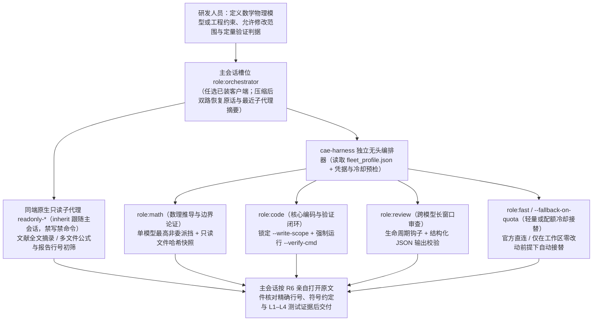

# 面向科学计算与工程研发的多客户端配置与验证工具

本仓库（`Antigravity_Codex_ClaudeCode_DeepSeekHarness`）面向科学计算、CAE、计算流体力学（CFD）、有限元分析（FEA）、计算几何与 CAM 刀轨规划以及高可靠系统软件研发，为本机已安装的官方 AI 编程客户端提供统一的全局工程规则、会话生命周期钩子与跨客户端无头命令行验证脚本。支持的四个对等客户端包括 **Google Antigravity（反重力，`agy`）**、**OpenAI Codex（`codex`）**、**Claude Code（`claude` 或 `cc`，可配合本地供应商卡片管理工具 CC Switch 使用）** 以及 **DeepSeek Harness（`dsh`）**。

运行一次 `install.py` 后，规则、钩子、只读子代理与技能按需同步至宿主机各客户端的全局配置目录（`~/.gemini/config/plugins/user-guard`、`~/.codex`、`~/.claude`、`~/.dsh`）。日常打开 C++、Fortran、Rust 或 Python 课题仓库即可直接生效，**无需向业务代码仓库拷入任何配置文件**。全仓仅依赖 Python 3.11+ 标准库，原生支持 Windows 与 WSL2／Linux 环境。

---

## 一、核心问题与两层解耦架构

### 1. 为什么在官方客户端外围补充确定性约束，而不重写底层执行循环？

各家官方命令行客户端与上游接口已内置成熟的文件补丁引擎与**自动前缀缓存机制**：当连续多轮工具调用保持系统指令与前序消息前缀字节一致时，服务端可直接复用键值（KV）缓存并对缓存命中 token 按折扣计费（实际缓存命中比例随对话轮数、单次工具返回体积及自动压缩频率动态变化）。自行重写底层代理循环既无法复用官方客户端订阅配额，也容易随宿主协议演进失效。

但在数值求解器与高可靠工程研发中，直接使用客户端出厂默认配置常遇到五类问题，需要通过外围确定性钩子与验证脚本补齐边界：

| 研发中常见的失效现象 | 直接原因 | 仓库对应防护模块与机制 |
| :--- | :--- | :--- |
| **长对话压缩后遗忘早期数学物理约定或子代理核查结论** | 会话累积至压缩阈值触发自动摘要后，首轮约定的无量纲参考量、法向指向、几何容差以及压缩前子代理刚查出的文件行号极易在摘要中丢失 | [user_words.py](template/user-guard/hooks/user_words.py) 与 [session_context_loader.py](template/user-guard/hooks/session_context_loader.py) 在未压缩回合保持零字节注入；发生压缩或恢复时原子归档并有界注入**历轮用户原话 + 最近 4 次已完成子代理首尾摘要及原始日志指针**（[AGENTS.md](template/user-guard/rules/AGENTS.md) `R9`） |
| **测试未过擅自放宽数值容差，或未跑验证即报完工** | 通用模型倾向于将 `rtol=1e-13` 放宽为 `1e-4`、删改测试断言，或仅凭静态阅读代码宣称修复完成 | `R3.6` 严禁弱化容差与网格收敛阶判据；[cae_harness.py](template/user-guard/skills/cae-harness/scripts/cae_harness.py) 的 `gate` 子命令强制绑定非空 `--verify-cmd` 与 `--write-scope` 白名单，未执行验证脚本的回执如实标记 `verification_executed: false` |
| **出厂默认挡位与窗口偏保守，或误开 `ultra` 轮询阻塞** | 部分客户端缓存默认推理挡位为 `low`／`medium`、默认窗口低于模型上限；而开启自动委派的 `ultra` 挡位会派生多层子代理引发长时轮询超时 | `install.py` 与 `cae_harness.py` 默认显式传入模型声明的最大上下文窗口与**单模型非委派最高推理挡位**（`max`、`xhigh` 或 `high`），在代码层过滤 `ultra` 与共享窗口复合路由 |
| **只读审查误改源码、越界写项目外路径或转换反代断流** | 审查任务顺手改写原文件、在仓库外创建 `git worktree`，或经第三方 `Responses API` 协议转换反代触发 `HTTP 422` 工具调用 ID 错位 | 原生 `readonly-*` 子代理禁用写工具与命令执行；无头只读任务前后校验全目录文件哈希快照；[status_guard.py](template/user-guard/hooks/status_guard.py) 拦截项目外写操作；Claude Code 仅连接原生实现 Anthropic `/v1/messages` 的官方接口或本地 [router.py](template/claude/router/router.py) |
| **模型换代导致常驻规则频繁返工，或盲目升级破坏编译依赖** | 各厂商主力模型与配额策略动态变化，硬编码模型名会导致规则和脚本迅速过时；跨次版本原地升级系统级 Python 会破坏 `jax`、`mpi4py` 等二进制扩展 | 将常驻治理代码与动态评估快照拆分为两层，由 [`fleet-evolve`](template/user-guard/skills/fleet-evolve/SKILL.md) 结合本机探测缓存重算选型，并通过 `install.py --audit-upgrade` 执行三级二进制接口（ABI）耦合检查 |

### 2. 两层解耦结构：常驻机制层与动态评估快照分离


1. **常驻机制层（跨版本稳定，零时期性模型名硬编码）**
   - **核心脚本与钩子**：[install.py](install.py)、[cae_harness.py](template/user-guard/skills/cae-harness/scripts/cae_harness.py)、[fleet_state.py](template/user-guard/skills/fleet-evolve/scripts/fleet_state.py)、[ccswitch_admin.py](template/claude/router/ccswitch_admin.py)、五类会话生命周期钩子及离线单元测试。代码仅面向抽象角色槽位（`orchestrator`、`math`、`code`、`review`、`fast`）与各客户端协议编程，不写死特定时期的模型名称，也不将任一客户端永久固定为主会话端。
   - **工程规则与三步文档校核**：[AGENTS.md](template/user-guard/rules/AGENTS.md)（`R0–R11`）、技能规程，以及“无头 `--clean-room` 空上下文盲读挑刺 -> 主会话平实工程中文整篇重写 -> 独立行号与脱敏核验”文档维护流程。
2. **动态模型评估快照层（随客户端与模型迭代校准，获批生效）**
   - 各角色当前推荐的客户端、模型系列、默认推理挡位、窗口预算、已知短板隔离参数及暂缓接入平台，集中维护在机器可读清单 [fleet_profile.json](template/user-guard/skills/cae-harness/fleet_profile.json) 中（本文第四章表一为其人工审阅视图）。
   - **四个必停用户拍板门禁（`R3.1.4`／`R4`）**：① 生成或调整推荐搭配表时（`fleet_state.py propose` 登记待审）；② 向宿主机全局配置目录写入变更或切换主控客户端时；③ 遇到系统级 Python、CUDA 或 WSL 跨大版本 ABI 强耦合升级时；④ 执行 `git push` 推送远端仓库前。

---

## 二、前置准备与快速安装

### 1. 用户自理前提与仓库同步范围

- **用户自行准备的基础前提（`R11`）**：
  1. **网络连接**：访问海外官方服务所需的合规网络环境由用户自行配置；国内直连或内网环境可直接使用官方 `DeepSeek Harness`（`dsh`），或将 `Claude Code` 指向国内原生兼容接口。本仓库仅按需读取系统已配置的代理环境变量，**不内置任何第三方中转反代**。
  2. **客户端安装与官方凭据**：至少安装四个客户端之一并完成官方账号登录（OAuth）或 API Key 配置（如环境变量、`~/.dsh/.credentials.yaml` 或 CC Switch 供应商卡片中的密钥）。`install.py` 与钩子不创建、不修改也不上传任何账号凭据；`cae-harness` 与本地 `router.py` 仅在本地只读读取已就绪凭据（`ccswitch_admin.py prepare-cards` 初始化卡片模板时原样保留已有真实密钥）。
- **本仓库自动同步的资产**：`R0–R11` 常驻全局规则、[fleet_profile.json](template/user-guard/skills/cae-harness/fleet_profile.json) 模型评估配置、五类生命周期钩子、三个只读子代理、[`cae-harness`](template/user-guard/skills/cae-harness/SKILL.md)、[`fleet-evolve`](template/user-guard/skills/fleet-evolve/SKILL.md)，以及可选的 Claude Code 本地模型分流代理 `router.py`。

### 2. 按本机环境一键安装

安装哪个客户端即可单独启用对应配置；多客户端并存时默认 `--app auto` 自动识别并幂等同步：

| 本机使用场景 | 推荐命令（Windows 用 `python`，WSL2／Linux 用 `python3`） | 写入的宿主机全局目录 |
| :--- | :--- | :--- |
| **仅用官方 DeepSeek 起步**（或国内直连） | `python -B install.py --app dsh` | 同步 `~/.dsh/AGENTS.md`（保留自定义尾段）与 `~/.dsh/skills/`，不触碰 `.credentials.yaml` |
| **仅用单个 Codex、Claude Code 或 Antigravity** | `python -B install.py --app codex`（或 `claude`、`antigravity`） | 仅写入对应客户端全局目录（`~/.codex`、`~/.claude` 或 `~/.gemini/config/plugins/user-guard`） |
| **同时使用 Antigravity 与 Codex** | `python -B install.py --app both` | 同步两端的全局规则、只读子代理、生命周期钩子、评估配置与技能模块 |
| **四客户端完整协作** | `python -B install.py`（启用本地混合分流时加 `--with-cc-router --disable-ccswitch-prompts`） | 自动为本机已检测到的全部客户端同步配置，重复执行保持幂等 |

```sh
git clone https://github.com/Xinyu-Li-1997/Antigravity_Codex_ClaudeCode_DeepSeekHarness.git
cd Antigravity_Codex_ClaudeCode_DeepSeekHarness

# 1. 只读探测 Windows 与 WSL2 已安装的客户端及工具链状态
python -B install.py --probe-apps

# 2. 空跑预览拟写入路径，获确认后执行安装（Windows 用 python，WSL2/Linux 用 python3）
python -B install.py --dry-run --yes
python -B install.py
# powershell -NoProfile -ExecutionPolicy Bypass -File .\install.ps1  # Windows PowerShell 入口
# bash install.sh                                                    # WSL2 / Linux Bash 入口

# 3. 只读核查配置对齐与全局科学计算扩展 ABI 耦合状态（summary.all_aligned == true 表示完全对齐）
python -B install.py --audit-upgrade
```

> **提醒模式切换与卸载还原**：如需关闭 Codex 或 Claude Code 的长对话交接提醒，运行 `python -B install.py --app codex --codex-handoff-mode off`（或 `--claude-handoff-mode off`）。如需卸载，删除对应全局目录下的 `user-guard` 插件目录或托管的 `hooks/`、`skills/cae-harness`、`skills/fleet-evolve` 子目录，并移除 `~/.codex/hooks.json`、`~/.claude/settings.json` 中的托管钩子项（或直接还原安装与切卡时自动生成的 `.bak-*` 备份文件，详见 [架构与钩子说明](docs/architecture-and-hooks.md)）。

### 3. 按角色槽位运行后台验证任务

安装完成后，日常在客户端窗口直接用中文交流即可；若从命令行调用 `cae-harness` 启动独立无头子进程，建议优先使用与时期性模型名解耦的 `role:*` 槽位（任务单模板见 [工作流实战指南](docs/workflow-guide.md)）：

```sh
# 1. 查看本机已就绪客户端及当前 fleet_profile.json 的角色路由解析结果（只读零写入）
python -B template/user-guard/skills/cae-harness/scripts/cae_harness.py assess --caller auto

# 2. 按角色发起只读代码审查（自动比对运行前后工作区哈希快照，严禁改写任何文件）
python -B template/user-guard/skills/cae-harness/scripts/cae_harness.py task --caller auto \
  --engine role:review --kind review --target "<课题项目目录>" --task-file "<任务单.md>"

# 3. 在允许写入白名单内修改源码，并强制运行定量验证脚本闭环
python -B template/user-guard/skills/cae-harness/scripts/cae_harness.py gate --caller auto \
  --worker role:code --tier max --fallback-on-quota --target "<课题项目目录>" \
  --task-file "<任务单.md>" --write-scope "src/**" --verify-cmd "pytest -q tests/test_core.py"
```

---

## 三、对等协作机制、钩子管线与四端能力对照

### 1. 对等角色槽位分工与 `R6` 复核链路

四个客户端处于同一对等层级：单装任一客户端即可独立开发，多客户端并存时按 [fleet_profile.json](template/user-guard/skills/cae-harness/fleet_profile.json) 动态分工。**主会话槽位（`role:orchestrator`）同样可随模型演进重算切换**，不与特定客户端永久绑定。



### 2. 会话生命周期防护管线与后台验证闭环


### 3. 四客户端底层协议、窗口预算与计费模型客观对照

以下各项均为客户端命令行协议与本仓脚本实现的客观工程属性（不随具体模型代号更替而改变）：

| 能力维度 | Antigravity (`agy`) | OpenAI Codex (`codex`) | Claude Code (`claude` / `cc`) | DeepSeek Harness (`dsh`) |
| :--- | :--- | :--- | :--- | :--- |
| **全局挂载目录** | `~/.gemini/config/plugins/user-guard` | `~/.codex` | `~/.claude`（可选配 `~/.cc-switch`） | `~/.dsh` |
| **生命周期钩子支持** | 4 类事件（`SessionStart`、`PreInvocation`、`PreToolUse`、`Stop`） | 5 类事件（`SessionStart`、`PostCompact`、`UserPromptSubmit`、`PreToolUse`、`Stop`） | 5 类事件（合并写入 `settings.json`） | 命令行暂未内置钩子事件协议（同步全局 `AGENTS.md` 与 `skills/`） |
| **压缩后原话与子代理恢复** | 增量扫描 `transcript.jsonl` `CHECKPOINT`，按需单遍回查 `transcript_full.jsonl` 补齐截断原话与最近 4 条子代理返回 | 合并 `sessions/` 与 `archived_sessions/` 同 ID 分段，去重提取原话与 `wait_agent` 完成返回并校验 SHA-256 清单 | 解析主轨迹人类输入、问答选择与非支线 `Agent`/`Task` 完成返回，自动关联 `subagents/` 支线日志 | 依赖会话内历史上下文；后台任务由独立进程单次执行 |
| **`--clean-room` 空上下文盲读** | 不支持（CLI 不支持临时剥离全局插件，脚本明确报错拦截） | 支持（临时隔离 `CODEX_HOME` 并剔除指令文件） | 支持（`--bare` + 最小认证 `--settings` 隔离） | 支持（临时配置目录 + 一次性凭据 `--patch`） |
| **结构化 JSON 输出保障** | 提示词约束 + `cae_harness.py` 本地 Schema 校验与 `AGY_ERROR` 诊断解析 | 原生 `--output-schema` 强约束 + 本地二次校验 | 原生 `--json-schema` 强约束 + `is_error` 信封识别 | 提示词单 JSON 约束 + 自动剥离尾随 `DSML` 内部标记 + 本地校验 |
| **单分片安全输入预算算法** | `agy models` 不输出整数窗口字段；默认按保守 `120,000` token 规划（可由 `CAE_AGY_INPUT_BUDGET` 覆盖） | 读取 `models_cache.json` 最大窗口 $\times$ 有效比例（如 $872\text{k} \times 95\% = 828.4\text{k}$）再取 $90\%$ 得 `745,560` token | 取 `min(max_context_tokens, auto_compact_window)` 的 $90\%$（默认 $1\text{M} \times 90\% = 900,000$ token） | 读取内置模型窗口 $1,048,576$ 的 $90\%$ 得 `943,718` token |
| **配额池与计费方式** | 客户端订阅按**模型组**分别计量 **5 小时滚动窗口 + 7 天周期配额**（`/usage` 可查） | ChatGPT 订阅共享 **5 小时滚动窗口 + 周度配额**（高阶订阅侧重周度阈值），或按 OpenAI API token 计费 | 接入兼容 Anthropic `/v1/messages` 的官方 API 时按**账户余额 + RPM/TPM 等级**计费（含自动前缀缓存折扣） | 官方账号登录或 `DEEPSEEK_API_KEY` 按 API 余额计费（含自动前缀缓存折扣） |

---

## 四、动态评估快照与日常指令速查矩阵

表一对应机器可读配置 [fleet_profile.json](template/user-guard/skills/cae-harness/fleet_profile.json) 的当前审定快照（随客户端与模型更新由 `fleet-evolve` 动态校准，变更须经用户批准）；表二为不受模型换代影响的常驻调用对照表。

### 1. 表一：当前阶段 `客户端 × 模型 × 推理挡位` 评估快照表

| 角色槽位 | 当前推荐客户端与模型 | 显式挡位与窗口预算（对比出厂默认） | 实证优势与计费特征（分工依据） | 已知短板与代码层隔离措施 |
| :--- | :--- | :--- | :--- | :--- |
| **通用主会话**<br>`role:orchestrator` | **Antigravity** + **`Gemini 4 Carbon`**<br>*(动态角色，非永久绑定)* | 最高单模型挡 **`high`**；后台分片保守预算 **`120,000`** token（`agy models` 未暴露窗口整数） | 中文自然语言沟通平实清晰，适合需求澄清、方案权衡与总控协调；直接使用客户端订阅内含的 Gemini 模型组滚动配额（5 小时 + 7 天窗口），无需单独按量采购 API | **短板**：交互会话在约 `200k–260k` token 附近触发自动检查点压缩；目录同时列出共享窗口 `Orchestrator` 与独立配额池第三方模型（如 `Claude Opus/Sonnet 5.5`、`GPT-OSS 120B`）。<br>**隔离**：挂载 `R9` 双路恢复钩子（原话 + 最近 4 条子代理摘要）；`blocked_auto_tokens` 自动过滤复合路由与异池第三方模型 |
| **同端并发初筛**<br>`readonly-*` | **当前主会话原生只读子代理** + **`inherit`** | 继承主会话当前模型，独立子会话上下文 | 仅开放只读检索工具（禁写文件、禁跑命令），启动开销低，适合多篇文献公式摘录与技术报告行号初筛 | **短板**：与主会话同属一个模型系列，可能存在同源盲区。<br>**隔离**：不替代跨模型独立代码审查；压缩前最近 4 次完成返回自动归档留痕；10+ 同构子目录盘点改用 `run_workflow` |
| **数理推导与论证**<br>`role:math` | **Codex CLI** + **`GPT-6-Astra`**（`codex:math`） | 显式 **`max`** + **`872,000`** 窗口（缓存默认 `medium` / `272k`；分片预算 **`745,560`** token） | 擅长长链条偏微分方程离散推导、几何不变量证明、通量雅可比求导与边界相容性分析；连续工具读取可复用服务端前缀缓存，支持复用 ChatGPT 订阅（5 小时 + 周度配额）或 API | **短板**：不显式传参时默认仅用 `medium` 挡与 `272k` 窗口；若开启 `ultra` 委派挡位会自动派生多层子代理引发轮询超时。<br>**隔离**：`install.py` 与 `cae_harness.py` 显式声明 `872,000` 窗口与单模型非委派 `max` 挡，只读运行前后比对全目录哈希快照 |
| **核心编码与闭环**<br>`role:code` | **Codex CLI** + **`GPT-6.1-Sol`**（`codex:code`） | 显式 **`max`** + **`872,000`** 窗口（缓存默认 `low` / `500k`；分片预算 **`745,560`** token） | 适合核心数值算法实现、跨模块重构以及配合 `gate --verify-cmd` 执行多轮定量测试闭环 | **短板**：出厂默认挡位为 `low`；Windows 下对大型仓库做无范围遍历时子进程调用开销易导致超时。<br>**隔离**：固定传入 `max` 挡与 `872,000` 窗口，任务单强制配合 `--write-scope` 与精确行号区间 |
| **交叉审查与终端协作**<br>`role:review` | **Claude Code CLI** + **`Kimi K3.1 Pro`（`k3.1-pro[1m]`）+ `DeepSeek-V4.1-Flash`** | 交互默认 `xhigh`、无头传 **`max`**；配置 **`1M`** 窗口（分片预算 **`900,000`** token） | 复用 Claude Code 五类钩子、原生 `--json-schema` 强校验与本地 `router.py` 前缀分流；Kimi 与 DeepSeek 官方接口均原生兼容 Anthropic `/v1/messages`（`1M` 窗口、按 API 余额计费并带自动前缀缓存折扣） | **短板与暂缓项**：受区域访问限制与订阅会话／周度配额上限影响，当前暂不默认接入 Anthropic 原生 Claude 模型；严禁接入第三方 `Responses API` 转换反代（防 `HTTP 422` 断流）；只读无头固定传 `--permission-mode dontAsk` 规避 `auto` 安全分类器限流报错 |
| **直连起步与配额接替**<br>`role:fast`／备用 | **DeepSeek Harness CLI** + **`DeepSeek-V4-Pro`／`DeepSeek-V4.1-Flash`** | 常规 **`max`**、快检 **`low`**（支持 `off/low/high/max`）；内置 **`1,048,576`** 窗口（分片预算 **`943,718`** token） | 通过官方 OAuth 或 `DEEPSEEK_API_KEY` 直接连接，无需本地路由；单端可独立承担开发，也可在其他客户端触发配额冷却时经 `--fallback-on-quota` 无损接替 | **短板**：`dsh` 暂未内置钩子与原生 `--json-schema` 参数，偶发输出尾随 `DSML` 内部停止标记。<br>**隔离**：脚本自动注入单 JSON 约束并清洗尾随标记；轻量 `low` 挡仅用于显式省额度或表面检查，绝不静默替代高严谨度推导与核心审查 |

> **同代候选与退役检测说明**（由 [fleet_profile.json](template/user-guard/skills/cae-harness/fleet_profile.json) 受控配置）：Codex `GPT-6.1-Terra`（缓存默认 `low` / `500k`，最大 `872k`）与 Antigravity `Gemini 4 Argon`（最高单模型挡 `High`）作为同代主力候选识别；轻量模型（Codex `GPT-6-Luna`、Antigravity `Gemini 4 Hydrogen`／`Gemini 3.8 Flash`）仅在显式调用 `role:fast` 或用户要求节省额度时选用；旧版或待下线模型标识（如 `claude-4.6`、`gpt-oss-120b`）由 `agy_retiring_patterns` 在 `--audit-upgrade` 时自动提示。官方参考文档：[OpenAI Codex Models](https://learn.chatgpt.com/docs/models)、[Antigravity Models](https://antigravity.google/docs/models)。

### 2. 表二：日常中文需求与常驻模块／角色调用对照表

| 目标事项 | 日常表达示例（自动路由） | 精确点名写法（零时期性模型名耦合） | 执行边界与必停拍板节点 |
| :--- | :--- | :--- | :--- |
| **升级工具并重算模型推荐表** | “全面更新整套配置”“重新调研最新模型和额度更新推荐表” | **`fleet-evolve`**（默认 `full` 模式，或 `/fleet-evolve`） | 采集本机缓存、运行日志与官方文档双向评估优缺点；**调整 `fleet_profile.json`、写入宿主机全局目录（`R4`）、跨大版本 ABI 升级及 `git push` 前均停下请用户拍板** |
| **只读检查配置漂移与 ABI 耦合** | “只检查 Windows 和 WSL 配置、模型和 Python 环境有没有漂移或冲突” | **`fleet-evolve audit`** 或 **`install.py --audit-upgrade`** | 全程零磁盘写入：输出四端配置对齐度、凭据状态、CC Switch 旧记录残留及全局编译型科学计算包耦合警告 |
| **全仓代码加固与文档去套话重写** | “全量优化仓库代码和文档可读性，校准技术事实并做脱敏验收” | **`fleet-evolve hygiene`** | 排查钩子与路由边界漏洞；按 `--clean-room` 空上下文盲读 -> 平实工程中文重写 -> `readonly-auditor` 行号与脱敏复核，跑通六模式沙箱与全套离线单测 |
| **首次部署本机或同步 WSL2** | “帮我把这台电脑和 WSL 环境配好” | 按根目录 **`AGENTS.md` 执行 `install.py`**（`--probe-apps`、`--dry-run`、`--with-cc-router`） | 先做只读探测，再展示 `--dry-run` 拟写入路径、现有模型与自定义尾段保留策略，**获用户 `R4` 批准后写入** |
| **长篇文献摘录或报告逐行核对** | “读完这几篇论文摘出控制方程”“逐行核对报告行号与源码是否一致” | 原生子代理 **`readonly-reader`**、**`readonly-collaborator`**、**`readonly-auditor`**；10+ 目录盘点用 **`run_workflow`** | 在当前客户端独立只读子窗口运行，返回精确文件路径与行号（最近 4 次完成摘要在压缩时自动留痕），交主会话按 `R6` 复核 |
| **推导离散格式与数学不变量** | “推导这套分裂格式的熵守恒条件或刀轨曲率连续性判据” | **`cae-harness task --kind math --engine role:math`** | 路由至数理推导槽位（单模型最高非委派挡 + 运行前后只读文件哈希快照保护） |
| **编写核心算法并跑通定量测试** | “实现 HLLC 通量或曲面求交模块，跑通守恒与收敛阶测试再交付” | **`cae-harness gate --worker role:code`**（配 `--write-scope` 与 `--verify-cmd`） | 锁定允许修改的文件白名单并强制运行 `--verify-cmd`，严禁放宽 `rtol`、`atol` 或删改测试断言 |
| **大目录分片审查或新读者盲读** | “把 `src/` 全面审查一遍排查越界隐患”“按新读者视角盲读这份文档” | **`cae-harness audit`** 或 **`cae-harness task --kind review --engine role:review`**（盲读加 **`--clean-room`**） | 按安全输入预算自动分片只读送审；`--clean-room` 剥离全部全局规则、钩子与技能 |
| **查看或切换 Claude 供应商卡片** | “看看 CC 当前激活哪张卡”“切回本地混合分流卡” | **`ccswitch_admin.py status`** 或 **`ccswitch_admin.py switch-card "<卡片名>"`** | 在线备份 `cc-switch.db` 与 `settings.json`，仅替换模型与认证环境变量，完整保留五类钩子与推理挡位 |
| **文档润色、节省额度或配额接替** | “润色这段说明但别扩大原有结论”“这轮只做快速表面检查省点额度” | 润色 **`--kind polish`**；省额度 **`--engine role:fast`**；配额接替 **`--fallback-on-quota`** | 润色采用 `medium`／`high` 防止无声放大；触发会话／周度限额且工作区零改动时自动切换至下一就绪客户端 |

---

## 五、仓库代码结构与 `install.py` 参数速查

| `install.py` 参数 | 功能说明 |
| :--- | :--- |
| `--app auto/all/both/antigravity/codex/claude/dsh` | 指定同步的客户端范围（默认 `auto` 自动匹配本机已安装客户端） |
| `--probe-apps`、`--audit-upgrade` | 前者只读探测客户端安装与凭据状态；后者只读检查四端配置漂移、模型对齐、CC Switch 状态与全局 Python 扩展 ABI 耦合 |
| `--dry-run`、`--yes` | `--dry-run` 仅输出变更计划不写磁盘；`--yes` 跳过命令行交互提示（供对话中已获用户批准后执行） |
| `--sync-model-defaults`、`--no-model-config` | 前者按 `fleet_profile.json` 刷新默认模型与最高非委派推理挡位（默认安装仅补缺不覆盖已有设置）；后者跳过模型配置 |
| `--codex-handoff-mode`、`--claude-handoff-mode` | 设置 Codex 或 Claude Code 长会话交接模式（可选 `advisory`、`enforce`、`off`，默认 `advisory`） |
| `--with-cc-router` | 同步 Claude Code 本地透明分流脚本 `router.py` 与卡片管理工具 `ccswitch_admin.py` |
| `--disable-ccswitch-prompts`、`--purge-ccswitch-legacy` | 在线备份 `cc-switch.db` 后停用或归档清理 CC Switch 内置旧提示词与旧技能记录 |
| `--target-dir`、`--codex-home`、`--claude-home`、`--dsh-home` | 显式指定目标安装目录（供离线临时沙箱回归测试隔离使用） |
| `--no-zotero`、`--skip-test` | 跳过可选 `zotero-mcp` 配置，或跳过安装末尾的快速回归自检 |

进阶阅读：[架构与钩子说明](docs/architecture-and-hooks.md) · [工作流实战指南](docs/workflow-guide.md) · [`cae-harness` 技能说明](template/user-guard/skills/cae-harness/SKILL.md) · [`fleet-evolve` 升级整理规程](template/user-guard/skills/fleet-evolve/SKILL.md) · [仓库维护说明](AGENTS.md) · [更新日志](CHANGELOG.md)。

```text
Antigravity_Codex_ClaudeCode_DeepSeekHarness/
├── README.md                                 # 总体说明：问题背景、两层架构、快速安装、能力矩阵与两张核心参考表
├── CHANGELOG.md                              # 版本演进、协议适配与边界修复记录
├── LICENSE / NOTICE                          # Apache License 2.0 许可证与第 4(d) 条原创归属声明
├── AGENTS.md                                 # 仓库维护规程、四客户端同步范围与四个用户拍板门禁
├── install.py / install.ps1 / install.sh     # 纯标准库跨平台幂等安装器与零写入配置／ABI 耦合审计工具
├── .github/workflows/ci.yml                  # Windows 与 Ubuntu 六模式沙箱安装及全量离线回归流水线
├── docs/
│   ├── assets/                               # 纯 ASCII 路径架构总览图与生命周期／定量验证管线矢量图（SVG）
│   ├── architecture-and-hooks.md             # 底层实现：模块映射、双路压缩恢复时序、钩子阈值、本地路由与预算公式
│   └── workflow-guide.md                     # 研发实战：五要素任务单、HLLC 通量示例、四步研发流与 L1–L4 验证矩阵
├── template/
│   ├── user-guard/                           # Antigravity 原生插件及四客户端共用的核心规则、钩子与技能模板
│   │   ├── plugin.json / hooks.json / README.md / assets/logo.svg
│   │   ├── rules/AGENTS.md                   # 四客户端共用的 R0–R11 常驻工程规则（零时期性模型名硬编码）
│   │   ├── hooks/                            # 五个生命周期钩子（user_words / session_context_loader / status_guard / reply_repeat_guard / handoff_gate）
│   │   ├── agents/readonly-*.md              # Antigravity 三个 inherit 原生只读子代理配置
│   │   └── skills/
│   │       ├── cae-harness/                  # 角色路由与后台验证工具（SKILL.md + fleet_profile.json + cae_harness.py）
│   │       └── fleet-evolve/                 # 客户端升级、模型重算与代码文档整理技能（SKILL.md + fleet_state.py）
│   ├── codex/                                # Codex 钩子模板与 read-only 只读子代理配置
│   └── claude/                               # Claude Code 钩子模板、只读子代理及 router/ 本地分流与在线备份切卡脚本
└── tests/                                    # 六模式沙箱安装、三端压缩双路恢复、钩子 AST 边界、路由与脱敏离线单测
```

---

## 六、English Overview & License

> **English Overview** — `Antigravity_Codex_ClaudeCode_DeepSeekHarness` provides unified engineering rules, deterministic session lifecycle hooks, and headless CLI verification scripts across **Google Antigravity (`agy`)**, **OpenAI Codex (`codex`)**, **Claude Code (`claude` / `cc`, with CC Switch)**, and **DeepSeek Harness (`dsh`)** for **scientific computing, CAE / CFD / FEA numerical solvers, computational geometry / CAM, and high-reliability systems engineering**.
> - **Two-Layer Decoupled Architecture**: Permanent governance rules (`R0–R11`), lifecycle hooks (including dual-track post-compaction recovery of user prompts and recent completed subagent digests), and role-routing scripts (`cae-harness`, `fleet-evolve`) contain **zero hardcoded seasonal model names** and **no permanent orchestrator lock-in**. Dynamic client/model pairings, context budgets, quota mechanics, and vendor exclusions are isolated in [`fleet_profile.json`](template/user-guard/skills/cae-harness/fleet_profile.json) and updated only after explicit user approval.
> - **Pure Python 3.11+ Standard Library**: Runs natively on Windows and WSL2/Linux without third-party packages. Network connectivity, official client installation, OAuth login, and API keys are prepared by the user. Built-in rule templates are written in Simplified Chinese.

本仓库仅调用用户通过官方渠道安装并自行配置凭据的客户端命令行与本地工具，不内置任何第三方反代中转、私有凭据或绕过官方权限与计费的逻辑。本项目采用 [Apache License 2.0](LICENSE) 开源许可，衍生分发须按协议第 4(d) 条完整保留根目录下的 [NOTICE](NOTICE) 原创归属声明（`Copyright 2026 Xinyu Li (Xinyu-Li-1997)`）。
