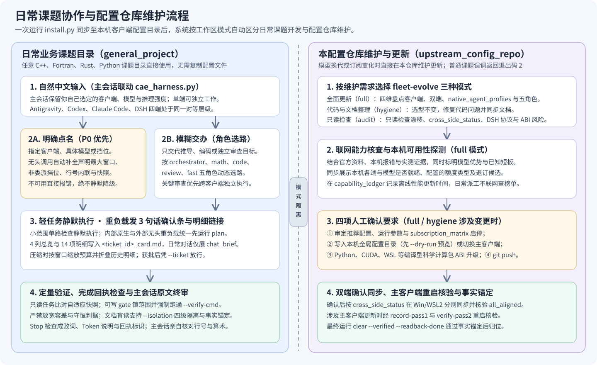
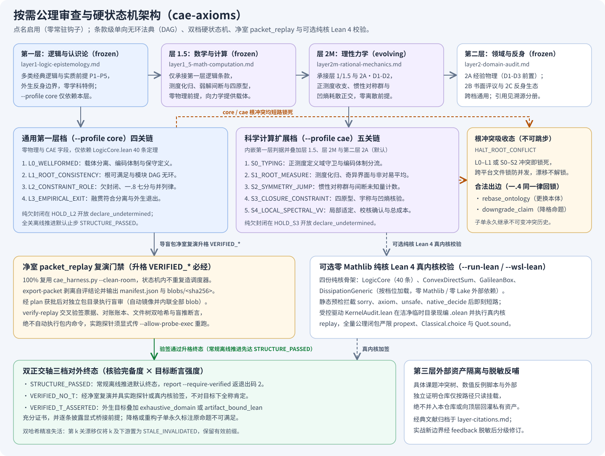

# 面向科学计算与工程研发的四客户端配置与验证工具

[](https://doi.org/10.5281/zenodo.24293507)
[](https://github.com/Xinyu-Li-1997/Antigravity_Codex_ClaudeCode_DeepSeekHarness/actions/workflows/ci.yml)
[](https://github.com/Xinyu-Li-1997/Antigravity_Codex_ClaudeCode_DeepSeekHarness/releases)
[](LICENSE)
[](install.py)

本仓库为 **Google Antigravity**（`agy`）、**OpenAI Codex**（`codex`）、**Claude Code**（`claude`）与 **DeepSeek Harness**（`dsh`）提供共享安全不变量与四端原生适配配置，涵盖工程规范、单入口生命周期钩子、只读审查代理、跨客户端离线核验脚本与按需公理审查技能。适用领域包括 **CAE、计算流体力学（CFD）、有限元分析（FEA）、偏微分方程（PDE）数值求解器、高性能计算（HPC）及高可靠系统软件工程**。

> **独立开源提示**：**本项目为个人独立开源适配工具，与上述各厂商及第三方工具链无官方关联或背书，全部内容按现状提供；使用前请查阅 [LEGAL.md](LEGAL.md)。**

设计上坚持**同端归原生、跨端与铁面验收归本仓**：各客户端的原生规划、多代理协作、手动压缩与定时功能直接顺畅放行，本仓库专注于工作区写边界防护、压缩防失忆、跨模型独立盲审、离线机械对账与按需公理验证。核心脚本仅依赖 Python 3.11+ 标准库，支持 Windows、WSL2 与 Linux（可选调用本机 Lean 4 编译器做纯核内核验签，不依赖 Mathlib）。

快速跳转：[安装与上手](#一安装与快速上手) · [核心风险防护](#二核心工程风险防护) · [日常使用与四端适配](#三日常课题使用与四端原生适配) · [配置仓库维护](#四配置仓库维护与常用选项) · [文档导航](#五文档分层导航与目录结构) · [致谢与许可](#六致谢english-overview-与开源许可)

---

## 一、安装与快速上手

> **执行前提示**：**安装与切换脚本会写入用户配置目录或本机数据库，按现状提供且无担保；执行前请先预览并备份，详见 [LEGAL.md](LEGAL.md)。**

1. **准备官方客户端**：安装至少一个上述官方客户端并完成官方登录或配置 API Key。本仓库不内置第三方反向代理，也不修改账号凭据；如需启用纯核 Lean 4 内核验签，可另行安装本机 Lean 4 工具链。
2. **同步至用户级配置目录**：克隆仓库后在根目录执行同步脚本（Windows 用 `python -B -X utf8`，WSL2 与 Linux 用 `python3 -B -X utf8`）：

   ```powershell
   python -B -X utf8 install.py --dry-run --yes   # 只读预览拟写入路径
   python -B -X utf8 install.py                   # 确认后同步至本机已安装客户端目录
   python -B -X utf8 install.py --audit-upgrade   # 核查配置漂移、四端能力矩阵、双端对齐与 ABI 风险
   ```

   安装脚本仅写入用户主目录下的客户端配置路径，不改动任何业务仓库；上游维护技能仅留配置仓内，不再下发至普通项目目录。同时在 Windows 与 WSL2 开发时，须在两侧分别同步。
3. **进入课题目录直接使用**：在任意课题仓库启动客户端即可常规对话。日常同端规划、多代理与只读检索直接使用各端原生模式（详见 [四客户端原生模式与本仓库协作指南](docs/workflow-guide.md#一四客户端原生模式与本仓库协作指南)）；跨模型独立审查或受白名单约束的求解器实现经三句话确认摘要获批后执行并自动生成机械对账表。

---

## 二、核心工程风险防护

针对科学计算与工程研发中反复出现的五类风险，本仓库通过单入口会话钩子与离线工具提供可复查的确定性约束：

| 工程风险 | 常见问题表现 | 本仓库的确定性机制 |
| --- | --- | --- |
| **长对话压缩后遗忘前置约定** | 自动摘要丢失早期的法向定义、数值容差、符号约定或待批任务 | 压缩恢复钩子分块还原历轮用户原话、实质子任务结论、双窗口回复索引与未决票据总览；手动压缩不误触交接熔断 |
| **大型仓库超窗或跳行漏读** | 一次性读入整仓引发频繁压缩，遗漏关键边界条件或约束 | 读前用 `read-plan` 评估体积并切分连续行段与保守波次；读毕用 `cross-check` 查盲区与分歧 |
| **改码后漏改配套文档与测试** | 源码已变但说明与单测滞后，人工总结遗漏依赖项 | 外部重负载完工自动产出离线 `reconcile` 机械对账表，基于文件基线与静态依赖列出待复核项 |
| **弱化验收标准或虚假全过** | 放宽容差、局部补测冒充全过、漏报失败或超时子流 | `gate` 锁写入白名单并跑通验收命令；回合结束钩子硬核验外部账单与测试成败，启发式文本实证提供温和提醒 |
| **审查误改源码、越界写或后台挂死** | 只读审阅改动文件、误写项目外目录、死等日志轮询，或裸调 CLI 越过确认 | 只读代理按端原生硬化并前后核验快照；工具执行前静态拦截越界写删、本地会话删除接口、空转轮询与裸调无头 CLI |

此外，`check-grounding --strict --doc-hygiene` 面向 Markdown、LaTeX 与 reStructuredText 文档核查代码依据、本地图件链接、定理证明完整度、计数一致、长句与跨文档复读。

---

## 三、日常课题使用与四端原生适配

日常研发遵循**同端用原生、跨端用调度、按需用专项**的分工：主会话负责需求澄清、局部修改与原文行号复核；同端多代理与规划直接使用宿主原生能力；跨模型盲审、长链推导与白名单编码交由隔离后台进程执行并回收机械对账表。四客户端各自原生模式的详细用法请查阅 [日常工作流指南](docs/workflow-guide.md#一四客户端原生模式与本仓库协作指南)。



### 1. 日常课题对话示例

| 使用场景 | 对话指令示例 | 执行方式与确定性边界 |
| --- | --- | --- |
| **局部修改与同端原生编排** | “修正边界条件符号并补一个单测”或直接使用原生多代理命令 | 主会话或宿主原生编排直接放行，全程保留项目外写边界硬守卫 |
| **显式指定跨端客户端或模型** | “用 Codex 高强度审查 `src/flux/` 守恒实现” | 锁定指定客户端、模型或挡位；目标不可用直接报错，不静默降级 |
| **大型代码库分批审阅** | “先评估整个求解器体积，分片让两端独立审阅并查盲区” | `read-plan` 分片编排，获批后分波次只读执行，`cross-check` 产出覆盖矩阵与分歧表 |
| **双端无草稿独立设计** | “请两家客户端分别独立给并行重构方案，不看主会话草稿” | 仅传入需求与背景，经空上下文或并行批次独立生成方案后对比取舍 |
| **白名单编码与机械对账** | “实现二维 Euler HLLC 通量并跑通守恒单测，附对账表” | 获批后通过 `gate` 锁写入范围与验收命令，完工自动输出 `reconcile` 对账链接 |
| **点名公理审查与学术润色** | “按 `cae-axioms` 审查接口相容性并净室复演”或“按期刊规范润色章节” | 仅在用户点名时按需加载对应技能，零常驻钩子，严守外部仓库隔离与审稿保密边界 |

公共动态角色映射与运行阈值集中存放于 [fleet_profile.json](template/user-guard/skills/cae-harness/fleet_profile.json)，本机私有选卡与个人停用项可放进不进 Git 的同级 `fleet_profile.local.json`。

### 2. 四客户端各自怎么用与原生适配

| 客户端 | 同步目录与防护 | 日常怎么用（原生模式与本仓库配合） |
| --- | --- | --- |
| **Antigravity** (`agy`) | `~/.gemini/config/plugins/user-guard`<br>窄匹配单入口 4 钩子（不动 `GEMINI.md`） | 同端规划与协作直接用 `/plan`、`/grill-me`、`/teamwork`、`/swarm`、`/boost`、`/goal`、`/compact`、`/browser`；跨端盲审或无头批处理直接点名调其余三端，后台自动守写边界与压缩回溯 |
| **Codex** (`codex`) | `~/.codex`<br>单入口 5 钩子（命令字节恒定） | 首次同步后在 Codex 输入 `/hooks` 确认一次信任哈希；同端开发与自审直接用 `spawn_agent`、`/review`、`/plan`；跨模型对照或大仓分片阅读唤起 `cae-harness`，兼容新版权限配置 |
| **Claude Code** (`claude`) | `~/.claude`<br>`settings.json` 单入口 5 钩子 | 同端讨论与并行改动直接用 `Plan`、`Agent`（内置硬化 `readonly-*` 只读代理）、`--worktree`、`--bg`；多供应商用 CC Switch 切卡，跨端高吞吐编码与独立复核交由 `cae-harness` |
| **DeepSeek Harness** (`dsh`) | `~/.dsh`<br>裁剪软规则 + 原生文件沙箱 | 安装后即用精简规则与三项技能，单端快查或作为外部无头 `fast`/`code`/`review` 节点被他端调用；当前无生命周期硬钩子，依赖原生文件沙箱与外部快照，体检持续追踪上游演进 |

### 3. 按需公理审查架构（`cae-axioms`）

需要严格拆解前提冲突、核查多模块接口相容性或审查连续介质建模公理时，可点名启用 [cae-axioms](template/user-guard/skills/cae-axioms/SKILL.md)。日常编码不会触发该技能，也不增加常驻钩子；它支持通用工程与科学计算双档检查，并将常规离线推进结果与独立净室复演终态严格区分。各层经典文献溯源与第三方边界详见 [分层文献与边界声明](template/user-guard/skills/cae-axioms/references/layer-citations.md)。



---

## 四、配置仓库维护与常用选项

在常规课题仓库仅使用三项下发技能；在本配置仓库目录下开放上游工具链维护，严守公理边界（常驻只读四端协议探针与数据提案，严禁静默自改主体代码）：

| 维护模式 | 对话指令示例 | 适用时机与执行内容 |
| --- | --- | --- |
| **全面更新**（`full`） | “核查各客户端协议与最新模型能力，给五类角色推荐与启停方案” | 模型换代、客户端升级或检出新能力信号时，消费体检报告生成提案 |
| **机制整理**（`hygiene`） | “保持选型不变，把反复暴露的问题下沉为单测与钩子并整理文档” | 修复脚本或钩子缺陷、精简常驻文字规则，并按四级受众整篇校核文档 |
| **只读巡检**（`audit`） | “只读检查配置漂移、四端能力信号、双端对齐和科学包 ABI 风险” | 日常体检，分轨报告运维阻断项与上游演进信号，零磁盘写入 |

调整推荐矩阵与阈值、写入宿主机全局目录、跨版本升级编译型科学包 ABI 及执行 `git push` 均须先获用户确认。日常可通过 `install.py --app` 限定目标客户端；全局规则会按宿主能力裁剪并自动保留个人自定义尾段；Claude 多供应商切卡建议使用配套管理脚本，本机私有配置放入不进 Git 的 `fleet_profile.local.json`。

---

## 五、文档分层导航与目录结构

公开文档按读者角色分四级单点维护，各主题均有唯一归属：

| 阅读目标 | 对应文档 |
| --- | --- |
| **日常研发：四客户端原生模式指南、分片阅读、Euler HLLC 闭环与按需技能配合** | [日常工作流指南](docs/workflow-guide.md) |
| **原理与运维：模块分工、单入口钩子、预算公式、公理引擎、双轨体检码与精确卸载** | [架构设计与钩子说明](docs/architecture-and-hooks.md) |
| **调度脚本与确认票据参数契约** | [cae-harness 技能规程](template/user-guard/skills/cae-harness/SKILL.md) |
| **按需学术写作与改稿规范（期刊论文、专著、报告与审稿回复）** | [cae-writing 写作规范](template/user-guard/skills/cae-writing/SKILL.md) |
| **按需公理审查、双档硬状态机、纯核 Lean 4 与经典文献溯源** | [cae-axioms 公理与状态机](template/user-guard/skills/cae-axioms/SKILL.md) · [分层文献溯源](template/user-guard/skills/cae-axioms/references/layer-citations.md) |
| **上游维护流程、公理元更新边界与审批门禁** | [fleet-evolve 维护规程](template/user-guard/skills/fleet-evolve/SKILL.md) · [仓库维护说明](AGENTS.md) |
| **插件目录索引、更新日志与时间戳说明** | [插件模板索引](template/user-guard/README.md) · [更新日志](CHANGELOG.md) · [时间戳与 DOI 说明](.timestamps/README.md) |
| **法律合规、安全披露、贡献与行为准则** | [法律与合规说明](LEGAL.md) · [安全政策](SECURITY.md) · [贡献指南](CONTRIBUTING.md) · [行为准则](CODE_OF_CONDUCT.md) |

```text
Antigravity_Codex_ClaudeCode_DeepSeekHarness/
├── README.md                              # T0 入口总览：安装上手、风险防护、四端适配与文档导航
├── AGENTS.md, CHANGELOG.md                # 上游配置仓库维护说明与版本更新日志
├── LICENSE, NOTICE, CITATION.cff          # Apache License 2.0、原创归属声明与学术引用元数据
├── LEGAL.md, SECURITY.md, CONTRIBUTING.md # 商标免责边界、漏洞披露、DCO 贡献与行为准则（含 CODE_OF_CONDUCT.md）
├── .github/                               # 跨平台离线 CI 流水线、Issue 与 Pull Request 合规模板
├── .timestamps/                           # RFC 3161 时间戳凭证与 DOI 发版说明
├── install.py, install.ps1, install.sh    # 按端裁剪同步、四端能力探针、双端对齐与 ABI 检查
├── docs/                                  # 日常工作流与四端原生模式指南、架构参考及 4 张 SVG 图示
├── template/
│   ├── _shared/                           # 三端只读代理唯一语义源
│   ├── user-guard/                        # 共用规则 (R0–R11)、单入口钩子、动态配置、课题技能与上游维护技能
│   ├── codex/                             # Codex 单入口事件钩子与只读子代理模板
│   └── claude/                            # Claude Code 单入口事件钩子、硬化只读代理、本地路由与切卡脚本
└── tests/                                 # 多平台安装、钩子、调度器、公理状态机与文档卫生离线回归套件
```

---

## 六、致谢、English Overview 与开源许可

### 1. 资助致谢

作者在**国家留学基金管理委员会**（简称**国家留学基金委**，**China Scholarship Council, CSC**）资助的留学期间完成本项目（学号 `202506280162`，批准文号 `留金选[2025]37号`）；截至本版本，未获得其他专项经费资助。

### 2. English Overview

`Antigravity_Codex_ClaudeCode_DeepSeekHarness` provides shared engineering invariants (R0–R11), client-idiomatic adaptations, a single-entry lifecycle hook dispatcher, hardened read-only review subagents, cross-client verification scripts, on-demand academic writing guides (`cae-writing`), and an on-demand four-layer acyclic axiom verification machine (`cae-axioms`) for **Google Antigravity**, **OpenAI Codex**, **Claude Code**, and **DeepSeek Harness** on Windows, WSL2, and Linux. Core tools rely solely on the Python 3.11+ standard library, with optional pure-core Lean 4 kernel checking (zero Mathlib).

Same-host native modes run without redundant ticket friction, while workspace write boundaries, compaction recovery, cross-client blind reviews, offline reconciliation, and read-only capability evolution probes remain mechanically guarded. Run `install.py` to sync tailored configs into user-level directories (sync both Windows and WSL2 when using both). Developed under China Scholarship Council (CSC) funding (No. `202506280162`, Approval No. `留金选[2025]37号`). Independent open-source project unaffiliated with any vendor, provided **"AS IS"** under [Apache License 2.0](LICENSE) (`Copyright 2026 Xinyu Li (Xinyu-Li-1997)`); see [NOTICE](NOTICE), [LEGAL.md](LEGAL.md), and [SECURITY.md](SECURITY.md).

### 3. 开源许可、商标声明与重要免责提示

本项目采用 [Apache License 2.0](LICENSE)（`Copyright 2026 Xinyu Li (Xinyu-Li-1997)`）；再分发须依第 4(d) 条保留 [NOTICE](NOTICE) 归属声明。

- **独立项目与商标**：**个人独立开源工具，与文中厂商及第三方工具链无官方关联或背书，未内嵌任何第三方源码；相关商标归各自权利人所有，见 [LEGAL.md](LEGAL.md)。**
- **免责与安全边界**：**按现状提供且无任何担保，维护者不承担使用损失（法定不得免除的除外）；未经独立人工验证与法定审定，不得直接用于安全关键生产决策。**
- **运行与合规**：**核心校验与钩子本地运行无遥测，联网与编译行为均按用户指令触发，合规与备份责任由用户自担。** 详见 [LEGAL.md](LEGAL.md)、[SECURITY.md](SECURITY.md)、[CONTRIBUTING.md](CONTRIBUTING.md) 与 [CODE_OF_CONDUCT.md](CODE_OF_CONDUCT.md)。
