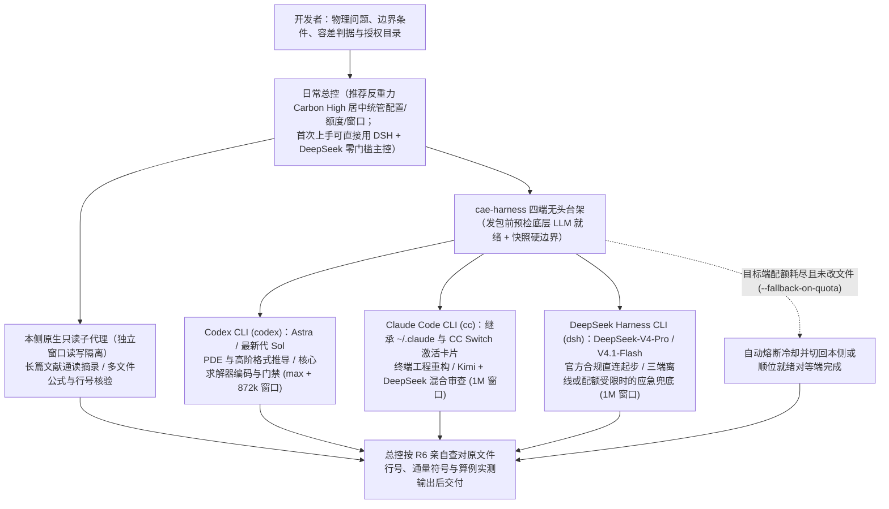

# Antigravity、Codex、Claude Code 与 DeepSeek Harness：面向 AI-CAE 研发的多代理工程约束与门禁验证台架

本仓库（`Antigravity_Codex_ClaudeCode_DeepSeekHarness`）面向计算流体力学（CFD）、有限元分析（FEA）、偏微分方程（PDE）数值求解器、网格生成与高性能科学计算研发，单点维护 Google Antigravity（反重力）、OpenAI Codex、Anthropic Claude Code（及 CC Switch）与 DeepSeek Harness（`DSH`）共用的全局工程规范、生命周期守护钩子、严格只读子代理、本地混合分流路由与跨端确定性门禁台架（`cae-harness`），同时兼容通用软件工程与技术写作。

**上游台架与业务仓库解耦**：本仓库并非需要随业务代码拷贝的“项目内配置包”。运行一次 `install.py` 后，四端配置各自独立落盘在宿主机全局根目录（`~/.gemini/config/plugins/user-guard`、`~/.codex`、`~/.claude`、`~/.dsh`），日常课题或求解器项目在自身目录直接受益于全局规范与跨端台架，无需打开或依赖本仓库；本仓库仅作为 Git 版本化上游真源、升级审计与自动化回归工具使用。全仓脚本仅依赖 Python 3.11+ 标准库（零第三方依赖，面向 Windows 与 WSL2／Linux 环境）。

> **English Overview** — `Antigravity_Codex_ClaudeCode_DeepSeekHarness` is an upstream multi-agent engineering guardrail and deterministic verification harness (`cae-harness`) spanning four peer CLI/IDE agents—**Google Antigravity (`agy`)**, **OpenAI Codex (`codex`)**, **Anthropic Claude Code (`claude` / `cc`, with CC Switch)**, and **DeepSeek Harness (`dsh`)**—built for **AI-assisted CAE / CFD / FEA / PDE numerical solver development** and scientific computing (**Python 3.11+ standard library only**, zero third-party packages, targeting Windows and WSL2/Linux, licensed under **Apache-2.0**):
> - **Host-Global Runtime Isolation & Peer-Tier Dispatch**: `install.py` deploys shared `R0–R11` rules, lifecycle hooks, read-only subagents, and `cae-harness` directly into each agent's own host-global root (`~/.gemini/config/plugins/user-guard`, `~/.codex`, `~/.claude`, `~/.dsh`), keeping scientific/solver repositories clean. All four agents sit at the same logical peer tier: each runs standalone or dispatches headless tasks (`task`, `audit`, `gate`) to any peer via explicit `--engine` or natural-language cues after preflight LLM readiness verification.
> - **Compliant Zero-Barrier Onboarding to Multi-Engine Orchestration**: First-time or domestic/intranet teams can start immediately with official **`DSH + DeepSeek`** (zero reverse-proxy grey areas) and later add **Antigravity** (recommended central orchestrator), **Codex** (`Astra` / `Sol` specialist for PDE derivations and solver gates), or **Claude Code** (inheriting `~/.claude`, CC Switch cards, and optional local Kimi+DeepSeek HTTP split routing), while retaining `DSH + DeepSeek` as an always-ready debugging and quota-failover backend.
> - **Deterministic Guardrails & Numerical Redlines**: Restores user specifications across context compaction, enforces workspace write boundaries (AST/shell static guards, sandboxing, and `cae-harness` snapshot diffs), manages long-session handoffs, and enforces `R3.6` numerical tolerance (`rtol`/`atol`) and empirical order of convergence (EOC) redlines via `--verify-cmd` gates. Machine contracts follow English conventions; built-in prompt rules (`R0–R11`) and interactive guards are authored in **Simplified Chinese**.

---

## 一、为什么需要这套工程约束与验证台架

用 AI 辅助推导高阶离散格式、编写和审查大型数值求解器时，最常见的工程失控点集中在以下六个环节：

1. **长对话自动压缩丢掉前置物理与数值约定**：推导可压缩 Navier-Stokes 离散算子、弯曲网格度量恒等式，或排查 C++/Fortran/Python 混合求解器时，宿主中途触发上下文压缩，漏掉首轮定下的无量纲基准、界面法向指向、边界通量符号或守恒判据。
2. **为凑测试绿灯偷偷放宽容差或虚报“已验证”**：遇到离散守恒残差不降或制造解网格收敛阶（EOC）不达标，模型擅自把 `rtol=1e-12` 放宽到 `1e-4`、删改断言，或刚改完源码尚未跑算例就宣称“验证通过”。
3. **只读审查顺手改坏源码、脚本越界污染其他算例**：独立复核雅可比矩阵（Jacobian）或通量公式时顺手改动被审文件；或命令写偏，在项目目录外创建 `git worktree`、误改相邻算例乃至宿主机全局配置。
4. **单一引擎难以兼顾“百万窗口文献统筹”“硬核数理编码攻坚”与“无门槛合规兜底”**：反重力擅长多篇文献综合与中文技术写作，Codex（`Astra`／`Sol`）擅长深层符号推导与 `872k` 窗口求解器门禁闭环，Claude Code 擅长终端工程流与 Kimi/DeepSeek 卡片切换，而首次上手或海外配额受限时又亟需一套无需反代灰色操作的官方直连国产模型（`DSH + DeepSeek`）随时顶上。
5. **多客户端与 CC Switch 各自散落配置，升级后规则冲突或模型代际失配**：四个客户端各自维护规则、钩子与凭据，CC Switch 切卡容易被旧提示词反向冲掉全局规则，模型换代后也缺乏一键对齐体检手段。

本台架通过**同源全局规则（`R0–R11`）+ 本地同步守护钩子 + 严格只读子代理 + 四端对等无头编排器（`cae-harness`）+ Claude 本地分流路由与全栈升级体检（`--audit-upgrade`）**闭环解决上述问题：

| AI-CAE 常见失控点 | 本台架的工程约束机制 | 实际作用边界（不夸大） |
| --- | --- | --- |
| 新建项目都要重复交代中文规范、精简目录与容差红线 | 四端同源落盘宿主机全局规则 `R0–R11`；具体控制方程与离散参数留在业务仓内 | 固化通用科研与工程纪律，不入侵业务仓库目录，也不覆盖具体算例物理参数 |
| 上下文自动压缩或跨天续接后，忘掉初始假设与中途拍板 | 压缩／恢复钩子自动从反重力、Codex 与 Claude Code 本地轨迹归档全部用户原话 | 自动注入回溯提醒重读磁盘原话；底层轨迹本身被截断时如实标明缺口 |
| 独立核查时顺手改坏源码，失去第三方复核意义 | 原生严格只读子代理 + `cae-harness` 只读模式与任务前后文件快照零写入校验 | 读写权限硬隔离；所有审查发现必须附文件路径与精确行号交回总控复核 |
| 严禁放宽 `rtol`／`atol`，区分“改完代码”与“算例跑通” | `R3.6` 验收红线 + 结构化 JSON 回执 + `cae-harness gate` 外部验证命令门禁 | 仅对当前目标环境与核心验证链路如实标注未实测项，不罗列无关外围平台免责 |
| 擅自堆砌老版本回退分支、多余抽象与假想兼容层 | `R3.3` 控制范围与反过度工程红线 + 阶段收口双端清淤把关 | 聚焦当前明确需求与主力环境（Python 3.11+、Windows／WSL2），砍掉冗余样板代码 |
| 越界修改相邻算例、建外部 `git worktree` 或改乱全局配置 | `R4` 目录硬边界 + 反重力／Claude Code AST 与 Shell 静态守卫 + Codex/DSH 工作区沙箱 | 项目外写删须经用户明确批准；系统标准临时目录与运行缓存正常放行 |
| 同一个算例残差日志被反复空读、空等套话连续刷屏 | 日志复合指纹门禁 + 回复数值进展识别守卫 | 日志内容有变化或迭代步数／残差有推进才放行，拦截原地空转刷屏 |
| 会话已频繁压缩丢细节，还在继续派任务铺摊子 | 长会话分级预警、排空（`drain`）、冻结（`freeze`）与交接四要素核验 | 反重力自动收口生成【新对话提示词】；Codex 与 Claude Code 默认采用 `advisory` 提醒 |
| 跨端调用未检查模型就绪，或目标端配额耗尽死循环重试 | 发包前 LLM／路由就绪预检 + 默认满血旗舰选模配窗 + `--fallback-on-quota` 顺位回退 | 预检拦截空凭据与离线路由；配额耗尽且工作区未改动时自动切回本侧或可用对等端 |
| CC Switch 切卡冲掉全局规则，或升级后模型窗口失配 | `ccswitch_admin.py` 无损卡片投影与提示词禁用 + `install.py --audit-upgrade` 全栈体检 | CC Switch 仅管卡片凭据，规则、钩子与技能统一归本仓库同源同步 |

---

## 二、六种部署模式：从零门槛起步到四端全栈协同

安装器自动探测本侧与跨子系统（Windows `<->` WSL）已安装的客户端，各端配置写入各自的宿主机全局目录，单端起步与多端协同平滑衔接：

| 部署模式 | 适用场景 | 安装参数 | 宿主机全局落盘内容 |
| --- | --- | --- | --- |
| **四端／全量自动协同** | 已安装多个客户端，希望日常由反重力统管并按需跨端调度 | `--app all`（或默认 `auto`） | 按实际检出客户端同步反重力、Codex、Claude Code 与 DSH 的全局规则、守护钩子、只读子代理及 `cae-harness`，可选附 `--with-cc-router` 与 `--disable-ccswitch-prompts` |
| **反重力 + Codex 协同** | 文献统筹写作与硬核数理推导／求解器门禁双主力配合 | `--app both` | 配齐反重力与 Codex 两端独立能力，打通 `cae-harness` 双向无头调用与额度熔断回退 |
| **单 DSH 零门槛合规模式** | **首次上手入门**、国内直连／企业内网环境，或作为保底调试端 | `--app dsh` | 同步 `~/.dsh/AGENTS.md`（保留自定义尾段）与 `~/.dsh/skills/cae-harness`，直接复用官方 `DEEPSEEK_API_KEY` 或官方账号，零反代灰色操作即可跑通整套工作流 |
| **单反重力模式** | 单独使用 Google Antigravity | `--app antigravity` | 安装 `~/.gemini/config/plugins/user-guard` 原生插件（`R0–R11`、四类守护钩子、三个 `inherit` 只读子代理、`cae-harness` 与可选 `zotero-mcp`） |
| **单 Codex 模式** | 单独使用 OpenAI Codex | `--app codex` | 同步 `~/.codex/AGENTS.md`（保留自定义尾段）、三个 `read-only` 子代理、原话恢复与交接钩子、`workspace-write` 沙箱、`cae-harness` 及可选 `zotero-mcp` |
| **单 Claude Code 模式** | 单独使用 Anthropic Claude Code（及可选 CC Switch） | `--app claude` | 同步 `~/.claude/CLAUDE.md`（保留自定义尾段）、三个只读子代理、五类生命周期钩子（无损合并 `settings.json`）、`cae-harness`，可选同步 `~/.claude/router/` 本地 Kimi+DeepSeek 分流路由 |

---

## 三、四端对等架构与日常协作流

### 1. 四端对等层级与执行层职责边界

反重力（`agy`）、Codex（`codex`）、Claude Code（`claude`／`cc`）与 DeepSeek Harness（`dsh`）在逻辑层级上完全对等——每一端都拥有完整的全局规则与 `cae-harness` 技能，既可独立担任主控，也可作为被调无头后端：

| 执行层 | 运行位置 | 上下文窗口形态 | 模型与思考挡位决策权 |
| --- | --- | --- | --- |
| **前端交互主会话** | 反重力、Codex、Claude Code 或 DSH 桌面／终端窗口 | 当前主会话窗口 | 用户在前端界面、CC Switch 卡片或 DSH 配置中自选，钩子与 `cae-harness` 绝不反向篡改 |
| **宿主内置复合模式** | 宿主内部（如反重力 `Orchestrator`） | 单一会话内多模型交替共享同一个窗口（容量不叠加） | 宿主固定编排，不支持外部传 `--effort` 调挡 |
| **本侧原生只读子代理／工作流** | 反重力 `invoke_subagent`／`run_workflow`、Codex 或 Claude Code 原生子代理 | 每个子代理拥有独立的子会话上下文窗口 | 默认 `inherit` 跟随主会话模型；Claude Code 接入本地 `router.py` 时按 `CLAUDE_CODE_SUBAGENT_MODEL`（默认 `deepseek-flash`）分流 |
| **`cae-harness` 四端无头 CLI** | 按需启动的 `codex`、`agy`、`claude -p` 或 `dsh --profile headless` 独立子进程 | 全新隔离会话，预检确认底层 LLM 就绪后匹配声明最大窗口 | 由 `cae-harness` 按显式参数、自然语言指派或任务专长独立选定，不受前端主控模型影响 |



`cae-harness` 与 `router.py` 均为仓库内的纯标准库脚本：`cae-harness` 仅调用用户通过官方渠道安装并配置好凭据的 `codex`、`agy`、`claude`、`dsh` CLI（未调用时不在后台常驻）；`router.py` 仅在显式启用 `--with-cc-router` 时在本地回环地址（`127.0.0.1`）将 Claude Code 请求分流至用户在 CC Switch 中填写的官方 API。

### 2. 从新手入门到多端统管的实战路线

1. **零门槛合规起步（`DSH + DeepSeek`）**：
   初次使用本台架的开发者，只需安装官方 DeepSeek Harness 并登录官方账号或填入 `DEEPSEEK_API_KEY`，执行 `python -B install.py --app dsh` 即可让裸态 DSH 立即接管整套 `R0–R11` 规范与 `cae-harness` 验证闭环，全程不涉及任何第三方反代等灰色操作；日后按需开通反重力、Codex 或 Claude Code 时，再运行一次 `install.py` 即可无缝切换至更强模型协同。
2. **日常反重力居中统管 + 原生 `inherit` 子代理并行读文献／审代码**：
   多端环境下，平时推荐用**反重力（单模型 `Gemini 4 Carbon (High)`）统一管理四端的升级体检、配额状态与上下文窗口规划**。通过 `invoke_subagent` 派生的三个 `readonly-*` 子代理自动继承 `Carbon (High)` 并各自拥有独立约 `1M` 标称窗口，适合并行通读文献或跨数十个源文件核对边界条件。
3. **按专长或自然语言跨端派工（默认满血旗舰 + 按需省流）**：
   - **硬核数理推导、求解器编码与验证门禁优先交由 Codex**：`math`／`direction` 自动选深度推理旗舰 **`Astra`**（`gpt-6-astra`），`code`／`review`／`audit`／`gate` 自动选最新代工程旗舰 **`Sol`**（`gpt-6.1-sol`），默认启用单模型纯思考最高挡 **`max`**（跳过二次派生的 `ultra` 挡防套娃烧穿配额）并显式下发 **`872,000` token** 声明最大窗口。
   - **按需或模糊指派 `Claude Code`（`cc`）与 `DSH`（`dsh`）**：无论是显式传 `--engine cc:default`／`--engine dsh:default`，还是在提示词里自然交办“让 CC 审一下”“用 DSH 跑个兜底检查”，`cae-harness` 都会先核验目标端底层 LLM／本地路由已就绪，再无痕拉起对应无头 CLI（`claude -p` 不加 `--bare`，完整继承 `~/.claude` 与 Windows／WSL2 双端 CC Switch 卡片配置；`dsh` 通过临时运行补丁下发 `deepseek-v4-pro`／`deepseek-flash` 与思考挡位）。
   - **按需分级省流与 `--fallback-on-quota` 顺位接管**：仅当用户明确或模糊提出降挡、省额度、省 token 时才切入分级省流模式；附带 `--fallback-on-quota` 时，若目标端在预检或启动期报 `quota_exhausted` 且工作区零改动，立即记录冷却时间并切回本侧或顺位就绪对等端（含保底调试端 `dsh`）完成任务。
4. **阶段收口与发版前全量把关**：
   里程碑收口或发版前对全量文件分工闭环——由 Codex 无头工作流完成代码回归检查、Debug 排错、死代码清理与门禁验证；由反重力完成文档润色、清淤精简与隐私凭据脱敏，经总控逐行复核差异与实测证据后收口。

---

## 四、四端模型、挡位与五层上下文能力矩阵

**核验日期：2026-11-15。** 下表汇总官方公开规格、本机客户端目录声明及受控实测结果；运行时以当前执行侧实时读取的模型目录与配置为准。

### 1. 四端主要模型规格对照

| 客户端／模型 | 研发场景定位 | 可调思考挡位／运行机制 | 上下文窗口依据 |
| --- | --- | --- | --- |
| Codex：`GPT-6-Astra` | 偏微分方程推导、高阶格式分析、复杂物理建模与根因排查 | 目录支持 `low/medium/high/xhigh/max/ultra`（后台默认选 `max`） | 本机目录声明默认 `272,000`、最大 `872,000` token（有效比 95%） |
| Codex：`GPT-6.1-Sol` | 求解器核心编码、常规审查、全仓审计与验证门禁主力 | 同上六挡（后台默认选 `max`；用户要求降挡／省 token 时降为 `high`） | 官方默认 `500,000`；本机目录声明最大 `872,000` token |
| Codex：`GPT-6.1-Terra` / `GPT-6-Luna` | `Terra` 面向多模态与明确修改；`Luna` 仅在按需省流表面微查时启用 | `Terra` 支持至 `ultra`；`Luna` 支持至 `max` | 本机目录声明最大 `872,000` token |
| 反重力：`Gemini 4 Carbon`／`Argon` | **推荐日常总控**、四端配置与额度统筹、长文献综合与架构把关 | 当前 CLI 目录提供 `low/medium/high`，单模型最高可用挡为 `high` | Google 官方 API 窗口 `1,048,576` token；客户端受自动检查点策略管理 |
| 反重力：`Gemini 4 Hydrogen`／`Orchestrator` | `Hydrogen` 用于快速编码与省流微查；`Orchestrator` 为单窗口复合编排 | `Hydrogen` 支持至 `xhigh`；`Orchestrator` 固定编排不可调挡（默认排除） | 复合模式共享同一会话窗口，总容量不叠加 |
| 反重力第三方托管：`Claude Sonnet/Opus 5.5` | 长周期稀缺配额第三方模型（`cae-harness` 默认排除，仅显式点名调用） | 托管推理模式（`Claude 4.6` 与 `GPT-OSS-120b` 下线后用 `probe --discover-models` 刷新） | 受托管平台配额与会话检查点策略管理 |
| Claude Code + CC Switch：`Kimi + DeepSeek` 分流／直连 | 终端独立工程闭环与跨端无头审查／编码（`claude -p` 完整继承 `~/.claude` 配置） | `settings.json` 默认补齐 `effortLevel: "xhigh"`；CLI 支持 `low/medium/high/xhigh/max` | 卡片默认配置最大上下文 `1,048,576` token、自动压缩窗口 `1,000,000` token |
| DeepSeek Harness（`DSH`）：`DeepSeek-V4-Pro` / `V4.1-Flash` | **零门槛官方合规起步**与三端不可用时的保底调试／门禁复核 | 支持 `off/low/high/max`（默认旗舰 `deepseek-v4-pro` + `max`；轻量档切 `deepseek-flash` + `low`） | 官方内置模型规格声明 `1,048,576` token（`1M` 窗口） |

参考文档：[OpenAI Codex 模型说明](https://learn.chatgpt.com/docs/models)、[Antigravity 模型说明](https://antigravity.google/docs/models)、[Gemini 4 Hydrogen 与 Orchestrator 公告](https://antigravity.google/blog/gemini-4-hydrogen-in-google-antigravity)、[Google Gemini 窗口规格表](https://docs.cloud.google.com/gemini-enterprise-agent-platform/models/migrate)。

### 2. 区分上下文窗口的五个层级（避免把“标称窗口”当成“单次塞入上限”）

1. **目录／配置声明最大窗口**：模型支持的最大上下文容量（如 Codex `872,000` token、Gemini 4 与 DeepSeek V4 `1,048,576` token、Claude Code 卡片 `1,000,000`／`1,048,576` token）。`cae-harness` 启动 Codex 时显式下发 `-c model_context_window=<最大声明窗口>`。
2. **单条消息入口上限**：客户端单次请求允许送入的字符／字节数。受控实测显示：Codex `turn/start` 单条消息上限为 `1,048,576` 字符；反重力 CLI `1.5.8` 单条达 44～66 万字节时出现入口截断，改为每轮约 13 万 UTF-8 字节分批送入则无截断（超长源码应让模型在目录内按文件读取，而非硬塞进单条提示词）。
3. **宿主自动检查点（压缩）触发点**：累积多少 token 后自动把早期对话折叠成摘要。实测 Codex `GPT-6.1-Sol` 分轮累积至 `808,892` 输入 token（占 `828,400` 有效窗口的 **97.65%**）未触发压缩，首中尾 6 处随机口令 **6/6 全中**；反重力 CLI `Hydrogen` 累积至 `241,625` token 时 **6/6 全中**，追加至 `290,028` token 触发检查点压缩后早期随机细节凭摘要无法找回。完整数据见[架构设计与生命周期钩子规范](docs/architecture-and-hooks.md)。
4. **分片审计安全输入预算**：`cae-harness audit` 扣除提示词、清单与 JSON Schema 开销并预留安全余量后的单批源码上限（支持 `--codex-input-budget`、`--agy-input-budget` 等参数调整）。
5. **实际阅读覆盖**：子任务真正读完了哪些文件与行号，以结构化回执和总控抽查为准。发生上下文压缩后严格按 `R9` 重读原话归档核对缺口，绝不盲目重跑已落盘写入。

### 3. `cae-harness` 选模与思考挡位速查表

| 场景分类 | 选模与挡位策略 |
| --- | --- |
| **默认满血模式**（`math`／`direction`／`code`／`review`／`audit`／`gate`） | 优选各端旗舰专长模型（Codex `Astra`／最新代 `Sol`、反重力 `Carbon`、Claude Code 当前激活卡片主模型、DSH `deepseek-v4-pro`）+ **单模型纯思考最高挡**（`max`／`high`）+ 声明最大窗口 |
| **纯文字润色**（`polish`） | 旗舰主力模型 + 短篇 `medium`／长篇 `high`（抑制过度改写，严防 R5 无声放大） |
| **按需省流模式**（仅当用户明确或模糊提出降挡、省额度、省 token 时启用） | 常规任务降为 `high` 挡（`gate` 首轮失败第 2 轮仍可升至 `max` 排错）；仅表面拼写／格式微查切至轻量高速模型（`Luna`／`Hydrogen`／`deepseek-flash`）+ `low` 挡 |

---

## 五、`cae-harness` 与 CC Switch 常用命令速查

在仓库根目录可直接运行（Windows 用 `python`，WSL2／Linux 用 `python3`；安装后在各客户端全局技能目录内同样可用）：

```sh
# 1. 只读体检四端客户端、CC Switch 数据库状态与大模型目录对齐情况（零写入）
python -B install.py --audit-upgrade

# 2. 只读评估四端就绪态、声明窗口与各任务推荐选路（零写入）
python -B template/user-guard/skills/cae-harness/scripts/cae_harness.py assess --caller antigravity

# 3. 反重力调 Codex 推导 PDE 离散格式／雅可比矩阵（Astra + max 挡 + 872k 窗口；配额耗尽自动回退）
python -B template/user-guard/skills/cae-harness/scripts/cae_harness.py task --caller antigravity --engine codex:default --kind math --tier max --fallback-on-quota --target "<项目目录>" --task-file "<任务单.md>"

# 4. 反重力调 Codex Sol 实现求解器算子并执行守恒律／收敛阶门禁验收
python -B template/user-guard/skills/cae-harness/scripts/cae_harness.py gate --caller antigravity --worker codex:sol --tier max --fallback-on-quota --target "<项目目录>" --task-file "<任务单.md>" --write-scope "src/*.py" --verify-cmd "python -B -m unittest discover -s tests"

# 5. 按需调用 Claude Code (cc) 或 DeepSeek Harness (dsh) 执行独立审查／兜底验证
python -B template/user-guard/skills/cae-harness/scripts/cae_harness.py task --caller antigravity --engine cc:default --kind review --target "<项目目录>" --task-file "<任务单.md>"
python -B template/user-guard/skills/cae-harness/scripts/cae_harness.py task --caller antigravity --engine dsh:default --kind review --target "<项目目录>" --task-file "<任务单.md>"

# 6. 检查或无损切换 Claude Code 的 CC Switch 供应商卡片（混合分流 / 直连 Kimi / 直连 DeepSeek）
python -B template/claude/router/ccswitch_admin.py status
```

> **Windows 版 Codex 反向调用 `agy.exe` 的沙箱权限说明**：反重力主会话直接启动 `codex`、`claude` 或 `dsh` 均可正常访问各自全局目录；但若在 Windows 版 Codex 受限工作区沙箱内反向启动 `agy.exe`，沙箱会阻止 `agy.exe` 写入 `~/.gemini/antigravity-cli` 状态锁导致超时。确需此方向调用时，须在放行 `~/.gemini` 写权限的宿主通道运行并设 `--timeout 300+`。

更多实战技巧见[工程及科研协作实践指南](docs/workflow-guide.md)与 [`cae-harness` 技能手册](template/user-guard/skills/cae-harness/SKILL.md)。

---

## 六、安装、升级与全栈适配回归验证

### 1. 一键探测、体检、预演与安装

```sh
git clone https://github.com/Xinyu-Li-1997/Antigravity_Codex_ClaudeCode_DeepSeekHarness.git
cd Antigravity_Codex_ClaudeCode_DeepSeekHarness

# 第一步：只读探测本机与 WSL 四端安装状态及升级漂移（零写入）
python -B install.py --probe-apps
python -B install.py --audit-upgrade

# 第二步：空跑预演变更计划，核对拟写入的宿主机全局路径（零写入）
python -B install.py --dry-run --yes
```

你也可以直接用反重力、Codex、Claude Code 或 DeepSeek Harness 打开本仓库，发送以下指令由当前助手自动引导配置或例行升级回归：

> 请按仓库 `AGENTS.md` 先探测并体检本机客户端与大模型配置，列出拟写入的全局根目录路径，保留我现有的模型选择和本机自定义说明，等我确认后再正式安装。

确认预演无误后执行正式安装：
- **Windows（PowerShell）**：`powershell -NoProfile -ExecutionPolicy Bypass -File .\install.ps1`
- **WSL2／Linux**：`bash install.sh`

| 安装器常用参数 | 作用说明 |
| --- | --- |
| `--app auto/all/both/antigravity/codex/claude/dsh` | 指定部署范围（默认 `auto` 自动探测已安装客户端；`both` 为反重力 + Codex，`all` 为全端同步，`dsh` 为单配 DeepSeek Harness） |
| `--probe-apps` | 只读输出本侧与跨子系统（Windows `<->` WSL）四端及 CC Switch 探测 JSON |
| `--audit-upgrade` | 只读体检四端规则／钩子／技能漂移、CC Switch 卡片与提示词状态、路由健康度及大模型对齐情况 |
| `--dry-run` / `--yes` | `--dry-run` 仅打印同步计划不改磁盘；`--yes` 跳过交互确认（适合已在对话中获用户批准后执行） |
| `--sync-model-defaults` / `--no-model-config` | 前者显式将前端默认模型更新为推荐值（默认保留用户既有选择），后者完全跳过模型配置（二者互斥） |
| `--codex-handoff-mode` / `--claude-handoff-mode` | 设置 Codex 或 Claude Code 长会话交接模式（`advisory`/`enforce`/`off`，默认 `advisory`） |
| `--with-cc-router` | 将 Kimi+DeepSeek 本地分流路由与 CC Switch 管理工具同步至 `<claude_home>/router/` |
| `--disable-ccswitch-prompts` | 在线原子备份 `cc-switch.db` 并禁用陈旧提示词，防止切卡时反向覆盖全局规则 |
| `--dsh-home` / `--claude-home` / `--codex-home` / `--target-dir` | 指定对应客户端自定义或临时沙箱目标根目录 |
| `--no-zotero` | 跳过可选的 `zotero-mcp` 文献检索服务配置 |

### 2. 客户端、CC Switch 与大模型升级后的回归清单

改动本仓库源码，或遇到任一客户端、CC Switch、上游大模型版本迭代时，按 [AGENTS.md](AGENTS.md) 第三章的触发式六步标准流程完成闭环：

1. **全栈升级体检与模型能力对齐**：运行 `python -B install.py --audit-upgrade` 与 `cae_harness.py probe --discover-models`／`assess` 核查四端最新版本、CC Switch Schema、模型代际、声明最大窗口与思考挡位；由 Codex 完成全量代码回归检查与 Debug 优化，由反重力完成文档润色、清淤精简与脱敏审查。
2. **六模式临时沙箱隔离安装**：
   ```sh
   python -B install.py --app codex --codex-home "<临时目录>/codex_home" --no-zotero
   python -B install.py --app antigravity --target-dir "<临时目录>/plugins/user-guard" --no-zotero
   python -B install.py --app claude --claude-home "<临时目录>/claude_home" --with-cc-router --no-zotero
   python -B install.py --app dsh --dsh-home "<临时目录>/dsh_home" --no-zotero
   python -B install.py --app both --target-dir "<临时目录>/plugins/user-guard" --codex-home "<临时目录>/codex_home" --no-zotero
   python -B install.py --app all --target-dir "<临时目录>/plugins/user-guard" --codex-home "<临时目录>/codex_home" --claude-home "<临时目录>/claude_home" --dsh-home "<临时目录>/dsh_home" --with-cc-router --no-zotero
   ```
3. **全量离线单元测试与 Python 3.11+ 语法回归**：
   ```sh
   python -B -X utf8 -m unittest discover -s tests -p "test_*.py" -v
   ```
4. **宿主实测与公开脱敏审计**：涉及钩子协议、路由转发或无头 CLI 选路改动时，补充真实宿主受控实测并记入[架构设计与生命周期钩子规范](docs/architecture-and-hooks.md)；确认零个人路径、零硬件型号、零内网地址、零密钥凭据后，经用户批准再提交推送并同步生产配置。

---

## 七、仓库目录导览与开源许可

```text
Antigravity_Codex_ClaudeCode_DeepSeekHarness/
├── README.md                                 # 仓库总入口：痛点定位、英文导引、六种部署模式与四端对等架构
├── CHANGELOG.md                              # 版本演进、模型代际对齐与宿主协议适配日志
├── LICENSE                                   # Apache License 2.0 开源许可证（含专利授权条款）
├── NOTICE                                    # Apache 2.0 第 4(d) 条原创架构与门禁台架署名归属文件
├── AGENTS.md                                 # 供四端共读的自举配置及触发式六步升级回归规范
├── install.py / install.ps1 / install.sh     # 跨平台安装器：四端探测体检、无损配置合并、越界链接防护与幂等同步
├── .github/workflows/ci.yml                  # 跨平台自动回归门禁（Windows + Ubuntu 六模式沙箱、零漂移体检与离线测试）
├── docs/
│   ├── workflow-guide.md                     # 四端日常科研、数值求解器开发、零门槛起步与升级回归实战指南
│   └── architecture-and-hooks.md             # 代码分区总览、宿主钩子协议、本地路由、四端无头编排与实测记录
├── template/
│   ├── user-guard/                           # 反重力原生插件及四端同源核心模板
│   │   ├── plugin.json / hooks.json / README.md
│   │   ├── assets/logo.svg                   # 极简插件矢量图标（通过官方 --strict 校验）
│   │   ├── rules/AGENTS.md                   # 四端共用的 R0–R11 全局工程与科学计算规则
│   │   ├── hooks/*.py                        # 原话归档回溯、目录硬边界、防空转刷屏与长会话交接 5 个共用模块
│   │   ├── agents/readonly-*.md              # 反重力三个 inherit 只读子代理（通读、审计、数理推导与润色）
│   │   └── skills/cae-harness/               # 四端无头协作与验证台架手册（SKILL.md）及编排脚本（cae_harness.py）
│   ├── codex/
│   │   ├── hooks.json                        # Codex 五类生命周期事件模板
│   │   └── agents/readonly-*.toml            # Codex 三个 read-only 只读子代理定义
│   └── claude/
│       ├── hooks.json                        # Claude Code 五类生命周期事件模板
│       ├── agents/readonly-*.md              # Claude Code 三个 Read/Grep/Glob 只读子代理定义
│       └── router/                           # Kimi+DeepSeek 本地分流路由、CC Switch SQLite 管理与 WSLg 脚本
└── tests/                                    # 安装器、钩子守卫、本地路由、升级体检与四端无头编排离线测试套件
```

本仓库仅调用用户通过官方合规渠道安装并配置好凭据的 `codex`、`agy`、`claude`、`dsh` CLI 与本地 `cc-switch`／`zotero-mcp` 工具，不内置任何第三方公共反代中转、私有凭据或绕过官方权限与计费的逻辑。本项目采用 [Apache License 2.0](LICENSE) 开源许可，衍生分发须按协议第 4(d) 条完整保留根目录下的 [NOTICE](NOTICE) 原创归属声明（`Copyright 2026 Xinyu Li (Xinyu-Li-1997)`）。
