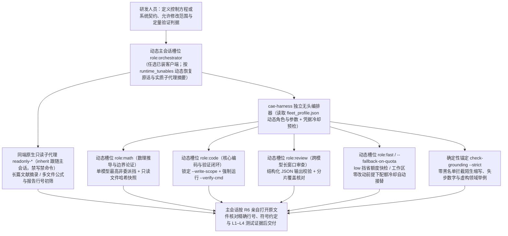
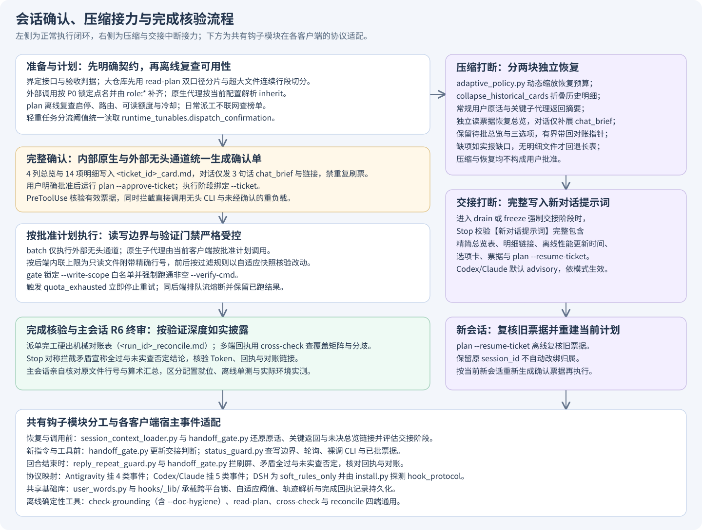

# 面向科学计算与工程研发的多客户端配置与验证工具

本仓库（`Antigravity_Codex_ClaudeCode_DeepSeekHarness`）面向科学计算、CAE、计算流体力学（CFD）、有限元分析（FEA）、偏微分方程（PDE）数值离散、高性能计算（HPC）与高可靠系统软件工程，为本机已安装的官方 AI 编程客户端提供统一的全局工程规则、会话生命周期钩子、零黑名单文档事实锚定核验与跨客户端后台验证脚本。支持的四个对等客户端包括 **Google Antigravity（反重力，`agy`）**、**OpenAI Codex（`codex`）**、**Claude Code（`claude` 或 `cc`，可配合本地供应商卡片管理工具 CC Switch 使用）** 与 **DeepSeek Harness（`dsh`）**。

运行一次 `install.py` 后，模板资产自动同步至宿主机各客户端的全局配置目录（`~/.gemini/config/plugins/user-guard`、`~/.codex`、`~/.claude`、`~/.dsh`）。日常打开任意 C++、Fortran、Rust 或 Python 课题仓库即可直接启用常驻规则、生命周期钩子与 `cae-harness` 验证工具，**无需向业务代码仓库拷入任何配置文件**；而 `fleet-evolve`、`fleet_state.py` 与 `install.py` 仅用于维护本上游配置仓库。全仓仅依赖 Python 3.11+ 标准库，原生支持 Windows 与 WSL2 及 Linux 环境。

**快速导航**：[一、核心问题与两层架构](#一核心问题与两层解耦架构) · [二、前置准备与快速安装](#二前置准备与快速安装) · [三、动态编排与四端对照](#三全动态角色编排钩子管线与四端能力对照) · [四、评估快照与日常指令](#四全动态评估快照与双场景日常指令表) · [五、目录结构与参数速查](#五仓库代码结构与-installpy-参数速查) · [六、致谢与开源许可](#六致谢english-overview--license)

```sh
# 30 秒快速上手（Windows 用 python -B -X utf8，WSL2 或 Linux 用 python3 -B -X utf8）
python -B -X utf8 install.py --probe-apps         # 1. 只读探测本机客户端、凭据与 WSL2 状态
python -B -X utf8 install.py --dry-run --yes      # 2. 空跑预览拟写入的全局目录（零磁盘修改）
python -B -X utf8 install.py                      # 3. 确认后幂等同步本机已安装的客户端配置
```

---

## 一、核心问题与两层解耦架构

### 1. 为什么在官方客户端外围补充确定性门禁，而不重写底层执行循环？

各家官方命令行客户端与上游接口已内置成熟的文件补丁引擎与**自动前缀缓存机制**：当连续多轮工具调用保持系统指令与前序消息前缀字节一致时，服务端可直接复用键值缓存并对命中部分按折扣计费（实际缓存命中率随对话轮数、单次工具返回体积及自动压缩频率变化）。自行重写底层代理循环既无法复用官方客户端订阅配额，也容易随宿主协议演进失效。

但在数值求解器与高可靠软件研发中，直接使用客户端出厂默认配置常遇到六类具体问题，需要通过外围确定性钩子与验证脚本补齐边界：

| 研发中常见的失效现象 | 直接原因 | 仓库对应的确定性防护机制 |
| :--- | :--- | :--- |
| **长对话压缩后遗忘早期物理约定，或被短回执挤掉关键子代理结论** | 会话触发自动摘要后，首轮约定的无量纲参考量、法向指向与容差红线易丢失；若仅按固定条数截取压缩前子代理返回，简短状态回执会挤占刚查完的审查行号与推导结论 | [user_words.py](template/user-guard/hooks/user_words.py) 与 [session_context_loader.py](template/user-guard/hooks/session_context_loader.py) 在未压缩回合保持零字节注入；压缩恢复时读取 [fleet_profile.json](template/user-guard/skills/cae-harness/fleet_profile.json) 的 `runtime_tunables.compaction_recovery`，按当前客户端窗口有界恢复**历轮原话 + 最新一条返回及候选窗口内达到实质字数阈值的子代理首尾摘要与原始日志指针**（`R9`） |
| **文档重写或润色阶段凭空编造陌生领域术语与失步数字** | 大模型在语言润色或整章重写时，容易顺手混入工作区源码与配置从未涉及的外围学科缩写、虚构算例名词或过时死数字 | [cae_harness.py](template/user-guard/skills/cae-harness/scripts/cae_harness.py) 提供零黑名单确定性事实锚定子命令 `check-grounding`（并在 `task --kind polish` 与 `fleet_state.py clear --verified --readback-done` 中自动联动），扫描源码与配置构建词法锚点，逐行拦截无依据 CLI 选项、陌生大写缩写、失步定量数字与虚构领域举例 |
| **测试未过擅自放宽数值容差，或未跑验证即报完工** | 通用模型倾向于将 `rtol=1e-13` 放宽为 `1e-4`、删改断言，或仅凭静态阅读代码宣称修复完成 | `R3.6` 严禁弱化容差与网格收敛阶判据；`cae_harness.py gate` 强制绑定非空 `--verify-cmd` 与 `--write-scope` 白名单，未执行验证脚本的回执如实标记 `verification_executed: false` |
| **出厂默认挡位与窗口偏保守，或误开 `ultra` 引发轮询阻塞** | 部分客户端缓存默认推理挡位为 `low` 或 `medium`、默认窗口低于模型上限；开启自动委派的 `ultra` 挡位会派生多层子代理导致长时轮询超时 | `install.py` 与 `cae_harness.py` 默认显式传入模型声明的最大上下文窗口与**单模型非委派最高推理挡位**（`max`、`xhigh` 或 `high`），在代码层过滤 `ultra` 与共享窗口复合路由 |
| **只读审查误改源码、越界写项目外路径或转换反代断流** | 审查任务顺手改写原文件、在仓库外创建 `git worktree`，或经第三方 `Responses API` 协议转换反代触发 `HTTP 422` 工具调用 ID 错位 | 原生 `readonly-*` 子代理禁写禁命令；无头只读任务前后校验全目录文件哈希快照；[status_guard.py](template/user-guard/hooks/status_guard.py) 静态拆解 Shell 与内联 Python 拦截项目外写操作；Claude Code 仅连接原生兼容 Anthropic `/v1/messages` 的官方接口或本地 [router.py](template/claude/router/router.py) |
| **模型换代或死数字散落导致规则脚本频繁返工，或升级破坏 ABI** | 各厂商主力模型、上下文压缩特性与配额策略动态演进，写死模型名或散落静态阈值极易失步；跨次版本原地升级系统级 Python 会破坏 `jax`、`mpi4py` 等二进制扩展 | 常驻代码与动态配置严格分层：五个角色槽位与 `runtime_tunables` 集中收口至 `fleet_profile.json`，由 [`fleet-evolve`](template/user-guard/skills/fleet-evolve/SKILL.md) 统一校准，并通过 `install.py --audit-upgrade` 执行三级二进制接口（ABI）耦合检查 |

### 2. 两层解耦结构：常驻机制层与全动态评估参数层


> **架构图导读**：上半部分左侧为跨版本稳定的**常驻机制层**（`R0–R11` 全局规则、5 个钩子脚本模块、`cae_harness.py`、`install.py`、`fleet_state.py` 与 `readonly-*` 子代理，不含时期性模型名与静态死数字），右侧为随客户端与模型演进动态重算的**评估与参数层**（`fleet_profile.json`，维护 5 个角色槽位与 `runtime_tunables`）；中间红色虚线框为**四个必停用户拍板节点**；下半部分展示四个对等客户端在宿主机上的独立全局挂载目录与协议分工。

1. **常驻机制层（零时期性模型名、零静态死数字）**
   - **核心脚本与钩子模块**：[install.py](install.py)、[cae_harness.py](template/user-guard/skills/cae-harness/scripts/cae_harness.py)、[fleet_state.py](template/user-guard/skills/fleet-evolve/scripts/fleet_state.py)、[ccswitch_admin.py](template/claude/router/ccswitch_admin.py)、5 个钩子脚本模块（1 个共享提取与参数核 `user_words.py` + 4 个事件入口脚本）及离线测试集。代码仅面向五个对等角色槽位（`orchestrator`、`math`、`code`、`review`、`fast`）、`runtime_tunables` 参数键与工作区身份（`workspace_mode`）编程，不将任何角色永久绑定在单一客户端或特定模型上。
   - **工程规则与三步文档校核**：[AGENTS.md](template/user-guard/rules/AGENTS.md)（`R0–R11`）、技能规程，以及“无头 `--clean-room` 空上下文盲读挑刺 -> 主会话平实工程中文整篇重写 -> `check-grounding --strict` 事实锚定核验 + `readonly-auditor` 行号与脱敏复核”三步文档校核流程。
2. **全动态评估与运行期参数层（随客户端与模型特性重算，获批生效）**
   - 五个角色槽位的当前候选顺序、推荐客户端与模型系列、默认推理挡位、短板隔离规则，以及各端压缩恢复预算、实质子代理筛选窗口、长会话交接阈值、轮询防护、过期锁清理周期与无头派工参数（`runtime_tunables`），统一维护在 [fleet_profile.json](template/user-guard/skills/cae-harness/fleet_profile.json) 中（本文第四章表一与 [架构与钩子说明](docs/architecture-and-hooks.md) 为其人工审阅视图）。
   - **四个必停用户拍板节点（`R3.1.4`、`R4`）**：① 生成或调整推荐的角色矩阵或 `runtime_tunables` 定量参数时（`fleet_state.py propose` 登记待审）；② 向宿主机全局配置目录写入变更或切换主会话客户端时；③ 涉及装有编译型科学计算包的系统级 Python 跨次版本升级、CUDA 跨大版本升级或 WSL 跨 LTS 发行版升级等二进制接口（ABI）强耦合操作时；④ 执行 `git push` 推送远端仓库前。

---

## 二、前置准备与快速安装

### 1. 用户自理前提与仓库同步范围

- **用户自行准备的基础前提（`R11`）**：
  1. **网络连接**：访问海外官方服务所需的合规网络环境由用户自行配置；国内直连或内网环境可直接使用官方 `DeepSeek Harness`（`dsh`），或将 `Claude Code` 指向国内原生兼容接口。本仓库仅按需读取系统已配置的代理环境变量，**不内置任何第三方中转反代**。
  2. **客户端安装与官方凭据**：至少安装四个客户端之一并完成官方账号登录（OAuth）或 API Key 配置（如环境变量、`~/.dsh/.credentials.yaml` 或 CC Switch 供应商卡片中的密钥）。`install.py` 与钩子不创建、不修改也不上传任何账号凭据；`cae-harness` 与本地 `router.py` 仅在本地只读读取已就绪凭据（`ccswitch_admin.py prepare-cards` 初始化卡片模板时原样保留已有真实密钥）。
- **本仓库自动同步的资产**：`R0–R11` 常驻全局规则、[fleet_profile.json](template/user-guard/skills/cae-harness/fleet_profile.json) 全动态角色与运行期参数配置、5 个钩子脚本模块、3 个只读子代理、[`cae-harness`](template/user-guard/skills/cae-harness/SKILL.md)、[`fleet-evolve`](template/user-guard/skills/fleet-evolve/SKILL.md)，以及可选的 Claude Code 本地模型分流代理 `router.py`。

### 2. 按本机环境一键安装

安装哪个客户端即可单独启用对应配置；多客户端并存时默认 `--app auto` 自动识别并幂等同步：

| 本机使用场景 | 推荐命令（Windows 用 `python -B -X utf8`，WSL2 或 Linux 用 `python3 -B -X utf8`） | 写入的宿主机全局目录 |
| :--- | :--- | :--- |
| **仅用官方 DeepSeek 起步**（或国内直连） | `python -B -X utf8 install.py --app dsh` | 同步 `~/.dsh/AGENTS.md`（保留自定义尾段）与 `~/.dsh/skills/`，不触碰 `.credentials.yaml` |
| **仅用单个 Codex、Claude Code 或 Antigravity** | `python -B -X utf8 install.py --app codex`（或 `claude`、`antigravity`） | 仅写入对应客户端全局目录（`~/.codex`、`~/.claude` 或 `~/.gemini/config/plugins/user-guard`） |
| **同时使用 Antigravity 与 Codex** | `python -B -X utf8 install.py --app both` | 同步两端的全局规则、只读子代理、事件钩子、动态参数配置与技能模块 |
| **四客户端完整协作** | `python -B -X utf8 install.py`（启用本地分流时加 `--with-cc-router --disable-ccswitch-prompts`） | 自动为本机已检测到的全部客户端同步配置，重复执行保持幂等 |

```sh
git clone https://github.com/Xinyu-Li-1997/Antigravity_Codex_ClaudeCode_DeepSeekHarness.git
cd Antigravity_Codex_ClaudeCode_DeepSeekHarness

# 1. 只读探测 Windows 与 WSL2 已安装的客户端及工具链状态
python -B -X utf8 install.py --probe-apps

# 2. 空跑预览拟写入路径，获确认后执行安装（WSL2 或 Linux 将 python 换为 python3）
python -B -X utf8 install.py --dry-run --yes
python -B -X utf8 install.py
# powershell -NoProfile -ExecutionPolicy Bypass -File .\install.ps1  # Windows PowerShell 入口
# bash install.sh                                                    # WSL2 / Linux Bash 入口

# 3. 只读核查配置对齐与全局科学计算扩展 ABI 耦合状态（summary.all_aligned == true 表示完全对齐）
python -B -X utf8 install.py --audit-upgrade
```

> **交接模式切换与卸载还原**：如需关闭 Codex 或 Claude Code 的长会话交接提醒，运行 `python -B -X utf8 install.py --app codex --codex-handoff-mode off`（或 `--claude-handoff-mode off`）。如需卸载，删除对应全局目录下的 `user-guard` 插件目录或托管的 `hooks/`、`skills/cae-harness`、`skills/fleet-evolve` 子目录，并移除 `~/.codex/hooks.json`、`~/.claude/settings.json` 中的托管钩子项（或直接还原安装与切卡时生成的 `.bak-*` 备份文件，详见 [架构与钩子说明](docs/architecture-and-hooks.md)）。

### 3. 在日常课题项目中按动态角色槽位运行验证

安装完成后，在任意科研或工程代码仓库中直接用中文交流即可；从命令行调用 `cae-harness` 启动独立无头子进程或做文档事实锚定核验时，统一使用与时期性模型名解耦的 `role:*` 槽位（任务单模板见 [工作流实战指南](docs/workflow-guide.md)）：

```sh
# 1. 查看工作区身份（general_project / upstream_config_repo）及五个动态角色槽位的当前解析结果
python -B -X utf8 template/user-guard/skills/cae-harness/scripts/cae_harness.py assess --caller auto

# 2. 按角色发起只读代码审查（运行前后校验全目录哈希快照，严禁改写任何文件）
python -B -X utf8 template/user-guard/skills/cae-harness/scripts/cae_harness.py task --caller auto \
  --engine role:review --kind review --target "<课题项目目录>" --task-file "<任务单.md>"

# 3. 限定写入白名单修改源码，并强制运行定量验证脚本闭环
python -B -X utf8 template/user-guard/skills/cae-harness/scripts/cae_harness.py gate --caller auto \
  --worker role:code --tier max --fallback-on-quota --target "<课题项目目录>" \
  --task-file "<任务单.md>" --write-scope "src/**" --verify-cmd "pytest -q tests/test_core.py"

# 4. 文档重写或润色终审时执行零黑名单确定性事实锚定核验
python -B -X utf8 template/user-guard/skills/cae-harness/scripts/cae_harness.py check-grounding \
  --target "<课题项目或文档路径>" --strict
```

---

## 三、全动态角色编排、钩子管线与四端能力对照

### 1. 五个动态角色槽位与 `R6` 复核链路

四个客户端处于同一对等层级：单装任一客户端即可独立承担全部研发工作，多客户端并存时按 [fleet_profile.json](template/user-guard/skills/cae-harness/fleet_profile.json) 动态选路。**`role:orchestrator`、`role:math`、`role:code`、`role:review`、`role:fast` 五个角色槽位与 `runtime_tunables` 定量参数均不与特定客户端或固定模型永久绑定**——现阶段推荐组合仅反映当前各客户端在中文沟通、长链推导、多文件迭代与协议钩子上的实测表现，后续随客户端与模型演进可通过 `fleet-evolve` 重新校准切换。



### 2. 会话生命周期防护管线与后台验证闭环



> **管线图导读**：上半部分 **A 通道**展示交互式主会话在恢复与调用前、工具执行前、回合结束时触发的事件钩子管线（普通未压缩回合零字节注入以保护前缀缓存，压缩后按 `per_client` 预算恢复人类原话与实质子代理摘要，并在写文件或跑命令前静态拦截越界写操作与未变化日志轮询）；下半部分 **B 通道**展示 `cae_harness.py` 在独立无头子进程中从动态选路预检、读写快照隔离、`gate --verify-cmd` 多轮闭环修正到 `check-grounding` 事实锚定与 L1–L4 验收的完整流程。

### 3. 四客户端底层协议、窗口预算与计费机制对照

以下各项为客户端命令行协议与本仓脚本实现的工程机制（定量阈值统一由 `fleet_profile.json` 的 `runtime_tunables` 受控配置）：

| 能力维度 | Antigravity (`agy`) | OpenAI Codex (`codex`) | Claude Code (`claude` / `cc`) | DeepSeek Harness (`dsh`) |
| :--- | :--- | :--- | :--- | :--- |
| **全局挂载目录** | `~/.gemini/config/plugins/user-guard` | `~/.codex` | `~/.claude`（可选配 `~/.cc-switch`） | `~/.dsh` |
| **生命周期钩子支持** | 4 类事件钩子（`SessionStart`、`PreInvocation`、`PreToolUse`、`Stop`） | 5 类事件钩子（`SessionStart`、`PostCompact`、`UserPromptSubmit`、`PreToolUse`、`Stop`） | 5 类事件钩子（合并写入 `settings.json`） | 命令行暂未内置钩子事件协议（同步全局 `AGENTS.md` 与 `skills/`） |
| **压缩后动态双路恢复** | 增量扫描 `CHECKPOINT`，单遍回查 `transcript_full.jsonl` 还原截断步骤后再筛选，按 `per_client.antigravity`（当前校准 `7,600` 字符、窗口 `12` 筛 `4` 条实质返回）恢复 | 合并 `sessions/` 与 `archived_sessions/` 分段并保持全局步骤号单调递增，按 `per_client.codex`（当前校准 `8,000` 字符、窗口 `15` 筛 `5` 条实质返回）去重恢复 | 解析人类输入、问答选择与非支线 `Agent`／`Task` 完成返回，按 `per_client.claude`（当前校准 `8,000` 字符、窗口 `15` 筛 `5` 条实质返回）关联 `subagents/` 日志 | 依赖会话内历史上下文；后台任务由独立进程单次执行 |
| **`--clean-room` 空上下文盲读** | 不支持（CLI 不支持临时剥离全局插件，脚本明确报错拦截） | 支持（临时隔离 `CODEX_HOME` 并剔除指令文件） | 支持（`--bare` + 最小认证 `--settings` 隔离） | 支持（临时配置目录 + 一次性凭据 `--patch`） |
| **结构化 JSON 输出保障** | 提示词约束 + `cae_harness.py` 本地 Schema 校验与 `AGY_ERROR` 诊断解析 | 原生 `--output-schema` 强约束 + 本地二次校验 | 原生 `--json-schema` 强约束 + `is_error` 信封识别 | 提示词单 JSON 约束 + 自动剥离外层代码围栏与尾随 `DSML` 标记 + 本地校验 |
| **单分片安全输入预算算法** | `agy models` 不输出整数窗口字段；读取 `unlisted_window_fallback_tokens`（当前 `120,000` token，可由 `CAE_AGY_INPUT_BUDGET` 覆盖） | 读取 `models_cache.json` 最大窗口 $\times$ 有效比例（如 $872\text{k} \times 95\% = 828.4\text{k}$）再乘安全系数 $0.90$ 得 `745,560` token | 取 `min(max_context_tokens, auto_compact_window)` 乘安全系数 $0.90$（当前 $1\text{M} \times 90\% = 900,000$ token） | 读取内置模型窗口 $1,048,576$ 乘安全系数 $0.90$ 得 `943,718` token |
| **配额池与计费方式** | 客户端订阅按**模型组**分别计量 **5 小时滚动窗口 + 7 天周期配额**（`/usage` 可查） | ChatGPT 订阅共享 **5 小时滚动窗口 + 周度配额**（高阶订阅侧重周度阈值），或按 OpenAI API token 计费 | 接入兼容 Anthropic `/v1/messages` 的官方 API 时按**账户余额 + RPM/TPM 等级**计费（含自动前缀缓存折扣） | 官方账号登录或 `DEEPSEEK_API_KEY` 按 API 余额计费（含自动前缀缓存折扣） |

---

## 四、全动态评估快照与双场景日常指令表

### 1. 表一：现阶段五个动态角色槽位评估快照表

表一对应 [fleet_profile.json](template/user-guard/skills/cae-harness/fleet_profile.json) 的当前审定快照（`all_roles_dynamic: true`、`dynamic_tunables_enabled: true`）。**表中五个角色槽位与定量预算均为动态配置，仅代表现阶段实测优选方案，不构成任何客户端或模型的永久绑定**；模型换代或配额调整时，运行 `fleet-evolve` 重算并经用户拍板即可整体切换：

| 动态角色槽位 | 现阶段推荐客户端与模型（均支持 `<client>:@<role>` 跨端切换） | 显式挡位与当前校准预算（对比出厂默认） | 现阶段实证优势与计费特征（当前分工依据） | 已知短板与代码层参数隔离措施 |
| :--- | :--- | :--- | :--- | :--- |
| **通用主会话**<br>`role:orchestrator` | **Antigravity** + **`Gemini 4 Carbon`**<br>（备选 `codex:@orchestrator`、`claude:@orchestrator`、`dsh:@orchestrator`） | 推荐挡位 **`high`**；无头分片预算 **`120,000`** token；内联恢复 **`7,600`** 字符 | 中文自然语言沟通平实清晰，适合需求澄清、方案权衡与总控协调；直接使用客户端订阅内含的 Gemini 模型组滚动配额（5 小时 + 7 天窗口），无需单独按量采购 API | **短板**：交互会话在约 `200k–260k` token 附近触发自动检查点压缩；目录混列共享窗口 `Orchestrator` 与异池第三方模型（如 `Claude Opus/Sonnet 5.5`、`GPT-OSS 120B`）。<br>**隔离**：`per_client.antigravity` 在近 `12` 次子代理返回中筛选最新与达 `64` 字符阈值的 `4` 条实质结论恢复；`blocked_auto_tokens` 自动跳过复合路由与异池模型 |
| **数理推导与论证**<br>`role:math` | **Codex CLI** + **`GPT-6-Astra`**（`codex:math`）<br>（备选 `codex:code`、`agy:@math`、`dsh:math`、`claude:math`） | 显式 **`max`** + **`872,000`** 窗口（缓存默认 `medium` / `272k`；分片预算 **`745,560`** token） | 擅长长链条偏微分方程离散推导、几何守恒律（GCL）与熵稳定条件证明、雅可比求导与边界相容性分析；连续工具读取复用服务端前缀缓存，支持 ChatGPT 订阅（5 小时 + 周度配额）或 API | **短板**：不显式传参时默认仅用 `medium` 挡与 `272k` 窗口；开启 `ultra` 委派挡位会自动派生多层子代理引发轮询超时。<br>**隔离**：`install.py` 与 `cae_harness.py` 显式声明 `872,000` 窗口与单模型非委派 `max` 挡，只读运行前后比对全目录哈希快照 |
| **核心编码与闭环**<br>`role:code` | **Codex CLI** + **`GPT-6.1-Sol`**（`codex:code`）<br>（备选 `codex:math`、`claude:code`、`agy:@code`、`dsh:code`） | 显式 **`max`** + **`872,000`** 窗口（缓存默认 `low` / `500k`；分片预算 **`745,560`** token） | 适合核心数值算法实现、跨模块重构以及配合 `gate --verify-cmd` 执行多轮定量测试闭环 | **短板**：出厂默认挡位为 `low`；Windows 下对大型仓库做无范围遍历时子进程调用开销易导致超时。<br>**隔离**：固定传入 `max` 挡与 `872,000` 窗口，任务单强制配合 `--write-scope` 与精确行号区间 |
| **交叉审查与终端协作**<br>`role:review` | **Claude Code CLI** + **`Kimi K3.1 Pro`（`k3.1-pro[1m]`）+ `DeepSeek-V4.1-Flash`**<br>（备选 `codex:review`、`agy:@review`、`dsh:review`） | 交互默认 `xhigh`、无头传 **`max`**；配置 **`1M`** 窗口（分片预算 **`900,000`** token；内联恢复 **`8,000`** 字符） | 复用 Claude Code 5 类事件钩子、原生 `--json-schema` 强校验与本地 `router.py` 前缀分流；Kimi 与 DeepSeek 官方接口均原生兼容 Anthropic `/v1/messages`（`1M` 窗口、按 API 余额计费并带自动前缀缓存折扣） | **短板与暂缓项**：受区域访问限制与订阅会话及周度配额上限影响，当前暂不默认接入 Anthropic 原生 Claude 模型；严禁接入第三方 `Responses API` 转换反代（防 `HTTP 422` 断流）；只读无头固定传 `--permission-mode dontAsk` 规避 `auto` 分类器限流报错 |
| **省额度快检与配额接替**<br>`role:fast` | **DeepSeek Harness CLI** + **`DeepSeek-V4.1-Flash`／`DeepSeek-V4-Pro`**<br>（备选 `claude:fast`、`agy:@fast`、`codex:@fast`） | `role:fast` 默认 **`low`**（常规任务 **`max`**，支持 `off/low/high/max`）；内置 **`1,048,576`** 窗口（分片预算 **`943,718`** token） | 通过官方 OAuth 或 `DEEPSEEK_API_KEY` 直接连接，无需本地路由；单端可独立承担开发，也可在其他客户端触发配额冷却时经 `--fallback-on-quota` 无损接替 | **短板**：`dsh` 暂未内置事件钩子与原生 `--json-schema` 参数，偶发包裹代码围栏或尾随 `DSML` 内部标记。<br>**隔离**：脚本自动注入单 JSON 约束并剥离外层围栏与尾随标记；轻量 `low` 挡仅用于显式省额度或表面检查，绝不静默替代高严谨度推导与核心审查 |

> **同端原生只读子代理（`readonly-*`）与候选模型说明**：
> - **同端并发初筛（`readonly-reader`、`readonly-collaborator`、`readonly-auditor`）**：独立于后台 `cae-harness` 五角色槽位之外，默认以 `inherit` 继承当前主会话模型在独立只读子会话中运行（禁写文件、禁跑命令），适合多篇文献公式摘录与报告行号初筛；超过 10 个同构子目录的批量盘点改用 `run_workflow`；不能替代跨模型独立代码审查。
> - **同代候选与退役检测**：Codex `GPT-6.1-Terra`（缓存默认 `low` / `500k`，最大 `872k`）与 Antigravity `Gemini 4 Argon`（最高单模型挡 `High`）作为同代主力候选识别；轻量模型（Codex `GPT-6-Luna`、Antigravity `Gemini 4 Hydrogen` 与 `Gemini 3.8 Flash`）仅在显式调用 `role:fast`／`<client>:@fast` 或用户要求节省额度时选用；旧版或待下线模型标识（如 `claude-4.6`、`gpt-oss-120b`）在 `--audit-upgrade` 与无头选路时自动提示或过滤。官方参考文档：[OpenAI Codex Models](https://learn.chatgpt.com/docs/models)、[Antigravity Models](https://antigravity.google/docs/models)。

### 2. 表二：日常中文需求分类指令表（通用课题项目 vs 上游配置仓维护）

安装本套全局配置后，系统通过**轻量工作区身份硬判别（`workspace_mode`）**严格隔离两类使用场景，防止在普通 CFD 或 FEA 课题仓库中说出“全量优化代码和文档”时误触宿主机全局配置演进：
- **判别规则**：仅当目标工作区同时包含 `install.py` 与 `template/user-guard/plugin.json` 时识别为 `upstream_config_repo`（开放全功能）；其他一切业务仓库均识别为 `general_project`（仅开放通用课题研发能力，`fleet_state.py` 在未传 `--repo` 调用时直接返回退出码 `2` 拒绝执行，`fleet-evolve` 亦不触发）。

#### （一）通用课题与工程项目日常研发（`workspace_mode: "general_project"`，任意项目开箱即用）

| 日常课题目标 | 中文自然表达示例 | 实际调用的常驻模块与角色槽位 | 硬门禁与安全边界 |
| :--- | :--- | :--- | :--- |
| **文献摘录或报告逐行核对** | “读完这几篇论文摘出控制方程”“逐行核对报告行号与源码是否一致” | 同端原生只读子代理 **`readonly-reader`**、**`readonly-collaborator`**、**`readonly-auditor`**；10+ 子目录盘点用 **`run_workflow`** | 仅开放只读工具；压缩前实质返回摘要按 `runtime_tunables` 自动留痕，采纳前主会话按 `R6` 核对原文件行号 |
| **推导离散格式与数学不变量** | “推导这套分裂格式的熵守恒条件或弯曲网格几何守恒律判据” | **`cae-harness task --kind math --engine role:math`** | 动态路由至当前数理推导槽位（单模型最高非委派挡 + 运行前后只读文件哈希快照保护） |
| **编写求解器代码并跑定量测试** | “实现二维可压缩 Euler 方程 HLLC 通量模块，跑通守恒与收敛阶测试再交付” | **`cae-harness gate --worker role:code`**（配 `--write-scope` 与 `--verify-cmd`） | 锁定允许修改的文件白名单并强制执行 `--verify-cmd`，严禁放宽 `rtol`、`atol` 或删改断言 |
| **课题代码审查或新读者盲读** | “把 `src/` 全面审查一遍排查越界隐患”“按新读者视角盲读项目文档” | **`cae-harness audit`** 或 **`cae-harness task --kind review --engine role:review`**（盲读加 **`--clean-room`**） | 按安全输入预算自动分片只读送审；仅审查当前课题目录，绝不触碰宿主机全局配置 |
| **文档润色与防幻觉事实核验** | “润色项目说明并检查有没有混入源码没写的虚构术语或错误参数” | **`cae-harness task --kind polish`** + **`cae-harness check-grounding --target . --strict`** | 润色按篇幅选用 `medium` 或 `high` 并自动附 `grounding_audit`；`check-grounding` 零黑名单拦截无源码依据的缩写、数字与举例词干 |
| **省额度快检、配额接替或切卡** | “这轮只做快速表面检查省点额度”“查看或切换 CC 供应商卡片” | 省额度 **`--engine role:fast`**；配额接替 **`--fallback-on-quota`**；切卡 **`ccswitch_admin.py status / switch-card`** | 触发限流且工作区零改动时自动切换下一就绪客户端；切卡先在线备份 `cc-switch.db` 与 `settings.json` |

#### （二）维护本上游配置仓库（`workspace_mode: "upstream_config_repo"`，含两大自主维护闭环）

在本仓库内除了可使用上述全部通用能力外，专享**“全面更新”**与**“全量优化”**两大自主维护闭环及宿主机同步工具：

| 上游维护目标 | 简明触发指令（仅在本仓库或明确演进全局配置时生效） | 专属模块与精确命令 | 硬门禁与四个必停用户拍板节点 |
| :--- | :--- | :--- | :--- |
| **全面更新（外部升级 + 动态矩阵重算）** | **“全面更新”**／“升级所有用到的工具并重算最新模型与参数推荐表” | **`fleet-evolve`**（`full` 模式）+ **`fleet_state.py propose / approve`** | 探测四端新模型缓存、报错日志与三级 ABI 耦合，重算五个角色槽位与 `runtime_tunables`；**调整推荐表、写宿主机全局目录（`R4`）、跨大版本 ABI 升级及 `git push` 四节点必停待批** |
| **全量优化（现配校准 + 代码文档加固）** | **“全量优化”**／“先不升级外部工具，按当前配置全仓优化代码文档并做技术与脱敏回归” | **`fleet-evolve hygiene`** + **`cae_harness.py check-grounding --target . --strict`** | 基于当前配置收口散落死数字、加固钩子与路由边界、三步整篇重写图文文档并通过 `check-grounding --strict`、六模式沙箱与全套单测；终审 `clear --verified --readback-done` 自动复核事实锚定 |
| **只读漂移与工具链 ABI 巡检** | “检查 Windows 和 WSL 四端全局配置与 Python 科学计算包有没有漂移或耦合冲突” | **`fleet-evolve audit`** 或 **`install.py --audit-upgrade`** | 全程零磁盘写入，输出脱敏后的四端配置差异、模型退役提醒、CC Switch 旧记录残留与编译扩展 ABI 警告 |
| **首次部署本机或同步全局配置** | “帮我把这台电脑和 WSL 的全局客户端环境同步好” | **`install.py`**（先 `--probe-apps` 与 `--dry-run --yes`，获批后正式执行） | 先展示拟写入的宿主机全局目录、现有模型与自定义尾段保留策略，**获用户 `R4` 明确批准后写入** |

---

## 五、仓库代码结构与 `install.py` 参数速查

| `install.py` 参数 | 功能说明 |
| :--- | :--- |
| `--app auto/all/both/antigravity/codex/claude/dsh` | 指定同步的客户端范围（默认 `auto` 自动匹配本机已安装客户端） |
| `--probe-apps`、`--audit-upgrade` | 前者只读探测客户端安装与凭据状态；后者只读检查四端配置漂移、动态角色配置对齐、CC Switch 状态与全局 Python 扩展 ABI 耦合 |
| `--dry-run`、`--yes` | `--dry-run` 仅输出变更计划不写磁盘；`--yes` 跳过命令行交互提示（供对话中已获用户批准后执行） |
| `--sync-model-defaults`、`--no-model-config` | 前者按 `fleet_profile.json` 刷新默认模型与最高非委派推理挡位（默认安装仅补缺不覆盖已有设置）；后者跳过模型配置 |
| `--codex-handoff-mode`、`--claude-handoff-mode` | 设置 Codex 或 Claude Code 长会话交接模式（可选 `advisory`、`enforce`、`off`，默认读取 `fleet_profile.json`） |
| `--with-cc-router` | 同步 Claude Code 本地透明分流脚本 `router.py` 与卡片管理工具 `ccswitch_admin.py` |
| `--disable-ccswitch-prompts`、`--purge-ccswitch-legacy` | 在线备份 `cc-switch.db` 后停用或归档清理 CC Switch 内置旧提示词与旧技能记录 |
| `--target-dir`、`--codex-home`、`--claude-home`、`--dsh-home` | 显式指定目标安装目录（供离线临时沙箱回归测试隔离使用） |
| `--no-zotero`、`--skip-test` | 跳过可选 `zotero-mcp` 配置，或跳过安装末尾的快速回归自检 |

进阶阅读：[架构与钩子说明](docs/architecture-and-hooks.md) · [工作流实战指南](docs/workflow-guide.md) · [`cae-harness` 技能说明](template/user-guard/skills/cae-harness/SKILL.md) · [`fleet-evolve` 双循环规程](template/user-guard/skills/fleet-evolve/SKILL.md) · [仓库维护说明](AGENTS.md) · [更新日志](CHANGELOG.md)。

```text
Antigravity_Codex_ClaudeCode_DeepSeekHarness/
├── README.md                                 # 总体说明：问题背景、两层架构、快速安装、五角色评估表与双场景指令表
├── CHANGELOG.md                              # 版本演进、协议适配与边界修复记录
├── LICENSE / NOTICE                          # Apache License 2.0 许可证与第 4(d) 条原创归属声明
├── AGENTS.md                                 # 仓库维护规程、双工作区边界、四端同步范围与四个拍板门禁
├── install.py / install.ps1 / install.sh     # 纯标准库跨平台幂等安装器与零写入配置／ABI 耦合审计工具
├── .github/workflows/ci.yml                  # Windows 与 Ubuntu 六模式沙箱安装及全量离线回归流水线
├── docs/
│   ├── assets/                               # 纯 ASCII 路径架构总览图与生命周期／定量验证管线矢量图（SVG）
│   ├── architecture-and-hooks.md             # 底层实现：模块映射、runtime_tunables 参数表、双路恢复、事实锚定与预算公式
│   └── workflow-guide.md                     # 研发实战：五要素任务单、HLLC 通量示例、四步研发流与 L1–L4 验证矩阵
├── template/
│   ├── user-guard/                           # Antigravity 原生插件及四客户端共用的核心规则、钩子与技能模板
│   │   ├── plugin.json / hooks.json / README.md / assets/logo.svg
│   │   ├── rules/AGENTS.md                   # 四客户端共用的 R0–R11 常驻工程规则（零时期性模型名与死数字硬编码）
│   │   ├── hooks/                            # 5 个钩子脚本模块（定量阈值统一由 fleet_profile.json runtime_tunables 驱动）
│   │   ├── agents/readonly-*.md              # Antigravity 3 个 inherit 原生只读子代理配置
│   │   └── skills/
│   │       ├── cae-harness/                  # 全动态角色路由、check-grounding 事实锚定与后台验证（SKILL.md + fleet_profile.json + cae_harness.py）
│   │       └── fleet-evolve/                 # 上游配置仓专属“全面更新”与“全量优化”双循环技能（SKILL.md + fleet_state.py）
│   ├── codex/                                # Codex 5 类事件钩子模板与 read-only 只读子代理配置
│   └── claude/                               # Claude Code 5 类事件钩子模板、只读子代理及 router/ 本地分流与在线备份切卡脚本
└── tests/                                    # 六模式沙箱安装、动态压缩恢复、对称角色路由、check-grounding 与脱敏离线单测
```

---

## 六、致谢、English Overview & License

**致谢（Acknowledgments）**：本项目获**中国国家留学基金委（China Scholarship Council, CSC）**资助（学号：`202506280162`，批准文号：`留金选[2025]37号`；目前唯一资助来源）。

> **English Overview** — `Antigravity_Codex_ClaudeCode_DeepSeekHarness` provides unified engineering rules, deterministic session lifecycle hooks, zero-blacklist document grounding checks, and headless CLI verification scripts across **Google Antigravity (`agy`)**, **OpenAI Codex (`codex`)**, **Claude Code (`claude` / `cc`, with CC Switch)**, and **DeepSeek Harness (`dsh`)** for **scientific computing, CAE / CFD / FEA / PDE numerical solvers, HPC, and high-reliability systems engineering**.
> - **Two-Layer Decoupled & Fully Dynamic Configuration**: Permanent governance rules (`R0–R11`), five lifecycle hook modules, workspace-mode guards (`general_project` vs `upstream_config_repo`), and verification scripts (`cae-harness`, `fleet-evolve`) contain **zero hardcoded seasonal model names** and **no permanent client lock-in for any role**. All five role slots (`orchestrator`, `math`, `code`, `review`, `fast`) and quantitative `runtime_tunables` (including per-client post-compaction recovery budgets and substantive subagent digest selection) are dynamically calibrated in [`fleet_profile.json`](template/user-guard/skills/cae-harness/fleet_profile.json) and applied only after explicit user approval.
> - **Pure Python 3.11+ Standard Library & Funding**: Runs natively on Windows and WSL2/Linux without third-party packages. Network connectivity, official client installation, OAuth login, and API keys are prepared by the user. Built-in rule templates are written in Simplified Chinese. **Supported solely by the China Scholarship Council (CSC, No. `202506280162`, Approval No. `留金选[2025]37号`).**

本仓库仅调用用户通过官方渠道安装并自行配置凭据的客户端命令行与本地工具，不内置任何第三方反代中转、私有凭据或绕过官方权限与计费的逻辑。本项目采用 [Apache License 2.0](LICENSE) 开源许可，衍生分发须按协议第 4(d) 条完整保留根目录下的 [NOTICE](NOTICE) 原创归属声明（`Copyright 2026 Xinyu Li (Xinyu-Li-1997)`）。
