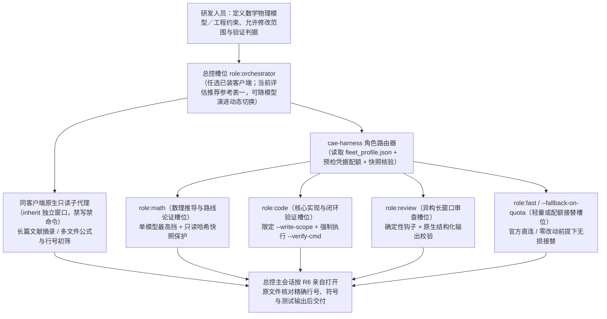

# 面向科学计算与严谨工程研发的多客户端元驱动治理与验证套件

本仓库（`Antigravity_Codex_ClaudeCode_DeepSeekHarness`）面向科学计算、CAE／CFD／FEA 数值求解器、计算几何／CAM 及高可靠系统软件研发，为本机已安装的官方 AI 编程客户端提供一套**“常驻机制层 + 动态评估快照层”分离**的全局工程规则、确定性生命周期钩子与跨端无头验证编排器。支持的对等客户端包括 **Google Antigravity（反重力，`agy`）**、**OpenAI Codex（`codex`）**、**Claude Code（`claude`／`cc`，配合 CC Switch 管理供应商卡片）** 以及 **DeepSeek Harness（`dsh`）**。

运行一次 `install.py` 后，资产按需写入宿主机各客户端全局配置目录（`~/.gemini/config/plugins/user-guard`、`~/.codex`、`~/.claude`、`~/.dsh`），日常打开 C++、Fortran、Rust 或 Python 课题项目即可直接生效，**无需向业务代码仓库拷入任何配置文件**。全仓仅依赖 Python 3.11+ 标准库，支持 Windows 与 WSL2／Linux。

---

## 一、设计动机、边界切分与软硬协同机制

### 1. 为什么要做这层“薄治理外层”，而绝不重造底层执行器？

对跨主机十余万次真实请求与近万份客户端会话轨迹的统计表明：各家官方 CLI 底层的文件补丁引擎与隐式前缀缓存已经非常成熟（实测前缀缓存命中率普遍达 `94%～98.7%`，直接决定包月订阅与 API 的可用吞吐），自己重写底层 Agent 循环既吃不到官方订阅缓存红利，又会在官方频繁改版中迅速腐化。

但单靠任何一家官方默认配置，在严谨的数值计算与复杂工程研发中仍会反复撞上五类结构性问题——这正是官方出于商业毛利（默认开启动态降档省算力）与生态锁定（不会替用户跨厂牌择优互审）不会替用户解决、必须由用户侧薄外层接管的边界：

| 真实研发中的高频失效模式 | 底层成因 | 本仓库的确定性治理方案（软契约 + 硬门禁） |
| :--- | :--- | :--- |
| **长对话压缩后丢失早期物理与数学契约** | 客户端上下文达到阈值自动压缩摘要后，首轮约定的无量纲参考量、法向指向、几何容差或接口不变量在摘要中丢失 | 生命周期钩子从本地会话轨迹增量提取历轮用户原话落盘；压缩恢复时强制注入原话路径，要求先核对原话与磁盘现状再继续（[AGENTS.md](template/user-guard/rules/AGENTS.md) `R9`） |
| **测试不过擅自放宽容差，或未跑验证即报完工** | 通用模型倾向于把 `rtol=1e-12` 改成 `1e-4`、删断言或只凭静态看代码宣称修复成功 | `R3.6` 严禁弱化容差与收敛阶判据；`cae-harness gate` 强制要求非空 `--verify-cmd` 并严格核验 `--write-scope` 白名单边界，未执行验证命令的回执显式标记 `verification_executed: false` |
| **默认挡位静默降智，或开启 `ultra` 引发派生死等** | 客户端 `auto` 路由会静默降级思考预算；而开启自动委派的 `ultra` 挡位在复杂任务中会派生上千次子代理轮询与空等超时 | 编排器默认锁定所选模型支持的**单模型非委派最高挡位**（`max`／`xhigh`／`high`），代码层硬过滤 `ultra` 与共享窗口复合路由 |
| **只读审查误改源码、越界污染项目外目录或协议断流** | 审查顺手改坏原文件、在仓库外乱建 `git worktree`，或经第三方 `Responses API` 转换反代触发 `HTTP 422` 工具调用 ID 断裂 | 原生只读子代理禁用写与命令工具；无头只读任务做前后文件哈希快照比对；`status_guard.py` 拦截项目外写入；`Claude Code` 仅走原生兼容 Anthropic Messages 的直连或本地透明路由 `router.py` |
| **模型换代导致规则写死腐化，或粗暴升级破坏科研环境** | 大模型每两三个月换代一次，把季节性模型名写死在规则和代码里会反复打补丁；原地跨次版本升级全局 Python 会搞崩 `jax`／`mpi4py` 编译扩展 | 建立**两层元驱动架构**与 [`fleet-evolve`](template/user-guard/skills/fleet-evolve/SKILL.md) 优缺点重算机制，并对全局工具链执行三级 ABI 耦合预警 |

### 2. 两层元驱动架构与四个用户拍板节点

为彻底消除“每次模型换代都要改规则、改 Python 分支”的耦合，全仓严格拆成两层：

1. **第一层：常驻机制层（跨代稳定，零模型名硬编码）**
   - **硬机制**：`install.py`、`cae_harness.py`、`fleet_state.py`、`ccswitch_admin.py`、五个生命周期钩子与离线测试集。所有代码只认识抽象角色槽位（`orchestrator`、`math`、`code`、`review`、`fast`）与客户端协议，**不硬编码任何季节性模型名**，也不把任一客户端永久焊死为总控。
   - **软机制**：[AGENTS.md](template/user-guard/rules/AGENTS.md)（`R0–R11`）、技能规程与“无头 `--clean-room` 新手盲读 -> 主控自然中文重写 -> 独立技术与脱敏核验”文档三步法。
2. **第二层：动态评估快照层（单点维护，双向寻优，拍板生效）**
   - 当前周期“哪个客户端担任总控、各角色配哪款模型与挡位、各自有什么致命短板、哪些平台因风控暂不启用”，**唯一**存放在机器可读清单 [fleet_profile.json](template/user-guard/skills/cae-harness/fleet_profile.json) 与本文第四章表一中。
   - 触发 `fleet-evolve` 重算时，同时检索长板与短板，且**优先排查致命短板**（过严封号风控、5 小时／7 天硬限流、协议转换丢包、子代理死等、高频压缩失忆）作为一票否决或隔离边界。
   - **四个必停用户拍板节点**：① 生成或变更推荐的 `客户端 × 模型 × 挡位` 表时（`fleet_state.py propose` 挂起待审）；② 向宿主机全局配置目录写入变更或切换主控时（`R4`）；③ 遇到系统级 Python／CUDA／WSL 跨大版本 ABI 强耦合升级时；④ 执行 `git push` 推送远端前。

---

## 二、前置准备与五分钟安装

### 1. 用户自理前提 vs. 仓库自动分发范围

- **用户自行准备的基础前提**：
  1. **网络连通**：访问海外官方服务所需的合规代理或 TUN 由用户自理；国内直连或纯内网环境可直接使用官方 `DeepSeek Harness`（`DSH`）或将 `Claude Code` 指向国内官方兼容接口（本仓库仅按需读取系统已有代理配置，**绝不内置任何第三方中转反代**）。
  2. **客户端与官方凭据**：至少安装四个客户端之一并完成官方登录或填写 API Key（如环境变量／`~/.dsh/.credentials.yaml` 中的官方 `DEEPSEEK_API_KEY`，或 CC Switch 卡片密钥）。`install.py` 与生命周期钩子不创建、不修改也不上传任何账号凭据；`cae-harness` 与本地 `router.py` 仅在本地按需只读读取已就绪凭据（`ccswitch_admin.py prepare-cards` 更新卡片模板时原样保留已有真实 Key）。
- **本仓库统一维护分发的内容**：`R0–R11` 常驻规则、[fleet_profile.json](template/user-guard/skills/cae-harness/fleet_profile.json) 评估快照、五类生命周期钩子、三个只读子代理、[`cae-harness`](template/user-guard/skills/cae-harness/SKILL.md)、[`fleet-evolve`](template/user-guard/skills/fleet-evolve/SKILL.md) 以及可选的 Claude Code 本地分流路由 `router.py`。

### 2. 按本机情况一键部署

用哪个客户端就装哪个，多客户端并存时默认 `--app auto` 自动识别配齐：

| 本机环境场景 | 推荐命令（Windows 用 `python`，WSL2／Linux 用 `python3`） | 实际写入的宿主机全局路径 |
| :--- | :--- | :--- |
| **仅用官方 DeepSeek，最快起步**（或内网直连） | `python -B install.py --app dsh` | 同步 `~/.dsh/AGENTS.md`（保留自定义尾段）与 `~/.dsh/skills/`，绝不触碰 `.credentials.yaml` |
| **仅用单个 Codex／Claude Code／Antigravity** | `python -B install.py --app codex`（或 `claude`／`antigravity`） | 仅写入对应全局目录（`~/.codex`、`~/.claude` 或 `~/.gemini/config/plugins/user-guard`） |
| **同时使用 Antigravity + Codex** | `python -B install.py --app both` | 对称同步两端的规则、只读子代理、钩子、评估清单与技能 |
| **多客户端完整协同** | `python -B install.py`（若启用 CC Switch 本地混合分流，加 `--with-cc-router --disable-ccswitch-prompts`） | 自动为本机已检出客户端同步配置，幂等无重复项 |

```sh
git clone https://github.com/Xinyu-Li-1997/Antigravity_Codex_ClaudeCode_DeepSeekHarness.git
cd Antigravity_Codex_ClaudeCode_DeepSeekHarness

# 1. 零写入探测双侧已安装客户端
python -B install.py --probe-apps

# 2. 空跑预览拟写入路径，确认无误后交互安装（直接运行 install.py 或平台封装脚本）
python -B install.py --dry-run --yes
python -B install.py                                                 # 通用交互安装（Windows 用 python，Linux/WSL 用 python3）
# powershell -NoProfile -ExecutionPolicy Bypass -File .\install.ps1  # Windows 等价封装脚本
# bash install.sh                                                    # WSL2 / Linux 等价封装脚本

# 3. 零写入对齐与工具链耦合体检（summary.all_aligned == true 即完全对齐）
python -B install.py --audit-upgrade
```

> **提醒开关与干净卸载**：如需关闭 Codex 或 Claude Code 的长对话提醒，执行 `python -B install.py --app codex --codex-handoff-mode off`（或 `--claude-handoff-mode off`）。如需卸载，删除对应全局目录下的 `user-guard` 插件目录或托管的 `hooks/`、`skills/cae-harness`、`skills/fleet-evolve` 目录，并移除 `~/.codex/hooks.json`、`~/.claude/settings.json` 中的托管钩子条目（或直接还原安装／切卡时自动生成的 `.bak-*` 备份文件，详见 [底层架构与钩子说明](docs/architecture-and-hooks.md)）。

### 3. 按角色槽位发起第一次跨端任务

安装后在聊天窗口直接用中文交办任务即可；若在终端直接调用 `cae-harness`，推荐优先使用**与具体模型换代解耦的角色槽位**（完整任务单模板见 [工程与求解器研发实战指南](docs/workflow-guide.md)）：

```sh
# 1. 查看本机已就绪后端与当前 fleet_profile.json 的角色路由映射（只读）
python -B template/user-guard/skills/cae-harness/scripts/cae_harness.py assess --caller auto

# 2. 按角色发起只读代码审查（role:review / role:code / role:fast 会自动解析到当前推荐且就绪的引擎）
python -B template/user-guard/skills/cae-harness/scripts/cae_harness.py task --caller auto \
  --engine role:review --kind review --target "<课题项目目录>" --task-file "<任务单.md>"

# 3. 按角色在白名单范围内修改源码，并强制运行定量验证脚本闭环
python -B template/user-guard/skills/cae-harness/scripts/cae_harness.py gate --caller auto \
  --worker role:code --tier max --fallback-on-quota --target "<课题项目目录>" \
  --task-file "<任务单.md>" --write-scope "src/**" --verify-cmd "pytest -q tests/test_core.py"
```

---

## 三、四端对等协作拓扑与核心概念

### 1. 对等角色槽位拓扑（总控与后台分工均可动态演进）

四个客户端在架构上完全对等：单装任一端均可独立担任主窗口，多端并存时按 [fleet_profile.json](template/user-guard/skills/cae-harness/fleet_profile.json) 中的角色槽位协同。**连总控（`orchestrator`）由谁担任也不是一成不变的**——当前评估推荐以反重力搭载 Google 旗舰模型作为通用总控，核心原因在于 Google 旗舰模型自然语言沟通最直白流畅（最说人话，极利于复杂需求对齐与方案权衡），且其旗舰额度原生包含在反重力订阅中、单独按量购买官方 API 过于昂贵；若未来其他客户端与模型组合在沟通准确度、长程稳定性与成本风控上综合占优，跑一次 `fleet-evolve` 经你拍板即可平滑切换。



### 2. 四个关键运行概念

- **单模型最高挡位（`--tier`）**：思考预算从低到高为 `low`、`medium`、`high`、`xhigh`、`max`。数理推导、核心编码与审查默认取模型支持的最高单模型非委派挡位（硬性跳过自动派生大量子代理轮询的 `ultra`）；仅在文字润色（防过度发挥放大结论）或明确要求省额度时降挡。
- **默认无头环境 vs. `--clean-room` 纯净盲读**：常规无头调用拥有全新空对话历史，但仍加载宿主全局规则、钩子与目标目录 `AGENTS.md`；而在只读 `task` 中传入 `--clean-room`（支持 `codex`、`claude`、`dsh`）时，会在临时目录剥离全部全局规则、钩子、技能与 `AGENTS.md`，用零预设空上下文检验文档对外部读者的真实可读性。
- **CC Switch 卡片与协议纯洁性**：CC Switch 仅用于管理 Claude Code 的供应商环境变量卡片（停用其旧提示词与旧技能同步）。连接国产官方模型时，一律选用**原生兼容 Anthropic Messages 协议**的官方接口或本仓透明分流器 `router.py`，避开易引发 `HTTP 422` 工具调用 ID 损坏与流截断的 `Responses API` 协议转换反代。
- **窗口声明值与压缩触发点的区别**：模型声明窗口（如 `872k` 或 `1M` token）不等于单条消息字符上限，也不等于客户端自动压缩点（如反重力约在二十余万 token 触发检查点压缩）。排查大型代码库时应限定目标范围或使用 `cae-harness audit` 自动分片送审。

---

## 四、两张核心参考表

表一为当前周期经本机实测与双向优缺点评估生成的快照（与 [fleet_profile.json](template/user-guard/skills/cae-harness/fleet_profile.json) 一一对应，变更须经用户拍板）；表二为不受模型换代影响的日常模糊表达与精确模块／角色调用对照表。

### 1. 表一：当前推荐客户端 × 模型 × 挡位评估快照表（双向优缺点与隔离边界）

| 角色槽位 | 当前推荐客户端与模型 | 锁定挡位与窗口 | 核心长板（能力上限依据） | 致命短板与硬隔离措施（一票否决／防护边界） |
| :--- | :--- | :--- | :--- | :--- |
| **通用总控**<br>`role:orchestrator` | **Antigravity** + **`Gemini 4 Carbon`**<br>*(角色非永久绑定，可重算切换)* | 单模型最高挡 **`high`**；标称 `1M` 窗口（避开共享窗口 `Orchestrator`） | Google 旗舰模型中文自然语言理解与直白沟通能力最强（最说人话），最适合需求澄清、架构取舍与总控汇报；旗舰配额原生绑定反重力订阅，单独按量购买官方 API 过贵 | **短板**：单会话在 `24 万～29 万` token 附近即触发自动检查点压缩，长对话易丢早期细节。<br>**隔离**：挂载 `R9` 用户原话落盘恢复钩子，重度推导与多文件改码分流至后台无头进程 |
| **同端并发初筛**<br>`readonly-*` | **当前客户端原生只读子代理** + **`inherit`** | 继承当前主会话模型，独占子上下文窗口 | 仅开放只读检索工具（禁写文件、禁跑命令），毫秒级拉起，适合多篇论文摘录与行号核对 | **短板**：与主窗口同属单一模型家族，存在同源盲区。<br>**隔离**：不替代跨厂牌独立审查；10+ 同构目录盘点改用 `run_workflow` |
| **数理推导与论证**<br>`role:math` | **Codex CLI** + **`GPT-6-Astra`**（`codex:math`） | 最高挡 **`max`** + 显式声明 **`872,000`** 窗口 | 长链条 PDE 离散推导、几何不变量证明、通量雅可比求导与边界相容性分析最严密；原生 CLI 前缀缓存命中率超 `98.5%`，复用订阅额度 | **短板**：多文件工程改写慢于编码模型；若误开 `ultra` 挡会触发上千次子代理派生与轮询超时。<br>**隔离**：代码层硬性过滤 `ultra`，锁定单模型 `max` 并开启只读哈希快照比对 |
| **核心编码与验证**<br>`role:code` | **Codex CLI** + **`GPT-6.1-Sol`**（`codex:code`） | 最高挡 **`max`** + **`872,000`** 窗口 | 核心算法实现、跨模块补丁收敛与带 `--verify-cmd` 自动闭环测试（`gate`）一次通过率最高 | **短板**：Windows 下对大型仓库做无范围全盘扫描时，PowerShell 子进程开销易导致 `900s` 超时。<br>**隔离**：派工须通过任务单与 `--write-scope` 明确限定读写目录和必读行号 |
| **终端协作与异构审查**<br>`role:review` | **Claude Code CLI** 外壳 + **`Kimi K3.1 Pro`（`k3.1-pro[1m]`）+ `DeepSeek-V4.1-Flash`** | 交互 `effortLevel: "xhigh"`，无头传 **`max`**；配置 `1M` 窗口 | 复用 `Claude Code` 成熟的五类确定性钩子、原生 `--json-schema` 强约束与本地 `router.py` 主从分流，兼顾多步工具稳定性与低成本长窗口交叉复核 | **短板与排除项**：**在 Anthropic 解除过严的封号风控及 5 小时／7 天硬限流墙之前，暂不考虑接入 Claude 原生模型**；严禁走 `Responses API` 转换反代（防 `HTTP 422`）；无头只读固定传 `--permission-mode dontAsk` 规避 `auto` 分类器限流报错 |
| **直连起步与配额接替**<br>`role:fast`／备用 | **DeepSeek Harness CLI** + **`DeepSeek-V4-Pro`／`DeepSeek-V4.1-Flash`** | 默认任务 **`max`**，轻量快检 **`low`**；内置 **`1,048,576`** 窗口 | 零路由配置即可通过官方账号或 API Key 直连起步，单客户端即可独立工作，也可在其他端配额耗尽时经 `--fallback-on-quota` 无损接替 | **短板**：`dsh` 暂未开放客户端钩子与原生 `--json-schema` 参数，偶发尾随停止标签或额外文本。<br>**隔离**：`cae_harness.py` 自动剥离尾随标签并注入单 JSON 输出强约束；轻量挡绝不静默替代核心审查 |

> **同代备选与退役拦截清单**（同步定义于 [fleet_profile.json](template/user-guard/skills/cae-harness/fleet_profile.json)）：Codex `GPT-6.1-Terra` 与反重力 `Gemini 4 Argon` 按同代主力系列识别；轻量系列（如 `Luna`、`Hydrogen`）仅在显式指定 `role:fast` 或用户要求省额度时选用；反重力目录中的旧 `Claude 4.6`、`GPT-OSS-120b` 等模型由 `--audit-upgrade` 自动标记为退役待替换。参考文档：[OpenAI Codex Models](https://learn.chatgpt.com/docs/models)、[Antigravity Models](https://antigravity.google/docs/models)。

### 2. 表二：日常自然语言说法与精确角色／模块调用对照表

平时用日常中文提需求即可按角色自动路由；需要精确锁定动作、角色槽位或了解何时会停下请你拍板时对照下表：

| 目标事项 | 日常怎么说（自动选路） | 精确点名写法（与具体模型名解耦） | 执行边界与必停拍板条件 |
| :--- | :--- | :--- | :--- |
| **全套升级工具并重算推荐表** | “全面更新整套配置”“调研最新模型优缺点更新配置，顺带检查升级工具链” | **`fleet-evolve`**（默认 `full` 模式，或 `/fleet-evolve`） | 并发采集本机失误账本与外部致命短板；**生成新版推荐搭配表（`fleet_profile.json`）、写入宿主机全局目录（`R4`）、遇到 Python／WSL 跨大版本 ABI 耦合升级、以及最终 `git push` 时均硬性停下请用户拍板** |
| **仅做只读体检与耦合审计** | “只检查双侧配置、模型和 Python／WSL 有没有漂移或冲突，别改文件” | **`fleet-evolve audit`** 或 **`install.py --audit-upgrade`** | 全程零写盘：输出双侧文件漂移、凭据缺口、CC Switch 残留及全局科学计算编译包耦合警告 |
| **整仓清淤与文档三步重写** | “全量优化仓库代码和文档可读性，去掉生硬套话并做技术与脱敏验收” | **`fleet-evolve hygiene`** | 并发排查死代码与越界漏洞；经 `--clean-room` 新手盲读挑刺 -> 主控重写平实工程中文 -> `readonly-auditor` 核对行号与脱敏，跑通六模式沙箱与全量单测 |
| **首次部署本机或同步 WSL** | “帮我配置这台电脑”“把 WSL 那边也配好” | 按根 **`AGENTS.md` 执行 `install.py`**（`--probe-apps`／`--dry-run`／`--with-cc-router`） | 先零写入探测，再展示 `--dry-run` 拟写路径与尾段保留策略，**获用户 `R4` 批准后落盘** |
| **文献通读或报告逐行验真** | “读完这几篇论文摘出控制方程”“逐行核对汇报里的行号与源码是否一致” | 原生子代理 **`readonly-reader`**、**`readonly-collaborator`**、**`readonly-auditor`**；10+ 目录盘点用 **`run_workflow`** | 当前客户端内独立窗口严格只读，返回精确路径与行号交主会话复核 |
| **推导离散格式与数学不变量** | “推导这套分裂格式守恒性／刀轨曲率连续性条件并给适用边界” | **`cae-harness task --kind math --engine role:math`** | 自动路由至当前就绪的数理推导主力引擎（单模型最高挡 + 只读文件哈希快照保护） |
| **编写核心算法并强制跑测试** | “实现这个算子／几何求交模块，跑通守恒与收敛阶测试再交付” | **`cae-harness gate --worker role:code`**（配 `--write-scope` 与 `--verify-cmd`） | 限定白名单写文件并强制执行 `--verify-cmd`，严禁放宽 `rtol`／`atol` 或删改断言 |
| **目录分片审查或纯净盲读** | “把 `src/` 全面审一遍查越界漏项”“按新手视角盲读这份 README” | **`cae-harness audit`** 或 **`cae-harness task --kind review --engine role:review`**（盲读加 **`--clean-room`**） | 大目录自动分片只读送审；`--clean-room` 剥离全部全局规则、钩子与技能做零预设审阅 |
| **切换或核查 Claude 供应商卡片** | “看看 CC 当前用的哪张卡”“切到本地混合路由卡” | **`ccswitch_admin.py status`** 或 **`ccswitch_admin.py switch-card "<卡片名>"`** | 在线备份 `cc-switch.db` 与 `settings.json`，仅投影模型与密钥，完整保留五类钩子与推理挡位 |
| **文字润色、省额度或配额接替** | “润色这段说明别扩大结论”“这轮只做简单快检省点额度”“没额度自动换客户端” | 润色 **`--kind polish`**；省额度 **`--engine role:fast`**；配额接替 **`--fallback-on-quota`** | 润色用 `medium`／`high` 防无声放大；配额耗尽且工作区零改动时自动切往下一就绪客户端 |

---

## 五、`install.py` 参数速查与仓库结构

| `install.py` 参数 | 功能说明 |
| :--- | :--- |
| `--app auto/all/both/antigravity/codex/claude/dsh` | 指定部署客户端范围（默认 `auto` 自动适配本机已安装客户端） |
| `--probe-apps`／`--audit-upgrade` | 前者零写入探测双侧客户端；后者零写入核查配置漂移、模型对齐、CC Switch 状态与工具链 ABI 耦合 |
| `--dry-run`／`--yes` | `--dry-run` 仅预览变更计划零写盘；`--yes` 跳过命令行交互确认（用于对话中已获用户批准后） |
| `--sync-model-defaults`／`--no-model-config` | 前者按 `fleet_profile.json` 显式刷新默认模型与最高单模型挡位（默认安装仅补缺不覆盖）；后者跳过模型配置 |
| `--codex-handoff-mode`／`--claude-handoff-mode` | 设置 Codex／Claude Code 长会话交接模式（`advisory`、`enforce`、`off`，默认 `advisory`） |
| `--with-cc-router` | 同步 Claude Code 本地透明分流器 `router.py` 与卡片管理工具 `ccswitch_admin.py` |
| `--disable-ccswitch-prompts`／`--purge-ccswitch-legacy` | 在线备份 `cc-switch.db` 后停用或归档清空 CC Switch 内已退役的提示词与技能记录 |
| `--target-dir`／`--codex-home`／`--claude-home`／`--dsh-home` | 显式指定目标根目录（供隔离沙箱回归测试使用） |
| `--no-zotero`／`--skip-test` | 跳过可选 `zotero-mcp` 配置／跳过安装末尾的快速回归自检 |

延伸文档：[工程与求解器研发实战指南](docs/workflow-guide.md)、[底层架构、生命周期钩子与实测数据说明](docs/architecture-and-hooks.md)、[`cae-harness` 编排说明](template/user-guard/skills/cae-harness/SKILL.md)、[`fleet-evolve` 演进规程](template/user-guard/skills/fleet-evolve/SKILL.md)、[仓库维护指引](AGENTS.md)。

```text
Antigravity_Codex_ClaudeCode_DeepSeekHarness/
├── README.md                                 # 总览：设计动机、两层元驱动架构、五分钟部署与两张核心参考表
├── CHANGELOG.md                              # 版本演进、实测缺陷修复与架构升级记录
├── LICENSE / NOTICE                          # Apache License 2.0 许可证与第 4(d) 条署名声明
├── AGENTS.md                                 # 仓库自举维护、四端同步与必停拍板节点指引
├── install.py / install.ps1 / install.sh     # 纯标准库跨平台安装器与零写入升级／耦合审计工具
├── .github/workflows/ci.yml                  # Windows + Ubuntu 六模式沙箱部署与离线回归流水线
├── docs/
│   ├── workflow-guide.md                     # 工程与求解器研发实战指南（含角色化任务单模板与 L1–L4 验证分级）
│   └── architecture-and-hooks.md             # 底层架构：钩子协议、状态机门禁、本地分流与双机实测遥测摘要
├── template/
│   ├── user-guard/                           # Antigravity 原生插件模板及四端同源核心资产
│   │   ├── plugin.json / hooks.json / README.md / assets/logo.svg
│   │   ├── rules/AGENTS.md                   # 四端共用的 R0–R11 常驻全局规则（零模型名硬编码）
│   │   ├── hooks/                                # 五个确定性生命周期钩子（user_words / session_context_loader / status_guard / reply_repeat_guard / handoff_gate）
│   │   ├── agents/readonly-*.md              # Antigravity 三个 inherit 严格只读子代理
│   │   └── skills/
│   │       ├── cae-harness/                  # 角色路由编排器（SKILL.md + fleet_profile.json + cae_harness.py）
│   │       └── fleet-evolve/                 # 优缺点重算、非主控升级与清淤协议（SKILL.md + fleet_state.py）
│   ├── codex/                                # Codex 钩子模板与 read-only 只读子代理配置
│   └── claude/                               # Claude Code 钩子模板、只读子代理及 router/ 本地分流与切卡工具
└── tests/                                    # 安装器、钩子边界、无模型耦合角色路由、状态门禁与脱敏回归单测
```

---

## 六、English Overview & License

> **English Overview** — `Antigravity_Codex_ClaudeCode_DeepSeekHarness` provides a **two-layer meta-driven outer governance suite** across **Google Antigravity (`agy`)**, **OpenAI Codex (`codex`)**, **Claude Code (`claude` / `cc`, with CC Switch)**, and **DeepSeek Harness (`dsh`)** for **scientific computing, CAE / CFD / FEA numerical solvers, computational geometry / CAM, and high-reliability systems engineering**.
> - **Mechanism vs. Snapshot Decoupling**: Permanent rules (`R0–R11`), deterministic lifecycle hooks, and role-based orchestration scripts (`cae-harness`, `fleet-evolve`) contain **zero hardcoded seasonal model names** and **no permanent orchestrator lock-in**. Current client/model pairings, strengths, fatal defects, and vendor exclusions are isolated in a single evaluated manifest ([`fleet_profile.json`](template/user-guard/skills/cae-harness/fleet_profile.json)) gated by explicit user sign-off checkpoints.
> - **Pure Python 3.11+ Stdlib**: Runs natively on Windows and WSL2/Linux with zero third-party dependencies. Network connectivity, official client installation, OAuth login, and API keys remain user-managed prerequisites. Built-in rule templates are authored in Simplified Chinese.

本仓库仅调用用户通过官方渠道安装并自行配好凭据的客户端 CLI 与本地工具，不内置任何第三方反代中转、私有凭据或绕过官方权限与计费的逻辑。本项目采用 [Apache License 2.0](LICENSE) 开源许可，衍生分发须按协议第 4(d) 条完整保留根目录下的 [NOTICE](NOTICE) 原创归属声明（`Copyright 2026 Xinyu Li (Xinyu-Li-1997)`）。
