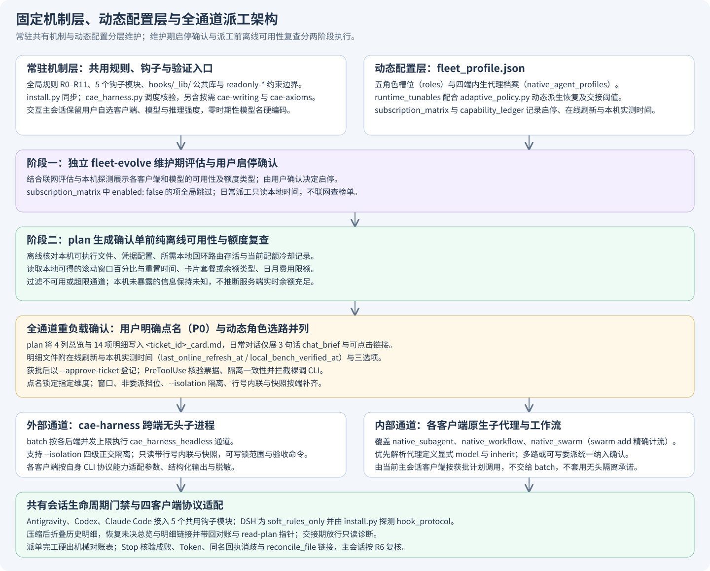

# 架构设计、共有生命周期钩子与上下文容量边界说明

本文供维护本仓库、排查门禁行为或审阅底层安全机制的工程师查阅。重点讲清六件事：模块分工与双工作区隔离、`fleet_profile.json` 动态配置结构、四阶段共有钩子在四个客户端上的协议适配、压缩双块恢复与交接接力、零黑名单词法事实锚定（`check-grounding`），以及单分片安全输入预算公式、脱敏、本地路由切卡与精确卸载。快速上手见 [仓库总说明](../README.md)，日常用法见 [日常工作流实战指南](workflow-guide.md)。



---

## 一、模块职责映射与双工作区隔离

全仓仅依赖 Python 3.11+ 标准库。所有会话钩子都是事件触发的短生命周期子进程，读写 JSON 后立即退出，平时不常驻内存；唯一可选后台进程是 Claude Code 本地回环协议分流器 `router.py`（仅绑定 `127.0.0.1`、`::1` 或 `localhost`，健康检查接口只代表本地进程存活，不代表服务端余额充足）。

| 模块与路径 | 适用工作区 | 核心职责与确定性边界 |
| --- | --- | --- |
| [rules/AGENTS.md](../template/user-guard/rules/AGENTS.md) | 通用 + 上游 | `R0–R11` 全局工程规则唯一来源；坚持“纠错优先下沉为机械守卫、已守住条文及时减薄”，零时期性模型名，安装时保留末尾用户自定义尾段 |
| [fleet_profile.json](../template/user-guard/skills/cae-harness/fleet_profile.json) | 通用 + 上游 | 单点动态配置源：维护五角色 `roles`、四端 `native_agent_profiles`、定量阈值 `runtime_tunables`、启停开关 `subscription_matrix` 与离线刷新时间 `capability_ledger` |
| [cae_harness.py](../template/user-guard/skills/cae-harness/scripts/cae_harness.py) | 通用 + 上游 | 识别工作区与调用方；执行 P0 点名锁定、五角色与风险分层选挡（`role:review` 常规走推荐挡、命中高危词升 `max`）、审查阻断/建议分级提示、`--isolation` 四级隔离、分后端只读内联上限与大目录对称元数据快快照（`stat:`）、默认持久化会话（`dsh` 独立 `headless-sessions`）与 `followup` 超时降挡续查、双层超时抢救（独立 `result_wrapup.json` 与 `agy` 后台活跃回合短路）、`--files`/`wave` 波次编排、`citation_audit` 行号核验、`<ticket_id>_card.md` 落盘与 `check-grounding` 事实锚定 |
| [user_words.py](../template/user-guard/hooks/user_words.py) | 通用 + 上游 | 四个钩子共用的基础库（底层委托 `hooks/_lib/`）：跨平台文件锁、原子写、配置读取、三端轨迹去噪与实质子代理摘要提取（含 `timeout_salvage`）、历史确认单折叠（`collapse_historical_cards`）及票据与回执账单存取 |
| `hooks/_lib/`（`fs_safety.py`、`shell_lex.py`、`adaptive_policy.py`、`process_guard.py`） | 通用 + 上游 | 底层安全锁与重解析点防御原子写（`fs_safety.py`）、Shell 词法拆壳（`shell_lex.py`）、按 `(client, model, effort)` 派生恢复与交接阈值的自适应策略（`adaptive_policy.py`），以及钩子入口墙钟自毁护栏（Windows 仅墙钟，POSIX 按条件附加 `RLIMIT_AS` 虚拟地址空间上限）与防分页环境（`process_guard.py`） |
| [session_context_loader.py](../template/user-guard/hooks/session_context_loader.py) | 通用 + 上游 | 压缩或恢复入口：普通回合零字节注入；压缩恢复时分块补回“历轮原话 + 实质子代理与抢救摘要”以及“磁盘未决票据精简总览与明细链接” |
| [status_guard.py](../template/user-guard/hooks/status_guard.py) | 通用 + 上游 | 工具执行前门禁：静态解析文件工具、Shell 包装与内联 Python AST，拦截项目外越界写删与外部 `git worktree`（支持同会话已批外部目录续租）、拦截空转读日志和绕过调度器裸调无头 CLI，核验 `APPROVED` 票据（含 `followup`、`--files` 计量、隔离一致性与 `swarm add` 并发流数） |
| [reply_repeat_guard.py](../template/user-guard/hooks/reply_repeat_guard.py) | 通用 + 上游 | 回合结束门禁（无头子进程 `CAE_HARNESS_DEPTH` 自动跳过）：拦截空等刷屏、同回合重复贴票与局部补测冒充全过，核验重负载完工成败词、Token 用量（兼容 Markdown 表格账单与 `cli_partial_on_timeout`）及流标识、回执文件名或轨迹词项 |
| [handoff_gate.py](../template/user-guard/hooks/handoff_gate.py) | 通用 + 上游 | 长会话分级交接门禁：追踪压缩次数、轨迹体积与读图字节数，在 `drain`/`freeze` 阶段限制新派工，核验【新对话提示词】内嵌精简总览卡、明细链接与 `plan --resume-ticket` 命令，防擅自将待拍板占位符填为已拍板 |
| [install.py](../install.py)、`install.ps1`、`install.sh` | 上游专属 | 校验非符号链接与非重解析点后幂等分发四端配置；提供零写入配置漂移、Windows/WSL2 `cross_side_status` 双端体检、DSH `hook_protocol` 探测、订阅候选汇总与科学计算包 ABI 耦合审计（`--audit-upgrade`） |
| [fleet_state.py](../template/user-guard/skills/fleet-evolve/scripts/fleet_state.py) | 上游专属 | 核验 `upstream_config_repo` 身份；维护提案审批锁（`propose`/`approve`）、主会话重启重入锁（`record-pass1`/`verify-pass2`）及终审 `clear --verified --readback-done` 事实锚定门禁 |
| [router.py](../template/claude/router/router.py)、[ccswitch_admin.py](../template/claude/router/ccswitch_admin.py) | 通用 + 上游 | 仅限回环绑定的 `/v1/messages` 前缀分流（向非回环上游注入真实卡片密钥时强制 HTTPS，日志仅记单行脱敏元数据与错误类型名，支持 `chunked` 与 401/403 密钥缓存失效）及 CC Switch SQLite 在线热备份安全切卡 |

`workspace_mode` 依据工作区或父目录是否同时存在 `install.py` 与 `template/user-guard/plugin.json` 区分 `upstream_config_repo` 与 `general_project`。独立安装的 `fleet_state.py` 在通用课题目录未指定 `--repo` 调用时直接返回 `not_upstream_config_repo`（退出码 `2`）。

---

## 二、两阶段可用性检查与 `fleet_profile.json` 动态配置结构

可用性核查拆成互不干扰的两道门：
1. **维护期联网评估与启停（`fleet-evolve`）**：联网核查官方更新与本机条件，由用户拍板决定启停并写入 `subscription_matrix`（`enabled: false` 全局跳过），刷新时间戳记入 `capability_ledger`。
2. **派工前纯离线复查（`cae_harness.py plan`）**：纯离线检查本机程序、凭据、本地路由健康、本地会话滚动窗口百分比、CC Switch 卡片限额及冷却记录，过滤不可用与超限通道；未暴露的服务端余额保持未知。

`fleet_profile.json` 将顶层能力档案与运行期阈值清晰分层（支持 `CAE_FLEET_PROFILE` 测试隔离覆盖）：

### 1. 顶层能力档案与启停矩阵

| 顶层键名 | 核心字段与职责 | 工程边界 |
| --- | --- | --- |
| `roles` | `orchestrator`、`math`、`code`、`review`、`fast` 候选列表、推荐挡位与短板隔离规则 | 五角色全动态，不与单一客户端永久绑定；用户点名按 P0 优先锁定；`review` 配合 `select_task_tier` 支持常规走推荐挡、高危词自动升 `max` |
| `native_agent_profiles` | `antigravity`、`codex`、`claude`、`dsh` 各自的主模型策略、原生子代理机制、只读代理列表与钩子协议 | 独立记录各端内生代理能力，与外部无头调度解耦；`--audit-upgrade` 上报 `fleet_profile.native_agent_profiles_configured` |
| `subscription_matrix` 与 `capability_ledger` | 客户端和模型的启停开关、额度类型及离线更新时间（`last_online_refresh_at`、`local_bench_verified_at`） | `enabled: false` 全局跳过；日常派工仅离线读取时间戳，不联网查榜 |

### 2. 运行期定量阈值（`runtime_tunables` 子分组）

| `runtime_tunables` 分组 | 核心键名 | 工程作用 |
| --- | --- | --- |
| `compaction_recovery` | `per_client.{antigravity,codex,claude}` 预算、`recent_subagent_window`、`min_substantive_subagent_chars`、`subagent_head_ratio` | 无条件保留最新一条子代理返回，其余名额优先保留达到实质长度且命中审查或推导角色的结论，并由 `adaptive_policy.py` 按窗口与推理强度缩放预算 |
| `handoff_thresholds` | `default_mode`、压缩次数、轨迹体积、读图阈值与 `drain` 收尾预算 | Antigravity 默认启用分段交接；Codex 与 Claude Code 默认 `advisory` 提醒 |
| `loop_guards` | `hook_safety`（`wall_timeout_sec` 墙钟上限与 POSIX 条件 `max_rss_mib` 上限）、`reply_repeat`、`status_guard`、`lifecycle_log` | 防止钩子进程异常卡死或 POSIX 地址空间失控，同时拦截空转轮询与重复等待短句 |
| `headless_dispatch` | `persist_sessions_by_default`、`soft_timeout_ratio`、`wrapup_min_sec`、`wrapup_max_sec`、`followup_default_effort`、`default_gate_max_rounds`、`inline_readonly_max_kib`、`agy_inline_readonly_max_kib`、`snapshot_ignored_dirs`、`batch_max_workers_per_backend` 等 | 控制默认持久化会话、软超时降挡紧凑收口（独立写 `result_wrapup.json`）、硬超时抢救、超时续接降挡、门禁收敛轮次上限、分后端只读内联与自适应文件快照 |
| `dispatch_confirmation` | 轻重任务分界（流数、文件数、Token、超时）、`ticket_ttl_sec` 与 `quota_block_percent` | 内部原生多路/可写子代理与外部无头调用共用同一套确认阈值 |

---

## 三、全通道确认票据与共有生命周期门禁的四端适配


### 1. 全通道 14 项明细落盘、`chat_brief` 极简确认条与 `PreToolUse` 票据门禁

`plan` 统一覆盖 `cae_harness_headless`、`native_subagent`、`native_workflow`、`native_swarm` 四类通道与 `--isolation` 四级正交隔离。`_save_plan` 先原子写入 `<ticket_id>.json`，再把完整背景、目标、后果、4 列总览和分路 14 项参数明细写入 `<ticket_id>_card.md`（字段定义见 [cae-harness 技能规程](../template/user-guard/skills/cae-harness/SKILL.md)），同时生成 3 句话确认条 `chat_brief`、精简总览卡 `compact_summary_card` 与交接片段 `compact_handoff_prompt_block`。聊天框只展 `chat_brief` 与明细链接，绝不贴长表刷屏。

批准并登记 `plan --approve-ticket`（登记前再次离线核验选路无漂移）后，`status_guard.py` 在 `PreToolUse` 执行四项检查：
1. **拦截裸调无头 CLI**：拆壳识别环境变量前缀、`cmd /c`、`powershell -EncodedCommand`（含最短唯一缩写）、`bash -lc`、`wsl`、`sudo`、`timeout` 等常见包装；
2. **核验外部重负载票据**：核对当前会话有效且未过期的 `APPROVED` 票据，严格校验 `--plan-dir`、`--isolation`、`--write-scope` 子集及可写流 `--verify-cmd` 一致性（`followup` 按原回执读写属性判定，可写续接强制持票，短只读续接不重扫全仓）；
3. **核验内部原生通道容量**：按回合快照核对票据中的原生通道名额（`_native_call_stream_weight` 对 `swarm add` 按 `tasks` 长度或 `n` 计流数）；
4. **缺省目标保底估算**：`task` 省略 `--target` 时按当前工作目录估算规模。

### 2. 共有门禁机制与四客户端事件协议映射

四个阶段门禁脚本加共用基础库 `user_words.py` 构成统一的确定性防护层，各客户端按自身事件协议接入：

| 共有防护阶段 | 对应脚本模块 | 核心确定性行为 |
| --- | --- | --- |
| **会话恢复与调用前** | `session_context_loader.py` + `handoff_gate.py` | 无新压缩时零字节注入；压缩恢复时分块还原“历轮原话 + 实质子代理摘要”与“磁盘未决票据精简总览及 `<ticket_id>_card.md` 链接”，并更新交接阶段 |
| **新指令提交时** | `handoff_gate.py`（Antigravity 在 `PreInvocation` 对账轨迹控制步） | 依据用户短而明确的指令更新交接请求或暂缓宽限期，长文引用不误触 |
| **工具执行前** | `status_guard.py` + `handoff_gate.py` | 守卫项目外写边界与同会话外部目录批准租约，拦截日志空转轮询与裸调 CLI，核验批准票据与强制交接限制（放行 `check-grounding --strict` 等只读收尾检查） |
| **回合结束时** | `reply_repeat_guard.py` + `handoff_gate.py` | 拦截空等短句、重复刷票与局部补测冒充全过，核验完工成败词、Token 与回执词项；强制交接时优先核验【新对话提示词】内的精简 4 列总览、明细链接与 `plan --resume-ticket` 命令 |

四个客户端的挂载方式与协议边界如下：

| 客户端 | 全局目录与宿主协议适配 |
| --- | --- |
| **Antigravity** (`agy`) | 同步至 `~/.gemini/config/plugins/user-guard`；原生插件 `hooks.json` 注册 `SessionStart`、`PreInvocation`、`PreToolUse`、`Stop` 四类事件并内部联动 `handoff_gate.py`；运行态写入宿主 `PLUGIN_DATA`，遇 `truncated_fields` 自动回查 `transcript_full.jsonl`；`--isolation` 拒绝 `hooks_only` 与 `clean_room` |
| **Codex** (`codex`) | 同步至 `~/.codex`；`hooks.json` 注册 `SessionStart`（匹配 `^(compact\|resume)$`）、`PostCompact`、`UserPromptSubmit`、`PreToolUse`、`Stop` 五类事件；钩子实质未变时不覆写文件以保留宿主信任记录；合并 `sessions/` 与 `archived_sessions/` 提取原话与子代理返回；完整支持全部四档 `--isolation` |
| **Claude Code** (`claude` / `cc`) | 同步至 `~/.claude`；向 `settings.json` 合并上述五类事件，默认随钩子同步 `hooks/ccswitch_admin.py`（`--no-claude-hooks` 跳过），可选 `--with-cc-router` 分发 `router/`；无头只读固定传 `--permission-mode dontAsk`，`clean_room` 同时启用 `--bare` 与 `--disable-slash-commands` |
| **DeepSeek Harness** (`dsh`) | 同步至 `~/.dsh/AGENTS.md` 与 `skills/`，不改 `.credentials.yaml`；当前 CLI 处于 `soft_rules_only`（`--audit-upgrade` 持续探测 `hook_protocol`、`hard_hooks_supported` 与 `meta_update_trigger`）；无头调用将日志隔离至 `headless-sessions` 避免与 `.jsonl.zstd` 冲突，自动适配新旧权限参数，`--isolation` 拒绝 `hooks_only` 并支持 `clean_room`，执行单 JSON 平衡解码与尾随 `DSML` 清洗 |

---

## 四、压缩双块恢复、零黑名单事实锚定与单分片预算公式

### 1. 压缩恢复与跨会话票据接力不变量

- **实质筛选与防二次截断**：在最近 `recent_subagent_window` 条已完成子代理返回中无条件保留最新一条，其余按实质字数、审查/推导角色关键词与时间序择优；归档写入与内联注入各自基于完整 `raw_body` 独立首尾截取（避免双重省略号），截断切中代码块时由 `_close_unbalanced_fence` 自动闭合围栏。
- **未决工作流独立分区（零幻觉）**：`collapse_historical_cards` 自动折叠历史 14 项长表；`render_pending_workflow_block` 独立于常规原话预算直接读取磁盘 `<ticket_id>.json`——明细文件 `<ticket_id>_card.md` 已落盘且为常规非链接文件时注入精简 4 列总览卡、明细链接与三选项（仅未落盘时回退 14 项表，缺项标 `未记录`）。`plan --resume-ticket` 在新会话离线重算可用性但保留原 `session_id` 不自动改绑，跨会话正式执行须重建绑定当前会话的票据。

### 2. 零黑名单文档事实锚定（`check-grounding`）

`audit_doc_grounding` 不维护人工违禁词表，而是扫描源码与配置（`fleet_profile.json`、`.py`、`.json`、`.toml`、`.yaml`、C++/Fortran/Rust 源码等）及 `NOTICE`——刻意跳过 `tests/` 与 Markdown 代理契约（`template/user-guard/agents/*.md`、`template/claude/agents/*.md`），对 Codex 代理 `.toml` 仅提键名，并将三端代理契约正文作为被审对象而非白名单——构建标识符、命令行选项、定量数值与双字技术词干集合，逐行拦截无代码依据的参数、文件名、陌生全大写缩写与失步数字。

`polish` 流自动附带 `grounding_audit`；上游 `fleet_state.py clear --verified --readback-done` 在状态锁内强制校验文档事实锚定，并对未过期活跃提案、活跃 `AWAITING_MASTER_RELOAD` Pass 2 重启锁及损坏状态文件默认拒绝清除（已认领 Pass 2 会话可显式传 `--session-id <sid>` 归位，其余覆盖须显式加 `--force`）。

### 3. 单分片安全输入预算公式（`_execution_budget`）

模型声明的可用上下文窗口（来自 `subscription_matrix.models` 或本地模型目录缓存）可能与底层原生 API 窗口或自动压缩触发上限（如 Claude 的 `client_catalog_rules.claude.auto_compact_window`）不同；当客户端在服务端或本地引擎侧限定更低活跃窗口时，`subscription_matrix.models` 按客户端实际生效的活跃窗口口径记录，避免分片与恢复缩放失真。

设 `runtime_tunables.headless_dispatch.input_budget_safety_ratio` 为安全系数 $\alpha$ ， $W_{\text{selec}\text{ted}}$ 为当前模型声明窗口， $p_{\text{eff}}$ 为本地目录声明的有效窗口百分比（缺省按 `100` 计）， $W_{\text{compact}}$ 为适用的自动压缩窗口上限，`cae_harness.py` 按下式动态计算单分片安全输入预算：

$$
W_{\text{eff}} = \left\lfloor W_{\text{selec}\text{ted}} \times \frac{p_{\text{eff}}}{100} \right\rfloor, \quad C_{\text{plan}} = \min(W_{\text{eff}}, \space W_{\text{compact}}), \quad B_{\text{input}} = \left\lfloor \alpha C_{\text{plan}} \right\rfloor
$$

客户端未输出整数窗口且未在配置声明的模型，回退使用 `runtime_tunables.headless_dispatch.unlisted_window_fallback_tokens` 保守预算。`plan` 对显式 `--files` 或单文件只读流复用同一 $B_{\text{input}}$ 与 $W_{\text{selec}\text{ted}}$ 阈值：超声明窗口报 `over_context_window` 并返回 `suggested_shards`（`--allow-over-budget` 可放行），超安全预算或内联上限则在明细与 `chat_brief` 预警。

---

## 五、规则同步细节、安全脱敏、本地路由切卡与清理卸载

1. **自定义尾段保留与冲突编号迁移**：Antigravity 独立装在 `plugins/user-guard`，不动 `~/.gemini/GEMINI.md`；Codex、Claude Code 与 DSH 的顶层规则文件完整同步至 `## 工具与运行环境`（含 `R10.`、`R11.`），自动保留其后的任意二级标题自定义段（跳过代码围栏，亦兼容标题不同的 `## 工具与...` 环境段），并将冲突的 `R10.`、`R11.` 改标为 `L1.`、`L2.`。`--audit-upgrade` 使用同一边界判等，不会误报漂移。
2. **全链路自动脱敏**：`install.py --audit-upgrade` 与 `cae_harness.py`（`--output` 默认脱敏、`--redact` 脱敏标准输出与异常出口）自动擦除 Windows/WSL/Linux 真实用户名路径、私网 IPv4/IPv6、API Key、`Bearer`/`Basic`/`sk-`/`ghp_`/`AIza`/`ya29.`/JWT/`AKIA`/`ASIA`/`hf_`/`glpat-`/PEM 私钥、带认证信息或查询参数的协议 URL 以及精确费用字段（`--audit-upgrade` 另脱敏自定义卡片 ID）。`router.py` 与 `user_words.py` 写本地日志前同样清洗凭据且不记录正文。
3. **本地分流代理与 CC Switch 安全切卡**：Claude Code 默认同步 `~/.claude/hooks/ccswitch_admin.py`，传 `--with-cc-router` 时另行同步 `~/.claude/router/`。常用命令如下（Windows PowerShell 用 `python -B -X utf8` 与反斜杠路径，WSL2 与 Linux Bash 改用 `python3 -B -X utf8` 并将 `\` 换为 `/`，两侧均保留双引号内的 `$HOME`）：
   ```powershell
   python -B -X utf8 "$HOME\.claude\hooks\ccswitch_admin.py" status
   python -B -X utf8 "$HOME\.claude\router\router.py" --config "$HOME\.claude\router\router.json"
   python -B -X utf8 "$HOME\.claude\hooks\ccswitch_admin.py" switch-card "<目标卡片名称>" --dry-run
   python -B -X utf8 "$HOME\.claude\hooks\ccswitch_admin.py" switch-card "<目标卡片名称>" --require-router-alive
   ```
   切换直连卡片可省略 `--require-router-alive`；真实切卡或清理 CC Switch 旧记录前，仅 `ccswitch_admin.py` 会自动生成 `.bak-before-*` 本地备份。
4. **交接模式切换与按文件名精确卸载**：
   - 关闭 Codex 或 Claude Code 长会话交接门禁可分别运行 `python -B -X utf8 install.py --app codex --codex-handoff-mode off` 或 `python -B -X utf8 install.py --app claude --claude-handoff-mode off`（保留其余三类钩子）。
   - `install.py` 采用原地幂等同步，不生成 `.bak-*`。完整卸载时请按托管文件名精确删除，**切勿整目录删掉 `hooks/` 误伤自建脚本**：移除 `~/.gemini/config/plugins/user-guard` 与 `~/.gemini/antigravity/plugin_data/user-guard`；在 `~/.codex/hooks/` 与 `~/.claude/hooks/` 中仅删除托管脚本 `user_words.py`、`session_context_loader.py`、`status_guard.py`、`reply_repeat_guard.py`、`handoff_gate.py`（Claude 含 `ccswitch_admin.py`）、`hooks/_lib/` 及不再使用的 `hooks/state/`、`hooks/logs/`；删除 `~/.codex/agents/` 与 `~/.claude/agents/` 下的 `readonly-*` 及三端 `skills/` 下的 `cae-harness`、`fleet-evolve`（和可选 `~/.claude/router/`）；从 `~/.codex/hooks.json` 与 `~/.claude/settings.json` 移除托管钩子项；最后对三端顶层规则文件，无自定义内容可直接删除，有自定义尾段则仅删去标准 `R0–R11` 至 `## 工具与运行环境` 章节。
