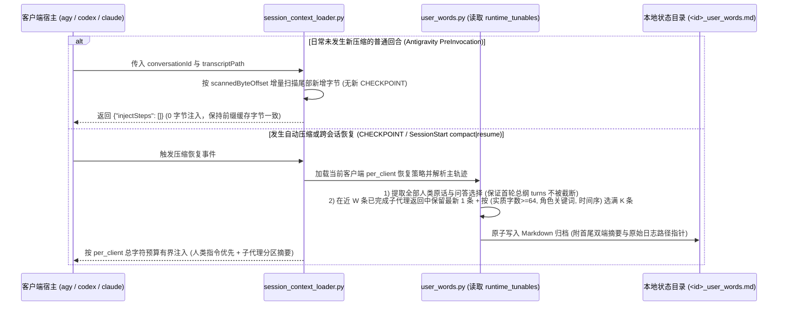

# 架构设计、动态参数整定与上下文容量边界说明

本文面向维护本仓库、排查钩子拦截行为或核查安全边界的工程师，逐层说明仓库各脚本模块的职责映射、`fleet_profile.json` 中 `runtime_tunables` 动态参数整定逻辑、压缩后“用户原话 + 高价值子代理返回摘要”双路恢复时序、零黑名单文档事实锚定机制（`check-grounding`）、四个客户端的挂载与隔离协议，以及单分片上下文预算公式与故障隔离依据。日常安装步骤与研发用法见 [仓库总说明](../README.md) 与 [工作流实战指南](workflow-guide.md)。

---

## 一、核心代码模块与双工作区职责映射

全仓代码仅依赖 Python 3.11+ 标准库。所有会话生命周期钩子均为宿主事件触发的短生命周期子进程（通过 `stdin`／`stdout` 传递 JSON，执行完毕立即退出），平时零后台驻留；仅可选启用的 Claude Code 本地透明分流脚本 `router.py` 为绑定 `127.0.0.1` 的轻量本地 HTTP 转发进程。

| 模块名称 | 仓库路径 | 适用工作区 | 核心职责与安全不变量 |
| :--- | :--- | :--- | :--- |
| **全动态评估与参数清单** | [fleet_profile.json](../template/user-guard/skills/cae-harness/fleet_profile.json) | 通用 + 上游 | 集中维护全部五个动态角色槽位（`orchestrator`、`math`、`code`、`review`、`fast`）候选顺序、实证优缺点隔离策略、客户端目录匹配规则以及 `runtime_tunables` 运行期定量参数 |
| **安装与 ABI 审计器** | [install.py](../install.py)、`install.ps1`、`install.sh` | 上游专属 | 探测 Windows 与 WSL2 客户端及 Python 3.11+ 解释器，校验非重解析点路径后幂等同步全局配置；提供零磁盘写入配置差异与全局科学计算包 ABI 耦合审计（`--audit-upgrade`） |
| **原话与子代理归档核** | [user_words.py](../template/user-guard/hooks/user_words.py) | 通用 + 上游 | 跨平台文件锁（`msvcrt`／`fcntl`）与原子写入；读取 `runtime_tunables.compaction_recovery`（按文件 `mtime_ns` 缓存），分区提取人类历轮原话与窗口内筛选出的实质子代理首尾摘要及日志指针 |
| **压缩恢复注入钩子** | [session_context_loader.py](../template/user-guard/hooks/session_context_loader.py) | 通用 + 上游 | 未发生新压缩时返回空对象（零额外 token 注入）；检测到新增 `CHECKPOINT`、`compact` 或 `resume` 时刷新归档，按当前客户端专属字符预算有界注入原话、实质子代理摘要与 `R9` 指引 |
| **写边界与防轮询钩子** | [status_guard.py](../template/user-guard/hooks/status_guard.py) | 通用 + 上游 | 静态解析文件工具、Shell 命令链与内联 Python AST，拦截未获批项目外写删及 `git worktree`；按 `loop_guards.status_guard` 阻止对未变化日志做同区间原地重复读取 |
| **防空等短句回复钩子** | [reply_repeat_guard.py](../template/user-guard/hooks/reply_repeat_guard.py) | 通用 + 上游 | 读取 `loop_guards.reply_repeat`，同一用户回合内连续达到阈值输出无新数值进展（如迭代步数或残差变化）的同质等待短句时触发单次拦截 |
| **长会话分段交接钩子** | [handoff_gate.py](../template/user-guard/hooks/handoff_gate.py) | 通用 + 上游 | 读取 `handoff_thresholds` 累计自动压缩次数、轨迹文件体积与读图字节数，按 `advisory`、`drain`、`freeze` 阶段限制新建后台任务并核验交接提示词完整性 |
| **动态路由、锚定与门禁** | [cae_harness.py](../template/user-guard/skills/cae-harness/scripts/cae_harness.py) | 通用 + 上游 | 识别 `workspace_mode`，对称解析五个动态角色槽位，执行凭据与运行侧配额冷却预检，启动无头子进程（含 `--clean-room`），提供 `check-grounding` 事实锚定核验并闭环运行 `--verify-cmd` |
| **审批与重入状态锁** | [fleet_state.py](../template/user-guard/skills/fleet-evolve/scripts/fleet_state.py) | 上游专属 | 校验 `upstream_config_repo` 工作区身份（通用课题目录直接以退出码 `2` 拦截）；维护推荐表审批锁（`propose`／`approve`）、主会话重启重入锁与终审 `audit_doc_grounding` 硬门禁 |
| **本地分流与卡片管理** | [router.py](../template/claude/router/router.py)、[ccswitch_admin.py](../template/claude/router/ccswitch_admin.py) | 通用 + 上游 | `router.py` 按 `headless_dispatch.router` 默认阈值与模型前缀将请求直通转发至兼容 Anthropic `/v1/messages` 的官方接口；`ccswitch_admin.py` 在线备份 SQLite 数据库并安全切换供应商卡片 |

---

## 二、`runtime_tunables` 动态整定与压缩后双路实质恢复

为避免在多个钩子与编排脚本中散落硬编码死数字，全仓定量运行阈值统一收口在 [fleet_profile.json](../template/user-guard/skills/cae-harness/fleet_profile.json) 的 `runtime_tunables` 下（支持环境变量 `CAE_FLEET_PROFILE` 离线覆盖，并在模块内保留单元测试属性打桩优先级）：

| 参数分组 | 核心受控键名 | 现阶段校准值与动态整定依据 |
| :--- | :--- | :--- |
| **`compaction_recovery`** | `per_client.{antigravity,codex,claude}`、`min_substantive_subagent_chars`、`subagent_head_ratio` | Antigravity 单会话约在 `200k–260k` token 较早生成 `CHECKPOINT`，校准为总内联 `7,600` 字符（子代理区上限 `1,400` 字符、单条 `280` 字符、候选窗口 `12` 条中选 `4` 条）；Codex 与 Claude Code 可用压缩前窗口更大，校准为总内联 `8,000` 字符（子代理区上限 `1,700` 字符、单条 `320` 字符、候选窗口 `15` 条中选 `5` 条）；实质内容字数下限 `64` 字符，首部截取占比 `0.58` |
| **`handoff_thresholds`** | `antigravity.{advisory_cp_threshold,drain_cp_threshold,...}`、`{codex,claude}.default_mode` | Antigravity 累计 `11` 次压缩（或紧凑轨迹 `4 MiB`、读图 `50 MiB`）进入 `advisory`，达 `16` 次压缩（或紧凑轨迹 `6 MiB`、读图 `100 MiB`）进入 `drain`（`4` 轮调用／`8` 次动作收尾配额）与 `freeze`；Codex 与 Claude Code 默认 `advisory`、`compact_limit = 0` |
| **`loop_guards`** | `reply_repeat`、`status_guard`、`lifecycle_log` | 空等短句上限 `300` 字符、尾部扫描 `256 KiB`、文本相似度 `0.80`／核心词干相似度 `0.75`、连续等待上限 `3` 次；大日志采样阈值 `4 MiB`（首尾各采样 `1 MiB`）、工作流脚本上限 `1 MiB`；生命周期日志达 `2 MiB` 裁剪至 `1 MiB` |
| **`headless_dispatch`** | `input_budget_safety_ratio`、`default_shard_tokens`、`polish_short_*`、`router.*` | 分片安全系数 `0.90`、未声明窗口回退预算与默认分片上限 `120,000` token、默认超时 `600` 秒、`gate` 默认轮数 `3`、配额默认冷却 `3,600` 秒（最大跨度 `45` 天）、目录缓存有效期 `7` 天、`--clean-room` 内联快照上限 `256 KiB`、短篇润色分界（`3` 文件／`4,000` token／`2,500` 字符）；`router.py` 默认端口 `8240`、超时 `900` 秒、请求体上限 `64 MiB`、并发上限 `64`、密钥缓存 `60` 秒、WSL 代理缓存 `5` 秒 |

### 压缩后双路实质恢复时序与筛选算法

四项关键安全不变量：

1. **实质子代理筛选（`select_recent_subagent_returns`）**：仅按固定条数截取末尾返回时，连续几次简短状态确认会把前面几千字的 `readonly-auditor` 行号核查表挤出窗口。筛选器在最近 `recent_subagent_window` 条完成记录中**无条件保留最新一条返回**，其余名额按 `(是否达到 min_substantive_subagent_chars 或存在截断字段, 是否命中 auditor/collaborator/reader/review/math 关键词, 时间先后)` 排序选优，再恢复原始时间顺序输出。
2. **权威性严格分区（遵守 `R8` 与 `R6`）**：子代理摘要独立存放在 `subagent_returns` 字段与归档末尾附表，绝不混入人类权威指令列表 `words`；注入标题明确要求“采纳前须按 `R6` 核对原文件或子代理日志”。
3. **首尾双端截取与日志指针**：`summarize_subagent_return` 按 `subagent_head_ratio`（默认首部 `58%` + 尾部 `42%`）保留开篇覆盖范围与末尾缺陷结论表，并附上子代理原始日志路径（Antigravity `logAbsoluteUri`、Codex 子代理 `rollout-*.jsonl`、Claude Code `subagents/agent-<id>.jsonl`）。
4. **三端噪声过滤与无子代理兼容**：自动剔除系统消息、`/task-` 命令回执、`BROWSER_HOST_FACTS`、仅含 `agent_id` 的异步启动句柄、`isSidechain` 支线记录及 `is_error` 异常块；当会话未调用子代理时，归档格式与旧版字节完全一致。

---

## 三、零黑名单文档事实锚定机制（`check-grounding`）

大模型在文档重写或语言润色收尾阶段，容易顺着常见学科联想混入当前项目根本不存在的技术概念（例如向纯配置与偏微分方程验证仓库混入制造加工术语、未实现的命令行标志或与配置失步的容量数字）。若依赖人工维护违禁词黑名单，换一个课题领域就会立即失效。

为此，`cae_harness.py` 实现了通用的**零黑名单确定性事实锚定检查器（`audit_doc_grounding` / `cmd_check_grounding`）**：

1. **自动构建工作区事实锚点语料（`_build_grounding_anchor`）**：扫描目标工作区内的真实源码、配置文件（`.py`、`.json`、`.toml`、`.yaml`、`.c/.cpp/.f90/.rs` 等）、子代理契约与 `NOTICE`（排除待检文档自身与 `tests/`），提取四类确定性集合——词法标识符集合 `words`、命令行选项集合 `flags`、数值与派生单位集合 `numbers`（含字节与 `KiB`/`MiB`、窗口有效比例与分片安全预算的确定性换算值）以及中文双字技术词干集合 `cjk2`。
2. **五类无依据漂移逐行拦截（`_audit_single_doc_text`）**：
   - `ungrounded_identifier`：行内反引号引用的本仓脚本 `--<选项>` 参数或配置文件名在源码与仓库路径中均不存在；
   - `ungrounded_acronym`：正文出现的三字母及以上全大写领域缩写既不在基础计算机通用协议集中，也不在工作区锚点词集 `words` 中；
   - `ungrounded_number`：带 `token`、`字符`、`KiB`、`MiB`、`%` 等单位的定量数字在 `fleet_profile.json` 与源码常量中无对应依据；
   - `ungrounded_exemplar`：“例如／涵盖／面向……”及全角括注并列枚举中的领域短语，剥离通用修饰词后与工作区 `cjk2` 词干集合零交集；
   - `ungrounded_rewrite_addition`：在传入 `--base-ref` 或执行 `cae_harness.py task --kind polish` 时，对照改写前原稿额外拦截润色期间凭空新增的陌生并列技术短语。
3. **双重硬门禁挂载**：日常课题与上游仓库均可独立运行 `cae_harness.py check-grounding --target . --strict`（检出漂移返回退出码 `2`）；同时 `cae_harness.py task --kind polish` 自动在回执中生成 `grounding_audit`，`fleet_state.py clear --verified --readback-done` 在终审归位前强制调用 `audit_doc_grounding`，未通过时直接拒绝解锁。

---

## 四、四个客户端挂载协议、钩子矩阵与本地分流

`install.py` 在写入任何目标前逐级执行 `lstat` 重解析点检查，拒绝向外部符号链接或 Windows 目录联接（Junction）写入，并将托管钩子解释器统一固化为 `<python> -X utf8 -I -B`。

1. **Google Antigravity（`~/.gemini/config/plugins/user-guard`）**：通过 `plugin.json` 与 `hooks.json` 挂载 `SessionStart`、`PreInvocation`、`PreToolUse`、`Stop` 四个事件；运行期状态与滚动裁剪日志统一写入宿主注入的 `PLUGIN_DATA` 目录，插件代码目录保持纯只读。
2. **OpenAI Codex（`~/.codex`）**：同步 `~/.codex/hooks/` 并在 `hooks.json` 中挂载 `SessionStart`（匹配 `^(compact|resume)$`）、`PostCompact`、`UserPromptSubmit`、`PreToolUse`、`Stop` 五个事件；规范化比对钩子实质内容未变时不重写文件，保留客户端已缓存的 `trusted_hash` 信任指纹，并将 `config.toml` 收紧为 `sandbox_mode = "workspace-write"` 与 `approval_policy = "on-request"`。
3. **Claude Code（`~/.claude`）**：将五个生命周期钩子合并写入 `~/.claude/settings.json`（未配置 `effortLevel` 时按 `fleet_profile.json` 补默认值 `"xhigh"`）。只读无头任务固定附加 `--permission-mode dontAsk` 配合 `--tools Read,Grep,Glob`，避免 `auto` 权限模式请求额外安全分类器引发限流报错。
4. **DeepSeek Harness（`~/.dsh`）**：`install.py` 仅同步 `AGENTS.md`（保留末尾自定义 `## 工具与...` 段落）与 `skills/`，不读取也不修改 `.credentials.yaml` 原文件。`cae_harness.py` 无头调用时在系统临时目录生成一次性 `--patch` YAML 激活官方登录态或 `DEEPSEEK_API_KEY`，附加单 JSON 输出约束并剥离偶发尾随的 `</｜｜DSML｜｜...>` 停止标记。
5. **本地透明分流（`router.py`）、安全切卡（`ccswitch_admin.py`）与全局 ABI 审计**：`router.py` 仅绑定回环地址 `127.0.0.1`（WSL2 默认端口 `8241`），按模型前缀直通转发至原生兼容 `/v1/messages` 的官方接口；`ccswitch_admin.py` 在切卡前在线备份 `cc-switch.db` 与 `settings.json`，并在 WSL2 下检测透明代理（TUN）Fake-IP 段（`198.18.0.0/15`）直连异常；`install.py --audit-upgrade` 只读扫描全局 Python `site-packages` 中的 `jax`、`scipy`、`mpi4py`、`petsc4py`、`torch` 等编译扩展，在跨次版本升级前给出 ABI 耦合警告。

| 钩子脚本 | 触发阶段 | 静默放行条件 | 拦截或提醒条件（阈值读取 `runtime_tunables`） | 执行动作与异常容错 |
| :--- | :--- | :--- | :--- | :--- |
| `session_context_loader.py` | 启动／压缩后／调用前 | 无新增压缩检查点且无待补缺口 | 新增 `CHECKPOINT`、`compact` 或 `resume` | 落盘并按 `per_client` 预算注入原话与实质子代理摘要；锁超时或异常时记录日志安全放行 |
| `status_guard.py`（写边界） | 写文件或执行命令前 | 当前工作区根目录（含 WSL `/mnt/<drive>` 映射）、系统临时目录、客户端轨迹／制品目录、标准 `.cache` | 写文件、重定向、`git worktree add` 或内联 Python AST 写入目标越出白名单；或 Shell 嵌套超 `4` 层 | 交互式会话返回 `force_ask`／`ask`；后台无头子进程（`CAE_HARNESS_DEPTH >= 1`）直接返回 `deny` |
| `status_guard.py`（防轮询） | 读文件或只读检索前 | 首次读日志、文件大小或 `mtime_ns` 已更新，或翻页更换行号区间 | 连续第 `2` 次对大小、时间戳与内容指纹均未变化的日志读取相同行号区间 | 返回 `deny` 提示等待完成通知；大于 `large_file_threshold_mib` 的日志仅采样首尾计算指纹 |
| `reply_repeat_guard.py` | 单轮回复结束时 | 正常技术汇报、提请拍板，或含新迭代步数与新残差量级的进度报告 | 同一用户回合连续达到 `consecutive_wait_limit` 输出无新数值进展的短句等待 | 每回合最多拦截提醒 `1` 次，要求结束本轮等待系统事件唤醒 |
| `handoff_gate.py` | 压缩后／工具前／回合末 | Codex 与 Claude Code 默认 `advisory` 仅提醒；Antigravity 未达阈值前静默 | 达到 `handoff_thresholds` 设定的压缩次数、紧凑轨迹体积或读图总量阈值 | `drain`／`freeze` 期阻断新开子代理、`cae_harness` 及 `git push`；状态文件损坏时保守返回 `deny` |

---

## 五、单分片上下文预算公式与配额冷却脱敏

1. **前缀缓存命中保护**：全仓钩子与编排脚本绝不在系统提示词前缀拼入动态时间戳或随机请求号，且 `session_context_loader.py` 在普通未压缩回合保持零字节注入，保护服务端自动前缀缓存字节一致性。
2. **目录审查单分片安全输入预算公式（`cae_harness.py` `_execution_budget`）**：
   - 模型目录声明的最大窗口（如 `872k` 或 `1M` token）既不同于客户端出厂默认窗口（Codex 缓存中 `sol` 默认窗口为 `500k`、`astra` 默认窗口为 `272k`），也不同于单次标准输入字符上限（`1,048,576` 字符）及交互式自动压缩触发点。
   - 设 `runtime_tunables.headless_dispatch.input_budget_safety_ratio` 为 $\alpha$（当前校准 $\alpha = 0.90$），`cae-harness audit` 按下式确定单分片输入预算：
     $$W_{\text{eff}} = \left\lfloor W_{\text{selected}} \times \frac{p_{\text{eff}}}{100} \right\rfloor, \quad C_{\text{plan}} = \min\!\big(W_{\text{eff}},\, W_{\text{compact}}\big), \quad B_{\text{input}} = \left\lfloor \alpha \, C_{\text{plan}} \right\rfloor$$
   - 对应四个客户端的当前计算值：Codex 为 $\lfloor \lfloor 872000 \times 0.95 \rfloor \times 0.90 \rfloor = 745,560$ token；Claude Code 为 $\lfloor \min(1048576, 1000000) \times 0.90 \rfloor = 900,000$ token；DSH 为 $\lfloor 1048576 \times 0.90 \rfloor = 943,718$ token；Antigravity 因 `agy models` 不输出整数窗口字段，读取 `unlisted_window_fallback_tokens = 120,000` token（可由 `CAE_AGY_INPUT_BUDGET` 显式覆盖）。
3. **配额限流熔断与运行期脱敏**：`cae_harness.py` 识别订阅制客户端滚动窗口／周度限流报文（`5-hour ... limit`、`hit your session/weekly limit · resets 5pm`）与 API 余额不足报文，在 `quota_max_horizon_days` 范围内解析重置时刻（仅含裸钟点时按 `quota_default_cooldown_sec` 默认冷却），按运行侧（Windows 与 WSL2 独立计量）持久化冷却记录并返回退出码 `5`（`quota_exhausted`）；所有冷却详情、异常回执与 `--audit-upgrade` 输出在落盘和打印前均经过令牌、URL 参数及个人路径脱敏。
