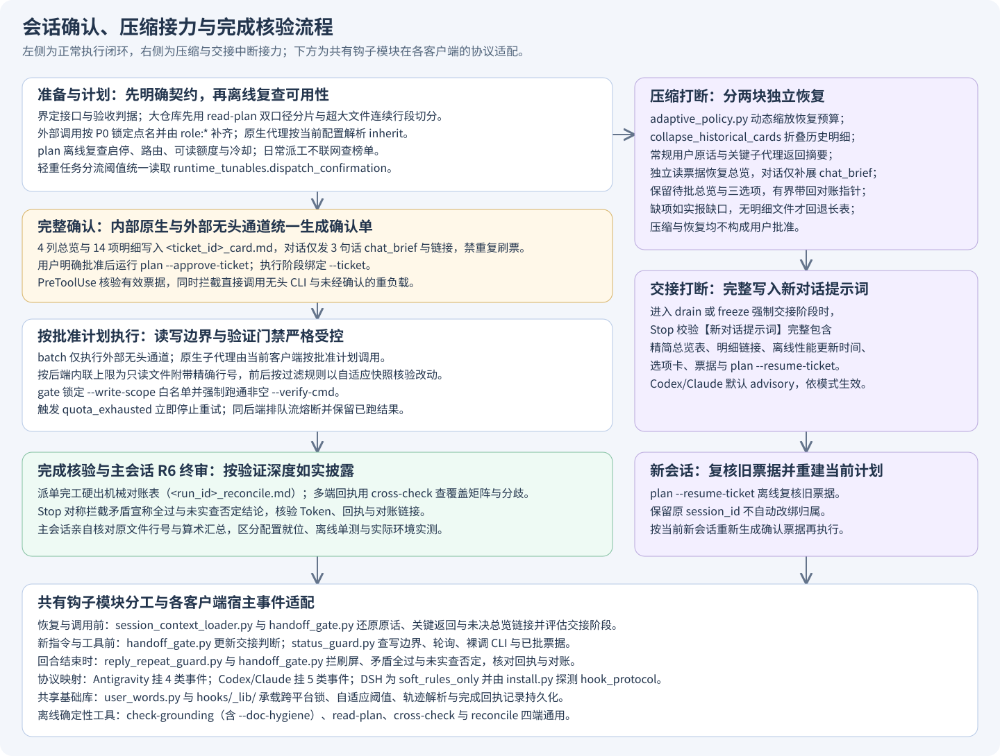
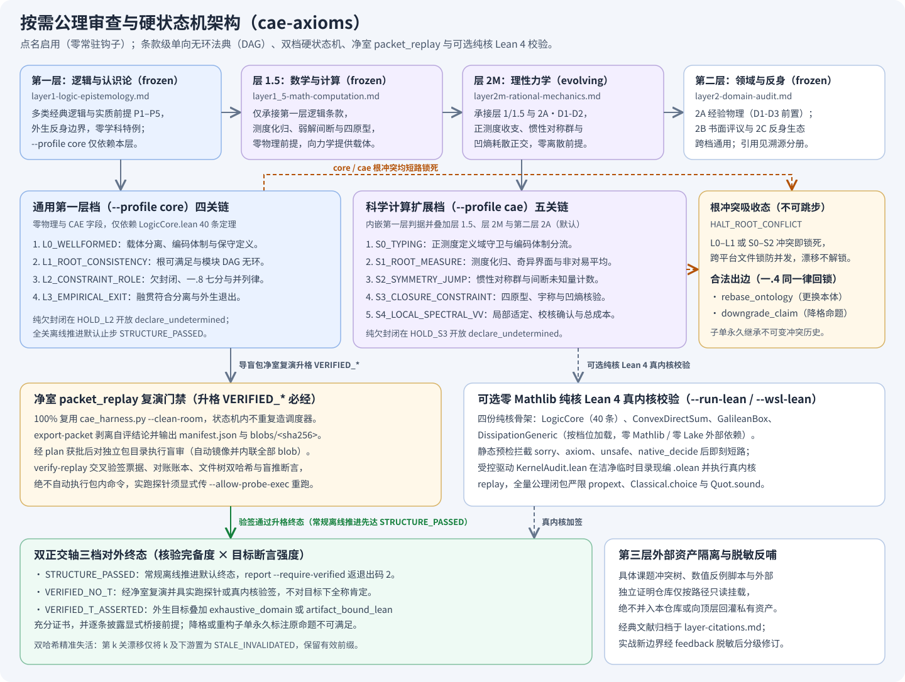

# 架构设计、共有生命周期钩子与运维参考

本文面向配置仓库维护者、安全审计人员与排查门禁行为的工程师，集中说明底层机制、配置键名、预算公式、上游维护与卸载步骤。入门说明见 [仓库总说明](../README.md)，日常用法与四客户端原生模式指南见 [日常工作流指南](workflow-guide.md)。


---

## 一、模块分工与双工作区隔离

全仓仅依赖 Python 3.11+ 标准库。所有会话钩子均通过单入口调度器 `uguard_hook.py` 以事件触发的短生命周期单进程运行，读写 JSON 后立即退出，不常驻内存；唯一可选常驻进程是 Claude Code 本地回环路由 `router.py`（仅绑定 `127.0.0.1`、`::1` 或 `localhost`，健康接口仅代表进程存活，不代表服务端余额充足）。

| 模块与路径 | 适用范围 | 核心职责 |
| --- | --- | --- |
| [rules/AGENTS.md](../template/user-guard/rules/AGENTS.md) | 通用 + 上游 | `R0–R11` 全局规则唯一模板；含 `@client` 条件裁剪块，安装时按宿主协议裁剪并保留用户自定义尾段 |
| [agents_spec.json](../template/_shared/agents_spec.json) | 上游真源 | 三端只读代理（`readonly-reader`、`readonly-auditor`、`readonly-collaborator`）的唯一语义源，分别映射为各端原生只读硬化格式 |
| [fleet_profile.json](../template/user-guard/skills/cae-harness/fleet_profile.json) | 通用 + 上游 | 公共动态配置源：维护 `roles`、`native_agent_profiles`、`runtime_tunables`、`client_capability_baselines`、`subscription_matrix` 与 `capability_ledger`；叠加不进 Git 的本机 `fleet_profile.local.json`（`hook_safety` 只紧不松） |
| [cae_harness.py](../template/user-guard/skills/cae-harness/scripts/cae_harness.py) 与 `scripts/_harness/` | 通用 + 上游 | 跨端无头调度与离线诊断总控：P0 点名锁定、角色选路与风险升挡、`--isolation` 四级隔离、持久化会话与超时抢救、`<ticket_id>_card.md` 落盘，以及 `check-grounding`、`read-plan`、`cross-check`、`reconcile` 四项离线工具 |
| [skills/cae-writing/](../template/user-guard/skills/cae-writing/SKILL.md) | 通用 | 按需学术写作与改稿技能：按体裁分册加载期刊论文、专著、报告与审稿回复指南，严守审稿保密伦理，零常驻钩子 |
| [skills/cae-axioms/](../template/user-guard/skills/cae-axioms/SKILL.md) | 通用 | 点名触发的公理审查与硬状态机技能：承载四层条款级单向公理分册与 [文献溯源](../template/user-guard/skills/cae-axioms/references/layer-citations.md)、双档状态机（`axiom_gate.py` 与 `_axiom_lib/`）、零 Mathlib 纯核 Lean 4 真内核驱动及净室 `packet_replay` 协议，零常驻钩子 |
| [uguard_hook.py](../template/user-guard/hooks/uguard_hook.py) | 通用 + 上游 | 四端统一单入口钩子调度器：按 `--client` 与 `--event` 懒加载串联下述四个钩子模块，单事件仅启 1 个 Python 进程，从运行时配置与 `handoff/policy.json` 读取交接策略以保持注册表命令字节恒定 |
| [user_words.py](../template/user-guard/hooks/user_words.py) 与 `hooks/_lib/` | 通用 + 上游 | 跨平台文件锁、原子写、三端轨迹去噪与双窗口回复归档、`fleet_profile.local.json` 覆盖层合并；`_lib/` 含 `fs_safety.py`、`shell_lex.py`、`adaptive_policy.py` 与 `process_guard.py` |
| [session_context_loader.py](../template/user-guard/hooks/session_context_loader.py) | 通用 + 上游 | 恢复与调用前门禁：普通回合零字节注入；压缩与手动 `/compact` 后分块补回原话、实质子代理摘要、未决票据总览与对账指针，并将手动 `/compact` 独立计数 |
| [status_guard.py](../template/user-guard/hooks/status_guard.py) | 通用 + 上游 | 工具执行前门禁：静态守卫 `R4` 写边界、同会话外部目录续租、只读代理与外部无头票据及裸调 CLI；放行同端只读多路子代理、用户显式原生斜杠编排与嵌套子代理，未指示可写原生多路走宿主 `ask` |
| [reply_repeat_guard.py](../template/user-guard/hooks/reply_repeat_guard.py) | 通用 + 上游 | 回合结束门禁（`CAE_HARNESS_DEPTH` 无头子进程跳过）：对外部无头 `run_id`/成败/Token/`reconcile_file` 账单、局部补测冒充全过、重复贴票与连续空等硬拦截；启发式实证门禁默认 `advisory` 并豁免 `.agents/`/`skills/`/`skill.md` |
| [handoff_gate.py](../template/user-guard/hooks/handoff_gate.py) | 通用 + 上游 | 长会话分级交接门禁：四端默认均为 `advisory`；剔除手动 `/compact` 抖动计数，`/goal` 激活期不启发式强杀（支持中英文取消口令），仅硬触发进入 `drain` 并放行 `browser_close`、查询/取消定时与 `swarm/plan.json` |
| [install.py](../install.py)、`install.ps1`、`install.sh` | 上游专属 | 校验非符号链接与非重解析点后按端裁剪分发三项课题技能与原生配置（`fleet-evolve` 仅留上游仓）；`--audit-upgrade` 输出四端四值 `capability_matrix` 与双轨信号 |
| [fleet_state.py](../template/user-guard/skills/fleet-evolve/scripts/fleet_state.py) | 上游专属 | 核验 `upstream_config_repo` 身份；管理提案审批锁（`propose`/`approve`）、全覆脚本/钩子/规则/代理模板的 `core_sha256` 校验锁与重启重入锁 |
| [router.py](../template/claude/router/router.py)、[ccswitch_admin.py](../template/claude/router/ccswitch_admin.py) | 通用 + 上游 | 本地回环 `/v1/messages` 前缀分流（非回环上游强制 HTTPS、脱敏日志、遇 401/403 刷新缓存）及带 SQLite 在线备份的 CC Switch 切卡 |

`workspace_mode` 依据工作区或父目录是否同时存在 `install.py` 与 `template/user-guard/plugin.json`，自动区分 `upstream_config_repo`（上游配置仓）与 `general_project`（通用课题仓）。独立运行的 `fleet_state.py` 在通用目录未传 `--repo` 时返回 `not_upstream_config_repo`（退出码 `2`）。

---

## 二、两阶段可用性检查与 `fleet_profile.json` 结构

可用性核查分为互不干扰的两个阶段：

1. **维护期联网评估（`fleet-evolve`）**：联网核对客户端与模型变化，消费 `--audit-upgrade` 产出的四端 `capability_matrix` 与 `evolution_signals`，经用户确认后写入 `subscription_matrix` 或本机 `fleet_profile.local.json`，刷新时间记入 `capability_ledger`。
2. **派工前纯离线复查（`cae_harness.py plan`）**：仅核查本机可执行文件、凭据、本地回环路由、本地会话滚动窗口百分比、CC Switch 卡片类型与配额冷却记录；未暴露的服务端余额如实标为未知。

`fleet_profile.json` 的顶层配置结构如下（单测可用 `CAE_FLEET_PROFILE` 与 `CAE_FLEET_PROFILE_LOCAL` 隔离覆盖）：

| 配置分区 | 核心键名 | 工程作用 |
| --- | --- | --- |
| `roles` | `orchestrator`、`math`、`code`、`review`、`fast` 候选、推荐挡位与短板隔离 | 动态配置五个角色，散文不再重复硬编码窗口数字，统一引用 schema 键 |
| `native_agent_profiles` | 四端主模型策略、原生模式清单 `native_modes`、只读代理与钩子协议 | 独立描述各端内生代理能力，区分 DSH 的 `no_lifecycle_hooks` 与 `native_file_sandbox` |
| `client_capability_baselines` | `tested_cli_version`、`version_alert_policy`、`adapted_native_modes`、`probe_watch_signals`、`deferred_or_excluded_capabilities` | 常驻四端协议与模式基线，驱动 `--audit-upgrade` 只读探针与 `docs/workflow-guide.md` 漂移信号 |
| `subscription_matrix` 与 `capability_ledger` | 客户端及模型启停开关、单一真相窗口、额度类型与刷新时间戳 | `enabled: false` 全局跳过；本机私有停用或选卡可在 `fleet_profile.local.json` 覆盖 |
| `runtime_tunables.compaction_recovery` | 四端 `per_client` 预算、`recent_subagent_window`、`min_substantive_subagent_chars`、`subagent_head_ratio` | 固定保留最新一条子代理返回，其余择优保留实质结论并按窗口与强度缩放 |
| `runtime_tunables.handoff_thresholds` | 四端 `default_mode`（均默认 `advisory`）、压缩次数、轨迹体积、读图阈值与收尾预算 | 统一四端默认提醒模式，支持用户按端显式切至 `enforce` 或 `off` |
| `runtime_tunables.loop_guards` | `hook_safety`（本机覆盖只紧不松）、`reply_repeat`（含 `evidence_gate_mode` 与 `native_bill_gate_mode`）、`status_guard`、`lifecycle_log` | 防止钩子卡死或内存失控，将确定性核验与启发式文本门禁分级解耦 |
| `runtime_tunables.headless_dispatch` | `persist_sessions_by_default`、`soft_timeout_ratio`、`wrapup_min_sec`、`followup_default_effort`、`default_gate_max_rounds`、分后端内联上限与并发上限 | 统一控制持久化会话、软超时降挡收口、硬超时抢救、续接降挡与快照过滤 |
| `runtime_tunables.dispatch_confirmation` | 流数、文件数、Token、超时分界、`ticket_ttl_sec`、`quota_block_percent` | 控制外部无头轻重任务分界与票据有效期 |

---

## 三、全通道确认票据与四阶段共有钩子



### 1. 跨端票据门禁与同端原生编排解耦

`cae_harness.py plan` 落盘 `<ticket_id>.json` 与 `<ticket_id>_card.md`，同时生成 3 句话 `chat_brief` 与精简交接片段。执行时 `status_guard.py` 分层执行四项检查：

1. **硬拦截裸调无头 CLI**：拆壳识别环境变量前缀、`cmd /c`、`powershell -EncodedCommand`、`bash -lc`、`wsl`、`sudo`、`timeout` 等包装，覆盖 `codex exec`、`claude -p`、`dsh --profile headless` 以及新版 `agy task`、`agy -p/--print/--prompt/--input-format stream-json`；
2. **硬核验外部重负载票据**：校验当前会话有效 `APPROVED` 票据的 `--plan-dir`、`--isolation`、`--write-scope` 子集及 `--verify-cmd` 一致性（`followup` 按原回执读写属性判定）；
3. **同端原生编排无摩擦共存**：同端只读原生子代理（含多路并行）、用户显式发起的原生斜杠编排（如 `/teamwork`、`/boost`、`/swarm`、`/plan`、`/grill-me`、`/browser`、`run_workflow`）及原生子代理会话（无人类 `USER_INPUT`）直接放行；模型未获指示擅自启动可写原生多代理时返回宿主 `ask` 确认；
4. **全程硬守卫工作区写边界**：所有主会话、原生编排与嵌套子代理均受 `R4` 写边界守卫，仅放宽非受管插件/边车目录的同会话续租，严禁未授权改动全局受管配置与项目外目录。

### 2. 单入口四阶段门禁与四客户端协议映射

| 防护阶段 | 对应入口与模块 | 核心确定性行为 |
| --- | --- | --- |
| **会话恢复与调用前** | `uguard_hook.py` -> `session_context_loader.py` + `handoff_gate.py` | 无新压缩时零字节注入；自动压缩与手动 `/compact` 均无损补回原话、实质子代理摘要、未决票据总览与对账指针 |
| **新指令提交时** | `uguard_hook.py` -> `handoff_gate.py`（Antigravity 在 `PreInvocation` 对账） | 识别简短明确的交接、暂缓或中英文 `/goal` 取消指令，长文引用不误触 |
| **工具执行前** | `uguard_hook.py` -> `status_guard.py` + `handoff_gate.py` | 守卫 `R4` 写边界与同会话续租、只读子代理、防空转轮询与外部票据，交互工作流放行工作区内动态路径 |
| **回合结束时** | `uguard_hook.py` -> `reply_repeat_guard.py` + `handoff_gate.py` | 对外部无头 `run_id`/成败/Token/`reconcile_file` 账单、测试失败谎报、重复贴票与连续空等硬拦截；启发式实证默认 `advisory` 并豁免 `.agents/`/`skills/`/`skill.md` |

| 客户端 | 全局目录与宿主事件适配 |
| --- | --- |
| **Antigravity** (`agy`) | 同步至 `~/.gemini/config/plugins/user-guard`（不含 `fleet-evolve`）；窄匹配 `PreToolUse` 跳过纯只读检索与 UI 工具，`hooks.json` 4 类事件统一调用 `uguard_hook.py`；默认 `advisory` 交接 |
| **Codex** (`codex`) | 同步至 `~/.codex`；`hooks.json` 5 类事件每事件 1 个字节恒定的 `uguard_hook.py` 进程，交接策略落盘 `hooks/state/handoff/policy.json` 保护 `[hooks.state]` 信任哈希；兼容 `default_permissions` 权限体 |
| **Claude Code** (`claude`) | 同步至 `~/.claude`；向 `settings.json` 合并 5 类单进程 `uguard_hook.py` 事件并同步 `ccswitch_admin.py`；只读代理硬化 `disallowedTools`、`permissionMode: dontAsk` 与 `maxTurns` |
| **DeepSeek Harness** (`dsh`) | 同步裁剪版 `~/.dsh/AGENTS.md` 与三项课题技能，不改动 `.credentials.yaml`；如实标明 `no_lifecycle_hooks` 与原生 `native_file_sandbox`，由 `--audit-upgrade` 只读探针持续追踪上游钩子演进 |

### 3. 压缩双块恢复与跨会话接力不变量

- **防二次截断与围栏闭合**：在最近 `recent_subagent_window` 条子代理返回中固定保留最新一条，归档与内联均基于完整 `raw_body` 独立截取；截断位置处于代码块内时，由 `_close_unbalanced_fence` 自动闭合围栏。
- **双压缩窗口助手回复归档**：三端恢复钩子经 `select_compaction_window_assistant_replies` 与 `save_assistant_replies_markdown` 仅提取两次压缩边界间的实质助手回复，独立写入 `<session_id>_assistant_replies.md` 并与用户原话清单物理隔离。系统注入仅附路径与标题索引；遇简短确认指令时提示先 `read_file` 核对完整方案。
- **未决工作流独立分区**：`collapse_historical_cards` 折叠历史长表；`render_pending_workflow_block` 独立于原话预算直接读取磁盘 `<ticket_id>.json`。`plan --resume-ticket` 保留原 `session_id` 且不自动改绑，跨会话执行须重建当前会话票据。

---

## 四、离线确定性核验工具与单分片预算公式

`cae_harness.py` 提供四项纯离线、零模型调用、四端通用的确定性工具：

### 1. 零黑名单事实锚定与文档卫生守卫（`check-grounding`）

- **词法事实锚定（`--strict`）**：扫描源码、配置、`.lean`、`.bib` 与 `NOTICE` 构建标识符、CLI 选项、定量数字与双字词干集合，覆盖 `.md`、`.tex`、`.rst` 与 `.svg` 文档，逐行拦截无代码依据的参数、文件名、陌生缩写与失步数字。
- **通用文档卫生守卫（`--doc-hygiene`）**：统一检查跨格式本地图件引用（`broken_local_media_ref`）与空壳定理（`unproved_theorem_shell`）。同时拦截 Markdown 计数失步（`count_structure_mismatch`）、补丁超长句与连续斜杠串（`runon_patch_sentence`、`slash_chain`）、跨 ≥ 3 份文档逐字复读（`cross_doc_duplication`）及入口页超体积、私有符号与高密度行话。

### 2. 读前分片、跨端核对与机械对账（`read-plan` / `cross-check` / `reconcile`）

- **`read-plan`**：同时按安全输入 Token 预算与真实带行号内联字节上限评估体积，超大文件按结构切分为带重叠连续行段，标记跨片边（`cross_shard_edges`）并输出保守波次清单与可选 `--emit-spec`。
- **`cross-check`**：基于计划分母输出分母 × 客户端覆盖矩阵、全端共同盲区（`shared_blind_spots`）、保留原文的严重度分歧（`severity_divergent`）及 `r6_source_check_list` 原文件行号清单。
- **`reconcile`**：支持手工运行与重负载完工自动触发，落盘至 `<plan_dir>/reconcile/<run_id>_reconcile.md`（不污染业务仓），按基线定界改动范围并列出强显式依赖 `pending_review` 与义务结算结果。

### 3. 单分片安全输入预算公式（`_execution_budget`）

`subscription_matrix.models` 按客户端实际生效的活跃窗口记录。设 `input_budget_safety_ratio` 为安全系数 $\alpha$ ， $W_{\text{selec}\text{ted}}$ 为声明窗口， $p_{\text{eff}}$ 为本地目录有效窗口百分比（缺省 `100`）， $W_{\text{compact}}$ 为适用的自动压缩上限，单分片安全输入预算按下式计算：

$$
W_{\text{eff}} = \left\lfloor W_{\text{selec}\text{ted}} \times \frac{p_{\text{eff}}}{100} \right\rfloor, \quad C_{\text{plan}} = \min(W_{\text{eff}}, \space W_{\text{compact}}), \quad B_{\text{input}} = \left\lfloor \alpha C_{\text{plan}} \right\rfloor
$$

未声明整数窗口的模型回退使用 `unlisted_window_fallback_tokens`。

---

## 五、上游维护、双轨体检码、脱敏、本地路由与精确卸载

### 1. 上游维护（`fleet-evolve`）与 `--audit-upgrade` 双轨建议码

上游 `fleet-evolve` 严守公理机器命题 $B'$：仅常驻只读四端四值探针与元配置提案/工程工单，硬禁自改主体代码层，审计结论封顶 `VERIFIED_NO_T`。`fleet_state.py` 的 `core_sha256` 校验锁覆盖全部脚本、钩子、规则与代理模板；涉及重启更新时，以 `record-pass1`、`verify-pass2` 及 `clear --verified --readback-done` 归位，终审拒绝清除未过期活跃提案、活跃 `AWAITING_MASTER_RELOAD` Pass 2 重启锁及损坏状态文件。

`install.py --audit-upgrade` 显式输出 `summary.evaluated_clients` 与 `summary.skipped_clients` 防空真，并将建议分为互不混扰的双轨：

- **运维阻断轨（`summary.recommended_actions`，决定 `summary.all_aligned`）**：
  - `sync_antigravity_plugin` / `sync_codex` / `sync_claude` / `sync_dsh`：模板或规则漂移、或目标仍残留旧版下发的 `skills/fleet-evolve`；
  - `refresh_codex_model_catalog`、`sync_codex_model_defaults`、`sync_claude_model_defaults`：刷新模型目录缓存或附 `--sync-model-defaults --skip-test` 补齐默认模型与挡位；
  - `fix_codex_package_isolation`：Codex 完整包混压于共享 `~/.local/` 根目录或存在逃逸符号链接，须迁至独立 `~/.local/share/codex-package/`；
  - `fix_antigravity_manifest`：`agy plugin validate --strict` 返回非零错误，须先修复插件清单；
  - `review_codex_hook_trust`、`review_ccswitch_schema`、`review_claude_router_primary`、`fix_claude_fallback_alias`、`start_cc_router`：分别对应 Codex 钩子信任槽位缺口、CC Switch 超基线 schema、路由主模型已停用、回退别名指向被排除厂商与本地路由未启动；
  - 若 `cross_side_status.dual_side_sync_required` 为 `true`，须在 Windows 与 WSL2 两侧分别同步。
- **演进信号轨（`summary.evolution_signals`，不影响日常 `all_aligned`）**：
  - `evolve_dsh_hard_hooks`：DSH CLI `--help` 检出生命周期钩子关键词（`detected_heuristic`），提示进入 `fleet-evolve` 立项评估；
  - `evolve_<client>_capabilities`：检测到未豁免新能力信号或主版本跃迁；
  - `update_mode_workflow_guide`：`docs/workflow-guide.md` 尚未覆盖 `client_capability_baselines` 登记的原生模式。

### 2. 自定义尾段保留与全链路自动脱敏

- **自定义规则保留**：Antigravity 安装于独立插件目录 `plugins/user-guard`，不修改 `~/.gemini/GEMINI.md`；其余三端更新至 `## 工具与运行环境`（含 `R10.`、`R11.`），自动保留其后任意二级自定义章节并将冲突编号迁移为 `L1.`、`L2.`。
- **全链路自动脱敏**：`install.py --audit-upgrade` 与 `cae_harness.py` 自动擦除用户主目录名、私网 IPv4/IPv6、API Key、带凭据或查询参数的 URL、常见令牌前缀与 PEM 私钥及精确费用字段；`router.py` 与 `user_words.py` 写日志前同样脱敏且不记录正文。

### 3. 本地回环路由与 CC Switch 安全切卡

Claude Code 默认同步 `~/.claude/hooks/ccswitch_admin.py`，传 `--with-cc-router` 时另同步 `~/.claude/router/`。常用命令如下（Windows 用 `python -B -X utf8` 与反斜杠，WSL2 与 Linux 改用 `python3 -B -X utf8` 与 `/`；两侧均保留双引号内的 `$HOME`）：

```powershell
python -B -X utf8 "$HOME\.claude\hooks\ccswitch_admin.py" status
python -B -X utf8 "$HOME\.claude\router\router.py" --config "$HOME\.claude\router\router.json"
python -B -X utf8 "$HOME\.claude\hooks\ccswitch_admin.py" switch-card "<目标卡片名称>" --dry-run
python -B -X utf8 "$HOME\.claude\hooks\ccswitch_admin.py" switch-card "<目标卡片名称>" --require-router-alive
```

切换直连卡片可省略 `--require-router-alive`；真实切卡或清理 CC Switch 旧记录前，由 `ccswitch_admin.py` 自动生成 `.bak-before-*` 本地备份。

### 4. 交接模式切换与按文件名精确卸载

- **切换或关闭 Codex / Claude Code 长会话交接门禁**（策略写入 `hooks/state/handoff/policy.json`，在 `advisory` 与 `enforce` 间切换不改变 `hooks.json` 命令串，保护 Codex 信任哈希）：
  ```powershell
  python -B -X utf8 install.py --app codex --codex-handoff-mode off
  python -B -X utf8 install.py --app claude --claude-handoff-mode off
  ```
- **按托管文件名精确卸载**（请勿删除整个 `hooks/` 目录以免误删自建脚本）：
  1. **Antigravity**：删除 `~/.gemini/config/plugins/user-guard` 与 `~/.gemini/antigravity/plugin_data/user-guard`。
  2. **Codex 与 Claude Code 托管钩子**：仅删除 `hooks/` 下托管脚本 `uguard_hook.py`、`user_words.py`、`session_context_loader.py`、`status_guard.py`、`reply_repeat_guard.py`、`handoff_gate.py`（Claude 含 `ccswitch_admin.py`）。同时按需清理 `hooks/_lib/` 及不再使用的 `hooks/state/` 与 `hooks/logs/`。
  3. **代理、技能与可选路由**：删除 `~/.codex/agents/` 与 `~/.claude/agents/` 下的 `readonly-*`，各端 `skills/` 下的 `cae-harness`、`cae-writing`、`cae-axioms`（及旧版残留的 `fleet-evolve`），以及可选的 `~/.claude/router/`。
  4. **宿主配置与规则文件**：从 `~/.codex/hooks.json` 与 `~/.claude/settings.json` 移除托管钩子项；三端顶层规则文件若无个人内容可直接删除，若有自定义尾段则仅删去标准 `R0–R11` 至 `## 工具与运行环境` 章节。

---

## 六、按需公理审查引擎与纯核 Lean 4 校验架构（`cae-axioms`）

[cae-axioms](../template/user-guard/skills/cae-axioms/SKILL.md) 复用本仓库零外部运行时依赖的工程基线，不挂载常驻会话钩子，也不重复实现模型客户端或调度器；所有模块纳入 `install.py` 四端镜像分发与 `fleet_state.py` `core_sha256` 完整性校验。



### 1. 模块边界与条款级单向无环法典

- **条款级单向无环图（DAG）**：四份公理分册严守 `第一层（零.1、零.3、一节、五.1）-> 层 1.5`、`第一层 + 层 1.5（一至二节）+ 2A·D1–D2 -> 层 2M -> 2A 审查规范`，`2B` 与 `2C` 跨档通用；经典文献溯源与外部仓库边界独立汇总于 [references/layer-citations.md](../template/user-guard/skills/cae-axioms/references/layer-citations.md)。
- **薄入口与标准库内部包 `_axiom_lib/`**：[axiom_gate.py](../template/user-guard/skills/cae-axioms/scripts/axiom_gate.py) 经重解析点校验后装载 `_axiom_lib/{contract,lean_gate,evidence,rules,case,replay}.py` 与真内核驱动 `KernelAudit.lean`，保证各子命令共用单一 Schema 与判定核。

### 2. 状态机安全不变量、双哈希失活与净室 `packet_replay`

- **单源严格 Schema 与前驱哈希链**：拒绝未知键、重复 JSON 键、布尔冒充整数与字符串真值强转；每次推进重算 `stage_digest` 与 `immutable_conflict_history` 哈希链并持跨平台文件锁写盘。
- **双哈希精准失活**：同时记录 `raw_sha256` 与 `\r\n -> \n` 归一化的 `normalized_sha256`，第 $k$ 关源码漂移仅精准将第 $k$ 关及下游置为 `STALE_INVALIDATED`；根冲突吸收态 `HALT_ROOT_CONFLICT` 绝不因文件漂移自动解锁。
- **净室复演与零自动命令执行边界**：`export-packet` 剥离主会话自评结论打包 `blobs`，`verify-replay` 交叉验签票据、对账账本、零改动净室回执与逐关盲推断言，且绝不自动执行复演包内任何命令（实跑探针须显式传 `--allow-probe-exec`）。

### 3. 纯核 Lean 4 反空真门禁与真内核重放

- **静态预检硬短路**：剥离注释后逐词法拦截 `sorry`、`sorryAx`、`admit`、`axiom`、`unsafe`、`partial`、`opaque`、`implemented_by`、`extern`、`csimp`、`initialize`、`run_cmd`、`native_decide` 与非法 `set_option`（仅独占行放行 `set_option autoImplicit false`），并核验零前提 `Nonempty` 见证。
- **受控真内核编译与重放（`--run-lean` / `--wsl-lean`）**：锁定 `KernelAudit.lean` SHA-256，在洁净临时目录与隔离 `LEAN_PATH` 中编译 `.olean` 并禁用初始化器执行 `Kernel.Environment.replay`。驱动逐常量核查全量 `collectAxioms` 闭包属于 `{propext, Classical.choice, Quot.sound}` 与 `LogicCore.lean` 40 条契约定理黄金签名。四份纯核骨架均零 Mathlib、零 Lake，Windows 与 WSL2 可独立校验。
