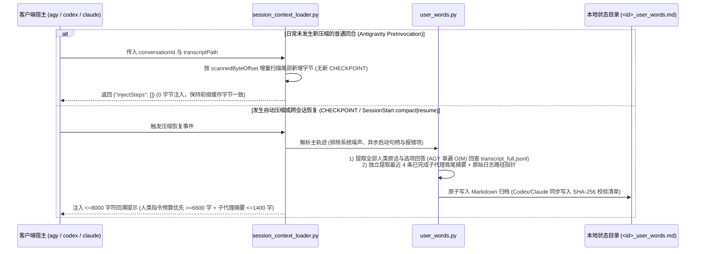

# 架构设计、生命周期钩子与上下文容量边界说明

本文面向维护本仓库、排查钩子拦截行为或核查安全边界的工程师，逐层说明仓库各脚本模块的职责映射、压缩后“用户原话 + 最近子代理返回摘要”双路恢复时序、四个客户端的挂载与隔离协议、钩子触发阈值与异常兜底机制、本地模型分流与工具链 ABI 检查，以及单分片上下文预算公式与故障隔离依据。日常安装步骤与研发用法见 [仓库总说明](../README.md) 与 [工作流实战指南](workflow-guide.md)。

---

## 一、核心代码模块与职责边界映射

全仓代码仅依赖 Python 3.11+ 标准库。所有会话生命周期钩子均为宿主事件触发的短生命周期子进程（通过 `stdin`／`stdout` 传递 JSON，执行完毕立即退出），平时零后台驻留；仅可选启用的 Claude Code 本地透明分流脚本 `router.py` 为绑定 `127.0.0.1` 的轻量本地 HTTP 转发进程。

| 模块名称 | 仓库路径 | 核心职责与安全不变量 |
| :--- | :--- | :--- |
| **模型评估配置清单** | [fleet_profile.json](../template/user-guard/skills/cae-harness/fleet_profile.json) | 集中维护五类抽象角色槽位（`orchestrator`、`math`、`code`、`review`、`fast`）候选顺序、实证优缺点与隔离措施、暂缓接入平台、客户端目录匹配规则及供应商卡片参数 |
| **安装与 ABI 审计器** | [install.py](../install.py)、`install.ps1`、`install.sh` | 探测 Windows 与 WSL2 客户端及 Python 3.11+ 解释器，校验非重解析点路径后幂等同步全局配置；提供零磁盘写入配置差异与系统级科学计算包 ABI 耦合审计（`--audit-upgrade`） |
| **原话与子代理归档核** | [user_words.py](../template/user-guard/hooks/user_words.py) | 跨平台文件锁（`msvcrt`／`fcntl`）与原子写入；解析 Antigravity、Codex、Claude Code 轨迹，分区提取人类历轮原话（含问答选择）与最近 `4` 次已完成子代理首尾摘要及原始日志指针 |
| **压缩恢复注入钩子** | [session_context_loader.py](../template/user-guard/hooks/session_context_loader.py) | 未发生新压缩时返回空对象（零额外 token 注入）；检测到新增 `CHECKPOINT`、`compact` 或 `resume` 时刷新磁盘归档，并在 `8,000` 字符总预算内注入原话摘要、子代理摘要与 `R9` 核对指引 |
| **写边界与防轮询钩子** | [status_guard.py](../template/user-guard/hooks/status_guard.py) | 静态解析文件工具、Shell 命令链与内联 Python AST，拦截未获批项目外写删及 `git worktree`；阻止对大小、时间戳与内容指纹均未变化的日志文件做同区间原地重复读取 |
| **防空等短句回复钩子** | [reply_repeat_guard.py](../template/user-guard/hooks/reply_repeat_guard.py) | 同一用户回合内连续 `3` 次输出不超过 `300` 字且无新数值进展（如迭代步数或残差变化）的同质等待短句时触发单次拦截，提示等待系统事件唤醒 |
| **长会话分段交接钩子** | [handoff_gate.py](../template/user-guard/hooks/handoff_gate.py) | 累计自动压缩次数、轨迹文件体积与读图字节数，按 `advisory`、`drain`、`freeze` 阶段限制新建后台任务并核验交接提示词完整性 |
| **角色路由与验证编排** | [cae_harness.py](../template/user-guard/skills/cae-harness/scripts/cae_harness.py) | 解析 `fleet_profile.json` 角色槽位，预检凭据、本地路由健康与运行侧配额冷却记录，启动独立无头子进程（含 `--clean-room` 盲读隔离），校验文件哈希快照并闭环运行 `--verify-cmd` |
| **审批与重入状态锁** | [fleet_state.py](../template/user-guard/skills/fleet-evolve/scripts/fleet_state.py) | 在宿主机本地状态目录维护推荐表审批锁（`propose`、`approve`）与主控端重启重入锁（`record-pass1`、`verify-pass2`），绑定核心文件 SHA-256 防篡改 |
| **本地分流与卡片管理** | [router.py](../template/claude/router/router.py)、[ccswitch_admin.py](../template/claude/router/ccswitch_admin.py) | `router.py` 按模型前缀（大小写不敏感）将主对话与子代理请求直通转发至兼容 Anthropic `/v1/messages` 的官方接口；`ccswitch_admin.py` 在线备份 SQLite 数据库并安全切换供应商卡片 |

---

## 二、压缩后双路恢复机制与前缀缓存零干扰设计

长对话触发上下文自动压缩后，若仅依赖模型生成的自由摘要，不仅首轮人类约定的物理量纲与容差红线容易丢失，**压缩前几次只读子代理刚查完的精确文件行号、边界公式或审查缺陷表也会只剩下子代理会话 ID**，导致压缩后重复派工或漏项。为此，`user_words.py` 与 `session_context_loader.py` 采用分区双路恢复机制：

四项关键安全边界：

1. **权威性严格分区（遵守 `R8` 与 `R6`）**：子代理返回摘要独立存放在 `subagent_returns` 字段与归档文件末尾的 `## 附：最近子代理返回摘要` 小节，绝不混入人类指令计数 `words`，也不会触发人类原话缺失告警；注入标题明确提示“采纳前须按 `R6` 核对原文件或子代理日志”。
2. **首尾双端摘要与原始日志指针**：子代理报告往往在开篇写明核查文件范围、在末尾给出缺陷汇总表与行号结论。`summarize_subagent_return` 采用首部约 `58%` + 尾部约 `42%` 的双端截取策略（归档单条上限 `1,200` 字符，内联单条上限 `280` 字符），并自动附上子代理原始日志路径（Antigravity `logAbsoluteUri`、Codex 子代理 `rollout-*.jsonl`、Claude Code `subagents/agent-<id>.jsonl`）供按需深查。
3. **三端噪声精准过滤**：Antigravity 过滤 `sender=system`、后台命令完成回执（`/task-`）与 `BROWSER_HOST_FACTS`；Codex 识别 `spawn_agent`／`wait_agent` 状态映射表，跳过仅含 `agent_id` 的异步启动句柄并在跨分段合并时按 `(call_id, agent_id, content_sha256)` 去重；Claude Code 跳过 `isSidechain` 支线记录、`async_launched` 启动回执及 `is_error: true` 异常块。
4. **严格有界预算与无子代理零差异兼容**：内联总长度硬上限为 `MAX_INLINE_TOTAL_CHARS = 8000`，其中子代理摘要区最多占用 `1,400` 字符，确保人类首轮立项总纲与最新定论始终保有至少 `6,600` 字符空间；当会话未调用子代理时，生成的归档正文与旧版字节完全一致，不触发多余重写。

---

## 三、四个客户端的挂载协议与 `--clean-room` 无头隔离

`install.py` 在写入任何目标前逐级执行 `lstat` 重解析点检查，拒绝向外部符号链接或 Windows 目录联接（Junction）写入，并将托管钩子解释器统一固化为 `<python> -X utf8 -I -B`。

1. **Google Antigravity（`~/.gemini/config/plugins/user-guard`）**：通过 `plugin.json` 与 `hooks.json` 挂载 `SessionStart`、`PreInvocation`、`PreToolUse`、`Stop` 四个事件；运行期状态与 `2 MiB` 自动滚动裁剪日志统一写入宿主注入的 `PLUGIN_DATA` 目录，插件代码目录保持纯只读。
2. **OpenAI Codex（`~/.codex`）**：同步 `~/.codex/hooks/` 并在 `hooks.json` 中挂载 `SessionStart`（匹配 `^(compact|resume)$`）、`PostCompact`、`UserPromptSubmit`、`PreToolUse`、`Stop` 五个事件；规范化比对钩子配置实质内容未变时不重写文件，避免破坏客户端已缓存的 `trusted_hash` 信任指纹。同时将 `config.toml` 收紧为 `sandbox_mode = "workspace-write"` 与 `approval_policy = "on-request"`。
3. **Claude Code（`~/.claude`）**：将五个生命周期钩子合并写入 `~/.claude/settings.json`（未配置 `effortLevel` 时补默认 `"xhigh"`）。常规无头调用 `claude -p` 继承全局规则、当前激活供应商卡片与钩子；**只读无头任务固定附加 `--permission-mode dontAsk`** 配合 `--tools Read,Grep,Glob`，避免 `auto` 权限模式额外请求安全分类器引发限流报错。
4. **DeepSeek Harness（`~/.dsh`）**：`install.py` 安装与 `--audit-upgrade` 检查时仅同步 `AGENTS.md`（保留末尾自定义 `## 工具与...` 段落）与 `skills/`，不读取也不修改 `.credentials.yaml` 原文件内容。`cae_harness.py` 后台无头调用时在系统临时目录生成一次性 `--patch` YAML 激活官方 `deepseek-account` 登录态或 `DEEPSEEK_API_KEY`（仅在本地从环境变量、`~/.dsh/.credentials.yaml` 或 `.env` 只读提取），自动附加单 JSON 对象输出约束，并在解析层剥离偶发尾随的 `</｜｜DSML｜｜...>` 内部停止标记。
5. **`--clean-room` 空上下文盲读隔离**：支持 `codex`、`claude`、`dsh` 的只读 `task`。脚本在系统临时目录构造仅含最小认证信息的隔离配置目录（`claude` 启用 `--bare` 与纯认证 `--settings`），并在只读工作区副本中剔除 `AGENTS.md` 与 `CLAUDE.md`（当 `codex` 只读副本不超过 `256 KiB` 时自动内联带行号源码快照以兼容 Windows 只读沙箱），用于零预设检验技术文档对新读者的可读性。

---

## 四、钩子触发阈值与异常兜底矩阵

| 钩子脚本 | 触发阶段 | 静默放行条件 | 拦截或提醒阈值 | 执行动作与异常容错 |
| :--- | :--- | :--- | :--- | :--- |
| `session_context_loader.py` | 会话启动／压缩后／模型调用前 | 无新增压缩检查点且无待补缺口 | 新增 `CHECKPOINT`、`compact` 事件或显式 `resume` | 落盘并有界注入原话与最近 `4` 条子代理摘要；状态锁超时或文件异常时记录日志并安全放行 |
| `status_guard.py`（写边界） | 写文件或执行命令前 | 当前工作区根目录（自动映射 Windows 盘符与 WSL `/mnt/<drive>`）、系统临时目录、客户端会话轨迹与制品目录、标准 `.cache` 目录 | 写文件、重定向、`git worktree add` 或内联 Python AST 写入目标越出白名单；或 Shell 嵌套超过 `4` 层、动态写入路径无法静态确认 | 交互式会话返回 `force_ask`／`ask` 请用户确认；后台无头子进程（`CAE_HARNESS_DEPTH >= 1`）直接返回 `deny` |
| `status_guard.py`（防重复读日志） | 读文件或只读检索前 | 首次读取 `.log`／`.out`／`.err`，文件大小或 `mtime_ns` 更新后重读，或更换起止行号翻页 | 连续第 `2` 次对大小、修改时间与内容指纹均未变化的同一日志读取完全相同的行号区间 | 返回 `deny` 提示等待后台任务完成通知；大于 `4 MiB` 的日志仅采样首尾各 `1 MiB` 计算指纹防读盘卡顿 |
| `reply_repeat_guard.py` | 单轮回复结束时 | 正常技术汇报、提请拍板，或携带新迭代步数与新残差量级的进度报告 | 同一用户回合内连续 `3` 次输出不超过 `300` 字且剥离时间戳后无新数值进展的等待短句 | 每回合最多拦截提醒 `1` 次（防止死循环），要求结束本轮等待系统唤醒 |
| `handoff_gate.py` | 压缩后／工具执行前／回合结束时 | Codex 与 Claude Code 默认 `advisory` 模式仅文字提醒；Antigravity 未达阈值前静默 | Antigravity 累计达 `11` 次压缩进入 `advisory`，达 `16` 次压缩（或紧凑轨迹 `>= 6 MiB`、累计读图 `>= 100 MiB`）进入 `drain` 与 `freeze` | `drain`／`freeze` 期阻断新开子代理、`cae_harness` 及 `git push`；若已有交接状态文件损坏则保守返回 `deny` 防止状态逃逸 |

---

## 五、本地模型分流、在线备份切卡与全局 ABI 检查

1. **Claude Code 本地透明分流（`router.py`）**：仅绑定本机回环地址 `127.0.0.1`（Windows 默认端口 `8240`，WSL2 默认端口 `8241`），按请求 JSON 中 `model` 字段前缀（不区分大小写）将主会话与子代理请求转发至原生实现 Anthropic Messages API（`/v1/messages`）的官方上游接口（默认主对话走 Kimi，前缀匹配 `deepseek` 的子代理请求走官方 DeepSeek 并自动剥离窗口后缀、补齐 `max` 推理挡位）。内置 `64 MiB` 请求体硬上限（超限返回 `413`）、`64` 路并发信号量上限（超限返回 `503`）、`60s` SQLite 只读 URI 密钥缓存及 WSL2 下 `5s` 宿主机代理探测缓存。
2. **CC Switch 在线备份与安全切卡（`ccswitch_admin.py`）**：默认模型与受管卡片列表统一读取 `fleet_profile.json`；切换前拦截符号链接并在线备份 `cc-switch.db` 与 `settings.json`，仅替换模型名与认证环境变量（状态输出自动剥离 URL 内嵌凭据与敏感查询参数），完整保留五类生命周期钩子与 `effortLevel`，写入中途异常时优先原子恢复 `settings.json`。在 WSL2 环境下，若直连卡片域名解析命中宿主机透明代理（TUN）的 Fake-IP 地址段（`198.18.0.0/15`）且未配置代理环境变量，`cae_harness.py` 会在预检阶段直接给出明确诊断。
3. **系统级科学计算扩展 ABI 耦合审计**：钩子脚本在 `-I` 隔离模式下运行，不依赖第三方包；但若宿主机全局 Python `site-packages` 已装有绑定特定次版本 ABI（如 `cp313`）的 `jax`、`jaxlib`、`scipy`、`mpi4py`、`petsc4py`、`torch` 等编译扩展，原地跨次版本升级 Python 会破坏科研算例环境。`install.py --audit-upgrade` 会只读扫描并在 `host.toolchain.coupling_warnings` 中列出耦合包，交由 `fleet-evolve` 归入第三级必停人工裁决项。

---

## 六、单分片上下文预算公式与运行故障隔离依据

1. **前缀缓存命中保护**：服务端自动前缀缓存要求系统提示词与历史消息前缀在连续轮次间保持字节级一致。因此全仓钩子与编排脚本绝不在系统提示词前缀拼入动态时间戳或随机请求号，且 `session_context_loader.py` 在未发生新压缩的回合保持零字节注入。
2. **目录审查单分片安全输入预算公式（`cae_harness.py` `_execution_budget`）**：
   - 模型目录声明的最大窗口（如 `872k` 或 `1M` token）既不同于客户端出厂默认窗口（例如 Codex 缓存中 `sol` 默认窗口为 `500k`、`astra` 默认窗口为 `272k`，需显式传 `-c model_context_window=872000` 才能启用 `872k` 上限），也不同于单次标准输入字节上限（Codex 单轮输入上限为 `1,048,576` 字符）及交互式自动压缩触发点（Antigravity 通常在约 `200k–260k` token 附近生成 `CHECKPOINT`）。
   - 为留出工具调用往返与结构化 JSON 输出余量，`cae-harness audit` 按以下确定性公式计算单分片输入预算：
     $$W_{\text{eff}} = \left\lfloor W_{\text{selected}} \times \frac{p_{\text{eff}}}{100} \right\rfloor, \quad C_{\text{plan}} = \min\!\big(W_{\text{eff}},\, W_{\text{compact}}\big), \quad B_{\text{input}} = \left\lfloor 0.9 \, C_{\text{plan}} \right\rfloor$$
   - 对应四个客户端的默认计算值：Codex 为 $\lfloor \lfloor 872000 \times 0.95 \rfloor \times 0.9 \rfloor = 745,560$ token；Claude Code 为 $\lfloor \min(1048576, 1000000) \times 0.9 \rfloor = 900,000$ token；DSH 为 $\lfloor 1048576 \times 0.9 \rfloor = 943,718$ token；Antigravity 因 `agy models` 不输出整数窗口元数据，默认采用保守单分片预算 $B_{\text{input}} = 120,000$ token（可通过环境变量 `CAE_AGY_INPUT_BUDGET` 显式覆盖）。
3. **配额限流熔断与运行期脱敏**：`cae_harness.py` 识别订阅制客户端的滚动窗口／周度限流报文（如 `5-hour ... limit`、`hit your session/weekly limit · resets 5pm`）与 API 余额不足报文，提取重置信息（含完整日期时间或相对时长时按解析时刻冷却，仅含裸钟点时记录提示并按默认 `3600s` 冷却）并按运行侧（Windows 与 WSL2 独立计量）持久化冷却记录，返回退出码 `5`（`quota_exhausted`）停止盲目重试；所有冷却详情、异常回执与 `--audit-upgrade` 报告在落盘和打印前均经过令牌、URL 参数及个人路径脱敏处理。
