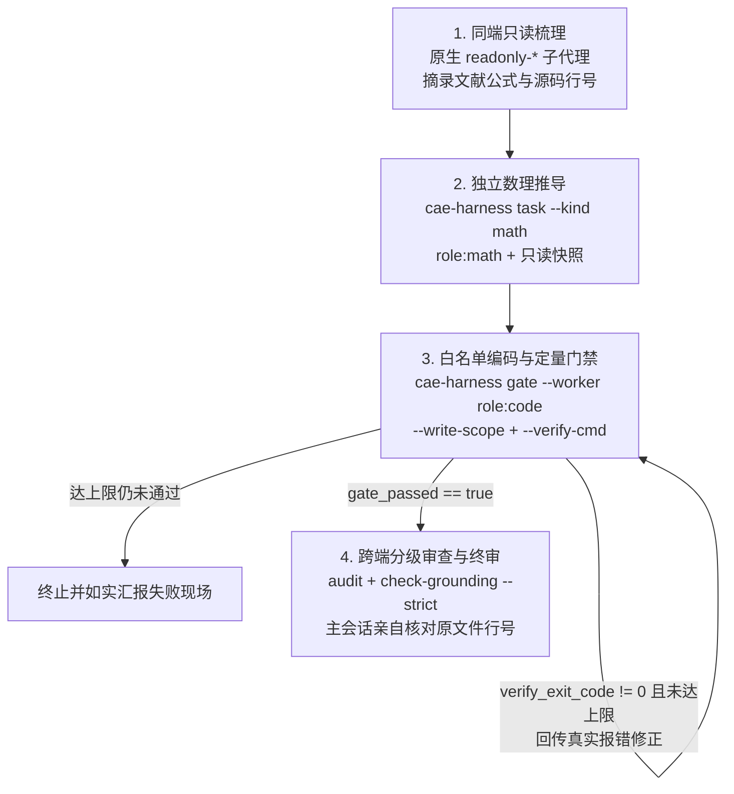

# 科学计算与工程研发日常工作流实战指南

本文写给已完成本机全局安装（见 [仓库总说明](../README.md#一三步快速上手)）的科研人员与工程师。结合偏微分方程（PDE）求解器和系统软件研发场景，讲清日常怎么分工、怎么用好点名与角色选路、怎么读大仓库不爆上下文、怎么跑通求解器编码验收闭环，以及压缩与超时后如何接续。

模块原理与钩子细节见 [架构设计与钩子说明](architecture-and-hooks.md#三全通道确认票据与四阶段共有钩子)，完整命令参数与确认单字段见 [cae-harness 技能规程](../template/user-guard/skills/cae-harness/SKILL.md#两道可用性检查与全通道确认单)。

Windows 统一用 `python -B -X utf8`，WSL2 与 Linux 用 `python3 -B -X utf8`。文中 `<...>` 表示需按实际课题替换的占位符；票据与回执应落在授权工作目录内。运行命令前，先将 `HARNESS` 指向本机任意已安装客户端对应的脚本（维护本配置仓库时可指向 `template/user-guard/skills/cae-harness/scripts/cae_harness.py`）：

```powershell
# Windows PowerShell（按本机已安装客户端任选一行）：
$HARNESS = "$HOME\.gemini\config\plugins\user-guard\skills\cae-harness\scripts\cae_harness.py" # Antigravity
# $HARNESS = "$HOME\.codex\skills\cae-harness\scripts\cae_harness.py"                         # Codex
# $HARNESS = "$HOME\.claude\skills\cae-harness\scripts\cae_harness.py"                        # Claude Code
# $HARNESS = "$HOME\.dsh\skills\cae-harness\scripts\cae_harness.py"                           # DeepSeek Harness (DSH)
```

```bash
# WSL2 与 Linux Bash（按本机已安装客户端任选一行）：
HARNESS="$HOME/.gemini/config/plugins/user-guard/skills/cae-harness/scripts/cae_harness.py"    # Antigravity
# HARNESS="$HOME/.codex/skills/cae-harness/scripts/cae_harness.py"                            # Codex
# HARNESS="$HOME/.claude/skills/cae-harness/scripts/cae_harness.py"                           # Claude Code
# HARNESS="$HOME/.dsh/skills/cae-harness/scripts/cae_harness.py"                              # DeepSeek Harness (DSH)
```

---

## 一、派工边界、明确点名与按专长选路

主会话始终保留你自己选择的客户端、模型与强度。开工前记住一条实用边界：**几十行小修、修审查小项或需要频繁来回对齐的改动，直接在主会话完成**；只有**接口清晰、成块独立的数理推导、求解器模块实现或关键代码与文档审查**，才值得派给后台子进程隔离执行。

派工前可先离线检查本机各端可用性（只读本地配置，不触发联网刷新，也不调用模型）：

```powershell
python -B -X utf8 "$HARNESS" probe --caller auto --redact
python -B -X utf8 "$HARNESS" assess --caller auto --redact
```

### 1. 直接点名与角色选路

在对话里说出具体客户端、模型、推理挡位或隔离级别时，调度脚本会通过 `--user-prompt` 锁定你的原话，绝不被默认推荐覆盖；不点名时则按五个动态角色自动选路：

| 你在对话里怎么说 | 调度行为 | 脚本自动保护 |
| --- | --- | --- |
| “这步编码用 Codex 高强度做”“交给 `<目标模型>` 核对脱敏” | 按 P0 锁定指定的客户端或模型 | 自动补齐声明窗口、只读行号内联、快照与脱敏；目标不可用或已停用直接报错，不静默换端 |
| “挂 `high` 挡跑”“用 `--isolation clean_room` 盲读文档” | 锁定挡位或隔离级别 | 非 `fast` 专业角色即使降挡仍保留主力模型；后端不支持所选隔离级别时显式拒绝 |
| “用 Codex 和 DSH 交叉审这部分代码” | 识别“和、与、及、等”并列语义，不误锁单端 | 完整保留多路计划中各分支各自指定的客户端、模型与隔离级别 |
| “推导弯曲网格 GCL 离散判据”“审查 `src/flux/` 边界相容性” | 按 `role:math`、`role:code`、`role:review` 或 `<client>:@<role>` 选路 | 跳过易衍生多层子代理的 `ultra`；审查命中守恒律、离散算子或权限越界词自动升至 `max` 挡 |
| “把这几篇文献的控制方程和源码行号摘出来” | 交同端 `readonly-reader`、`readonly-collaborator`、`readonly-auditor` | 禁写禁测，专做原文摘录与行号初筛；不替代跨客户端独立审查 |

### 2. 四级正交隔离（`--isolation`）

外部无头命令均支持独立的 `--isolation` 参数，与后端、模型和读写模式解耦（`--clean-room` 为 `--isolation clean_room` 的兼容别名）：

| 隔离级别 | 保留与剥离范围 | 支持后端与典型用途 |
| --- | --- | --- |
| `full` | 保留全局规则、安全钩子（DSH 当前为软规则）与技能 | `codex`、`claude`、`dsh` 默认值；常规推导、编码验证与沿用全局规范的审查 |
| `no_skills` | 保留全局规则与安全钩子，剥离技能包与斜杠命令 | 四端通用（`agy` 默认值）；避免技能说明挤占上下文窗口 |
| `hooks_only` | 仅保留底层凭据与安全钩子，剥离全局规则与技能 | 仅 `codex`、`claude`；`agy` 与当前 `dsh` 显式报错拒绝 |
| `clean_room` | 仅保留凭据，剥离规则、钩子、技能、项目说明与斜杠命令 | `codex`、`claude`、`dsh`（仅限只读）；新读者盲读文档或无草稿盲出双方案 |

### 3. 五种常用口语协同套路

模型映射集中在 [fleet_profile.json](../template/user-guard/skills/cae-harness/fleet_profile.json)，平时不用背模型名。日常按课题是否有编译或单测硬验证器选好主窗口系列（未闭环理论与论文期优先低幻觉审慎系列，门禁完备的工程维护期可用高吞吐编码系列），遇到下面五类场景直接带半句口语即可：

| 你想做什么 | 平时怎么说 | 实际编排方式 |
| --- | --- | --- |
| **重大架构盲出独立双方案** | “这是大方案，两家各自独立出一版，别给对方看草稿” | 用 `batch` 或 `clean_room` 只传你的原话和背景（不附主控草稿），独立产出后再对比合并，避免锚定偏见 |
| **早期发散探路与排雷** | “并发探探路，对比几种方案并挑硬伤” | 并发核算候选方案的显存与计算复杂度边界，定纲前由主会话对照归档收口 |
| **关键命题正反双路推导** | “这个命题很关键，正反双路深推并找反例” | 编排 2 路：1 路审慎模型正向立论，1 路高算力模型对照初稿找反例与奇点边界 |
| **限定或排除特定客户端** | “不用 Codex，用其他端做”或“只用反重力双路审” | 跳过被排除端；单端受限时自动在同端组合审慎系列与编码系列做异构双审 |
| **低成本快检表面格式** | “省点额度快速扫一遍格式与拼写” | 切轻量 `role:fast` 槽位与低消耗挡位，绝不冒充核心代码审查 |

---

## 二、大仓库阅读、审批执行与完工机械对账

面对大型求解器仓库或超长技术文档，直接整仓读入很容易触发频繁压缩、跳行漏读或改漏配套文档。推荐固定走 **读前评估分片 → 审批分波执行 → 跨端核对与机械对账** 三步链：

```powershell
# 1. 纯离线读前评估与分片（自动按双口径预算切分超大单文件行段并导出审批工作流）
python -B -X utf8 "$HARNESS" read-plan --target "<项目根目录>" --shared-files "AGENTS.md" --cross-client-mode risk-tiered --emit-spec "<分片工作流.json>"

# 2. 纯离线生成确认单与待批票据（本地交互勿加 --redact 以保留可点击链接）
python -B -X utf8 "$HARNESS" plan `
  --spec-file "<分片工作流.json>" --session-id "<当前会话标识>" --plan-dir "<授权票据目录>" `
  --user-prompt "<用户点名原话>" --output "<计划回执路径>" `
  --workflow-bg "通量与边界模块已修改" `
  --workflow-goal "按保守波次跨端只读核查源码与配套文档" `
  --workflow-impact "纯只读核查并保存回执，零源码改动"

# 3. 确认批准后登记票据并执行外部无头批次
python -B -X utf8 "$HARNESS" plan `
  --approve-ticket "<票据标识>" --session-id "<当前会话标识>" --plan-dir "<授权票据目录>" --user-prompt "<用户点名原话>"
python -B -X utf8 "$HARNESS" batch `
  --ticket "<票据标识>" --session-id "<当前会话标识>" --plan-dir "<授权票据目录>" `
  --user-prompt "<用户点名原话>" --output "<批次回执路径>" --redact

# 4. 纯离线跨端覆盖核对并并轨至总机械对账表
python -B -X utf8 "$HARNESS" cross-check --target "<项目根目录>" --receipt "<批次回执路径>" --read-plan "<阅读计划JSON>"
python -B -X utf8 "$HARNESS" reconcile --target "<项目根目录>" --base-ref HEAD --cross-check "<跨端核对JSON>"
```

手动编写 `--spec-file` 时，常见多波次配置示例：

```json
[
  {"stream_id":"S1","wave":1,"channel":"cae_harness_headless","kind":"review","engine":"codex:@review","target":"<项目根目录>","files":["src/flux/hllc.py","docs/spec.md"],"negative_scope_files":["docs/cancelled.md"],"subtask":"核对离散通量接口与守恒性实现"},
  {"stream_id":"S2","wave":2,"channel":"cae_harness_headless","kind":"review","engine":"dsh:@review","isolation":"clean_room","target":"<第二份文件路径>","subtask":"空上下文核对边界条件与配置参数"}
]
```

四条实用要点：

- **确认单不刷屏**：小范围单路只读在阈值内静默执行。多路并发、可写任务或超阈值委派前，`plan` 会把 4 列总览和分路 14 项明细写进 `<ticket_id>_card.md`，聊天框里只显示 3 句话确认条与链接；审批并执行 `plan --approve-ticket` 后，钩子才放行启动。
- **跨端双审显式分端**：两个 `role:review` 不保证自动落到不同客户端，双源交叉审请显式指定两端（如 `codex:@review` 与 `dsh:@review`）或直接用 `audit --left ... --right ...`。
- **波次联动防空转**：多波次 `batch` 中，前序波次同目录可写流失败时，后续波次默认中止（仅显式设 `"run_on_upstream_failure": true` 的只读流放行）。
- **完工自动出账表**：重负载派单完工会自动落盘确定性机械对账表 `<run_id>_reconcile.md`（不污染你的业务仓库），列出实改与未更新文件、代码依赖与义务结算，并由三端回合结束钩子核验回执与对账链接覆盖。

---

## 三、求解器编码验收实战闭环（二维 Euler HLLC 示例）

### 1. 无头任务单五要素

外部无头子进程看不到主会话历史。把下面五项一次写进 `--task-file`，能省掉绝大部分返工：

1. **物理方程与符号约定**：守恒变量顺序、无量纲参考量（ $L_{\text{ref}}, U_{\text{ref}}, \rho_{\text{ref}}$ ）、界面单位外法向 $\mathbf{n}$ 指向、状态方程与边界相容条件；
2. **目标工作区路径**：对应 `--target` 根目录；
3. **必读源码与精确行号**：标出参考实现与测试夹具的起止行号，避免沙箱盲扫大目录超时；
4. **写范围白名单与红线**：可写任务配 `--write-scope` 锁路径，只读任务声明零修改，明文禁止放宽容差或删改断言；
5. **可执行验收命令**：配合 `--verify-cmd` 跑守恒残差、数值导数比对或收敛阶单测。

### 2. 任务单模板与 `gate` 闭环

````markdown
# 任务：实现二维可压缩 Euler 方程 HLLC 界面通量并通过离散守恒测试

## 1. 物理与符号约定
- 控制方程：二维守恒型可压缩 Euler 方程，守恒变量顺序 `U = [rho, rho*u, rho*v, E]^T`，理想气体状态方程 `p = (gamma - 1) * (E - 0.5 * rho * (u^2 + v^2))`，`gamma = 1.4`。
- 法向与通量方向：单元界面单位外法向 `n = (nx, ny)` 由左单元 `L` 指向右单元 `R`；返回值 `F_hat` 为沿 `n` 流出左单元 `L` 的数值通量（右单元累加 `-F_hat`）。

## 2. 必读源码与参考接口
- `src/flux/rusanov.py` 第 1–68 行：对齐 `compute_flux(u_left, u_right, normal, gamma)` 签名与负密度、负压强保护逻辑。
- `tests/test_flux_conservation.py` 第 1–95 行：复用自由流保持与周期网格离散守恒测试夹具。

## 3. 允许修改范围与禁止事项
- 仅允许新建或修改 `src/flux/hllc.py`、`src/flux/__init__.py` 与 `tests/test_flux_conservation.py`。
- 严禁放宽双精度容差（`rtol=1e-13, atol=1e-14`）或删改已有断言。

## 4. 定量验收判据
- 静止接触间断算例精确保持密度阶跃无数值耗散抹平；
- 周期网格随机扰动初值单步推进后，全局质量、动量、总能离散守恒残差均小于 `1e-14`。
````

先经 `plan` 登记白名单与验收命令并获批，再持 `--ticket` 启动 `gate` 闭环（未通过时在默认 2 轮上限内带真实报错自动修正，仍未收敛即停下交人拍板）：

```powershell
python -B -X utf8 "$HARNESS" gate `
  --caller auto --worker role:code --target "<项目根目录>" --task-file "task_hllc.md" `
  --write-scope "src/flux/hllc.py,src/flux/__init__.py,tests/test_flux_conservation.py" `
  --verify-cmd "pytest -q tests/test_flux_conservation.py" `
  --ticket "<票据标识>" --session-id "<当前会话标识>" --plan-dir "<授权票据目录>" `
  --output "<验收回执路径>" --redact
```

### 3. 高风险模块四步协同流程

遇到高阶通量分裂、弯曲网格几何守恒律（GCL）或隐式解析雅可比这类核心模块，按四步推进最稳妥：



审查阶段自带两道防吹毛求疵规则：

- **严重度分两级**：仅将有明确触发或复现链路的实质缺陷标为阻断级（`critical`/`high`，如破坏守恒律、边界失配或越界写）；细节与风格记为参考级（`medium`/`low`），不借极端假想反复打回。
- **文档可读性与事实双检**：重要文档先用 `task --kind review --isolation clean_room` 以新读者视角挑出晦涩表达，整篇重写后全仓运行 `check-grounding --target "<项目根目录>" --strict --doc-hygiene` 同步核验事实依据与文档卫生。

---

## 四、超时续接、压缩恢复与诚实核验

1. **持久化续接与超时抢救**：外部无头会话默认持久化（`--ephemeral` 关闭）。接近超时会先自动降挡收口，硬超时也会保留部分结果与会话标识；随后可用 `followup` 沿原会话上下文增量追问，无需从零重跑：
   ```powershell
   python -B -X utf8 "$HARNESS" followup --receipt "<回执路径>" --stream S1 --task "补充核对第 42 行边界条件符号" --output "<追问回执>" --redact
   ```
2. **压缩打断与跨会话接力**：等待审批时触发压缩，钩子会按窗口缩放恢复关键原话、重要子任务结论、未决票据总览与对账指针，并只补展 1 次简短确认提示（压缩与沉默绝不等于批准）。切到新对话后，先离线复核旧票据，再按新会话重建确认单执行：
   ```powershell
   python -B -X utf8 "$HARNESS" plan --resume-ticket "<票据标识>" --plan-dir "<授权票据目录>" --user-prompt "<用户点名原话>"
   ```
3. **对称核验与主会话终审**：三端回合结束钩子既拦截“拿局部补测冒充全过、把含失败账单写成全成功”，也拦截“探测命令全报错或零执行却宣称已核实未连接/不存在”。本机排查直连主机或共享盘时保留完整输出查清事实，仅在写进文档或对外汇报时脱敏。所有后台回执与引用行号均须由主会话按 `R6` 亲自打开原文件复核（完整销账细则见 [cae-harness 技能规程](../template/user-guard/skills/cae-harness/SKILL.md)）。

---

## 五、定量验证的四级证据矩阵（`R3.6`）

阶段汇报与合入审查必须如实说明当前走到了哪一级，未跑的环节直接注明“未验证”，只列核心验证链路的缺口：

| 证据等级 | 判定标准与回执特征 | 典型科学计算与工程判据 |
| --- | --- | --- |
| **`L1` 源码或配置落盘** | 源码、接口或配置已写入磁盘，尚未编译或未运行验收命令（`verification_executed: false`） | 静态结构与语法完整，待目标环境编译与单测 |
| **`L2` 编译或离线单测** | 目标编译器零错误通过，单模块输出与解析公式及离线契约一致（`gate_passed: true`） | 解析雅可比与有限差分或复步导数相对误差达标；边界退化与离线单测全绿 |
| **`L3` 守恒与不变量实测** | 算子在封闭、周期域或弯曲网格下保持物理守恒律与状态不变量（`gate_passed: true`） | 均匀自由流保持（GCL），全局质量、动量、总能离散守恒残差达双精度机器零量级（ $10^{-14} \sim 10^{-12}$ ）；多进程锁与快照零越界 |
| **`L4` 收敛阶与基准达标** | 在光滑解或制造解（MMS）加密序列（ $h, h/2, h/4, \dots$ ）上达到理论阶数 $p$ ，或吻合标准算例 | 经验收敛阶 $\text{EOC} = \frac{\log(E_1 / E_2)}{\log(h_1 / h_2)}$ 稳定逼近设计阶数 $p$ ；Sod 与 Lax 激波管、顶盖驱动方腔等吻合文献基准 |

高内存三维网格生成、大型 C++/Fortran 并行编译与长时数值模拟应按 `R10` 放在 WSL2、容器或独立计算节点运行，避免拖垮宿主机桌面内存。
