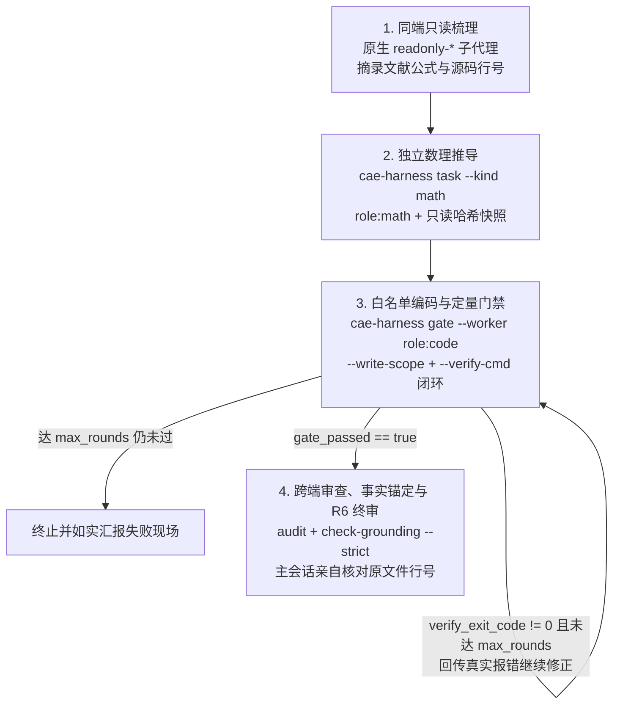

# 科学计算与工程研发日常工作流实战指南

本文供已完成本机全局配置安装（步骤见 [仓库总说明](../README.md)“快速上手”与第二节“安装与配置选项”）的科研人员与工程师查阅，以偏微分方程（PDE）数值求解器与高可靠系统软件工程为例，系统说明日常研发中的完整用法闭环：如何并用**明确点名**（P0 第一优先级）与**模糊角色选路**、如何按需选择 `--isolation` 四级正交隔离、如何审阅 **3 句话极简确认条 `chat_brief` 与本地 `<ticket_id>_card.md` 完整明细链接**、如何编写无头子任务单（附二维可压缩 Euler 方程 HLLC 界面通量范本）、如何在压缩与交接中断后恢复关键原话与未决票据，以及如何按 **L1–L4 四个定量证据等级**完成验收。底层实现见 [架构设计与钩子说明](architecture-and-hooks.md)，全部命令行参数见 [cae-harness 技能规程](../template/user-guard/skills/cae-harness/SKILL.md)。

Windows 环境统一使用 `python -B -X utf8`，WSL2 与 Linux 环境改用 `python3 -B -X utf8`。文中 `<...>` 均为按实际课题替换的受控占位符；票据目录、回执路径与隔离临时目录均须落在本轮获准的写入范围内。

在任意业务课题仓库运行本文命令前，先将变量 `HARNESS` 指向本机已安装客户端对应的技能脚本路径（四选一即可；若在本配置仓库上游维护模式下直接运行，可设为 `template/user-guard/skills/cae-harness/scripts/cae_harness.py`）：

```powershell
# Windows PowerShell（按本机已安装的任意一端设置 HARNESS）：
$HARNESS = "$HOME\.codex\skills\cae-harness\scripts\cae_harness.py"                        # Codex
# $HARNESS = "$HOME\.claude\skills\cae-harness\scripts\cae_harness.py"                     # Claude Code
# $HARNESS = "$HOME\.dsh\skills\cae-harness\scripts\cae_harness.py"                        # DeepSeek Harness (DSH)
# $HARNESS = "$HOME\.gemini\config\plugins\user-guard\skills\cae-harness\scripts\cae_harness.py" # Antigravity
```

```bash
# WSL2 与 Linux Bash（按本机已安装的任意一端设置 HARNESS）：
HARNESS="$HOME/.codex/skills/cae-harness/scripts/cae_harness.py"                           # Codex
# HARNESS="$HOME/.claude/skills/cae-harness/scripts/cae_harness.py"                        # Claude Code
# HARNESS="$HOME/.dsh/skills/cae-harness/scripts/cae_harness.py"                           # DeepSeek Harness (DSH)
# HARNESS="$HOME/.gemini/config/plugins/user-guard/skills/cae-harness/scripts/cae_harness.py"    # Antigravity
```

---

## 一、明确点名（P0）、隔离级别与模糊交办的并列选路机制

日常在任意已安装客户端（Antigravity、Codex、Claude Code 或 DeepSeek Harness，下文简称 DSH）主窗口交流时，交互主会话始终保留你自己选择的客户端、模型与推理强度。遇到实质性数理推导、跨文件编码验证或独立审查时，先只读探测本机各对等端的可用状态：

```powershell
python -B -X utf8 "$HARNESS" probe --caller auto --redact
python -B -X utf8 "$HARNESS" assess --caller auto --redact
```

在通用课题仓库（`workspace_mode: "general_project"`）中，通过 `"$HARNESS"` 直接调用本机已安装的 `cae_harness.py` 即可，无需复制上游仓库文件；`probe` 与 `assess` 仅执行本地文件只读核对，不触发在线模型调用或性能榜单联网刷新。

向后台派发任务时，**用户明确点名**与**动态角色槽位**（`role:*`）为并列入口，通过 `--user-prompt "<用户原话>"` 保留你的原始意图，其余繁琐底层参数由脚本自动补齐：

| 指令类型与日常表达示例 | 锁定的维度（P0 优先） | 脚本自动补齐的参数与安全边界 |
| --- | --- | --- |
| **点名客户端或模型**：“这步编码用 Codex 高挡位做”“请交给 `<目标客户端或模型名>` 做脱敏审查” | 锁定指定的客户端、模型标识或模型系列 | 外部无头调用自动补齐模型声明最大上下文窗口、无头非交互标志、只读行号内联、文件哈希快照与输出脱敏；目标不可用或 `enabled: false` 时直接报错，不静默换端 |
| **点名挡位、隔离级别或省额度**：“这轮挂 high 挡跑”“用 `--isolation clean_room` 盲读说明文档”“省点额度快速扫一遍格式” | 锁定指定推理挡位、四级隔离模式或低消耗策略 | 显式非 `fast` 角色即使降到 `low` 挡仍保留该槽位主力模型；后端不支持所选 `--isolation` 级别时直接报错拒绝 |
| **多端并列协作指令**：“用 Codex 与 DSH 等多工作流全仓校核验证一下” | 识别“等、和、与、及”多端并列语义，不误锁单端 | 完整保留 `--spec-file` 中各分路声明的不同对等客户端、模型与隔离级别组合 |
| **只说研究目标（模糊交办）**：“推导弯曲网格离散几何守恒律判据”“审查 `src/flux/` 边界相容性” | 按 `--kind` 搭配 `role:orchestrator`、`role:math`、`role:code`、`role:review`、`role:fast`（或 `<client>:@<role>`、`<client>:<role>`、`<client>:default`、`<client>:<model>`） | 按 `fleet_profile.json` 候选顺序选取当前已启用且额度正常的对等端；常规任务默认采用单模型非委派最高强度（跳过会自动派生多层子代理的 `ultra`），`polish` 润色按篇幅自动选 `medium` 或 `high` |
| **同端多文件摘录与行号初筛**：“把这三篇论文的控制方程和源码对应行号摘出来” | 当前客户端内部原生 `readonly-reader`、`readonly-collaborator`、`readonly-auditor`（读取 `native_agent_profiles`，默认 `inherit`） | 禁写文件、禁跑构建与测试（Antigravity 与 Claude 禁用终端命令；Codex 交互式原生 `readonly-*` 继承父会话沙箱并由开发者指令、`[features]` 权限收窄与 `PreToolUse` 钩子约束，独立沙箱与文件快照由外部无头 `codex exec -s read-only` 提供）；解析 `inherit` 时优先识别 Codex `agents/*.toml` 及 Claude 与 Antigravity 代理前置元数据中的显式 `model`，不替代跨客户端独立审查 |

### 四级正交隔离（`--isolation`）按需选择

外部无头命令（`task`、`gate`、`audit`、`plan`、`batch` 及 `--spec-file`）均支持 `--isolation`，将上下文与规则挂载级别与后端、模型、挡位、读写模式解耦（`--clean-room` 继续作为 `--isolation clean_room` 的兼容别名）：

| 隔离级别 | 保留项与剥离项 | 支持后端与适用场景 |
| --- | --- | --- |
| `full` | 保留客户端全局规则、安全钩子（DSH 当前处于 `soft_rules_only`，无硬安全钩子）与技能 | `codex`、`claude`、`dsh` 未显式指定时的默认级别（`agy` 未显式指定时默认 `no_skills`）；常规推导、编码验证与需要沿用全局规则的审查 |
| `no_skills` | 保留全局规则与安全钩子（DSH 为软规则），剥离技能包与斜杠命令 | 全部四端（`agy` 默认级别）；避免技能文档占用上下文窗口但仍需规则护栏 |
| `hooks_only` | 保留底层认证凭据与安全钩子护栏，剥离全局规则与技能 | `codex`、`claude`；`agy` 与当前 `soft_rules_only` 状态的 `dsh` 显式报错拒绝 |
| `clean_room` | 仅保留底层凭据，剥离全局规则、钩子、技能、项目说明及斜杠命令（Claude 同时启用 `--bare` 与 `--disable-slash-commands`）的空上下文盲读 | `codex`、`claude`、`dsh`（仅限只读任务）；`agy` 显式报错拒绝；用于新读者视角盲读文档 |

### 课题阶段选型、日常无感分流与模糊口语速查矩阵

日常协作无需手写底层命令或记忆模型代号，具体模型映射统一由 `fleet_profile.json` 动态维护（当前具体模型快照见根仓 [README.md](../README.md) 角色表），日常遵循“**三项常规操作无感自动分流，四类特殊意图靠半句口语触发**”：

1. **平时无需额外说明的无感行为**（打开课题时仅需按是否存在编译或单测硬验证器选一次主窗口模型：未闭环理论与论文定稿期选 `main_model_family` 低幻觉审慎系列，架构与门禁已定型的工程维护期选 `code_families` 高吞吐编码系列）：
   - **代码实现与验证自动切高速编码模型**：模块编写、脚本修复与门禁闭环外部默认走 `role:code`（跨端主力编码槽位或 `agy:@code` 对应 `code_families` 高挡位），内部 `native_swarm` 编码流自动推荐 `swarm_worker_model_family`；
   - **工程主控自动配异构低幻觉验收**：当主窗口选用高速编码系列统筹工程仓库时，跨端 `role:review` 优先派往独立对等端，反重力后台审查（`agy:@review`）与内部 `native_swarm` 验收流（`swarm_verifier_model_family`）无感切回 `deep_families` 审慎系列异构把关，规避同模型自审盲区（主窗口本就处于审慎系列时保持 `inherit`）；
   - **单端受限时自动组同端异构审查**：其余客户端处于配额冷却或被口语限定排除时，双盲 `audit` 无感配对同客户端内的 `deep_families` 与 `code_families` 组建异构双源审查。

2. **遇到以下 4 类特殊意图时，随口带半句日常口语即可（无需提模型名或底层参数）**：

| 你想做的事 | 平时随口怎么说（不用提模型名） | 主控看到后自动替你编排什么 |
| --- | --- | --- |
| **早期发散探路与方案排雷** | “并发探探路，对比几种方案并挑挑硬伤” | 并发调高吞吐推理流铺开候选、核算显存与计算复杂度边界；正式定纲写文档前由审慎主控核对历史归档收口 |
| **关键新命题正反双路推导** | “这个命题很关键，正反双路深推并找反例挑刺” | 自动通过 `--spec-file` 组 2 流确认单：1 路审慎模型从零正向推导（`role:math`）加 1 路高算力模型对照初稿寻找反例、排查奇点与成立边界 |
| **限定或排除某几个端** | “不用 Codex，用本机其他端并发做”或“只用反重力双路审查” | 自动过滤未授权或被排除的客户端；若仅剩单一多模型后端则自动拉起 `deep_families` 与 `code_families` 异构双源审查 |
| **表面快检省额度** | “省点额度快速扫一遍格式与拼写” | 自动切轻量 `role:fast` 槽位与低消耗挡位，不替代核心数理与代码正确性审查 |

---

## 二、两阶段可用性检查、`chat_brief` 极简确认条与 `<ticket_id>_card.md` 确认流程

### 1. 两阶段可用性检查与本地额度边界

- **维护期联网核查与启停确认**：由独立 `fleet-evolve` 流程联网评估能力并展示本机可用性及额度类型，用户决定启用或停用哪些客户端与模型，写入 `subscription_matrix`（如退订某模型后置 `enabled: false`，日常选路全局跳过）。
- **派工前纯离线可用性复查**：`cae_harness.py plan` 在生成确认单前纯离线检查本机可执行文件、凭据、所需本地回环路由健康、本地会话记录中的滚动窗口已用百分比与重置时间、CC Switch 卡片套餐或余额类型与日月限额，以及当前运行环境的配额冷却记录，自动过滤不可用或已超限通道。本机未暴露的服务端实时余额如实标明未知，绝不谎称余额充足。

### 2. 单流与多流重负载确认单（对话只发 3 句话确认条 + 明细链接）

单路小范围只读检查在满足 `runtime_tunables.dispatch_confirmation` 轻任务条件时可直接静默执行。多路并发任务、可写编码任务或超出轻任务阈值的调用——**无论调用外部 `cae_harness_headless` 无头进程，还是在客户端内部发起多路或可写原生子代理**（`invoke_subagent`、`run_workflow`、`swarm`、`spawn_agent`、`Agent` 或 `Task`）——均须先运行 `plan` 生成确认单：

```json
[
  {"stream_id":"S1","wave":1,"channel":"cae_harness_headless","kind":"review","engine":"codex:@review","target":"<项目根目录>","files":["src/flux/hllc.py","docs/spec.md"],"negative_scope_files":["docs/cancelled.md"],"subtask":"核对离散通量接口与守恒性实现"},
  {"stream_id":"S2","wave":2,"channel":"cae_harness_headless","kind":"review","engine":"dsh:@review","isolation":"clean_room","target":"<第二份文件路径>","subtask":"跨客户端空上下文核对边界条件与配置参数"}
]
```

```powershell
# 1. 纯离线生成任务确认单与待批票据（不启动任何子代理）
python -B -X utf8 "$HARNESS" plan `
  --spec-file "<工作流配置.json>" --session-id "<当前会话标识>" --plan-dir "<授权票据目录>" `
  --user-prompt "<用户点名原话>" --output "<授权计划回执路径>" --redact `
  --workflow-bg "核心通量与边界模块已修改" `
  --workflow-goal "分两路跨客户端只读核查离散格式与参数依据" `
  --workflow-impact "纯只读检查并保存结构化回执，零源码改动"
```

注意：两个 `role:review` 并不自动保证落在不同客户端；需要跨模型双源独立审查时，应如上例显式指定不同客户端（支持 `dsh:@review` 或简写 `dsh:review`），或使用 `audit --left ... --right ...` 双盲分片审查。

`plan` 保存票据时先写 `<ticket_id>.json`，再将包含完整背景、要做什么、预计后果、4 列总览表及分路 3 列纵向 **14 项完整参数明细**的确认单写入同目录 `<ticket_id>_card.md`，同时生成日常对话用的 3 句话极简确认条 `chat_brief`、含 4 列总览表的 `compact_summary_card` 与交接片段 `compact_handoff_prompt_block`。**日常对话默认只展示 3 句话极简确认条 `chat_brief` 和可点击明细链接，严禁在聊天框粘贴表格或把多路 14 项长表展开挤占上下文**（未发生压缩且票据未变时，后台任务被动唤醒亦不得重复贴票）；需要逐项核验时直接点击链接查阅 `<ticket_id>_card.md` 中的 4 列总览与 14 项字段：

| 序号 | 参数项 | 展示内容与核验要求 |
| --- | --- | --- |
| 1 | 流号 | 每路唯一标识（如 `S1`、`S2`） |
| 2 | 子任务与范围 | 本路具体职责说明与限定目标文件或目录路径 |
| 3 | 通道 | 外部无头（`cae_harness_headless`）或客户端内部原生通道（`native_subagent`、`native_workflow`、`native_swarm`） |
| 4 | 客户端及子代理类型 | 实际执行客户端及子代理角色类型 |
| 5 | 模型名字 | 具体模型标识及原生 `inherit` 的本地解析结果（优先读取代理定义中显式 `model`，不用角色槽位名冒充） |
| 6 | 挡位 | 实际采用的推理强度 |
| 7 | 上下文窗口 | 已解析的模型声明窗口数值，未暴露时如实标明 `未声明` |
| 8 | 是否无头 | 是否启动独立非交互无头子进程 |
| 9 | 是否净室与隔离级别 | 是否启用 `clean_room` 盲读；显式指定任一非净室 `--isolation` 级别时均追加标注 `（隔离：<级别>）` |
| 10 | 访问模式、写入范围与验收命令 | `只读`，或可写任务的 `--write-scope` 白名单及 `--verify-cmd` 验收命令 |
| 11 | 内联与超时 | 只读文件是否附带行号内联（`--inline-readonly`）及本路超时秒数 |
| 12 | 当前是否可用 | 派工前离线可用性复查结论及不可用原因 |
| 13 | 本机配置额度类型与当前状态 | 额度计费来源；未启用 `--redact` 脱敏时显示本地可读百分比、重置时间或限额，启用脱敏或未暴露时标明隐藏或未知说明 |
| 14 | 回执或子代理日志位置 | 结构化回执文件路径或客户端原生轨迹目录位置 |

确认单下方展示离线性能更新时间（`capability_ledger.last_online_refresh_at` 与 `capability_ledger.local_bench_verified_at`），并提供三个选项：**① 批准当前计划（推荐）**、**② 微调引擎、挡位或超时后批准**（支持 `--override-json`）、**③ 暂缓并交接**。

用户明确确认批准后，登记票据为 `APPROVED` 并绑定 `--ticket` 执行（前后保持相同的 `--session-id` 与 `--plan-dir`）：

```powershell
# 2. 登记用户批准并按后端并发上限执行外部无头批次
python -B -X utf8 "$HARNESS" plan `
  --approve-ticket "<票据标识>" --session-id "<当前会话标识>" --plan-dir "<授权票据目录>" --user-prompt "<用户点名原话>"
python -B -X utf8 "$HARNESS" batch `
  --ticket "<票据标识>" --session-id "<当前会话标识>" --plan-dir "<授权票据目录>" `
  --user-prompt "<用户点名原话>" --output "<授权回执路径>" --redact
```

若计划包含内部原生通道（如发起多路 `readonly-*`、`swarm` 或可写子代理），同样先用 `python -B -X utf8 "$HARNESS" plan --channel native_subagent --caller auto --agent-type readonly-auditor --model inherit ...` 生成确认单并登记批准；执行时由当前客户端直接调用原生子代理工具（不交给 `batch`），Antigravity、Codex 与 Claude Code 的 `status_guard.py` 在 `PreToolUse` 自动核验批准票据与通道容量（DSH 交互侧当前由 `soft_rules_only` 软规则约束；对 `swarm` 的 `add` 按 `tasks` 列表长度或正整数 `n` 精确计入流数），并拦截绕过 `cae_harness.py` 直接调用底层无头 CLI 的命令。

---

## 三、后台无头任务单五要素与 PDE 求解器实战闭环

### 1. 为什么无头任务单必须写清五项要素

交互主窗口持有当前对话上下文，而 `cae-harness` 首次启动的外部无头子进程运行在后台非交互独立上下文中（完成后由 `provider_session_id` 定位可续接无头子会话，由 `session_id` 记录所属主会话票据）。因此传给 `--task-file` 的任务单须一次交代清楚五项要素：

1. **数学物理控制方程与符号约定**：守恒型或原始变量顺序、无量纲参考量（ $L_{\text{ref}}, U_{\text{ref}}, \rho_{\text{ref}}$ ）、单元界面单位外法向 $\mathbf{n}$ 的指向约定、状态方程与边界相容性条件；
2. **目标工作区路径**：对应 `--target` 根目录；
3. **必读源码路径与精确行号区间**：直接指明相关算子与测试夹具的起止行号（避免 Windows 沙箱遍历大型目录超时；在累计内联字节上限 `inline_readonly_max_kib` 内，只读目标文件会自动附带精确行号内联）；
4. **允许修改的文件白名单与红线**：可写任务配合 `--write-scope` 限定路径，审查与推导任务声明“零文件修改”，严禁放宽容差或删改断言；
5. **可执行的定量验证命令**：配合 `--verify-cmd` 运行离散守恒残差、数值导数比对或收敛阶单测。

### 2. `<任务单.md>` 实战模板（二维可压缩 Euler 方程 HLLC 界面通量）

````markdown
# 任务：实现二维可压缩 Euler 方程 HLLC 界面通量并通过离散守恒测试

## 1. 物理与符号约定
- 控制方程：二维守恒型可压缩 Euler 方程，守恒变量顺序 `U = [rho, rho*u, rho*v, E]^T`，理想气体状态方程 `p = (gamma - 1) * (E - 0.5 * rho * (u^2 + v^2))`，`gamma = 1.4`。
- 法向与通量方向：单元界面单位外法向 `n = (nx, ny)` 由左单元 `L` 指向右单元 `R`；返回值 `F_hat` 为沿 `n` 流出左单元 `L` 的数值通量（右单元累加 `-F_hat`）。

## 2. 必读源码与参考接口
- `src/flux/rusanov.py` 第 1–68 行：对齐现有函数签名 `compute_flux(u_left, u_right, normal, gamma)` 与非物理负密度、负压强保护逻辑。
- `tests/test_flux_conservation.py` 第 1–95 行：现有均匀自由流保持与周期网格离散守恒测试夹具。

## 3. 允许修改范围与禁止事项
- 仅允许新建或修改 `src/flux/hllc.py`、`src/flux/__init__.py` 与 `tests/test_flux_conservation.py`。
- 严禁放宽双精度容差（`rtol=1e-13, atol=1e-14`）或删改已有测试断言。

## 4. 定量验收判据
- 静止接触间断算例精确保持密度阶跃无数值耗散抹平；
- 周期网格随机扰动初值单步推进后，全局质量、动量、总能离散守恒残差均小于 `1e-14`。
````

为本例单独运行 `plan` 生成可写确认票据（登记上述写入白名单与同一条验收命令）并获用户批准后，绑定新 `--ticket` 启动 `gate` 定量验证闭环（验证未通过时，真实报错在 `--max-rounds` 轮次内自动回传给执行模型迭代修正，测试命令由目标课题环境提供）：

```powershell
python -B -X utf8 "$HARNESS" gate `
  --caller auto --worker role:code --target "<项目根目录>" --task-file "task_hllc.md" `
  --write-scope "src/flux/hllc.py,src/flux/__init__.py,tests/test_flux_conservation.py" `
  --verify-cmd "pytest -q tests/test_flux_conservation.py" `
  --ticket "<票据标识>" --session-id "<当前会话标识>" --plan-dir "<授权票据目录>" `
  --output "<授权回执路径>" --redact
```

### 3. 高风险核心模块四步协同流程

对于高阶通量分裂算子、弯曲网格几何守恒律（GCL）度量恒等式、隐式时间推进解析雅可比矩阵等核心模块，推荐按以下四步推进：



修订重要技术文档时，可对支持 `clean_room` 的外部后端（如本机已就绪的 Codex、Claude Code 或 DSH）运行 `python -B -X utf8 "$HARNESS" task --kind review --engine codex:@review --isolation clean_room --target "<文档路径>" ...`（或使用兼容别名 `--clean-room`）剥离全局规则、技能与项目说明，从新读者视角找出晦涩行话与阅读断层；主会话整篇重写后，运行 `python -B -X utf8 "$HARNESS" check-grounding --target "<项目根目录>" --strict` 做零黑名单词法事实核验。

---

## 四、压缩恢复、长会话交接与完工回执核验

1. **压缩打断后的双块恢复（`R9`）**：等待用户确认期间若发生上下文自动压缩，钩子按 `hooks/_lib/adaptive_policy.py` 根据当前模型窗口与推理强度动态调整恢复预算，并用 `collapse_historical_cards` 折叠历史确认单明细表；恢复信息严格分为两块：第一块是常规的历轮用户原话与实质子代理结论摘要；第二块直接从磁盘未决票据 `<ticket_id>.json` 加载本次重负载工作流的背景、要做什么、预计后果、**精简 4 列总览表、可点击 `<ticket_id>_card.md` 完整明细链接**与选项卡供模型恢复核对（仅未落盘 `<ticket_id>_card.md` 时才回退 14 项全字段表）。主会话先如实说明已重读的记录与剩余工作，再向用户补展 1 次 `chat_brief` 极简确认条与明细链接等待确认（勿在日常对话中粘贴 Markdown 表格或展开 14 项长表）——自动压缩与沉默绝不视同批准。
2. **长会话交接与跨会话接力**：当会话进入 `drain` 或 `freeze` 强制交接阶段时，停止新派工并整理【新对话提示词】；`handoff_gate.py` 在 `Stop` 阶段强制校验提示词内已完整嵌入待选工作流的背景、目标与预计后果，**精简 4 列总览表、`<ticket_id>_card.md` 明细链接、离线性能更新时间、选项卡、票据号与 `plan --resume-ticket` 恢复命令**（仅无落盘明细文件时要求嵌入 14 项全字段表）。进入新对话后先运行以下命令读取复核旧票据（该命令保留旧 `session_id` 不自动改绑，跨会话正式执行前须按原流内容与新会话标识重新生成确认票据）：
   ```powershell
   python -B -X utf8 "$HARNESS" plan `
     --resume-ticket "<票据标识>" --plan-dir "<授权票据目录>" --user-prompt "<用户点名原话>"
   ```
3. **持久化续接、双层超时抢救与完工回执核验**：外部无头会话按 `persist_sessions_by_default` 默认保存 `provider_session_id`（显式传 `--ephemeral` 时关闭）。长任务达到软时限时先发起只读续接收尾（`soft_timeout_wrapup`）；到达硬截止仍超时时，只要实时管道或本地会话日志有已落盘记录，回执即保留真实 `timeout` 状态并返回已产出的部分用量（`cli_partial_on_timeout`）及 `timeout_salvage`（含已读文件、落盘改动与末尾消息）。后续可用 `followup --receipt <回执路径> [--stream <流号>] [--ticket <票据标识>] --task "<追问内容>"` 沿原会话读写范围追问（原会话可写或超出轻任务时限时须绑定已批 `--ticket`）。任务结束后，`reply_repeat_guard.py` 在 `Stop` 拦截将局部补测冒充全套测试通过、将含失败或超时的账单写成“全部成功”的表述，并检查本轮回复是否包含：明确的执行成败词、真实 Token 用量数字（或“该通道未单独暴露整数、无法统计”的明确说明），以及外部任务的各流标识（单路 `task` 或单路 `gate` 省略默认流号 `S1` 时须匹配具体模型名，仅在未记录具体模型名时可用任务状态词替代）与非空回执实际文件名（内部原生任务则覆盖完成数量、全部流标识或互不重复的角色名之一及轨迹或日志说明）。漏报且同回合未触发其他门禁时单次阻断并附上磁盘账单；主会话仍须逐路核对真实状态（`status`、`gate_passed`、`scope_violations`）、`citation_audit` 原文行号与汇总算术。

---

## 五、定量验证的四个证据等级矩阵（`R3.6`）

阶段性汇报与合入审查必须严格区分实际达到的验证层级，未执行的环节如实注明“未验证”（仅列当前目标环境与核心验证链路的缺口，不堆砌无关外围平台充当免责声明）：

| 证据等级 | 判定标准与回执特征 | 典型科学计算与工程判据 |
| --- | --- | --- |
| **`L1` 源码或配置落盘** | 源码、接口或配置已写入磁盘，尚未编译或未运行定量验证命令（`verification_executed: false`） | 静态结构与语法完整，待目标环境编译与单测 |
| **`L2` 编译或离线单测** | 目标编译器零错误通过，单函数或单模块输出与解析公式及基准一致（离线单测 `gate_passed: true`） | 解析雅可比与有限差分或复步导数相对误差达标；边界退化与离线契约单测全绿 |
| **`L3` 守恒与不变量实测** | 算子在封闭、周期域或弯曲网格下严格保持物理守恒律与状态不变量（守恒与不变量实测 `gate_passed: true`） | 均匀自由流保持（GCL），全局质量、动量、总能离散守恒残差处于双精度机器零量级（ $10^{-14} \sim 10^{-12}$ ）；多进程状态锁与快照零越界 |
| **`L4` 收敛阶与基准达标** | 在光滑解或制造解（MMS）加密序列（ $h, h/2, h/4, \dots$ ）上达到理论设计阶数 $p$ ，或吻合标准算例（收敛阶与基准算例 `gate_passed: true`） | 经验收敛阶 $\text{EOC} = \frac{\log(E_1 / E_2)}{\log(h_1 / h_2)}$ 稳定接近设计阶数 $p$ ；Sod 与 Lax 激波管、顶盖驱动方腔等与文献基准吻合 |

高内存三维网格生成、大型 C++/Fortran 并行编译与长时数值模拟应按 `R10` 置于 WSL2、容器或独立计算节点等隔离环境中运行，防止宿主机桌面内存溢出（OOM）。
