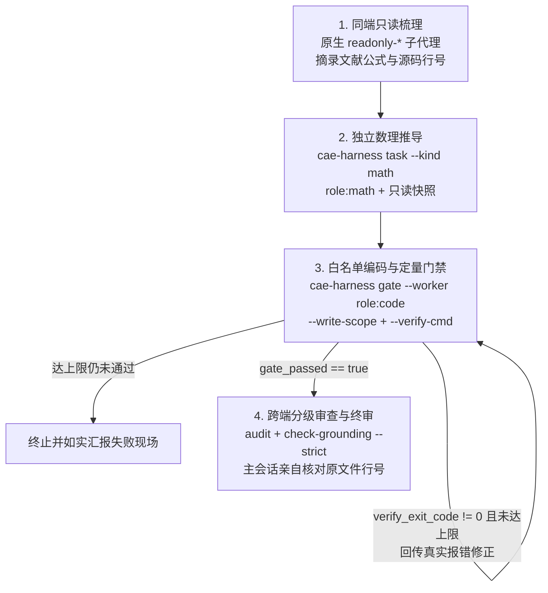

# 科学计算与工程研发日常工作流指南

本文面向已完成本机全局安装（见 [仓库总说明](../README.md#一安装与快速上手)）的科研人员与工程师，结合偏微分方程（PDE）求解器和系统软件研发场景，说明任务分流原则、显式点名与角色选路、大型仓库分片阅读、求解器编码验收闭环，以及超时续接与压缩恢复操作。

模块架构与钩子细节见 [架构设计与钩子说明](architecture-and-hooks.md#三全通道确认票据与四阶段共有钩子)，完整命令参数与确认单字段定义见 [cae-harness 技能规程](../template/user-guard/skills/cae-harness/SKILL.md#两道可用性检查与全通道确认单)。

Windows 统一使用 `python -B -X utf8`，WSL2 与 Linux 使用 `python3 -B -X utf8`。文中 `<...>` 表示按实际课题替换的占位符；票据与回执应保存于授权工作目录内。执行命令前，先将 `HARNESS` 指向本机任意已安装客户端对应的技能脚本（维护本配置仓库时可指向 `template/user-guard/skills/cae-harness/scripts/cae_harness.py`）：

```powershell
# Windows PowerShell（按本机已安装客户端任选一行）：
$HARNESS = "$HOME\.gemini\config\plugins\user-guard\skills\cae-harness\scripts\cae_harness.py" # Antigravity
# $HARNESS = "$HOME\.codex\skills\cae-harness\scripts\cae_harness.py"                         # Codex
# $HARNESS = "$HOME\.claude\skills\cae-harness\scripts\cae_harness.py"                        # Claude Code
# $HARNESS = "$HOME\.dsh\skills\cae-harness\scripts\cae_harness.py"                           # DeepSeek Harness (DSH)
```

```bash
# WSL2 与 Linux Bash（按本机已安装客户端任选一行）：
HARNESS="$HOME/.gemini/config/plugins/user-guard/skills/cae-harness/scripts/cae_harness.py"    # Antigravity
# HARNESS="$HOME/.codex/skills/cae-harness/scripts/cae_harness.py"                            # Codex
# HARNESS="$HOME/.claude/skills/cae-harness/scripts/cae_harness.py"                           # Claude Code
# HARNESS="$HOME/.dsh/skills/cae-harness/scripts/cae_harness.py"                              # DeepSeek Harness (DSH)
```

---

## 一、任务分流、显式点名与角色选路

主会话保持用户选定的客户端、模型与推理强度。任务分流遵循以下边界：**局部修改、零星审查修订或需高频交互确认的变更，由主会话直接处理**；**接口边界清晰的数理推导、求解器模块实现以及关键代码与文档审查**，交由后台隔离进程执行。

派工前可离线核查本机各端可用状态（仅读取本地配置，不触发联网刷新，也不调用模型）：

```powershell
python -B -X utf8 "$HARNESS" probe --caller auto --redact
python -B -X utf8 "$HARNESS" assess --caller auto --redact
```

### 1. 显式指定与动态角色选路

在指令中指定客户端、模型、推理挡位或隔离级别时，调度脚本通过 `--user-prompt` 锁定用户原话，不被默认角色推荐覆盖；未指定时按五类动态角色自动分配：

| 指令表述示例 | 调度解析方式 | 脚本保护机制 |
| --- | --- | --- |
| “此步编码使用 Codex 高强度完成”“交由 `<目标模型>` 核对脱敏” | 按最高优先级（P0）锁定客户端或模型 | 自动补齐上下文窗口声明，并执行只读行号内联、快照记录与脱敏；目标不可用或已停用时直接报错，不静默降级 |
| “采用 `high` 挡运行”“以 `--isolation clean_room` 空上下文审阅文档” | 锁定推理挡位或隔离级别 | 非 `fast` 专业角色即使降挡仍保留主力模型；后端不支持所选隔离级别时显式拒绝 |
| “由 Codex 与 DSH 并行交叉审查此模块” | 识别并列语义，不误锁单端 | 保留多路配置中各分支各自指定的客户端、模型与隔离级别 |
| “推导弯曲网格 GCL 离散判据”“审查 `src/flux/` 边界相容性” | 按 `role:math`、`role:code`、`role:review` 或 `<client>:@<role>` 选路 | 跳过自动派生多层子代理的 `ultra`；审查命中守恒律、离散算子或权限越界关键词时自动升至 `max` 挡 |
| “提取三篇文献的控制方程与对应源码行号” | 调用同端 `readonly-reader`、`readonly-collaborator` 或 `readonly-auditor` | 禁止修改文件与运行测试，仅用于原文摘录与行号初筛，不替代跨客户端独立审查 |

### 2. 四级正交隔离（`--isolation`）

外部无头命令均支持独立的 `--isolation` 参数，与后端、模型及读写模式正交解耦（`--clean-room` 为 `--isolation clean_room` 的兼容别名）：

| 隔离级别 | 保留与剥离范围 | 支持后端与适用场景 |
| --- | --- | --- |
| `full` | 保留全局规则、安全钩子（DSH 当前为软规则）与技能 | `codex`、`claude`、`dsh` 默认值；常规推导、编码验证与遵循全局规范的审查 |
| `no_skills` | 保留全局规则与安全钩子，剥离技能包与斜杠命令 | 四端通用（`agy` 默认值）；减少技能文档对上下文窗口的占用 |
| `hooks_only` | 仅保留底层凭据与安全钩子，剥离全局规则与技能 | 仅 `codex`、`claude`；`agy` 与当前 `dsh` 显式拒绝 |
| `clean_room` | 仅保留凭据，剥离规则、钩子、技能、项目说明与斜杠命令 | `codex`、`claude`、`dsh`（仅限只读）；新读者视角盲审文档或无草稿独立方案设计 |

### 3. 五类常见协作模式

具体模型映射与阈值集中维护于 [fleet_profile.json](../template/user-guard/skills/cae-harness/fleet_profile.json)。主会话模型系列可按课题验证条件选择：尚未建立自动验证的理论推导与论文阶段宜选用审慎推理系列，编译与单元测试门禁完备的工程维护阶段可选用编码系列。针对以下五类协作场景，可在指令中直接声明需求以启用对应编排：

| 协作目标 | 指令表述示例 | 实际编排方式 |
| --- | --- | --- |
| **重大架构独立双方案** | “请两家客户端各自独立产出方案，不提供主会话草稿” | 通过 `batch` 或 `clean_room` 仅传入用户需求与背景，独立生成两版方案后逐条对比合并，避免锚定偏见 |
| **早期方案论证与风险排查** | “并行比较几种离散与存储方案，核算主要限制条件” | 并行评估候选方案的显存与计算复杂度边界，定稿前由主会话对比汇总并归档结论 |
| **关键命题正反双路推导** | “对此命题开展正向推导并由另一路寻找反例与奇点边界” | 分两路执行：一路由审慎模型完成正向推导，另一路按高推理挡位对照初稿排查反例与退化边界 |
| **限定或排除特定客户端** | “排除 Codex，使用其余可用端并行审查”或“仅在单端双路审查” | 跳过被排除的客户端；限定单一客户端时，在同一客户端内组合审慎系列与编码系列完成交叉审查 |
| **低成本表面格式初筛** | “以低开销快速检查拼写与排版格式” | 切换轻量 `role:fast` 槽位与低消耗挡位，不替代核心代码审查 |

---

## 二、大型仓库分片阅读、审批执行与机械对账

面对大型求解器仓库或超长技术文档，直接全量读入易触发频繁的上下文压缩，或造成跳行漏读与配套文档遗漏。建议按 **读前评估分片 → 票据生成与审批执行 → 跨端核对与机械对账** 三个阶段推进（对应下方四步命令）：

```powershell
# 1. 纯离线读前评估与分片（按安全预算与内联字节双口径切分超大单文件行段并导出审批工作流）
python -B -X utf8 "$HARNESS" read-plan --target "<项目根目录>" --shared-files "AGENTS.md" --cross-client-mode risk-tiered --emit-spec "<分片工作流.json>"

# 2. 纯离线生成确认单与待批票据（本地交互省略 --redact 以保留可点击链接）
python -B -X utf8 "$HARNESS" plan `
  --spec-file "<分片工作流.json>" --session-id "<当前会话标识>" --plan-dir "<授权票据目录>" `
  --user-prompt "<用户点名原话>" --output "<计划回执路径>" `
  --workflow-bg "通量与边界模块已修改" `
  --workflow-goal "按保守波次跨端只读核查源码与配套文档" `
  --workflow-impact "纯只读核查并保存回执，零源码改动"

# 3. 用户批准后登记票据并执行外部无头批次
python -B -X utf8 "$HARNESS" plan `
  --approve-ticket "<票据标识>" --session-id "<当前会话标识>" --plan-dir "<授权票据目录>" --user-prompt "<用户点名原话>"
python -B -X utf8 "$HARNESS" batch `
  --ticket "<票据标识>" --session-id "<当前会话标识>" --plan-dir "<授权票据目录>" `
  --user-prompt "<用户点名原话>" --output "<批次回执路径>" --redact

# 4. 纯离线跨端覆盖核对并并轨至总机械对账表
python -B -X utf8 "$HARNESS" cross-check --target "<项目根目录>" --receipt "<批次回执路径>" --read-plan "<阅读计划JSON>"
python -B -X utf8 "$HARNESS" reconcile --target "<项目根目录>" --base-ref HEAD --cross-check "<跨端核对JSON>"
```

手动编写多波次 `--spec-file` 的配置示例：

```json
[
  {"stream_id":"S1","wave":1,"channel":"cae_harness_headless","kind":"review","engine":"codex:@review","target":"<项目根目录>","files":["src/flux/hllc.py","docs/spec.md"],"negative_scope_files":["docs/cancelled.md"],"subtask":"核对离散通量接口与守恒性实现"},
  {"stream_id":"S2","wave":2,"channel":"cae_harness_headless","kind":"review","engine":"dsh:@review","isolation":"clean_room","target":"<第二份文件路径>","subtask":"空上下文核对边界条件与配置参数"}
]
```

四项操作要点：

- **简洁确认单**：小范围单路只读在轻任务阈值内静默执行。多路并发、可写任务或超阈值委派前，`plan` 将 4 列总览与分路 14 项明细写入 `<ticket_id>_card.md`，对话界面仅显示三句话确认摘要与文件链接；登记 `plan --approve-ticket` 后钩子放行执行。
- **跨端双审显式指定两端**：两个 `role:review` 不保证自动落到不同客户端，双源交叉审阅应显式指定两端（如 `codex:@review` 与 `dsh:@review`）或直接调用 `audit --left ... --right ...`。
- **波次联动中止**：多波次 `batch` 中，前序波次同目录可写流失败时，后续波次默认中止（仅显式声明 `"run_on_upstream_failure": true` 的只读流继续执行）。
- **完工自动生成对账表**：重负载任务完成后自动写入确定性机械对账表 `<run_id>_reconcile.md`（不向目标业务仓库写入文件），记录实际修改与未同步更新的文件、静态依赖关系及关联检查项状态，并由三端回合结束钩子核验回复是否包含完整的回执与对账表链接。

---

## 三、求解器编码验收闭环（二维 Euler HLLC 示例）

### 1. 无头任务单五要素

外部无头子进程无法访问主会话历史。在 `--task-file` 中写明以下五项，可显著降低返工概率：

1. **物理方程与符号约定**：守恒变量顺序、无量纲参考量（ $L_{\text{ref}}, U_{\text{ref}}, \rho_{\text{ref}}$ ）、界面单位外法向 $\mathbf{n}$ 指向、状态方程与边界相容条件；
2. **目标工作区路径**：对应 `--target` 根目录；
3. **必读源码与精确行号**：标明参考实现与测试夹具的起止行号，避免无范围扫描大目录导致超时；
4. **写范围白名单与禁止项**：可写任务配合 `--write-scope` 限定路径，只读任务声明零修改，明文禁止放宽容差或删改断言；
5. **可执行验收命令**：配合 `--verify-cmd` 执行守恒残差、数值导数比对或收敛阶单测。

### 2. 任务单模板与 `gate` 闭环

````markdown
# 任务：实现二维可压缩 Euler 方程 HLLC 界面通量并通过离散守恒测试

## 1. 物理与符号约定
- 控制方程：二维守恒型可压缩 Euler 方程，守恒变量顺序 `U = [rho, rho*u, rho*v, E]^T`，理想气体状态方程 `p = (gamma - 1) * (E - 0.5 * rho * (u^2 + v^2))`，`gamma = 1.4`。
- 法向与通量方向：单元界面单位外法向 `n = (nx, ny)` 由左单元 `L` 指向右单元 `R`；返回值 `F_hat` 为沿 `n` 流出左单元 `L` 的数值通量（右单元累加 `-F_hat`）。

## 2. 必读源码与参考接口
- `src/flux/rusanov.py` 第 1–68 行：对齐 `compute_flux(u_left, u_right, normal, gamma)` 签名与负密度、负压强保护逻辑。
- `tests/test_flux_conservation.py` 第 1–95 行：复用自由流保持与周期网格离散守恒测试夹具。

## 3. 允许修改范围与禁止事项
- 仅允许新建或修改 `src/flux/hllc.py`、`src/flux/__init__.py` 与 `tests/test_flux_conservation.py`。
- 严禁放宽双精度容差（`rtol=1e-13, atol=1e-14`）或删改已有断言。

## 4. 定量验收判据
- 静止接触间断算例精确保持密度阶跃无数值耗散抹平；
- 周期网格随机扰动初值单步推进后，全局质量、动量、总能离散守恒残差均小于 `1e-14`。
````

先经 `plan` 登记写入范围与验收命令并取得批准，再持 `--ticket` 启动 `gate` 验收闭环。若验收未通过，脚本在默认 2 轮上限内回传原始报错信息供子进程修正；超出上限仍未通过时立即中止，交由人工裁定：

```powershell
python -B -X utf8 "$HARNESS" gate `
  --caller auto --worker role:code --target "<项目根目录>" --task-file "task_hllc.md" `
  --write-scope "src/flux/hllc.py,src/flux/__init__.py,tests/test_flux_conservation.py" `
  --verify-cmd "pytest -q tests/test_flux_conservation.py" `
  --ticket "<票据标识>" --session-id "<当前会话标识>" --plan-dir "<授权票据目录>" `
  --output "<验收回执路径>" --redact
```

### 3. 核心模块四步协同流程

对于高阶通量分裂、弯曲网格几何守恒律（GCL）或隐式解析雅可比等高风险模块，建议按以下四步推进：



审查阶段包含两项质量约束：

- **严重度分级**：仅将具备明确触发条件或复现链路的实质缺陷标为阻断级（`critical` 或 `high`，如破坏守恒律、边界条件失配或越界写入）；代码风格与局部细节建议记为参考级（`medium` 或 `low`），避免基于缺乏复现条件的极端假设反复退回修改。
- **文档可读性与事实双检**：重要论文、报告或规格文档（`.tex`、`.md`、`.rst`）可先经 `task --kind review --isolation clean_room` 以新读者视角检查表达断层，整篇重写后全仓运行 `check-grounding --target "<项目根目录>" --strict --doc-hygiene` 同步核验事实依据、本地图件引用、定理证明完整度与文档分层卫生。

---

## 四、超时续接、压缩恢复与对称核验

1. **持久化续接与超时抢救**：外部无头会话默认持久化保存（传入 `--ephemeral` 可关闭）。任务临近超时时先降低推理挡位并整理阶段结果，达到硬超时后仍保留已有输出与会话标识；后续可通过 `followup` 基于原会话上下文与权限边界增量追问，无需重新完整运行：
   ```powershell
   python -B -X utf8 "$HARNESS" followup --receipt "<回执路径>" --stream S1 --task "补充核对第 42 行边界条件符号" --output "<追问回执>" --redact
   ```
2. **压缩恢复与跨会话接力**：等待审批期间若发生上下文自动压缩，钩子按可用窗口容量恢复关键用户原话、实质子任务结论、未决票据总览与对账指针，并仅补充展示 1 次确认摘要（自动压缩与用户沉默均不构成批准）。切换至新会话后，先离线复核旧票据，再在当前会话中重新生成确认单后执行：
   ```powershell
   python -B -X utf8 "$HARNESS" plan --resume-ticket "<票据标识>" --plan-dir "<授权票据目录>" --user-prompt "<用户点名原话>"
   ```
3. **对称核验与主会话终审**：三端回合结束钩子同步守卫正向冒充与负向武断：既禁止局部补测或失败回执冒充“全部通过”，也禁止零探测宣称“已核实不存在”、仅查少量局部文件便断言“现有数据不足须重做”，或单端整写长文却不经复核也不标明初稿状态。本机排查直连主机或共享目录时，应保留完整命令输出以核实状态，仅在写入公开文档或对外汇报时执行脱敏。长会话交接提示词须保留项目总纲与资产索引入口，并将重算、批量读图与长文写作拆分为独立会话；所有后台回执与引用行号仍须由主会话按 `R6` 亲自打开原文件逐行复核（完整细则见 [cae-harness 技能规程](../template/user-guard/skills/cae-harness/SKILL.md)）。

---

## 五、定量验证的四级证据矩阵（`R3.6`）

阶段汇报与合入审查须如实标注当前所处的证据等级，未执行环节直接标明“未验证”，仅列核心验证链路缺口：

| 证据等级 | 判定标准与回执特征 | 典型科学计算与工程判据 |
| --- | --- | --- |
| **`L1` 源码或配置落盘** | 源码、接口或配置已写入磁盘，尚未编译或未运行验收命令（`verification_executed: false`） | 静态结构与语法完整，待目标环境编译与单测 |
| **`L2` 编译或离线单测** | 代码经目标编译器编译无错误，单模块输出与解析公式及离线接口契约一致（`gate_passed: true`） | 解析雅可比与有限差分或复步导数相对误差达标；退化边界条件与离线单元测试全部通过 |
| **`L3` 守恒与不变量实测** | 算子在封闭、周期域或弯曲网格下保持物理守恒律与状态不变量（`gate_passed: true`） | 均匀自由流保持（GCL），全局质量、动量、总能离散守恒残差达双精度机器零量级（ $10^{-14} \sim 10^{-12}$ ）；多进程锁与快照零越界 |
| **`L4` 收敛阶与基准达标** | 在光滑解或制造解（MMS）加密序列（ $h, h/2, h/4, \dots$ ）上达到理论阶数 $p$ ，或吻合标准算例 | 经验收敛阶 $\text{EOC} = \frac{\log(E_1 / E_2)}{\log(h_1 / h_2)}$ 稳定逼近设计阶数 $p$ ；Sod 与 Lax 激波管、顶盖驱动方腔等吻合文献基准 |

高内存三维网格生成、大型 C++ 或 Fortran 并行编译以及长时数值模拟，应按 `R10` 置于 WSL2 等隔离环境运行，避免耗尽宿主机内存。
