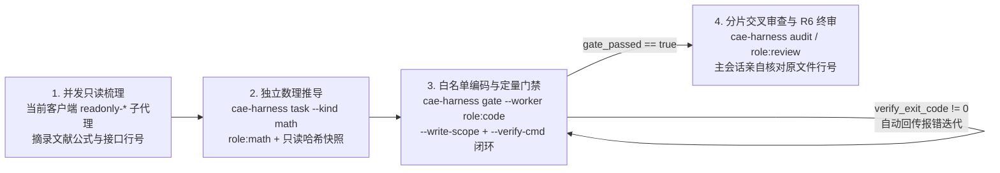

# 科学计算与工程求解器研发实战指南

本文面向已完成本机全局配置安装（步骤见 [仓库总说明](../README.md) 第二章）的研发人员，结合偏微分方程数值求解器算例说明：打开日常 C++、Fortran、Rust 或 Python 课题仓库后，如何编写跨进程任务单、如何通过与时期性模型名解耦的**角色槽位（`role:*`）**发起数学推导与代码定量验证闭环、如何核对结构化 JSON 回执，以及如何按 L1–L4 四个证据等级进行验收。命令行参数详见 [`cae-harness` 技能说明](../template/user-guard/skills/cae-harness/SKILL.md)，底层钩子与预算公式详见 [架构与钩子说明](architecture-and-hooks.md)。

---

## 一、任务单五要素、算例模板与结构化回执核验

### 1. 为什么后台无头任务单必须写清五项要素

在交互式主窗口对话时，客户端持有当前会话历史；而通过 `cae-harness` 启动后台独立无头命令行子进程时，子进程运行在全新空白上下文中，看不到主窗口先前的口头讨论。因此传给 `--task-file` 的 Markdown 任务单须一次写清五项要素：

1. **数学物理定义与符号约定**：如守恒型或原始变量形式、无量纲参考量（$L_{\text{ref}}, U_{\text{ref}}, \rho_{\text{ref}}$）、单元界面单位外法向 $\mathbf{n}$ 的指向约定、几何容差定义或数据结构状态不变量；
2. **项目根目录与分支状态**：对应 `--target` 指定的工作区路径；
3. **必读源码路径与精确行号范围**：直接写明核心头文件、离散算子与测试夹具的起止行号（尤其在 Windows 环境下，可避免后台子进程全盘扫描大型仓库引发调用超时）；
4. **允许修改的文件范围与红线约束**：代码修改任务配合 `--write-scope` 限定路径白名单，公式推导与代码审查任务明确声明“零文件修改”，严禁放宽数值容差或删改断言；
5. **可执行的定量验证命令**：配合 `--verify-cmd` 指定离散守恒残差、有限差分／复步导数核对、几何退化单测或网格加密收敛阶脚本。

### 2. `<任务单.md>` 示例（二维可压缩 Euler 方程 HLLC 界面通量）

````markdown
# 任务：实现二维可压缩 Euler 方程 HLLC 界面通量并通过离散守恒测试

## 1. 物理与符号约定
- 控制方程：二维守恒型可压缩 Euler 方程，守恒变量顺序 `U = [rho, rho*u, rho*v, E]^T`，理想气体状态方程 `p = (gamma - 1) * (E - 0.5 * rho * (u^2 + v^2))`，`gamma = 1.4`。
- 法向与通量方向：单元界面单位外法向 `n = (nx, ny)` 由左单元 `L` 指向右单元 `R`；返回值 `F_hat` 为沿 `n` 流出左单元 `L` 的数值通量（右单元累加 `-F_hat`）。

## 2. 必读源码与参考接口
- `src/flux/rusanov.py` 第 1–68 行：对齐现有函数签名 `compute_flux(u_left, u_right, normal, gamma)` 与非物理负密度／负压强保护逻辑。
- `tests/test_flux_conservation.py` 第 1–95 行：现有均匀自由流保持与周期网格离散守恒测试夹具。

## 3. 允许修改范围与禁止事项
- 仅允许新建或修改 `src/flux/hllc.py`、`src/flux/__init__.py` 与 `tests/test_flux_conservation.py`。
- 严禁放宽双精度容差（`rtol=1e-13, atol=1e-14`）或删改已有测试断言。

## 4. 定量验收判据
- 静止接触间断算例精确保持密度阶跃无数值耗散抹平；
- 周期网格随机扰动初值单步推进后，全局质量、动量、总能离散守恒残差均小于 `1e-14`。
````

使用角色槽位 `role:code` 启动带定量验证闭环的 `gate` 命令（脚本自动读取 [fleet_profile.json](../template/user-guard/skills/cae-harness/fleet_profile.json) 匹配当前就绪客户端、最大声明窗口与单模型非委派最高挡）：

```sh
python -B template/user-guard/skills/cae-harness/scripts/cae_harness.py gate --caller auto \
  --worker role:code --tier max --fallback-on-quota --target "<项目根目录>" \
  --task-file "task_hllc.md" \
  --write-scope "src/flux/*.py" --write-scope "tests/test_flux_conservation.py" \
  --verify-cmd "pytest -q tests/test_flux_conservation.py"
```

### 3. 结构化 JSON 回执关键字段核验表

| 回执字段 | 含义与验收判据 |
| :--- | :--- |
| `status` 与进程退出码 | `"ok"`（退出码 `0`）表示任务完成（`gate` 同时要求 `gate_passed == true`）；`"verification_failed"`（退出码 `2`）表示验证脚本未通过；`"quota_exhausted"`（退出码 `5`）表示触发会话／周度限流或余额不足并已登记运行侧冷却 |
| `verification_executed` | `true` 表示 `--verify-cmd` 已被实际调用执行；未绑定验证命令的普通 `code` 任务如实标记为 `false`，不得在汇报中写成“已通过实测” |
| `changed_files` / `scope_violations` | 记录实际增删改的文件列表，以及是否存在越出 `--write-scope` 白名单或违反只读零改动哈希快照的违规路径 |
| `history[]` / `result.evidence` | `gate` 在 `history[]` 中记录每轮 `invocation.returncode`、`verify_exit_code` 与修改摘要；`task`／`audit` 在 `result` 中给出精确文件路径与行号证据。**采纳前主会话须按 `R6` 亲自打开原文件逐行复核** |

---

## 二、常规局部修改与复杂核心模块四步协同流程

- **常规局部修改（调整算例参数、修复明确下标错误、编写后处理绘图脚本）**：直接在当前单客户端交互窗口内读清源码、完成修改并运行本地测试即可，无需启动跨进程编排。
- **高风险核心模块研发（高阶离散算子、弯曲网格度量恒等式、隐式时间推进雅可比矩阵、复杂曲面求交与刀轨干涉检查或核心并发状态机）**：建议按以下四步闭环推进：



1. **文献与现有接口并发梳理（同客户端 `readonly-*` 子代理）**：调用 `readonly-reader` 或 `readonly-collaborator` 在独立只读子窗口内读完参考论文、几何核或边界条件代码，汇总精确文件路径与行号（超过 10 个同构子目录的批量盘点可使用 `run_workflow`）。
2. **公式推导与退化边界检验（`cae-harness task --kind math --engine role:math`）**：将离散几何守恒律（GCL）、熵稳定通量对称性、解析雅可比求导或几何奇异退化判据交给 `role:math`（`--tier max --timeout 900`）在只读文件快照保护下独立推导，再由主会话逐项核对符号约定。
3. **限定范围编码与定量验证闭环（`cae-harness gate --worker role:code`）**：同时绑定 `--write-scope` 与 `--verify-cmd`。若守恒残差超标、退化算例报错或收敛阶未达标，真实测试输出会自动回传给工作进程在 `--max-rounds` 轮次上限内继续修正，直至验证脚本退出码为 `0`。
4. **目录分片交叉审查与主会话终审（`cae-harness audit` 或 `--engine role:review`）**：对核心模块执行跨模型只读复核；超出单分片安全预算的大型目录会自动按文件分片送审，最后由主会话联立核查跨文件耦合关系（如体积分与面积分高斯求积权重配对、右端项残差与预处理雅可比正负号一致性、无量纲物性常数统一性）。

---

## 三、定量验证的四个证据等级矩阵（`R3.6`）

阶段性技术汇报与代码合入审查时，严格按实际完成的验证深度披露证据等级，未执行的等级直接注明“未验证”：

| 证据等级 | 判定标准 | 典型数值或工程判据 | 对应回执特征 |
| :--- | :--- | :--- | :--- |
| **L1 源码或配置已就位** | 源码、接口或配置文件已编写完成，尚未编译或未执行定量验证脚本 | 语法与静态结构完整，待目标环境编译与算例验证 | `verification_executed: false` |
| **L2 编译与函数级单测通过** | 目标编译器零错误通过，单函数输出与解析公式或数值导数基准一致 | 解析雅可比与有限差分／复步导数相对误差达预定量级；退化输入边界单测通过 | `gate_passed: true`（单测命令） |
| **L3 离散物理或几何不变量保持** | 离散算子在封闭／周期计算域或刚体变换下严格保持守恒律与几何拓扑不变量 | 均匀自由流保持、全局质量／动量／总能离散守恒残差或对称性误差处于双精度机器零量级（$10^{-14} \sim 10^{-12}$） | `gate_passed: true`（不变量算例） |
| **L4 网格加密收敛阶与基准算例达标** | 在光滑精确解或制造解（MMS）加密序列（$h, h/2, h/4, \dots$）上达到理论设计阶数 $p$，或通过标准基准算例 | 经验收敛阶 $\text{EOC} = \frac{\log(E_1 / E_2)}{\log(h_1 / h_2)}$ 稳定接近设计阶数 $p$；激波管、顶盖驱动方腔或标准几何基准吻合文献 | `gate_passed: true`（收敛阶／基准套件） |

---

## 四、运行期常见事项提示

1. **压缩后双路对齐与长会话分段交接（`R9`）**：对话发生自动压缩后，先重读磁盘归档文件（同时包含历轮用户原话与压缩前最近 `4` 次已完成子代理的首尾摘要及原始日志路径）并核对 `git status`，子代理摘要中的行号与建议仍须按 `R6` 打开原文件核实后再采纳；收到长会话交接提醒时停止新开后台任务，收尾当前局部改动并输出可直接复制的【新对话提示词】。
2. **配额冷却与无损切换前提（`--fallback-on-quota`）**：仅当工作区文件尚未发生任何修改时，才自动切换至 `fleet_profile.json` 回退顺序中下一个已就绪且未处于冷却期的客户端；若执行中途已改写文件，脚本原样保留现场 `git diff` 交由研发人员裁决。
3. **高内存计算与科学计算依赖隔离（`R10`）**：大规模并行编译、细密网格生成与长时 MPI／GPU 数值模拟建议放在 WSL2、隔离容器或独立计算节点内运行，防止内存溢出（OOM）影响宿主机桌面；课题自身的 `jax`、`scipy`、`mpi4py`、`petsc4py` 等编译扩展建议使用 `uv` 或项目独立虚拟环境管理，不直接装入宿主机系统级 Python。
