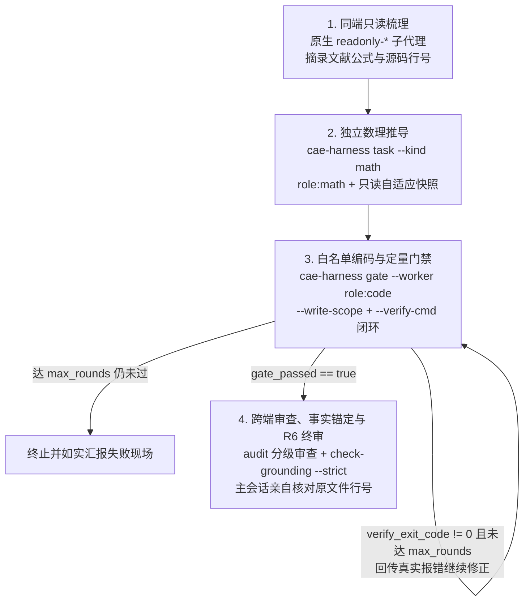

# 科学计算与工程研发日常工作流实战指南

本文写给已经完成本机全局安装（见 [仓库总说明](../README.md)“快速上手”）的科研人员与工程师。以偏微分方程（PDE）求解器和高可靠系统软件为例，讲清楚日常怎么把这套多端工具用顺：什么时候直接自己改、什么时候值得派工、怎么同时用好**明确点名**（P0）和**角色选路**、怎么盲出双方案防锚定、怎么用审查分级和 2 轮门禁避免反复拉扯，以及压缩打断后怎么不断链。底层原理见 [架构设计与钩子说明](architecture-and-hooks.md)，完整命令参数见 [cae-harness 技能规程](../template/user-guard/skills/cae-harness/SKILL.md)。

Windows 统一用 `python -B -X utf8`，WSL2 与 Linux 用 `python3 -B -X utf8`。文中 `<...>` 为需按实际课题替换的占位符；票据、回执与临时目录须落在授权工作范围内。运行命令前，先将 `HARNESS` 指向本机已安装客户端对应的技能脚本（上游仓库维护时可指向 `template/user-guard/skills/cae-harness/scripts/cae_harness.py`）：

```powershell
# Windows PowerShell（按本机已安装的任意一端设置 HARNESS）：
$HARNESS = "$HOME\.gemini\config\plugins\user-guard\skills\cae-harness\scripts\cae_harness.py" # Antigravity
# $HARNESS = "$HOME\.codex\skills\cae-harness\scripts\cae_harness.py"                         # Codex
# $HARNESS = "$HOME\.claude\skills\cae-harness\scripts\cae_harness.py"                        # Claude Code
# $HARNESS = "$HOME\.dsh\skills\cae-harness\scripts\cae_harness.py"                           # DeepSeek Harness (DSH)
```

```bash
# WSL2 与 Linux Bash（按本机已安装的任意一端设置 HARNESS）：
HARNESS="$HOME/.gemini/config/plugins/user-guard/skills/cae-harness/scripts/cae_harness.py"    # Antigravity
# HARNESS="$HOME/.codex/skills/cae-harness/scripts/cae_harness.py"                            # Codex
# HARNESS="$HOME/.claude/skills/cae-harness/scripts/cae_harness.py"                           # Claude Code
# HARNESS="$HOME/.dsh/skills/cae-harness/scripts/cae_harness.py"                              # DeepSeek Harness (DSH)
```

---

## 一、明确点名（P0）、派工边界与按专长选路

日常在任意已安装客户端（Antigravity、Codex、Claude Code 或 DeepSeek Harness，下文简称 DSH）主窗口交流时，主会话始终保持你自己选定的模型与强度。

在考虑把活派出去之前，先守一条实用边界：**几十行小修、修审查小项、或者需要和主窗口频繁来回对齐的改动，直接主会话自己做完**，因为派一次后台活有写任务单、等回执和复核的沟通成本。只有**接口清晰、成块独立的数理推导、求解器模块实现或关键代码与文档审查**，才值得跨端派工。

派工前可先只读核查各端状态（只读本地配置，不触发联网查榜或模型调用）：

```powershell
python -B -X utf8 "$HARNESS" probe --caller auto --redact
python -B -X utf8 "$HARNESS" assess --caller auto --redact
```

向后台派发任务时，**用户明确点名**与**动态角色槽位**（`role:*`）并列生效；通过 `--user-prompt "<用户原话>"` 锁定你的原话，底层窗口、行号内联、快照和脱敏全由脚本自动补齐：

| 日常怎么说 | 锁定的维度（P0 优先） | 脚本自动兜底与报错保护 |
| --- | --- | --- |
| “这步编码用 Codex 高挡位做”“交给 `<目标客户端或模型>` 做脱敏审查” | 指定的客户端、模型标识或模型系列 | 自动补齐声明最大窗口、非交互标志、分后端只读行号内联、自适应快照与脱敏；目标不可用或 `enabled: false` 直接报错，不静默换端 |
| “这轮挂 high 挡跑”“用 `--isolation clean_room` 盲读文档”“省点额度快速扫一下” | 指定推理挡位、四级隔离或省额度策略 | 非 `fast` 专业角色降到 `low` 仍保留主力模型；不支持所选隔离级别时显式报错 |
| “用 Codex 与 DSH 等多工作流全仓校核” | 识别“等、和、与、及”并列关系，不误锁单端 | 保留 `--spec-file` 中各分路各自指定的客户端、模型与隔离级别 |
| “推导弯曲网格 GCL 离散判据”“审查 `src/flux/` 边界相容性” | 按 `--kind` 搭配 `role:orchestrator`/`math`/`code`/`review`/`fast` 或 `<client>:@<role>` | 读取 `fleet_profile.json` 按可用性选对等端；跳过会自动派生多层子代理的 `ultra`；`role:review` 常规走推荐挡、命中守恒/离散/权限高危词自动升 `max` |
| “把这三篇论文的控制方程和源码行号摘出来” | 同端原生 `readonly-reader`、`readonly-collaborator`、`readonly-auditor`（默认 `inherit`） | 禁写禁测，专做原文摘录与行号初筛；不替代跨客户端独立审查（解析 `inherit` 时优先识别代理定义里的显式 `model`） |

### 四级正交隔离（`--isolation`）按需选择

外部无头命令均支持独立的 `--isolation` 参数，与后端、模型、挡位和读写模式解耦（`--clean-room` 为 `--isolation clean_room` 的兼容别名）：

| 隔离级别 | 保留与剥离边界 | 支持后端与适用场景 |
| --- | --- | --- |
| `full` | 保留全局规则、安全钩子（DSH 当前为 `soft_rules_only`）与技能 | `codex`、`claude`、`dsh` 默认级别；常规推导、编码验证与沿用全局规则的审查 |
| `no_skills` | 保留全局规则与安全钩子，剥离技能包与斜杠命令 | 四端通用（`agy` 默认级别）；避免技能文档挤占上下文窗口 |
| `hooks_only` | 仅保留底层凭据与安全钩子，剥离全局规则与技能 | 仅 `codex`、`claude`；`agy` 与当前 `dsh` 显式报错拒绝 |
| `clean_room` | 仅保留凭据，剥离规则、钩子、技能、项目说明与斜杠命令（Claude 同时启用 `--bare` 与 `--disable-slash-commands`） | `codex`、`claude`、`dsh`（仅限只读）；用于新读者视角盲读文档或无草稿独立方案 |

### 课题阶段选型、日常无感分流与模糊口语速查矩阵

具体模型映射与窗口配置全部收口在 [fleet_profile.json](../template/user-guard/skills/cae-harness/fleet_profile.json)，平时不用记模型代号，记住“**三项常规无感分流，五类意图半句口语触发**”就行：

1. **三项日常无感分流**（进课题时只按是否有编译/单测硬验证器选一次主窗口系列：未闭环理论与论文期用 `main_model_family` 低幻觉审慎系列，门禁完备的工程维护期可用 `code_families` 高吞吐编码系列）：
   - **成块编码自动走编码槽位**：实现与门禁走 `role:code`（内部 `native_swarm` 用 `swarm_worker_model_family`）；
   - **高吞吐主控自动配异构低幻觉验收**：主窗口用高速编码系列统筹时，后台审查优先走跨端 `role:review`，反重力内审与 `native_swarm` 验收流（`swarm_verifier_model_family`）自动切回 `deep_families` 审慎把关；
   - **单端受限时自动组同端异构审查**：其他端冷却或被排除时，双盲 `audit` 自动配对同端内的 `deep_families` 与 `code_families`。

2. **五类特殊意图，随口带半句话触发**：

| 你想做的事 | 平时随口怎么说 | 主控自动替你怎么编排 |
| --- | --- | --- |
| **重大架构盲出独立双方案** | “这是大方案，两家各自独立出一版，别给对方看草稿” | 用 `batch` 或 `clean_room` 只传你的原话与必要背景（不附主控草稿与倾向），盲出双方案后再逐条对比合并交你拍板，避免锚定偏见 |
| **早期发散探路与方案排雷** | “并发探探路，对比几种方案并挑挑硬伤” | 并发拉起推理流铺开候选、核算显存与计算复杂度边界，正式定纲前由主控核对历史归档收口 |
| **关键新命题正反双路推导** | “这个命题很关键，正反双路深推并找反例挑刺” | 组 2 流确认单：1 路审慎模型正向立论（`role:math`）加 1 路高算力模型对照初稿找反例与奇点边界 |
| **限定或排除某些客户端** | “不用 Codex，用其他端并发做”或“只用反重力双路审” | 自动跳过被排除端；若只剩单一多模型端，自动组建同端异构双源审查 |
| **表面快检省额度** | “省点额度快速扫一遍格式与拼写” | 切轻量 `role:fast` 槽位与低消耗挡位，绝不冒充核心审查 |

---

## 二、两阶段可用性检查、`chat_brief` 极简确认条与 `<ticket_id>_card.md` 确认流程

### 1. 两阶段可用性检查

- **维护期联网核查与启停**：由 `fleet-evolve` 联网核对模型与客户端变化，由你决定启停并写入 `subscription_matrix`（置 `enabled: false` 即全局跳过）。
- **派工前纯离线复查**：`cae_harness.py plan` 在出确认单前只查本机程序、凭据、本地回环路由、本地会话滚动窗口百分比、CC Switch 卡片类型与配额冷却记录，自动过滤不可用或超限通道。本机查不到的服务端余额如实标为未知，绝不猜补。

### 2. 重负载确认单与多波次批处理（对话只发 3 句话确认条 + 明细链接）

小范围单路只读在轻任务阈值内直接静默执行。凡是多路并发、可写编码或超阈值的任务——不管走外部 `cae_harness_headless` 还是客户端内部原生子代理（`invoke_subagent`、`run_workflow`、`swarm`、`spawn_agent`、`Agent`、`Task`）——先经 `plan` 落盘确认单：

```json
[
  {"stream_id":"S1","wave":1,"channel":"cae_harness_headless","kind":"review","engine":"codex:@review","target":"<项目根目录>","files":["src/flux/hllc.py","docs/spec.md"],"negative_scope_files":["docs/cancelled.md"],"subtask":"核对离散通量接口与守恒性实现"},
  {"stream_id":"S2","wave":2,"channel":"cae_harness_headless","kind":"review","engine":"dsh:@review","isolation":"clean_room","target":"<第二份文件路径>","subtask":"跨客户端空上下文核对边界条件与配置参数"}
]
```

```powershell
# 1. 纯离线生成确认单与待批票据（本地交互勿加 --redact 以保留可点击链接，仅对外分享时附加）
python -B -X utf8 "$HARNESS" plan `
  --spec-file "<工作流配置.json>" --session-id "<当前会话标识>" --plan-dir "<授权票据目录>" `
  --user-prompt "<用户点名原话>" --output "<授权计划回执路径>" `
  --workflow-bg "核心通量与边界模块已修改" `
  --workflow-goal "分两路跨客户端只读核查离散格式与参数依据" `
  --workflow-impact "纯只读检查并保存结构化回执，零源码改动"
```

实用要点有四条：
- **跨端双审显式分端**：两个 `role:review` 不保证落在不同客户端，双源交叉审请如上显式写不同端或直接用 `audit --left ... --right ...`。
- **超窗与内联提前拦截**：对显式 `--files` 或单文件只读流，`plan` 离线核对声明窗口与分后端内联上限（`agy` 按 `agy_inline_readonly_max_kib`，其余按 `inline_readonly_max_kib`）；超出窗口默认报 `over_context_window` 并返回 `suggested_shards` 分片建议（确需抽查加 `--allow-over-budget`）。
- **波次联动防空转**：多波次 `batch` 中，前序波次同目录可写流失败时，后续波次默认全部中止为 `upstream_wave_failed`（仅显式写 `"run_on_upstream_failure": true` 的只读流放行）。可写流退出码为 0 但磁盘零改动时，回执会标 `no_files_changed: true` 方便排查。
- **聊天框只看 3 句话**：`plan` 先写 `<ticket_id>.json`，再把完整 4 列总览和分路 **14 项明细**写进 `<ticket_id>_card.md`（14 项字段定义见 [cae-harness 技能规程](../template/user-guard/skills/cae-harness/SKILL.md#两道可用性检查与全通道确认单)）。对话里默认只展示 3 句话确认条 `chat_brief`、明细链接、离线性能更新时间和三选项（① 批准、② 用 `--override-json` 微调后批准、③ 暂缓并交接），不在聊天框贴长表刷屏。

你确认批准后，登记票据并持 `--ticket` 执行（保持相同的 `--session-id` 与 `--plan-dir`）：

```powershell
# 2. 登记批准并执行外部无头批次
python -B -X utf8 "$HARNESS" plan `
  --approve-ticket "<票据标识>" --session-id "<当前会话标识>" --plan-dir "<授权票据目录>" --user-prompt "<用户点名原话>"
python -B -X utf8 "$HARNESS" batch `
  --ticket "<票据标识>" --session-id "<当前会话标识>" --plan-dir "<授权票据目录>" `
  --user-prompt "<用户点名原话>" --output "<授权回执路径>" --redact
```

内部原生通道多路或可写委派同样先跑 `plan --channel native_subagent ...` 登记批准，执行时由客户端直接调用原生工具，由 `status_guard.py` 在 `PreToolUse` 核验票据容量（`swarm add` 按 `tasks` 长度或 `n` 计流数）并拦截裸调无头 CLI。

---

## 三、后台无头任务单五要素与 PDE 求解器实战闭环

### 1. 为什么无头任务单必须写清五项要素

外部无头子进程看不到你的主会话聊天记录（后续可通过回执中的 `provider_session_id` 用 `followup` 续接）。把下面五项一次写进 `--task-file`，就能省掉 80% 的返工：

1. **物理方程与符号约定**：守恒变量顺序、无量纲参考量（ $L_{\text{ref}}, U_{\text{ref}}, \rho_{\text{ref}}$ ）、界面单位外法向 $\mathbf{n}$ 指向、状态方程与边界相容条件；
2. **目标工作区路径**：对应 `--target` 根目录；
3. **必读源码与精确行号**：直接标出起止行号，避免沙箱扫整个大目录超时（在内联上限内的只读文件会自动带精确行号内联）；
4. **写范围白名单与红线**：可写任务配合 `--write-scope` 锁路径，只读任务声明零修改，明文禁止放宽容差或删改断言；
5. **可执行验收命令**：配合 `--verify-cmd` 跑守恒残差、数值导数比对或收敛阶单测。

### 2. `<任务单.md>` 实战模板（二维可压缩 Euler 方程 HLLC 界面通量）

````markdown
# 任务：实现二维可压缩 Euler 方程 HLLC 界面通量并通过离散守恒测试

## 1. 物理与符号约定
- 控制方程：二维守恒型可压缩 Euler 方程，守恒变量顺序 `U = [rho, rho*u, rho*v, E]^T`，理想气体状态方程 `p = (gamma - 1) * (E - 0.5 * rho * (u^2 + v^2))`，`gamma = 1.4`。
- 法向与通量方向：单元界面单位外法向 `n = (nx, ny)` 由左单元 `L` 指向右单元 `R`；返回值 `F_hat` 为沿 `n` 流出左单元 `L` 的数值通量（右单元累加 `-F_hat`）。

## 2. 必读源码与参考接口
- `src/flux/rusanov.py` 第 1–68 行：对齐现有函数签名 `compute_flux(u_left, u_right, normal, gamma)` 与非物理负密度、负压强保护逻辑。
- `tests/test_flux_conservation.py` 第 1–95 行：现有均匀自由流保持与周期网格离散守恒测试夹具。

## 3. 允许修改范围与禁止事项
- 仅允许新建或修改 `src/flux/hllc.py`、`src/flux/__init__.py` 与 `tests/test_flux_conservation.py`。
- 严禁放宽双精度容差（`rtol=1e-13, atol=1e-14`）或删改已有测试断言。

## 4. 定量验收判据
- 静止接触间断算例精确保持密度阶跃无数值耗散抹平；
- 周期网格随机扰动初值单步推进后，全局质量、动量、总能离散守恒残差均小于 `1e-14`。
````

先跑 `plan` 登记白名单与验收命令并获批，再持 `--ticket` 启动 `gate` 闭环（未通过时真实报错会在 `default_gate_max_rounds` 默认 2 轮内回传模型修正，仍未收敛即停下交人拍板，不无休止空耗）：

```powershell
python -B -X utf8 "$HARNESS" gate `
  --caller auto --worker role:code --target "<项目根目录>" --task-file "task_hllc.md" `
  --write-scope "src/flux/hllc.py,src/flux/__init__.py,tests/test_flux_conservation.py" `
  --verify-cmd "pytest -q tests/test_flux_conservation.py" `
  --ticket "<票据标识>" --session-id "<当前会话标识>" --plan-dir "<授权票据目录>" `
  --output "<授权回执路径>" --redact
```

### 3. 高风险核心模块四步协同流程

遇到高阶通量分裂、弯曲网格几何守恒律（GCL）或隐式解析雅可比这类核心模块，按四步走最稳：



审查阶段内置两道防吹毛求疵机制：
- **发现分两级**：仅将有明确触发或复现链路的实质缺陷标为 `critical`/`high`（阻断级，如破坏物理守恒、边界失配、越界写或并发死锁）；细节与风格建议记为 `medium`/`low`（参考级），不借极端假想反复打回。
- **按风险分层选挡**：常规文档和辅助脚本审查走 `high` 挡提速；命中物理守恒、离散算子、边界条件、并发死锁或安全钩子/权限越界等关键词自动升 `max` 挡深审。

修订重要技术文档时，可对支持 `clean_room` 的后端运行 `task --kind review --isolation clean_room` 剥离全部规则与背景，以新读者视角挑出晦涩行话和阅读断层；整篇重写后再跑整仓 `check-grounding --target "<项目根目录>" --strict` 做词法事实校验。

---

## 四、压缩恢复、长会话交接与完工回执核验

1. **压缩打断后的双块恢复（`R9`）**：等审批时发生自动压缩，钩子会按当前模型窗口动态缩放恢复预算、折叠历史确认单明细表，并分两块恢复——第一块是历轮用户原话与实质子代理结论；第二块直接读磁盘 `<ticket_id>.json` 加载精简 4 列总览卡与 `<ticket_id>_card.md` 链接供模型核对。主会话先说清已重读的记录和剩余工作，再向你补展 1 次 `chat_brief` 与明细链接等待拍板；压缩与沉默绝不等于批准。
2. **长会话交接与跨会话接力**：进入 `drain` 或 `freeze` 强制交接时，停止新派工并输出【新对话提示词】（`handoff_gate.py` 会核对里面是否包含未决总览、明细链接、离线性能更新时间、选项卡、票据号与 `plan --resume-ticket` 命令）。新会话先运行下面命令复核旧票据，再按新会话标识重建确认票据后执行：
   ```powershell
   python -B -X utf8 "$HARNESS" plan `
     --resume-ticket "<票据标识>" --plan-dir "<授权票据目录>" --user-prompt "<用户点名原话>"
   ```
3. **持久化续接、双层超时抢救与完工核验**：外部无头会话默认持久化（`--ephemeral` 关闭）。到达软时限时先自动降挡向独立 `result_wrapup.json` 紧凑收口（`agy` 遇后台活跃回合直接短路防死锁）；硬超时仍保留总超时、部分 Token（`cli_partial_on_timeout`）与 `timeout_salvage`。后续可用 `followup --receipt <回执路径> [--stream <流号>] [--effort <挡位>] --task "<追问>"` 沿原会话边界追问（续接超时回执未指定挡位时自动按 `followup_default_effort` 降挡；原回执标记 `resumable: false` 则直接拦截提醒分片重开）。
   任务结束后，重负载派单自动生成确定性机械对账表落盘至 `<plan_dir>/reconcile/<run_id>_reconcile.md`，并在回执 `reconciliation.chat_line` 提供单行可点击链接（不挤占聊天上下文），列出已更新/未更新源码与文档、AST/Markdown 强逻辑依赖、只读交付覆盖及显式义务结算结果。在准备读取大型仓库或长文档前，可先运行 `read-plan` 做读前尺寸评估与保守层级分片（自动按双口径防爆窗、切分超大单文件行段并导出可供 `plan --spec-file` 审批的多端分波清单），多端回执完工后用 `cross-check` 做确定性覆盖矩阵与分歧回源核对，并一键并入总机械对账表：
   ```powershell
   python -B -X utf8 "$HARNESS" read-plan --target "<项目根目录>" --shared-files "AGENTS.md" --cross-client-mode risk-tiered --emit-spec "<分片工作流.json>"
   python -B -X utf8 "$HARNESS" cross-check --target "<项目根目录>" --receipt "<回执路径>" --read-plan "<阅读计划JSON>"
   python -B -X utf8 "$HARNESS" reconcile --target "<项目根目录>" --base-ref HEAD --cross-check "<跨端核对JSON>"
   ```
   `reply_repeat_guard.py` 在 Antigravity、Codex、Claude Code 三端 `Stop` 钩子中统一拦截把未全量复跑的局部补测冒充全过、把含失败或超时的账单写成“全部成功”的表述，并按 `run_id` 核对回复是否覆盖成败词、Token 用量（兼容 Markdown 表格账单与“无法统计”说明）、外部流标识（单路 `task` 或单路 `gate` 省略默认流号 `S1` 时须匹配具体模型名，仅在未记录具体模型名时可用任务状态词替代）、同名回执消歧、回执文件名以及机械对账表链接（原生任务对应完成数量、流标识或角色名及轨迹说明）。主会话仍须亲自核对状态、`citation_audit` 原文行号与汇总算术。

---

## 五、定量验证的四个证据等级矩阵（`R3.6`）

阶段汇报和合入审查必须如实说清目前走到了哪一级，没跑的环节直接注明“未验证”（只列核心验证链路的缺口，不堆无关免责声明）：

| 证据等级 | 判定标准与回执特征 | 典型科学计算与工程判据 |
| --- | --- | --- |
| **`L1` 源码或配置落盘** | 源码、接口或配置已写入磁盘，尚未编译或未运行定量验证命令（`verification_executed: false`） | 静态结构与语法完整，待目标环境编译与单测 |
| **`L2` 编译或离线单测** | 目标编译器零错误通过，单函数或单模块输出与解析公式及基准一致（离线单测 `gate_passed: true`） | 解析雅可比与有限差分或复步导数相对误差达标；边界退化与离线契约单测全绿 |
| **`L3` 守恒与不变量实测** | 算子在封闭、周期域或弯曲网格下严格保持物理守恒律与状态不变量（守恒与不变量实测 `gate_passed: true`） | 均匀自由流保持（GCL），全局质量、动量、总能离散守恒残差处于双精度机器零量级（ $10^{-14} \sim 10^{-12}$ ）；多进程状态锁与快照零越界 |
| **`L4` 收敛阶与基准达标** | 在光滑解或制造解（MMS）加密序列（ $h, h/2, h/4, \dots$ ）上达到理论设计阶数 $p$ ，或吻合标准算例（收敛阶与基准算例 `gate_passed: true`） | 经验收敛阶 $\text{EOC} = \frac{\log(E_1 / E_2)}{\log(h_1 / h_2)}$ 稳定接近设计阶数 $p$ ；Sod 与 Lax 激波管、顶盖驱动方腔等与文献基准吻合 |

高内存三维网格生成、大型 C++/Fortran 并行编译与长时数值模拟应按 `R10` 放在 WSL2、容器或独立计算节点运行，避免把宿主机桌面内存打爆（OOM）。
